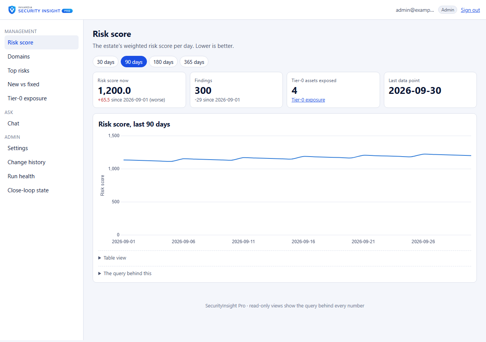
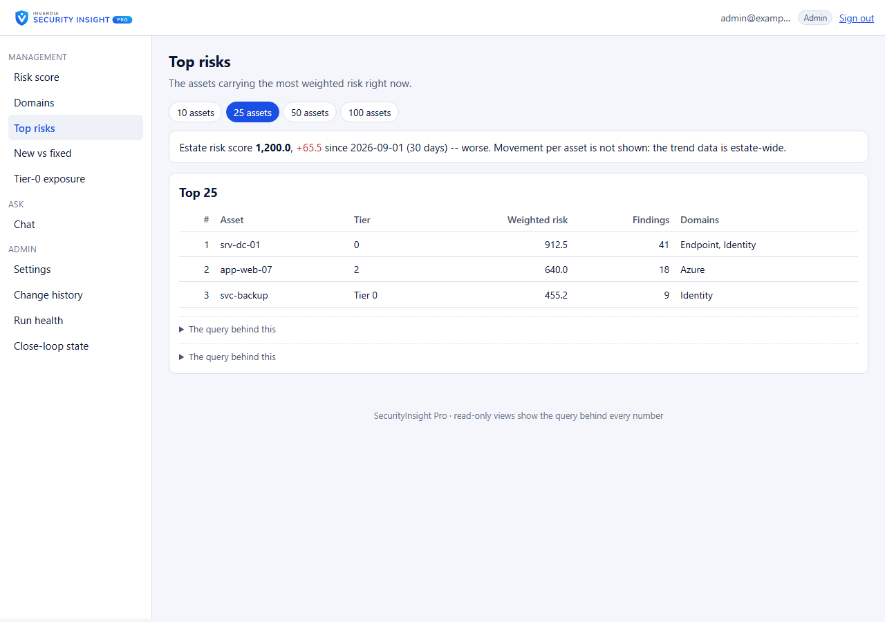
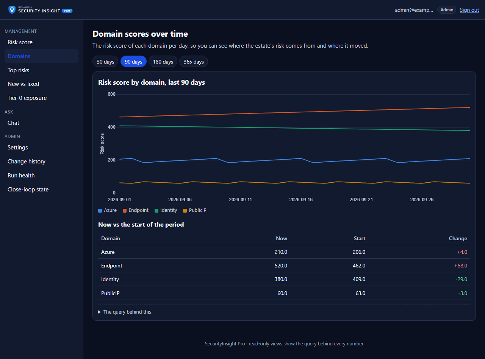
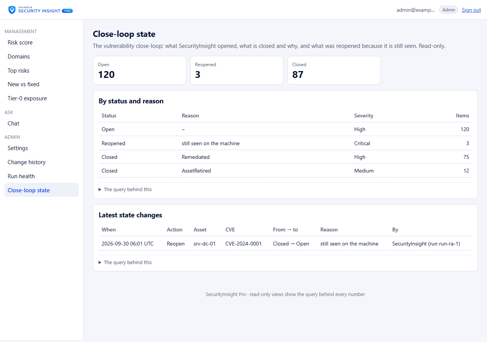
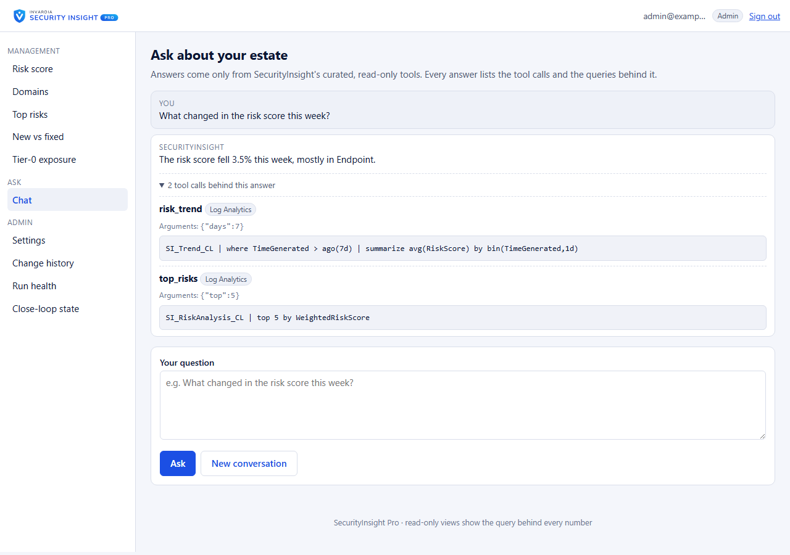
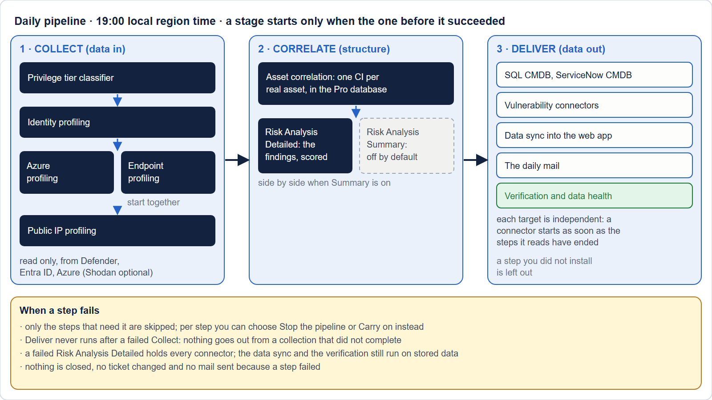
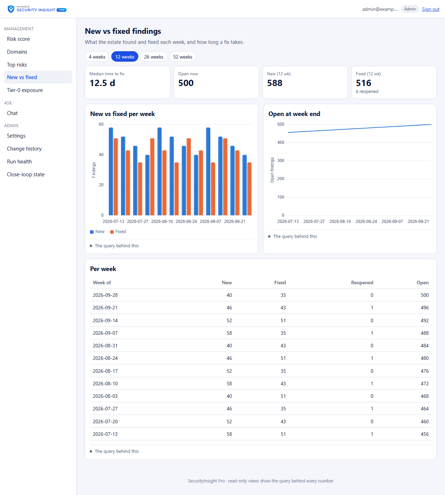
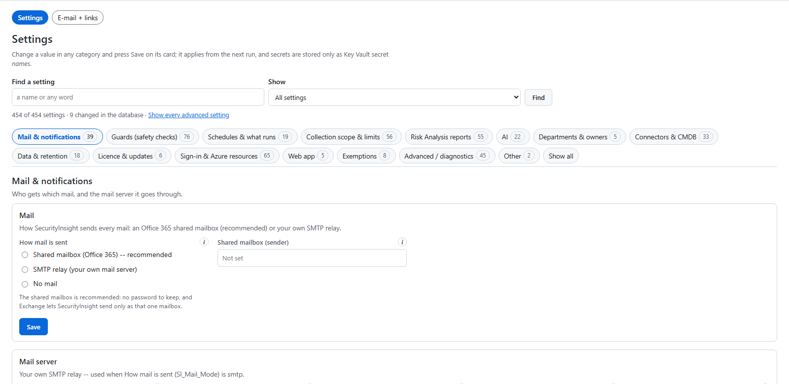

<p align="center">
  <picture>
    <source media="(prefers-color-scheme: dark)" srcset="docs/images/brand/invardia-securityinsight-community-horizontal-reversed.svg">
    
  </picture>
</p>

# SecurityInsight

**Think like the attacker. Act like the defender. Fix what matters first.**

SecurityInsight turns the Microsoft security data you already have into **one ranked list of what to fix first**,
across vulnerabilities, recommendations, attack paths, identities, devices, Azure resources and public IPs. It runs
in your own Azure, reads read-only, and installs no agent.

> ### ⬇️ Install Community: free
> **[Install in Azure Cloud Shell](#install-securityinsight-five-samples)** (five copy-and-paste samples) &nbsp;·&nbsp;
> **[Download the latest release](https://github.com/KnudsenMorten/SecurityInsight/releases/latest)** &nbsp;·&nbsp;
> [Community vs Pro](#community-vs-pro)
>
> One command into your own Azure subscription. No PowerShell modules, no Azure CLI, no client secret.

<p align="center">
  
</p>

## Contents

- [Why SecurityInsight](#why-securityinsight)
- [What it covers](#what-it-covers)
- [See it in action](#see-it-in-action)
- [What you need](#what-you-need)
- [Install SecurityInsight: five samples](#install-securityinsight-five-samples)
- [Updates, status reports and 2.2](#updates-status-reports-and-22)
- [Community vs Pro](#community-vs-pro)
- [Documentation](#documentation)
- [Pro editions and support](#pro-editions-and-support)
- [License](#license)

## Why SecurityInsight

**Microsoft Defender sorts by severity. An attacker sorts by opportunity.**

Defender shows you thousands of vulnerabilities, misconfigurations and risky identities. An attacker looks at the
same list and asks one question: what gets me to a domain controller, a Global Administrator or the tenant itself?
When every finding looks equally urgent, your team stays busy and the real risk stays open.

SecurityInsight looks at your estate the way the attacker does.

- **One ranked list of what to fix first.** Every finding is scored by its severity, the criticality of the asset it
  sits on and the risk factors around it, such as internet exposure, a known exploit or leaked credentials. The same
  weakness ranks higher on a domain controller than on a Tier 3 laptop, and you see the evidence behind every rank.
- **Tiers from the rights identities really hold.** An identity's Tier 0-3 comes from the Entra roles, API
  permissions, Azure roles and Active Directory groups it really holds, including eligible roles and nested
  PIM-for-Groups chains. Not from a tag someone set years ago, and every tier shows what set it.
- **Every source, one picture.** Defender vulnerabilities and recommendations, Exposure Graph attack paths, Entra ID,
  Active Directory, Azure and your public IPs, joined into one record per asset.
- **Read-only, in your own Azure, no agent.** SecurityInsight runs in your own subscription as Azure Container Apps
  jobs and reads Microsoft data as its own managed identity with read-only permissions. Nothing is installed on your devices.
- **Your rules, kept.** More than 500 built-in rules classify server roles, applications and appliances. Your own
  rules and settings live apart from the built-in ones, so an update never overwrites them.
- **Evidence for the auditors.** The asset inventory and risk model support NIS2, DORA, ISO 27001 and GDPR Art. 32
  evidence needs.

## What it covers

Every area below is in the free **Community** edition unless it says **Pro**.
[Community vs Pro](#community-vs-pro) has the short comparison.

### Defender vulnerabilities and recommendations

*Community and Pro*

Every vulnerability Defender lists, read straight from Defender Vulnerability Management, plus Defender for Cloud
recommendations and their CVEs. Each finding names the affected software and the recommended security update, so
the fix travels with the finding. A recommendation on a virtual machine is scored by what the machine is: a domain
controller is Tier 0, tag or no tag.

### Exposure Graph and attack paths

*Community and Pro*

Attack-path reports built on Defender Exposure Graph trace credential-driven and lateral-movement paths to sensitive
data and Tier 0 targets, ranked by the business impact of the final target. You see the routes an attacker would
take, not just the doors.

### Identities and the rights they really hold

*Community and Pro*

Users, guests, service principals and managed identities are tiered from their real permissions: Entra roles, API
permissions, Azure roles, Active Directory groups and eligible (PIM) roles, including nested PIM-for-Groups chains.
MFA, SSPR and passwordless registration are captured per identity, and disabled accounts that still hold rights are
included. A shipped privilege tier catalog ranks every role and permission by what an attacker could do with it, and
an optional AI step places roles it has not seen before.

### Devices

*Community and Pro*

Servers are classified from installed software, detected roles, Defender tags, subnet and naming, matched against a
catalog of more than 500 known server applications. Clients inherit their tier from the most-privileged users who
actually sign in to them. One machine is one row, even when Exposure Graph and Defender keep duplicate records, and
a device you exclude by tag shows up in a report of every excluded asset, so nothing hides forever.

### Azure resources

*Community and Pro*

Every resource is profiled from Azure Resource Graph, with tags inherited from resource group, subscription and
management group, so criticality flows down the hierarchy by itself. Read one subscription, a management group or
the whole tenant.

### Public IPs

*Community and Pro*

The public IPs of your devices and Azure resources, with Shodan's view of open ports and CVEs mapped straight back to
the asset behind them, its tier and its business context. See your internet edge the way an attacker does.

### 138 Risk Analysis reports

*Community and Pro*

138 ready-made reports (69 summary, 69 detailed) across identity, endpoint, Azure and public IP. Every row carries its
severity, tier, the risk factors that raised it, the weighted score, business context, links to the Defender, Entra
and Azure portals, and MITRE ATT&CK. Add, override, narrow or exclude reports in your own files. A report that
suddenly finds less than last time is flagged, so a broken report never looks like an estate that improved.

### A risk score that explains itself

*Community and Pro*

Risk Score = consequence (severity) x probability (the asset's Tier 0-3) x risk factors, weighted by the business
criticality and data sensitivity from your CMDB. You get one headline number with a breakdown per security domain
for management, and for every asset the reason behind its tier: which rule, tag or default set it. The scoring
matrix and the weights are plain files you can tune to your own risk appetite.

### One object across every source

*Community and Pro*

Correlation joins the same machine, identity or resource across Defender, Exposure Graph, Entra ID and Azure. An
Azure virtual machine and its Defender device become one asset, with one tier, counted and reported once.

### The web app: findings and management views

*Community and Pro*

The SecurityInsight web app shows every finding of a run, most critical asset first: filter, sort, search and export
to Excel or CSV. Management views show the risk score, the risk per domain, the top risks, new versus fixed, and
Tier-0 exposure. A wall board refreshes itself for the SOC screen. Every setting says in plain words what it is for
and what its default really does.

<p align="center">
  
</p>

### Trends

*Community and Pro*

Is the estate getting safer? Daily trends of the risk score per tier, severity and security domain, and new versus
fixed findings per week with the median time to fix. Each asset is counted once.

<p align="center">
  
</p>

### Mail reports and Excel

*Community and Pro*

A ranked Excel workbook, built without Office, and a summary mail that reads well on a phone, with an optional
AI-written executive summary from your own Azure OpenAI. Mail goes from a shared mailbox that SecurityInsight may send
from and nowhere else. Results also land in Log Analytics tables (query them from Sentinel or Defender XDR), as JSON
files, and in Azure blob storage or a file share.

### Asset tagging, with a dry run first

*Community and Pro*

Write SecurityInsight's classification back as Defender, Azure and Entra tags, under its own identity. It only
reports what it would change until you switch writing on.

### Departments and governed exemptions

***Pro***

Every asset and recommendation has a department, with owners who see their own work. Accepted risk is requested,
approved per security domain, time-limited and reviewed, with governance mails and follow-up tasks. Every change is
recorded with who, when, why and the value before and after, in an audit trail the database itself protects.

<p align="center">
  
</p>

### CMDB, business services and ServiceNow

*CMDB from a CSV file: Community and Pro. CMDB in SecurityInsight, business services and ServiceNow: **Pro***

Drop in a CMDB export as CSV and SecurityInsight folds business criticality, data sensitivity and owners onto every
matched asset, weights the risk score with them, and reports CMDB items nothing discovered (and assets with no CMDB
record). Pro keeps a CMDB in SecurityInsight with your business services ranked by weighted risk, writes your assets
to a SQL CMDB table with their history, and feeds the ServiceNow CMDB.

<p align="center">
  
</p>

### Vulnerability close-loop

***Pro***

Every finding becomes a vulnerability record in ServiceNow, a SQL table or any REST system: opened, kept current,
closed with its real reason and reopened if it comes back. Absence is not remediation: a vulnerability closes as
fixed only after a complete run, and an asset that is gone closes as "asset retired", never as fixed. Batched
hand-off moved 12,271 real findings to ServiceNow in under three minutes.

<p align="center">
  
</p>

### Ask SecurityInsight and MCP

***Pro***

Ask in plain language, "what changed in the risk score this week?", and get an answer that shows the tool calls and
queries behind it. Answers come only from SecurityInsight's own read-only tools. An MCP server gives AI assistants
the same read-only tools, protected by Entra tokens.

<p align="center">
  
</p>

### Runs itself

*Community and Pro*

One daily pipeline runs Collect, Correlate and Deliver at the time you choose; each step starts as soon as the steps
it needs have finished. Only what changed is rebuilt, large reports split themselves to stay inside Defender's limits,
and the Detailed reports run side by side on several workers, so large estates finish. A run that did not publish
everything says so.

<p align="center">
  
</p>

## See it in action

<table>
  <tr>
    <td></td>
    <td></td>
  </tr>
  <tr>
    <td align="center">New versus fixed, and how long a fix takes</td>
    <td align="center">Every setting explained in plain words</td>
  </tr>
</table>

Screenshots use synthetic demo data. More on [invardia.com/products/securityinsight](https://invardia.com/products/securityinsight/).

## What you need

- An Azure subscription where SecurityInsight runs as Azure Container Apps jobs, with its own Log Analytics workspace,
  database, storage account and Key Vault. The install creates them.
- To install: Owner on the resource group, or Contributor and Role Based Access Control Administrator on it.
  When the resource group does not exist yet, Owner or Contributor on the subscription.
- Once, for the read-only Microsoft Graph and Defender permissions (for example **SecurityRecommendation.Read.All**,
  Vulnerability.Read.All and SecurityAlert.Read.All): a Privileged Role Administrator or Global Administrator.
  Without one, the install finishes and prints the exact command for them.
- Microsoft licenses for the data you want scored: Defender for Endpoint Plan 2 or Defender Vulnerability Management
  for vulnerabilities, Defender Exposure Management for Exposure Graph, Defender for Identity for Active Directory
  data, and Entra ID P2 for identity risk.

<!-- install samples: final text from SI -->
## Install SecurityInsight: five samples

Open [Azure Cloud Shell](https://shell.azure.com) in **PowerShell**, signed in to the tenant you want to assess, and get the code once:

```powershell
git clone https://github.com/KnudsenMorten/SecurityInsight.git
cd SecurityInsight
```

Every sample is the same install command; you only add what you want to change. You sign in as yourself: in Cloud
Shell there is no prompt; on your own PC (PowerShell 7 or Windows PowerShell 5.1) a browser window asks you to sign
in. No PowerShell modules, no Azure CLI and no client secret are needed. Everything you leave out has a sensible
default.

### 1. The quickest install (most people start here)

Use this when you want SecurityInsight running in one subscription with all the defaults: a new resource group in
West Europe, a new Log Analytics workspace, the web app, and the reports mailed to you from a shared mailbox
SecurityInsight@&lt;your domain&gt; that the install creates.

```powershell
./setup/Install-SecurityInsight.ps1 -TenantId '<your tenant id>' -SubscriptionId '<your subscription id>'
```

The checks run first and nothing is created until they pass. The first results arrive after the first run.

### 2. Your own region, resource group and mail recipients

Use this when your company has naming rules, wants the data in a given region, or the reports should go to a team.

```powershell
./setup/Install-SecurityInsight.ps1 -TenantId '<your tenant id>' -SubscriptionId '<your subscription id>' `
    -Location 'northeurope' -ResourceGroup 'rg-securityinsight' -MailTo 'secops@contoso.com'
```

### 3. Read a management group or the whole tenant

Use this when SecurityInsight should see Azure resources in every subscription, not only the one it runs in.

```powershell
# a management group
./setup/Install-SecurityInsight.ps1 -TenantId '<your tenant id>' -SubscriptionId '<your subscription id>' `
    -CollectionScope 'managementGroup' -ManagementGroupId '<management group id>'

# or the whole tenant
./setup/Install-SecurityInsight.ps1 -TenantId '<your tenant id>' -SubscriptionId '<your subscription id>' `
    -CollectionScope 'tenantRoot'
```

If your account cannot grant read access there, the install still finishes and prints the exact command for someone
who can.

### 4. Private network only

Use this when SecurityInsight must have no public endpoints: it runs in its own virtual network, the database, Key Vault
and storage get private endpoints, and the web app is reachable from your network only.

```powershell
./setup/Install-SecurityInsight.ps1 -TenantId '<your tenant id>' -SubscriptionId '<your subscription id>' `
    -PrivateNetwork -VnetAddressPrefix '10.212.24.0/24'   # a free range for SecurityInsight's own network (a /24 is the usual size)
```

At the end you get the hand-off list for your network team (peering to your hub, DNS).

### 5. Check first, or continue an install that stopped

Use this before a change window, or when an install stopped half-way (for example a missing permission). Add the
switch to the command you used.

```powershell
./setup/Install-SecurityInsight.ps1 -TenantId '<your tenant id>' -SubscriptionId '<your subscription id>' -PreflightOnly   # checks only, changes nothing
./setup/Install-SecurityInsight.ps1 -TenantId '<your tenant id>' -SubscriptionId '<your subscription id>' -Resume          # continues from the step that stopped
```

### Pro trial

Start it at [invardia.com/trial](https://invardia.com/trial/). Your installation page there gives you the one-line command
for the Pro edition, with the same choices as the samples above.

### Every setting

All settings, with their defaults and what they do, are in `setup/install-parameters.json` and on
[Community edition: the scripts you run](https://invardia.com/docs/securityinsight/community-scripts/#install).
For advanced installs, put them in a `config.json` and pass `-ConfigPath ./config.json`.
<!-- /install samples -->
## Updates, status reports and 2.2

**Updates.** A Community install updates itself from the SecurityInsight update channel. Before anything is
installed, the release is checked against a signed entry: its version, its size and its SHA-256.

**Status reports.** The Community edition sends Invardia an anonymous daily status report: version, hosting type and
run results, with no tenant id, host name or company. Set `$global:SI_Telemetry_Enabled = $false` in your
configuration and nothing is sent.

**Coming from 2.2?** SecurityInsight 3 is installed beside 2.2, not over it. Branch
[`main`](https://github.com/KnudsenMorten/SecurityInsight/tree/main) keeps 2.2 unchanged. Read
[SecurityInsight 3 beside 2.2](https://invardia.com/docs/securityinsight/upgrade/#securityinsight-3-beside-22-no-upgrade).

## Community vs Pro

**Community is "see your risk". Pro is "work on it."** Everything that finds, scores and shows your risk is free.

| | Community | Pro |
|---|:---:|:---:|
| Four profilers: devices, identities, Azure resources, public IPs (Shodan) | ✅ | ✅ |
| Defender vulnerabilities and recommendations, Exposure Graph attack paths | ✅ | ✅ |
| Tiers from real rights, privilege tier catalog, optional AI role classification | ✅ | ✅ |
| One object across every source (correlation) | ✅ | ✅ |
| 138 Risk Analysis reports, risk score and weighted risk score | ✅ | ✅ |
| CMDB from a CSV file | ✅ | ✅ |
| Excel, summary mail with optional AI summary, Log Analytics tables, JSON | ✅ | ✅ |
| Web app: findings, management views, trends, wall board, Excel export | ✅ | ✅ |
| Asset tagging with a dry run first | ✅ | ✅ |
| Signed updates from the Community channel | ✅ | |
| Departments, governed exemptions, follow-up tasks and governance mails | | ✅ |
| CMDB in SecurityInsight, business services ranked by weighted risk | | ✅ |
| ServiceNow CMDB and the vulnerability close-loop (ServiceNow, SQL, REST) | | ✅ |
| Alert mails and management summary mails | | ✅ |
| Roles and scopes for people and groups, audit trail | | ✅ |
| Template releases by update ring, conformance and deviations | | ✅ |
| Ask SecurityInsight (AI chat) and the MCP server | | ✅ |
| Updates from Invardia by update ring, licence, support from Invardia | | ✅ |

Move from Community to Pro without reinstalling.

## Documentation

Everything about SecurityInsight is at **[invardia.com/docs/securityinsight](https://invardia.com/docs/securityinsight/)**:

- [Community edition: the scripts you run](https://invardia.com/docs/securityinsight/community-scripts/)
- [The daily pipeline](https://invardia.com/docs/securityinsight/pipeline/) and [Weighted risk by CMDB service](https://invardia.com/docs/securityinsight/weighted-risk/)
- [Security](https://invardia.com/docs/securityinsight/security/) and [Identities and permissions](https://invardia.com/docs/securityinsight/identities-and-permissions/)
- [Operations](https://invardia.com/docs/securityinsight/operations/), [Guards](https://invardia.com/docs/securityinsight/guards/) and [Data health](https://invardia.com/docs/securityinsight/data-health/)
- [Updates](https://invardia.com/docs/securityinsight/upgrade/), including [SecurityInsight 3 beside 2.2](https://invardia.com/docs/securityinsight/upgrade/#securityinsight-3-beside-22-no-upgrade)

## Pro editions and support

<p align="center">
  <picture>
    <source media="(prefers-color-scheme: dark)" srcset="docs/images/brand/invardia-securityinsight-community-horizontal-reversed.svg">
    
  </picture>
  &nbsp;&nbsp;&nbsp;
  <picture>
    <source media="(prefers-color-scheme: dark)" srcset="docs/images/brand/invardia-securityinsight-pro-horizontal-reversed.svg">
    
  </picture>
</p>

SecurityInsight Pro (Pro Business and Pro Enterprise) adds the ServiceNow CMDB connector, a CMDB with business
services and its connectors, the vulnerability close-loop to ServiceNow, a SQL table or a REST system, departments
and governed exemptions with governance mails and follow-up tasks, Ask SecurityInsight and the MCP server, managed
updates from Invardia and support from Invardia.

- Product page and editions: [invardia.com/products/securityinsight](https://invardia.com/products/securityinsight/)
- Pricing: [invardia.com/pricing](https://invardia.com/pricing/) · 60-day Pro trial: [invardia.com/trial](https://invardia.com/trial/)
- Pro support: [support@invardia.com](mailto:support@invardia.com) or [portal.invardia.com](https://portal.invardia.com/) > Support
- Questions: [info@invardia.com](mailto:info@invardia.com)
- Community questions and bugs: [GitHub issues](https://github.com/KnudsenMorten/SecurityInsight/issues)

## License

From version 3.0.0, the Community edition is licensed under the [PolyForm Shield License 1.0.0](LICENSE): you may use,
change and run it, also commercially inside your own organization, but not to offer a product that competes with it.
Pro components are not in this repository and need a license from Invardia. Versions published before 3.0.0 stay
under the MIT License they were published with.

Invardia is a brand of 2LINKIT, founded and owned by Morten Knudsen.
