<!-- public:start -->
<a id="top"></a>

<picture>
  <source media="(prefers-color-scheme: dark)" srcset="docs/images/brand/invardia-securityinsight-community-horizontal-reversed.svg">
  
</picture>

[](https://github.com/KnudsenMorten/SecurityInsight/releases)
[](https://learn.microsoft.com/powershell/)
[](LICENSE)

**Author**: [Morten Knudsen](https://mortenknudsen.net) — Microsoft MVP  
**Product page**: [invardia.com/products/securityinsight](https://invardia.com/products/securityinsight/)  
**Support**: Community — [GitHub Issues](https://github.com/KnudsenMorten/SecurityInsight/issues) · Pro (licensed) — [support@invardia.com](mailto:support@invardia.com) or [portal.invardia.com](https://portal.invardia.com/) › Support  
**Get Pro**: [Pricing](https://invardia.com/pricing/) · [Buy](https://invardia.com/order/) · [60-day Pro trial](https://invardia.com/trial/)  
**Contact**: [info@invardia.com](mailto:info@invardia.com) · [invardia.com/contact](https://invardia.com/contact/)  
**Watch**: [Video walkthroughs](#video-walkthroughs)

<sub>Invardia – a brand of 2LINKIT, founded and owned by Morten Knudsen.</sub>

---

<a id="securityinsight-3-a-new-side-by-side-install"></a>
### SecurityInsight 3: a new, side-by-side install

> **SecurityInsight 2.2 is no longer updated.** It stays available on GitHub (branch
> [`main`](https://github.com/KnudsenMorten/SecurityInsight/tree/main)). We recommend installing SecurityInsight 3 beside it:
> [SecurityInsight 3 beside 2.2](https://invardia.com/docs/securityinsight/side-by-side/). There is no upgrade from 2.2 to 3 --
> you install 3 as a separate installation, run both while you compare the results, and then switch 2.2 off. Your 2.2
> install keeps running unchanged until you do.

**Why:** SecurityInsight 3 is built differently on the inside. It runs in Azure Container Apps with its own SQL
database and web app, signs in with managed identities, keeps its settings in the database and has its own update path.
None of that can be converted in place on a system that produces your security reports every night.

**How:** the guided install creates its own resource group (`rg-si-prod-community-ca` for Community,
`rg-si-prod-pro-ca` for Pro) and its own workspace, identity and database, so it never touches 2.2's resources. Read
[SecurityInsight 3 beside 2.2](https://invardia.com/docs/securityinsight/side-by-side/) for every step: what you need,
the install, running both, what you carry over by hand (settings, rules, risk index, exclusions; for Pro also your
`CMDB.csv`), and what to remove when you retire 2.2. All documentation:
[invardia.com/docs/securityinsight](https://invardia.com/docs/securityinsight/).

<a id="download--install-community"></a>
### Download / Install Community

| | |
|---|---|
| **Download** | The latest Community release package: [GitHub releases](https://github.com/KnudsenMorten/SecurityInsight/releases/latest) |
| **Install** | Answer the install wizard, then run its one command in Azure Cloud Shell (PowerShell). With the package unpacked in Cloud Shell you can also run `./setup/Install-SecurityInsight.ps1 -ConfigPath ./config.json` yourself. Add `-PreflightOnly` to run only the checks. |
| **Documentation** | [invardia.com/docs/securityinsight](https://invardia.com/docs/securityinsight/) |
| **Product page** | [invardia.com/products/securityinsight](https://invardia.com/products/securityinsight/) |
| **Coming from 2.2** | [SecurityInsight 3 beside 2.2](https://invardia.com/docs/securityinsight/side-by-side/) |

---

**What you see on your Defender dashboard isn't what attackers see on their target list.** One is sorted by severity; the other is sorted by opportunity. Microsoft Defender surfaces every vulnerability, misconfiguration, and exposure in your environment — but deciding which one to address *first* is where most teams get stuck. Closing that gap is the difference between staying busy and actually reducing risk.

**SecurityInsight** rethinks Secure Score into a **risk-based score** that weights every finding across your security telemetry — Microsoft Defender for Endpoint (XDR + advanced hunting), Defender for Identity, Microsoft Exposure Graph, Entra ID, on-prem Active Directory, Azure Resource Graph, and Shodan public-IP intel — by **consequence** (severity), **probability** (Tier 0–3 asset criticality), and **risk factors** — so you fix what an attacker would reach for first, not what's alphabetically next. **Asset-profiling engine** with dynamic detection + classification, **ready-to-use reports** built on Defender Exposure Graph correlated with profiled asset data, fully customizable, with an **executive summary report**. **Zero footprint** — read-only, no agents, no schema changes. Free, MVP-built, community-driven.

**ExposureGraph** correlates assets, relationships, and attack paths across endpoints and Azure. SecurityInsight uses that data to classify assets and expose risks. Hundreds of ready-made queries and a built-in classification framework get you tagging servers, clients, and Azure resources from day one. For users, service principals, and managed identities, tiers are derived from **actual assigned permissions** — no static tags — and **AI** categorizes new Entra, Graph, and Azure roles automatically.

### 🎯 Think like the hacker. Act like the defender. Fix what matters — first.

### Why you need SecurityInsight

- Thousands of observations — *"set & forget"* dashboards that never get acted on
- No tiering of users, devices, or workloads — every finding looks equally urgent
- Exposure data scattered across tools and consoles
- Prioritization challenges — crown jewels / business priority vs. attack paths for tenant takeover
- Compliance requires asset profiling and risk analysis:
  - **NIS2** (Art. 21): risk-management measures, asset inventory
  - **DORA**: ICT risk register, criticality classification
  - **ISO 27001** (A.5.9 / 8.8): asset register + risk treatment
  - **GDPR** Art. 32: risk-appropriate security of processing

### What SecurityInsight delivers

- Take **better decisions on what to fix** first
- **Risk Analysis** computes a Risk Score — with Risk Factors that amplify *severity × criticality*
- **Weighted Risk Score** when you enable CMDB integration (Criticality, DataSensitivity)
- **Automatic Asset Profiling** using a dynamic approach — e.g. tiering based on *actual permissions*, not on tags
- Picks up **new telemetry** (e.g. `IsAccountLeaked`, new roles, new API permissions) without redeploy
- **AI integrated** in profiling & classification

### Outcome for business

- Fix what matters most — criticality, risk, business priority, data sensitivity
- Detect drifts faster — re-focus
- Faster audits with traceable evidence
- Permission snapshots — diff two snapshots
- Prioritize mini-projects — baseline security
- Culture, awareness, guidance — the *why* behind every action
- Establish lifecycle processes — who, what, when, how

### Editions — Community (free) and Pro

| | **Community** (this repository) | **Pro** (licensed) |
|---|---|---|
| Asset profiling — endpoints, identities, Azure, public IPs | ✅ | ✅ |
| Risk Analysis, Risk Score, reports, executive summary | ✅ | ✅ |
| Trend, CMDB enrichment from a CSV, AI classification, Shodan | ✅ | ✅ |
| Cross-engine correlation — one object id across all engines, plus asset properties | — | ✅ |
| ServiceNow CMDB connector — match and create CIs | — | ✅ |
| Vulnerability close-loop to ServiceNow or a SQL database — open what SI finds, close what is fixed (with the reason), reopen what was closed but is still there | — | ✅ |
| Updates | this repository | managed, ring-based rollout |

The Community edition is complete on its own: nothing in it needs a licence, and it never contacts
a licence server. Pro components are not part of this repository; they are delivered to licensed
customers with a signed licence file.

**Status reports (telemetry) — on by default, one setting turns them off.** Each install sends Invardia one
status report a day (product, edition, version, hosting type, the *kind* of sign-in identity, licence state) and one
short report per engine run (which engine, ok / warning / failed, how long it took, the stage that failed and the
*kind* of error, e.g. `graph-403` or `throttled`). The **Community** edition reports **anonymously**: a random install
id kept on the machine — no tenant id, no host name, no company, no error text, and counts only as ranges
(`1k-10k`). **Pro** reports are identified by the install's key, so failed or silent runs can be spotted before you
call; their error text is shortened and secrets are removed before it leaves. A report that cannot be sent never
fails or slows a run. To turn it off, set `$global:SI_Telemetry_Enabled = $false` in your configuration (or the
environment variable `SI_TELEMETRY_ENABLED=false`) — nothing is sent at all then.

**Pro only — licence and updates from Invardia by themselves, on by default.** A Pro install's updater job asks
Invardia for the licence every night when there is none, it ends within 30 days or it is in its grace period (the
result is recorded in the audit trail and mailed to you; nothing is asked while it is valid), and takes the Pro
release approved for its update ring from Invardia, verified before anything changes. Each has one switch on the
web app's Settings page: *Automatic licence request* (`SI_LicenseRequest_Auto`) and *Pro updates from Invardia*
(`SI_InvardiaUpdate_Enabled`). The Community edition does neither.

<picture>
  <source media="(prefers-color-scheme: dark)" srcset="docs/images/brand/invardia-securityinsight-pro-horizontal-reversed.svg">
  
</picture>

**Get Pro:** SecurityInsight Pro is sold by Invardia — see the
[product page](https://invardia.com/products/securityinsight/), [pricing](https://invardia.com/pricing/),
[buy](https://invardia.com/order/) or start a [60-day Pro trial](https://invardia.com/trial/). Your licence arrives by
mail and is always available in the [portal](https://portal.invardia.com/) › Licences.

**Support:** Pro customers mail [support@invardia.com](mailto:support@invardia.com) (each mail opens a ticket) or use
[portal.invardia.com](https://portal.invardia.com/) › Support. The Community edition is supported here, through
[GitHub Issues](https://github.com/KnudsenMorten/SecurityInsight/issues). Everything else:
[info@invardia.com](mailto:info@invardia.com) or [invardia.com/contact](https://invardia.com/contact/).

**License:** the Community edition is licensed under the [PolyForm Shield License 1.0.0](LICENSE) —
you may use, modify and run it, including commercially inside your own organisation, but not to
provide a product that competes with it. Versions published before 3.0.0 remain under the MIT License
they were published with.

### Architecture

👉 **Zero footprint** — only requires read permissions. No tagging of resources (except if you want to *exclude* endpoints in MDE — no API for exclusion, so we use tags)

👉 **Two engine families**: Asset Profiling (Endpoint, Azure, Identity, Public IP) + Risk Analysis, plus a daily Trend rollup and optional asset tagging. Collects data from 6 providers (Entra, ExposureGraph, MDE, MDI, AD, Azure) and sends enriched data into Log Analytics

👉 **Enriched data** comes from 700+ fields — supported providers + calculated fields like Tier, API permissions, Role permissions

👉 **100% dynamic detection** based on 540+ detection rules (server roles, applications and appliances). Mapping gives tier + CMDB-mapping
- Dynamic detection of **client endpoints** based on permissions (tier) of the users who use the device the most
- Dynamic detection of **servers** using software installed, detected modules, tagging, IP subnet and more
- Dynamic detection of **Azure** using tags (incl. parent tagging), subscription details and more
- Dynamic detection of **identities** based on AI-qualified detection of actual permissions for all identities

👉 **Asset mapping** — SecurityInsight Pro can also push asset mapping back to a ServiceNow CMDB (optional)

👉 **External Public IP scanning** of CVEs + open ports using Shodan against all detected public IPs. Automatic mapping of results into Risk Analysis reports with CMDB / tier information

👉 **138 Risk Analysis reports** (69 summary + 69 detailed), covering Identity, Azure, Endpoints, CVEs, Public IPs

👉 **Data model** includes schema files (JSON) for fields, exclusions, detection rules + YAML files

👉 **Dynamic scaling** with Azure Container Apps Jobs to support large enterprises. Built-in performance includes KEDA scaling, fingerprint caching, hash caching, tier schedules and more

👉 **Management-friendly Risk Score KPI** — Quick overview using overall Risk Score (KPI) and an Risk Score breakdown per security domain in email summary. Data is also stored in LogAnalytics for trend reporting.

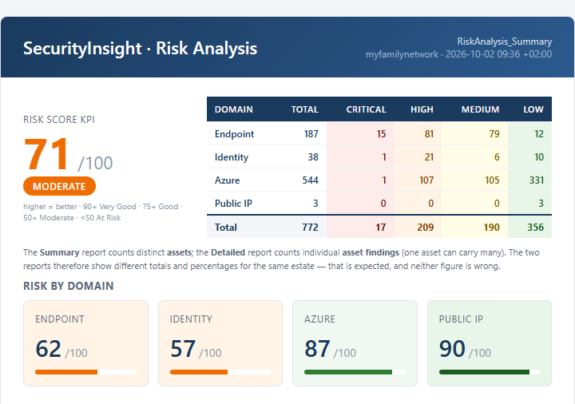

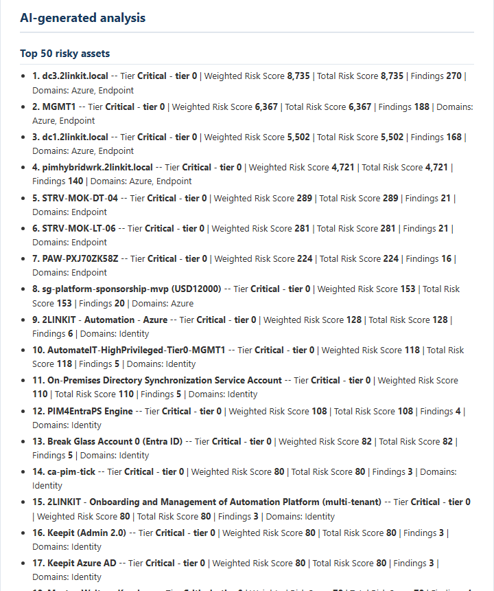

---

<a id="toc"></a>
## 📑 Table of Contents

1. [Introduction](#-1-introduction) — outputs, use-cases, agents, sample output
2. [Understanding the Framework](#understanding-the-framework) — the risk model concept (start here if new)
   - 2.1 [Why a graph, not a list](#21-why-a-graph-not-a-list)
   - 2.2 [Risk Score model](#risk-score-model)
   - 2.3 [Risk Factors](#risk-factors)
   - 2.4 [Risk Index (customizable scoring)](#risk-index-customizable-scoring)
   - 2.5 [Outputs at a glance](#outputs-at-a-glance)
3. [What's supported — Inputs, Enrichment, Outputs](#supported-inputs-enrichment-outputs)
   - 3.1 [Inputs — supported data providers](#31-inputs)
   - 3.2 [Enrichment — joining external context](#32-enrichment)
   - 3.3 [Outputs — supported sinks](#33-outputs)
   - 3.4 [Setup file checklist — which sample files to copy](#34-setup-file-checklist)
4. [How to Implement (Quick Start)](#how-to-implement-quick-start)
   - 4.1 [Three-step quick start (recommended)](#41-three-step-quick-start-recommended)
   - 4.2 [Get the code](#42-get-the-code)
   - 4.3 [Authenticate, then launch the Setup Wizard](#43-authenticate-then-launch-the-setup-wizard)
   - 4.4 [Run the engines](#44-run-the-engines)
     - 4.4.1 [Schedule on a VM (Task Scheduler)](#441-schedule-the-engines-on-a-vm-windows-task-scheduler)
     - 4.4.2 [Schedule on Container Apps Job + KEDA](#442-schedule-the-engines-on-azure-container-apps-job-keda-auto-scaling)
     - 4.4.3 [VM vs Container — recommendation](#443-vm-vs-container-apps-job--recommendation)
   - 4.5 [Try out a preview release](#-45-try-out-a-preview-release)
   - 4.6 [Pre-requisite configuration](#pre-requisite-configuration)
     - 4.6.1 [Config-file model — `.defaults.ps1` vs `.custom.ps1`](#config-file-model)
     - 4.6.2 [Defender XDR licensing & onboarding requirements](#defender-xdr-licensing)
     - 4.6.3 [No Sentinel? Routing model + Entra diagnostic-settings](#no-sentinel-setup)
   - 4.7 [Azure OpenAI (optional)](#azure-openai-optional)
   - 4.8 [LauncherConfig files](#understand-the-launcherconfig-files)
   - 4.9 [Distribution model — launchers and getting the code](#39-distribution-model)
   - 4.10 [Asset-profiling engine catalog](#310-asset-profiling-engine-catalog)
   - 4.11 [Container & KEDA host-mode](#311-container-keda)
5. [How to fine-tune reporting](#how-to-fine-tune-reporting) — pick reports, override queries, manage exclusions
   - 5.1 [Override the standard template (add/remove reports)](#51-override-template)
   - 5.2 [Override a standard report by changing its query (or add a new custom report)](#52-override-report-query)
   - 5.3 [Exclude a configuration recommendation per report](#53-exclude-configuration-recommendation)
   - 5.4 [Exclude a CVE per report](#54-exclude-cve)
   - 5.5 [Exclude an asset finding per report](#55-exclude-asset-tag)
   - 5.5b [Exclude a specific asset from a profiling detection rule](#55b-exclude-asset-from-profiling-rule)
   - 5.6 [Scalar overrides per report (e.g. CVE minimum age)](#56-scalar-overrides)
   - 5.7 [Weighted risk-factor rules (per-engine field-driven uplifts)](#57-weighted-risk-factors)
   - 5.8 [Detailed report severity scope (defaults + how to narrow)](#58-detailed-report-severity-scope)
6. [Severity & Criticality Definitions](#severity--criticality-definitions)
   - 6.1 [Severity definitions](#61-severity-definitions)
   - 6.2 [Criticality definitions](#criticality-definitions)
   - 6.3 [Asset classification: Identity](#asset-classification-identity)
   - 6.4 [Asset classification: Endpoint](#asset-classification-endpoint)
   - 6.5 [Asset classification: Azure](#asset-classification-azure)
7. [The YAML Concept (Locked + Custom)](#the-yaml-concept-locked--custom)
   - 7.1 [Two files per topic](#71-two-files-per-topic)
   - 7.2 [Merge flow](#72-merge-flow)
   - 7.3 [Three things you do in Custom](#73-three-things-you-do-in-custom)
   - 7.4 [Concrete example](#74-concrete-example)
   - 7.5 [How-to — override a Locked rule (and what NEVER goes in Locked)](#75-how-to--override-a-locked-rule-and-what-never-goes-in-locked)
   - 7.6 [What a release upgrade does to your YAML](#76-what-a-release-upgrade-does-to-your-yaml)
   - 7.7 [`AssetTagName` naming convention](#77-assettagname-naming-convention--stem--tiern--si--stem-based-merge)
8. [Appendix](#appendix) — reference + technical detail
   - 8.1 [Permissions catalog](#permissions-catalog)
   - 8.2 [Bucketing — beating the 30k row ceiling](#82-bucketing--beating-the-30k-row-ceiling)
   - 8.3 [Output destinations](#output-destinations)
   - 8.4 [Per-template mail recipient override (YAML)](#per-template-mail-recipient-override-yaml)
   - 8.5 [Cross-subscription workspace support](#cross-subscription-workspace-support)
   - 8.6 [Layered config flow](#layered-config-flow)
   - 8.7 [End-to-end architecture](#end-to-end-architecture)
   - 8.8 [Locked catalog — Detection queries + Tagging rules + Profile schema + AI tier catalog](#locked-catalog)
9. [Video walkthroughs](#video-walkthroughs)
10. [Support](#support)
11. [What's New](#whats-new)

## 📘 1. Introduction

[⤴ Back to top](#top)

#### 🖼️ The whole product in one picture

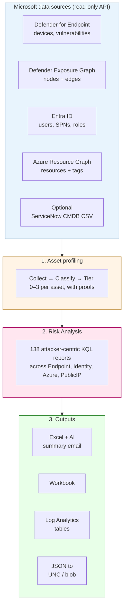

> 🎯 **The headline**: SecurityInsight **never writes back** to your tenant. It reads, scores, and reports. No agent, no tag prep, no schema changes to your existing assets.

Defender will happily tell you about every vulnerability, misconfiguration, and exposure in your environment. What it won't tell you is which one an attacker would reach for first. **That's the prioritization gap — and it's where most security teams lose the battle.**

**SecurityInsight** is a free, community-built add-on that consolidates security telemetry from Microsoft Defender, Entra ID, Active Directory, Azure, and Microsoft ExposureGraph and applies a tier-based risk scoring model designed to think like a hacker and act like a defender. Every finding across Endpoint, Azure, and Identity is evaluated on four dimensions:

- the **security consequence** of the missing control,
- the **criticality tier** (0–3) of the affected asset,
- the **risk factors** that amplify exposure (Internet Exposure, Verified Secret, Critical Resource, Lateral Movement, Sensitive Data, LegacyEndOfSupport, ExploitSignals),
- and a **customizable Risk Index** that lets you adapt the model to your organization.

The solution is built on **Microsoft Defender ExposureGraph**, which gives it the contextual view attackers already have: what runs where, what's connected to what, which device hosts a domain controller, which VM has a managed identity with high-privilege access. SecurityInsight uses ExposureGraph to detect roles and relationships across endpoints and Azure resources and tag them automatically — without depending on someone remembering to label them.

On top of that, the solution ships with a detailed classification framework — an initial tier definition library already mapped across identity, endpoint, and cloud — and a large set of ExposureGraph-powered detection and tagging queries for Azure and endpoints that help you classify resources in your own environment quickly. You know your estate better than anyone; the queries give you a running start. Everything is continuously updated and fully customizable, so you can extend or replace any detection with your own as your environment changes.

A core focus is the **Identity collection** — users, service principals, and managed identities. Rather than relying on admins to tag accounts as "privileged" (a process that is always out of date), the model derives tier level automatically from the actual effective permissions each identity holds across AD, Entra ID roles, Microsoft Graph / API application permissions, and Azure RBAC. When Microsoft introduces a new role — as they do constantly — AI evaluates the permissions it grants and slots it into the right tier without human intervention.

#### What you'll get from this document

- Why "sort by severity, fix the biggest pile first" is the wrong instinct
- How consequence, criticality, risk factors, and a customizable Risk Index combine into one score
- How Tier 0–3 prioritization works across Endpoint, Azure, and Identity
- How ExposureGraph drives automatic role and resource detection
- How the built-in classification framework and tagging query library accelerate rollout
- How to classify user, SPN, and managed identity criticality from permissions — not tags
- How AI-driven classification keeps pace with Microsoft's ever-expanding role catalog

What this gives you is a concrete, reproducible framework — free and community-maintained — and a repeatable way to answer *"what should we fix first?"* with confidence.

> **Risk Score = Consequence (severity) × Probability (criticality + risk factors)**

The output is a ranked list — not 4,000 recommendations, but the small set of fixes that meaningfully reduce attacker dwell-time, lateral movement, and tenant takeover risk. Same Defender data, different framing: **attacker-centric instead of tool-centric.**

> [!TIP]
> **Talk track for execs**: SecurityInsight tells your CISO *"if we patch these 12 things this week, we cut the realistic blast radius of a successful phishing attack by 60%."* It does NOT add another portal — it consumes your existing Defender + Entra + Azure data via API.

<a id="outputs"></a>

### Outputs

The same ranked dataset is fan-out to multiple sinks so every stakeholder gets it in their preferred shape — ops in Excel, SOC in KQL, execs in Power BI, automation in JSON.

| Output | Purpose | Status |
|---|---|---|
| **Excel spreadsheet via email** | Operator-friendly XLSX of ranked findings, optionally with an AI-generated exec summary as the first sheet. Sent per run to configurable distribution lists (summary / detailed, per-recipient). | **Available** |
| **Log Analytics custom tables** (`SI_RiskAnalysis_Summary_CL`, `SI_RiskAnalysis_Detailed_CL`, `SI_IdentityAssets_CL`) | Durable time-series store for Kusto queries, Azure Monitor alerts, cross-run trending, compliance diffs. Every row carries a deterministic `TraceID` + `CollectionTime` so findings are stable across runs. | **Available** |
| **JSON upload to UNC share** | Automatic publish of each run's Summary JSON to a `\\server\share\...` path. Drop-in feed for on-prem BI / file-based integrations. | **Available** |
| **JSON upload to Azure Storage blob** | Automatic publish to `https://<acct>.blob.core.windows.net/<container>/`. Container auto-created + RBAC granted; ideal for cross-tenant reporting or Logic Apps / Power Automate pickup. | **Available** |
| **Azure Workbooks** | Native Azure Monitor workbook over `SI_RiskAnalysis_*_CL` + `SI_IdentityAssets_CL` — 8 pills (time range, latest-run toggle, domain, severity, tier, subcategory, search, Top-N) + KPI tiles + trend / domain / tier charts + velocity + Top-N + stale + identity inventory. Import from `preview/AzureWorkbook/SecurityInsight-RiskAnalysis.workbook.json` via Portal → Azure Monitor → Workbooks → Advanced Editor, then save. | **Available** |

<a id="use-cases"></a>

### Use-cases

Real-world patterns customers run this against. Every one of them is cheap to light up because the data is already in LA with stable identifiers (`TraceID` + `CollectionTime`):

| Use-case | How |
|---|---|
| **Daily Security Prioritization Meetings — top risks** | Run RiskAnalysis on a 4×/day cron; agenda = the Top-25 tile in the Workbook / the XLSX email. No more "what do we focus on this week" arguments. |
| **ServiceNow ticket lifecycle (open / close)** | SOC subscribes to `SI_RiskAnalysis_Summary_CL`. `TraceID` (deterministic SHA-256 hash of `TraceName`) is the external correlation key — open on first appearance, auto-close when the `TraceID` disappears from the latest `CollectionTime`. |
| **Alerting on significant changes** | Azure Monitor alerts on Kusto: e.g. *"open critical findings jumped 30% vs last run"* or *"a new Tier-0 asset appeared in the stale list"*. Paged to the on-call channel, not buried in a report. |
| **Management reporting** | Execs open the Workbook (Pro: the web app) → trend of total risk score, closed tickets, velocity of fix, domain breakdown. The numbers do the talking — no narration required. |
| **Compliance reporting** | Two `CollectionTime` snapshots of `SI_IdentityAssets_CL` diffed in Kusto → *what permissions changed?* Answers audit questions about access drift between two fixed dates. |
| **Baseline new security + Just-In-Time delegations** | First-time scan establishes the baseline tier for every identity + resource. Anything spikier on a later run is JIT-flagged for review. |
| **Disable / clean up legacy identity assets** | `SI_IdentityAssets_CL | where IsStale == true and ObjectType in ('ServicePrincipal','ManagedIdentity')` surfaces orphan / unused SPNs + MIs for bulk deprovisioning. |
| **Detect Shadow IT delegations** | Cross-tenant SPNs, unverified publishers, high-permission grants flagged on first appearance in `SI_IdentityAssets_CL` — catches delegations business units stood up without IT's knowledge. |

<a id="sample-output"></a>

### Sample output

#### Asset profiling — Identity (find users with no MFA registered)

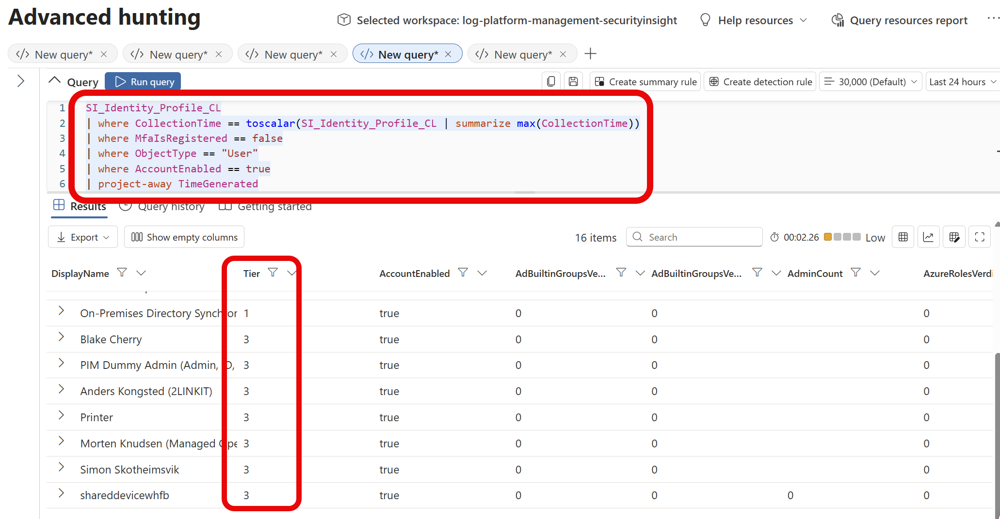

#### Asset profiling — Endpoint (Tier 0 Domain Controller with CMDB enrichment)

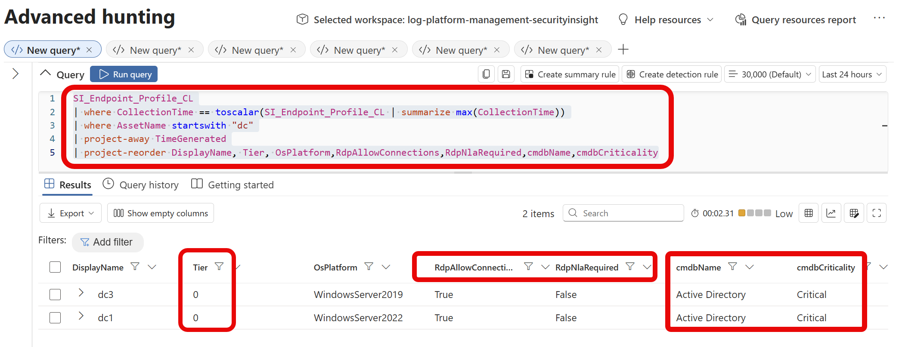

#### Asset profiling — Azure (resource criticality inherited from parent subscription)

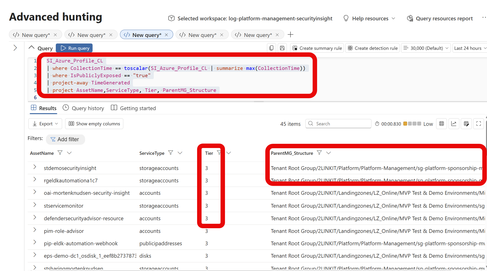

#### Asset profiling — Identity (top-matches drive tier decision)

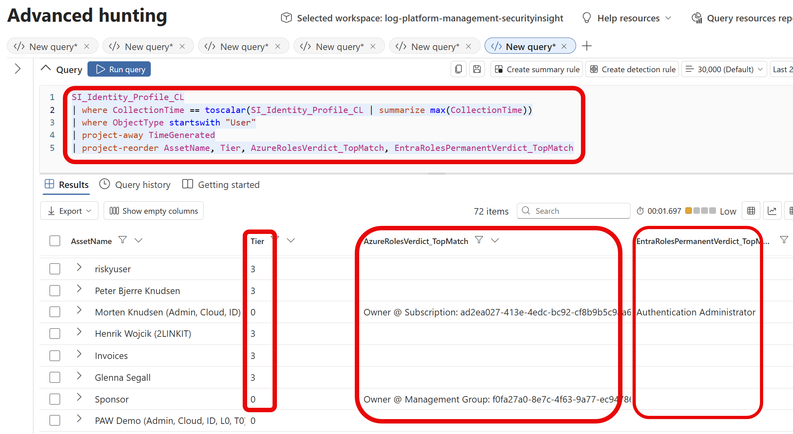

#### Asset profiling — Identity (API-permission-driven tier)

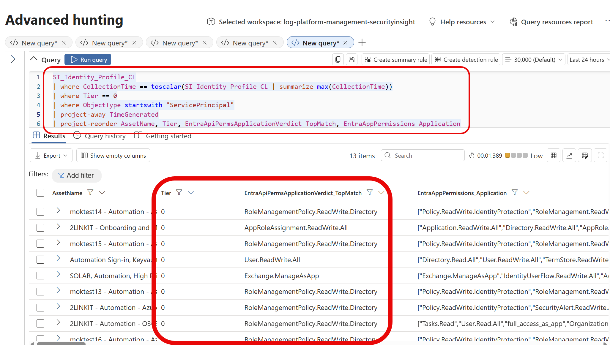

#### Risk Analysis — Defender for Cloud recommendations and CVEs

Every Defender for Cloud recommendation, scored by what the affected machine is — a vulnerability on a domain controller ranks as tier 0 even though the VM itself carries no criticality tag.

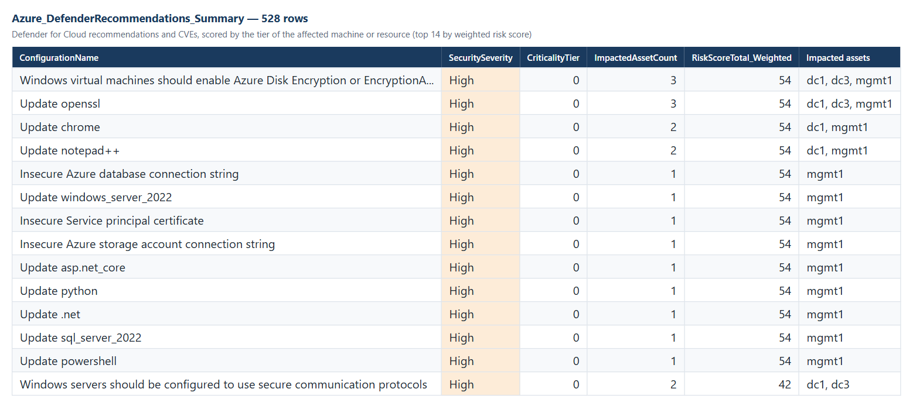

#### Sample reports + AI exec-summary email

| File | Link |
|---|---|
| Sample Summary report (XLSX) | [Sample - RiskAnalysis_Summary.xlsx](https://github.com/KnudsenMorten/SecurityInsight/raw/refs/heads/main/engine/risk-analysis/_samples/Sample%20-%20RiskAnalysis_Summary.xlsx) |
| Sample Detailed report (XLSX) | [Sample - RiskAnalysis_Detailed.xlsx](https://github.com/KnudsenMorten/SecurityInsight/raw/refs/heads/main/engine/risk-analysis/_samples/Sample%20-%20RiskAnalysis_Detailed.xlsx) |
| Sample Summary email (PDF, with AI exec summary) | [Sample mail - Summary report with AI summary.pdf](https://github.com/KnudsenMorten/SecurityInsight/blob/main/engine/risk-analysis/_samples/Sample%20mail%20-%20Summary%20report%20with%20AI%20summary.pdf) |
| Sample Detailed email (PDF, with AI exec summary) | [Sample mail - Detailed report with AI summary.pdf](https://github.com/KnudsenMorten/SecurityInsight/blob/main/engine/risk-analysis/_samples/Sample%20mail%20-%20Detailed%20report%20with%20AI%20summary.pdf) |

---

<a id="2-understanding-the-framework"></a><a id="understanding-the-framework"></a>
<a id="2-understanding-the-framework"></a><a id="understanding-the-framework"></a>
## 🧠 2. Understanding the Framework

### 2.1 Why a graph, not a list

[⤴ Back to top](#top)

**Defenders typically think in lists** — devices, users, vulnerabilities, recommendations. Lists are good for inventory and reporting. They are useless for prioritization, because they hide *how systems connect to each other.*

**Attackers think in relationships.** A typical compromise rarely targets the most critical system directly:

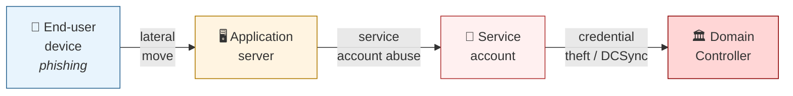

The path goes through 4 systems. Three of them look *low-risk* in isolation. Their relationships are what makes the path catastrophic. SecurityInsight uses **Microsoft Defender Exposure Graph** + **Azure Resource Graph** to score recommendations the way an attacker would weigh them: *can this finding put me one step closer to a Tier-0 asset?*

> [!NOTE]
> The technical underpinning is `ExposureGraphNodes` + `ExposureGraphEdges` (Defender) and Azure Resource Graph KQL — same data your SOC already has, framed as a graph instead of a flat table.

<a id="22-risk-score-model"></a><a id="risk-score-model"></a>
### 2.2 Risk Score model

[⤴ Back to top](#top)

Two dimensions, one formula:

> **Risk Score = Consequence × Probability**

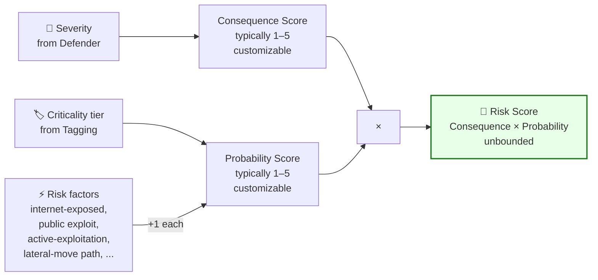

| Dimension | Where it comes from |
|---|---|
| **Consequence Score** | Defender's `Severity` rating of the recommendation (Very High → Low). Reflects *how bad it is if this gets exploited.* |
| **Probability Score** | The asset's **criticality tier** (Tier 0–3) modulated by **risk factors** (see [§ 2.3](#risk-factors)). Reflects *how likely it is to actually be exploited on THIS asset, in THIS environment.* |

Both scores are positive integers from the **Risk Index CSV** ([§ 2.4](#risk-index-customizable-scoring)) — a fully customizable mapping that organizations tune to their own risk appetite. The shipped CSV uses 1–5 for each dimension (so scores run 1–25), but there's **no hardcoded ceiling** — customers who want finer-grained ranking can bump the scale to 1–10 or beyond and the product `Consequence × Probability` follows directly.

**Worked example**:

```
Finding          : "Endpoint missing critical CVE patch"
Severity         : Very High
Consequence      : 4   (mapped from "Very High" in the Risk Index)
Asset            : An internet-facing web server tagged "Tier 1 (High)"
Criticality base : 3   (Tier 1 base score from the Risk Index)
Risk factor +1   : because the asset has the "InternetExposed" tag → Probability = 4
                                                                  ─────────
Risk Score = 4 × 4 = 16  →  ranks above a Tier-3 internal-only finding
```

<a id="23-risk-factors"></a><a id="risk-factors"></a>
### 2.3 Risk Factors

[⤴ Back to top](#top)

Probability is bumped up by **+1 per matching risk factor**. Each represents a real-world attribute that materially raises the chance of exploitation:

| Risk factor | Why it bumps probability |
|---|---|
| **Active exploitation** | The vulnerability is being weaponized in the wild today. |
| **Public exploit code** | Proof-of-concept is freely available. |
| **Internet exposure** | The asset is reachable from outside your perimeter. |
| **Legacy / unsupported** | No security updates available. |
| **Contains verified secret** | A real credential is sitting in the asset (Defender Secret Scanning hit). |
| **Critical resource** | Defender flags the asset as foundational to your tenant. |
| **Lateral movement** | The asset sits on a known attack path. |
| **Sensitive data** | The asset stores classified, PII, or regulated content. |

Each factor contributes +1 to the Probability score, capped per the Risk Index.

<details>
<summary>📌 <b>Future risk factors under consideration</b></summary>

- **Large attack surface** — many open services / APIs / ports
- **Third-party exposure** — partner / vendor reach
- **Shared infrastructure** — multi-tenant / multi-team blast radius
- **Weak network segmentation** — flat L2 / VLAN sprawl
- **Credential exposure risk** — shared accounts, weak MFA
- **Remote access enabled** — VPN / RDP / SSH / management UIs

PRs welcome to extend the engine with these — the scoring math stays the same, only the bump count changes.
</details>

<a id="24-risk-index-customizable-scoring"></a><a id="risk-index-customizable-scoring"></a>
### 2.4 Risk Index (customizable scoring)

[⤴ Back to top](#top)

The mapping `Severity → Consequence` and `Criticality → Probability` lives in **`SecurityInsight_RiskIndex.csv`** ([download](https://github.com/KnudsenMorten/SecurityInsight/raw/refs/heads/main/SecurityInsight_RiskIndex.csv)). Customers edit this file to reflect their own risk appetite — the engine reads it on every run.

| SecuritySeverity | Consequence | CriticalityTierLevel | Probability | Comments |
|---|---|---|---|---|
| Very High | 4 | Critical (tier 0) | 4 | Top of the matrix |
| Very High | 4 | High (tier 1) | 3 | |
| High | 3 | Critical (tier 0) | 4 | |
| Medium-High | 2 | Critical (tier 0) | 4 | |
| Low | 1 | Low (tier 3) | 1 | Bottom of the matrix |

Want a different scoring matrix for a regulated business unit? Edit the CSV. Want to penalize Tier-0 findings more aggressively? Bump the Probability column for Tier-0 rows. Want certain `ConfigurationId`s to score harder regardless of severity? Add a row with that exact ConfigurationId — it overrides the generic mapping.

<a id="25-outputs-at-a-glance"></a><a id="outputs-at-a-glance"></a>
### 2.5 Outputs at a glance

[⤴ Back to top](#top)

Every Risk Analysis run produces all of these from a single in-memory dataset (no double work):

| Output | Default | Toggle |
|---|---|---|
| 📗 Excel (.xlsx) | always | — |
| 📄 JSON sibling (.json) | off | `$global:WriteJsonOutput` |
| 📊 Log Analytics ingest (2 tables: `SI_RiskAnalysis_Summary_CL` / `_Detailed_CL`) | on | `$global:SendToLogAnalytics` |
| ☁️ Upload to UNC share OR Azure Storage | off | `$global:ExportDestination` |
| 📧 Email with HTML body + .xlsx attachment | off | `$global:SendMail` (community) / `$global:Mail_*_SendMail` (internal) |
| 🤖 Azure OpenAI executive summary embedded in Excel + email | off | `$global:BuildSummaryByAI` |

> [!IMPORTANT]
> Once the data is in Log Analytics it is queryable from Sentinel, Defender XDR, Power BI, Logic Apps, Workbooks, and Security Copilot. That's the long-term home — the .xlsx and email are convenience outputs.

---

<a id="3-supported-inputs-enrichment-outputs"></a><a id="supported-inputs-enrichment-outputs"></a>
## 🔌 3. What's supported — Inputs, Enrichment, Outputs

[⤴ Back to top](#top)

Before you set up, here's the data SecurityInsight reads (Inputs), what it joins with (Enrichment), and where it ships the results (Outputs). Everything is opt-in — start with the minimum, layer on the rest.

> 📚 **Documentation set** (the canonical docs maintained alongside the engine):
> - [`docs/DESIGN.md`](./docs/DESIGN.md) — the single design doc: architecture & engine pipeline, the provider plug-in contract, the asset-profiling data model & per-engine schemas, the privilege-tier catalog, the enrichment/detection-rule model, the risk-score model, the Risk Analysis query/report catalog, the report-enrichment vocabulary, the MDE/ExposureGraph field-gap analysis, CMDB reconciliation, Power BI, container/KEDA deployment, the preview/release model, day-2 operations & run-health KQL, troubleshooting, and the publish layout. *(Several sections are generated from source-of-truth files — `*.schema.locked.json`, `RiskAnalysis_Queries_Locked.yaml`, `privilege-tier-catalog.locked.json` — which remain the contract; regenerate via the `tools/Build-*` scripts.)*
> - [`docs/FEATURES.md`](./docs/FEATURES.md) — the delivered-feature catalog, per area, in plain language

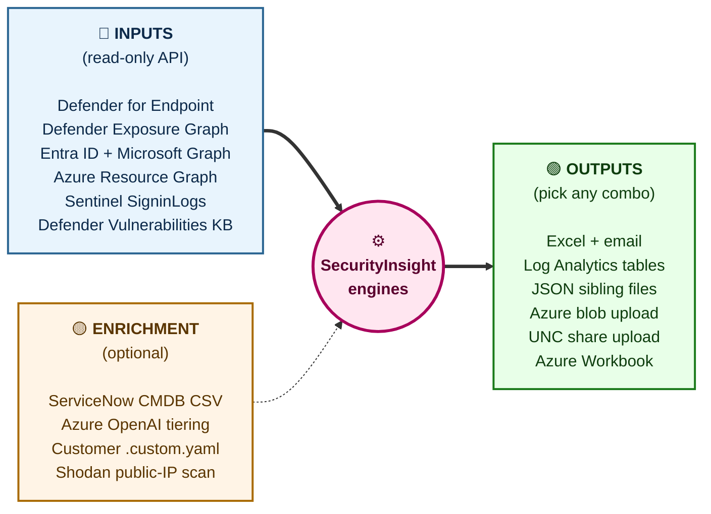

<a id="31-inputs"></a>
### 3.1 Inputs — supported data providers

- ✅ **Microsoft Defender for Endpoint** *(XDR + advanced hunting)*
  Devices, vulnerabilities, secure-config posture. Required.
  *Read by:* `endpoint`, `risk-analysis`

- ✅ **Microsoft Defender Exposure Graph** *(`ExposureGraphNodes`, `ExposureGraphEdges`)*
  Asset graph: nodes (devices / users / Azure resources) + edges (relationships, attack paths). Required.
  *Read by:* `endpoint`, `azure`, `identity`, `risk-analysis`

- ✅ **Entra ID + Microsoft Graph**
  Users, service principals, groups, role assignments, app permissions, MFA registration. Required.
  *Read by:* `identity`, `risk-analysis`

- ✅ **Azure Resource Graph (ARG)**
  Subscriptions, resource groups, every Azure resource + tags + properties. Required.
  *Read by:* `azure`, `risk-analysis`

- ⚠️ **Sentinel `SigninLogs` + `AADNonInteractiveUserSignInLogs`** *(Log Analytics)*
  Per-signin events: location, device, risk, conditional access. Required **only if you want the Identity sign-in reports** — needs an Entra ID Diagnostic Setting routing into LA (the wizard auto-creates one if you don't have Sentinel; see Step 7).
  *Read by:* `risk-analysis` (Identity reports)

- ✅ **Defender Vulnerabilities KB** *(`DeviceTvmSecureConfigurationAssessmentKB`)*
  CVE descriptions, MITRE ATT&CK mapping, compliance benchmarks (CIS / NIST / PCI). Auto-included with MDE.
  *Read by:* `risk-analysis` (`Device_Recommendations`)

- *Optional* — **Shodan API**
  Public-IP exposure: open ports, CVEs on internet-facing assets. Tier 0/1 assets only.
  *Read by:* `publicip`

- *Optional* — **Provider connectors** *(`asset-profiling-providers/<provider>/`)*
  Pluggable. Today: `entra` (built-in), `generic-cmdb` (CSV pull).
  *Read by:* all asset-profiling engines

> 🔒 **All inputs are read-only.** SecurityInsight never writes back to MDE / Entra / ARM during a collection run. The optional asset-tagging engine (`launcher\asset-tagging\launcher.community-vm.ps1`) is **report only by default**: it logs every tag it would set and writes only when you ask — `-Apply` on a run, or `$global:SI_AssetTagging_Apply = $true` in your configuration.

<a id="32-enrichment"></a>
### 3.2 Enrichment — joining external context

| Enrichment | What it does | Where you configure |
|---|---|---|
| **ServiceNow CMDB CSV** | Folds `cmdbId`, `cmdbName`, `cmdbCriticality` (`Critical`/`Important`/`Standard`), `cmdbDataSensitivity` (`Public`/`Internal`/`Confidential`/`Restricted`) onto every asset row at the Reconcile stage. Drives `RiskFactor_Consequence_Detailed` tokens (`BusinessCriticalAsset`, `RestrictedDataAccess`). | `asset-profiling-providers/generic-cmdb/CMDB.csv` (drop your file; gitignored) — see `sample/CMDB.csv` for column shape |
| **Azure OpenAI** (role/permission tier classification) | When a Microsoft role / permission isn't in the locked tier catalog, AI evaluates the permissions it grants and slots it into Tier 0–3. Off by default; opt in via `$global:SI_EnableAI = $true`. | Step 4 of bootstrap — `Validate-SIOpenAI.ps1` |
| **Custom asset-profiling rules** (`*.custom.yaml`) | Override or add to the 559 locked enrichment rules. Customer wins on conflict (merge by `id`). | Drop `<RuleName>.custom.yaml` next to the matching `<RuleName>.locked.yaml` in `asset-profiling-enrichment/<domain>/` |
| **Custom RA report exclusions** (`*.exclude.custom.json`) | Per-report exclusions (e.g. "exclude these ConfigurationIds from `Device_Recommendations_Summary` because we accept this risk"). | `risk-analysis-detection/<ReportName>.exclude.custom.json` |
| **Custom Risk Index** (`riskscore_weighted.schema.custom.json`) | Customer-tunable scoring matrix (Severity × CriticalityTier × per-engine multipliers). | `risk-analysis-detection/riskscore_weighted.schema.custom.json` (copy from `*.sample.json`) |
| **Custom asset-profile schemas** (`*.schema.custom.json`) | Add tenant-specific columns to a Profile_CL table. | `asset-profiling-schema/<engine>.schema.custom.json` (copy from `*.sample.json`) |

<a id="33-outputs"></a>
### 3.3 Outputs — supported sinks (pick any combo)

| Sink | Purpose | Toggle | Status |
|---|---|---|---|
| **📧 Excel + AI summary email** | Operator-friendly XLSX of ranked findings (optional AI exec summary as first sheet). Per-template recipients via `Mail_<ReportName>_To` in YAML. | `$global:Report_SendMail = $true` + `$global:Report_To = @('a@b.com')` | ✅ Available |
| **🗃️ Log Analytics custom tables** | Durable time-series store. Tables: `SI_RiskAnalysis_Summary_CL`, `SI_RiskAnalysis_Detailed_CL`, `SI_*_Profile_CL`, `SI_RunHealth_CL`. Auto-created via DCR. | `$global:SendToLogAnalytics = $true` | ✅ Available |
| **📦 JSON sibling** | One-line-per-row JSON next to every XLSX. Drop-in feed for downstream tools. | `$global:WriteJsonOutput = $true` (default off) | ✅ Available |
| **☁️ Azure blob upload** | Auto-publish each run's xlsx + json to a blob container. Backup-then-overwrite semantics so re-runs never lose data. | `$global:RiskAnalysis_ExportDestination` set to `https://<acct>.blob.core.windows.net/<container>/` | ✅ Available |
| **📁 UNC share upload** | Same as blob, to `\\server\share\path`. Caller's Windows identity needs share write. | `$global:RiskAnalysis_ExportDestination` set to UNC path | ✅ Available |
| **📓 Azure Monitor Workbook** | Pre-built Workbook JSON for visual exploration. One-time import, queries `SI_*_CL` tables. | Import `preview/AzureWorkbook/SecurityInsight-RiskAnalysis.workbook.json` | ✅ Available |
| **🔔 Run-health KQL alert** | Alert when a Start row has no matching End row in 1 hour (= crashed run). | KQL on `SI_RunHealth_CL` (sample query in `docs/DESIGN.md` → Operations & runbook) | ✅ Available |

<a id="34-setup-file-checklist"></a>
### 3.4 Setup file checklist — which sample files to copy

For a fresh install, you'll copy these sample files to their `.custom.` siblings (gitignored — your copy is yours, never overwritten by upgrades).

#### 🟢 Required (everyone copies these)

| Step | Copy from | To | Edit |
|---|---|---|---|
| 1 | `config/SecurityInsight.custom.sample.ps1` | `config/SecurityInsight.custom.ps1` | SPN credentials, Workspace name, mail-relay settings |
| 2 | `launcher/<engine>/LauncherConfig.custom.sample.ps1` | `launcher/<engine>/LauncherConfig.custom.ps1` | Per-engine overrides (often empty if defaults work) |

#### 🟡 Optional (copy only if you use the feature)

| Feature | Copy from | To | Edit |
|---|---|---|---|
| **ServiceNow CMDB enrichment** | `asset-profiling-providers/generic-cmdb/sample/CMDB.csv` | `asset-profiling-providers/generic-cmdb/CMDB.csv` | Drop your CMDB extract (columns: `id,name,criticality,dataSensitivity,...`) |
| **Custom Risk Index weights** | `risk-analysis-detection/riskscore_weighted.schema.custom.sample.json` | `risk-analysis-detection/riskscore_weighted.schema.custom.json` | Adjust per-domain weight multipliers |
| **Custom enrichment rule** (e.g. add a Tier 0 marker for your bastion hosts) | `asset-profiling-enrichment/endpoint/AssetProfileByApplicationServiceDetection/<App>.custom.sample.yaml` | Same name, drop `.sample.` segment | Set `id`, `match` criteria, `tier`, `tags` |
| **Custom Azure-tag rule** | `asset-profiling-enrichment/azure/AssetProfileByTags.custom.sample.yaml` | `asset-profiling-enrichment/azure/AssetProfileByTags.custom.yaml` | Map your Azure-tag keys/values to tier verdicts |
| **Per-report exclusion** | (no sample — create from scratch) | `risk-analysis-detection/<ReportName>.exclude.custom.json` | Array of `{ConfigurationId, AssetId, reason}` |
| **Public-IP test list** | `asset-profiling-schema/public-ip.schema.custom.sample.json` | `asset-profiling-schema/public-ip.schema.custom.json` | Add IPs you want Shodan-scanned beyond the auto-discovered Tier 0/1 set |

#### 🔵 Generated / managed by bootstrap (don't hand-edit)

- `staging/asset-profiling/identity.tier.classification.json` — AI verdict catalog (regenerated on AI re-classification)
- `risk-analysis-detection/OUTPUT/AutoBucketCache.json` — per-report bucket-count cache
- `output/RiskAnalysis_*.xlsx` + `output/RiskAnalysis_*.json` — RA report output. Override the path with `$global:SI_RiskAnalysis_OutputDir` in custom.ps1.
- `logs/<engine>_<flavor>_<timestamp>.log` — per-run transcripts

> 💡 **Naming convention rule of thumb**: any file with `.sample.` in the name is documentation. Drop `.sample.` to make it active. Files ending in `.custom.<ext>` (no `.sample.`) are gitignored and yours to keep across upgrades.

---

## 🚀 4. How to Implement (Quick Start)

[⤴ Back to top](#top)

<a id="how-to-implement-quick-start"></a><a id="35-ten-step-newbie-setup"></a><a id="41-three-step-quick-start-recommended"></a>

### 4.1 Three-step quick start (recommended)

Never seen SecurityInsight before? It's three steps: **clone the repo → run the Setup Wizard → run the engines.** Estimated time first run: **30–45 min** — most of it is Azure provisioning during the wizard's Setup phase.

If you'd rather drive each provisioning task by hand (one script per phase), Steps 4–7 further below are the manual equivalent of what the wizard automates — exactly the same actions, no GUI.

#### ✅ Prerequisites

##### PowerShell

- **Wizard / Setup**: **PowerShell 7+** (`pwsh`). The wizard's local web server (HttpListener) needs pwsh 7.
- **Engines (runtime)**: **Windows PowerShell 5.1** is the canonical engine runtime — the launchers, asset-profiling pipeline, and Risk-Analysis engine all run on PS 5.1. Engines also run on pwsh 7 if you prefer, but the published behaviour (and integration tests) target 5.1.

##### PowerShell modules: none needed

SecurityInsight v3 uses **no PowerShell modules** -- nothing to install from the PowerShell Gallery, nothing to keep up to date. Every call it makes is native: REST against Azure Resource Manager, Resource Graph, Log Analytics, Key Vault, Storage, Microsoft Graph and Defender, data sent through the Azure Monitor **Log Ingestion API**, and .NET for the rest (certificates, JSON, the Excel and YAML handling). The container image carries no modules either.

What **is** needed:

| Need | Details |
|------|---------|
| PowerShell | **Windows PowerShell 5.1** or **PowerShell 7+** (the wizard needs 7, see above) |
| Network | HTTPS (443) from the machine or container to the Microsoft endpoints it calls: `login.microsoftonline.com`, `management.azure.com`, `api.loganalytics.io`, `graph.microsoft.com`, `api.securitycenter.microsoft.com`, `*.vault.azure.net`, `*.blob.core.windows.net` (and the queue / table endpoints of the SI storage account), and the data collection endpoint (`*.ingest.monitor.azure.com`) -- or their private endpoints |
| An identity | A **managed identity** (container, Azure VM, Azure Arc server) or a **service principal with a certificate** (the certificate with its private key in the machine's certificate store). SI requests its own tokens from the Microsoft identity platform; no `Connect-AzAccount`, no `Connect-MgGraph` |

> 💡 Running 2.2 as well? There is no upgrade from 2.2 -- SecurityInsight 3 is a separate install beside it (see [SecurityInsight 3: a new, side-by-side install](#securityinsight-3-a-new-side-by-side-install)). The modules 2.2 installed (`Az.*`, `Microsoft.Graph*`, `AzLogDcrIngestPS`, `MicrosoftGraphPS`, `ImportExcel`, `powershell-yaml`) belong to 2.2; remove them when you remove 2.2, and only if nothing else on the machine uses them.

##### Git for Windows

Required for cloning the repo (§ 4.2) and pulling future updates. Stock Windows Server / Windows 11 doesn't ship with `git`.

**Install via direct download (recommended):**

```powershell
# Run in an elevated PowerShell window (Run as Administrator).
$ProgressPreference = 'SilentlyContinue'
$gitUrl = ((Invoke-RestMethod 'https://api.github.com/repos/git-for-windows/git/releases/latest').assets |
    Where-Object { $_.name -like '*-64-bit.exe' -and $_.name -notlike 'PortableGit*' -and $_.name -notlike 'MinGit*' } |
    Select-Object -First 1).browser_download_url
Invoke-WebRequest -Uri $gitUrl -OutFile .\GitInstaller.exe
Start-Process .\GitInstaller.exe -Wait -ArgumentList '/VERYSILENT','/NORESTART','/NOCANCEL','/SP-'

# Then close + reopen PowerShell so PATH picks up `git`, then verify:
git --version
```

The GitHub API call resolves the latest release URL (no version pinning); `/VERYSILENT /SP-` is Inno Setup's unattended install flag — no GUI prompts.

##### No Azure CLI, no PowerShell modules

SecurityInsight needs **neither the Azure CLI nor any PowerShell module** -- setup, the container option (the image is built in your own registry over Azure Resource Manager), the Pro web app's deploy and the updates all call Azure, Microsoft Graph and Log Analytics over REST with SecurityInsight's own sign-in. Nothing to install here.

##### Azure + Entra

- An **Azure subscription** to host the workspace + DCE + storage account.
- The operator running the wizard needs (at least one of):
  - **Owner** OR **Contributor** + **User Access Administrator** at the target subscription (for resource creation + SPN role assignments).
  - For Microsoft Graph permission grants: **Application Administrator**, **Cloud Application Administrator**, **Privileged Role Administrator**, OR **Global Administrator**. *If you don't have any of these, the wizard still creates the SPN but surfaces an admin-consent URL you hand to a Global Admin — re-clicking Setup after they consent finishes the run.*
  - For **Phase 4 (Entra ID Diagnostic Setting)**: **Security Administrator** OR **Global Administrator** at tenant scope. Subscription-level Owner is **not** sufficient — `aadiam` diagnosticSettings are tenant-scoped, not ARM-scoped.

### 4.2 Get the code

```powershell
# Option A (recommended): clone the latest stable release (tag-tracking).
# 2>$null suppresses the non-fatal "destination path already exists" stderr
# noise on re-run; the cd lands you in the freshly cloned (or pre-existing) tree.
git clone "https://github.com/KnudsenMorten/SecurityInsight.git" "C:\SecurityInsight" 2>$null
cd C:\SecurityInsight

# Option B: download the zip
Invoke-WebRequest 'https://github.com/KnudsenMorten/SecurityInsight/archive/refs/heads/main.zip' -OutFile $env:TEMP\si.zip
Expand-Archive $env:TEMP\si.zip -DestinationPath C:\SecurityInsight -Force
cd C:\SecurityInsight

# Bleeding-edge alternative -- only if you want the preview branch (see § 4.5):
#   git clone -b preview "https://github.com/KnudsenMorten/SecurityInsight.git" "C:\SecurityInsight"
```

#### Update to latest version

```powershell
cd C:\SecurityInsight
.\Update-SecurityInsight.ps1
```

It takes the release your **update ring** approves from SecurityInsight's signed release channel on GitHub — no git
needed, also for an install made from the zip:

| Ring | Who | How |
|---|---|---|
| **3** — broad | every install, by default | nothing to set |
| **2** — early release | installs that want a release before everyone else | `{ "ring": 2 }` in `config\update.custom.json` (kept by every update), or `-Ring 2` for one run |

A new version reaches ring 2 first and ring 3 after it has run there. The update client:

1. verifies the channel entry for your ring — signed with the update key your installed version ships with, for this
   product and this ring, never older than what is installed — and **holds** a release that asks for a manual step
   first or needs a newer starting version (it says what to do);
2. downloads the release zip and checks it is exactly the signed one (size and SHA-256);
3. pauses SecurityInsight's engine tasks (a running engine makes the update wait for its next run), keeps a backup in
   `.si-update\`, writes the release, checks the result and **puts the previous version back** on any failure;
4. on a container install, builds the engine image from the new code in your registry and moves your jobs to it,
   restoring the previous image if anything fails (`-SkipContainerUpdate` updates the files only).

It prints one result line: `current` (nothing newer for your ring), `updated: <from> -> <to> (ring …)`, `hold: …`,
or `refused` / `network` / `rolledback` with the reason — in those three cases nothing changed. Schedule it once a
day; it changes something only when your ring has a newer release. `-ShowReleaseNotes` prints these notes after an
update.

`config\SecurityInsight.custom.ps1`, `config\update.custom.json`, `launcher\<engine>\LauncherConfig.custom.ps1`,
every `*.custom.*` file (including `risk-analysis-detection\riskscore.index.custom.csv`), `output\` (reports),
`risk-analysis-detection\OUTPUT\` (caches) and `logs\` are never touched by an update — your secrets, overrides,
generated reports and transcripts stay as they are. A **shipped** file you edited is replaced (put your change in its
`*.custom.*` partner instead).

> A git clone keeps working with the update client. Do not also schedule a `git pull` in the folder: after the first
> channel update the folder no longer matches the public `main` branch, and the pull stops with "local changes".

<a id="upgrading-from-22x-to-30"></a>
#### Coming from 2.2.x

There is no upgrade from 2.2 to 3, and `Update-SecurityInsight.ps1` never moves a 2.2 install to 3. Install
SecurityInsight 3 as a separate installation beside 2.2, compare the two, and switch 2.2 off when you are ready -- see
[SecurityInsight 3: a new, side-by-side install](#securityinsight-3-a-new-side-by-side-install) and
[SecurityInsight 3 beside 2.2](https://invardia.com/docs/securityinsight/side-by-side/) for every step.

### 4.3 Authenticate, then launch the Setup Wizard

There is nothing to install and no separate sign-in command to run first: the wizard signs you in itself when it starts, with no PowerShell module.

```powershell
# Start the wizard for your tenant (and, optionally, subscription). It signs you in, then opens
# http://localhost:8766 in your default browser.
.\setup\ConfigWizard\Start-SetupWizard.ps1 -TenantId <your-tenant-id> -SubscriptionId <your-subscription-id>
```

**How you are signed in:**

- **Azure Cloud Shell** — automatically, as the person who opened Cloud Shell (no prompt). If Cloud Shell is signed in to a different tenant, the wizard says so; switch directory in the Azure portal and reopen Cloud Shell.
- **A workstation or server** — your browser opens the Microsoft sign-in page; after you sign in (MFA and Conditional Access apply as usual), the browser shows *"The sign-in is complete"* and you return to PowerShell. The answer comes back to a short-lived listener on `http://localhost` on the same machine (authorization code with PKCE). If no browser opens, the address is printed — open it yourself on the same machine.
- **No device code** — it is blocked by Conditional Access in many tenants and is never used.
- The sign-in is kept **in memory** in that PowerShell session only; nothing is written to disk. Every step of the wizard reuses it, so you sign in once. `-UserSignIn Browser` or `-UserSignIn CloudShell` forces one of the two.

The account needs the Azure and Microsoft Entra roles listed under *Azure + Entra* above. No Azure CLI is needed: the container option builds the image in your registry over Azure Resource Manager.

#### What the wizard does

The wizard walks you through **8 short pages** in your browser, then on the **Setup** page it provisions everything end-to-end across **4 phases**:

##### Phase 1 — Sign-in (managed identity by default)

**Default: a user-assigned managed identity** — no secret or certificate to create, store or rotate. On an Azure VM the wizard creates the identity in the install's resource group (with Phase 2), grants it the same read-only Microsoft Graph, Defender and Azure permissions, and attaches it to the VM you name on Step 1 (an Azure Arc server uses its own system-assigned identity: `setup\Grant-SIIdentity.ps1 -ArcMachineName <name> -ArcResourceGroup <rg> -Apply`). For Container Apps the jobs sign in as their own user-assigned identity, which the container setup creates and grants. The configuration gets `$global:SI_AuthMethod = 'ManagedIdentity'`.

**A service principal, when you choose it** (and always on a server outside Azure, where no managed identity can exist — the wizard says so and offers the certificate first): creates an Entra app registration + service principal + credential (self-signed certificate, recommended, or a client secret — supported), grants 13 Microsoft Graph application permissions with admin consent, assigns Azure RBAC at tenant-root MG (`Reader` — skip-able; `Tag Contributor` only when you opt in to asset tagging). The credential is stored where you picked: KV / local cert store / inline in custom config.

##### Phase 2 — Infrastructure (LA + DCE + Storage + RBAC)

**Auto-registers required Azure resource providers** (`Microsoft.OperationalInsights`, `Microsoft.Insights`, `Microsoft.Monitor`, `Microsoft.Storage`, `Microsoft.AlertsManagement`, and `Microsoft.KeyVault` if KV-cred). Creates the RG + Log Analytics workspace + Data Collection Endpoint + Storage account. Grants the SPN:

- `Contributor` + `Log Analytics Contributor` on the **LA workspace**
- `Contributor` + `Monitoring Metrics Publisher` on the **DCR resource group**
- `Storage Blob`/`Table`/`Queue Data Contributor` on the **storage account**

**Lands in your tenant:** workspace, DCE, storage account in your sub. Per-engine DCRs and their custom tables are created by SecurityInsight itself at first ingest (Azure Resource Manager over REST). **Storage is reached only with the signed-in identity** — the managed identity in a container, the app identity (certificate or secret) or a managed identity on a VM — through its `Storage Blob/Table/Queue Data Contributor` roles on the storage account. There is no storage-key option. The same `custom.ps1` works for VM + Container Apps Job, and the storage path goes through Private Endpoint + Private DNS zones transparently with no code changes.

##### Phase 3 — Config file

Renders `config\SecurityInsight.custom.ps1` with every required `$global:SI_*` value. Optional sections (SMTP, Azure OpenAI, Shodan, CMDB CSV, per-engine JSON sink, Defender XDR / Sentinel linkage) are added only when you toggled them on. Backs up any existing custom file to `*.bak.<timestamp>` before overwriting.

**Lands in your tenant:** a populated `config\SecurityInsight.custom.ps1` ready for the engines to read.

##### Phase 4 — Entra ID Diagnostic Setting

*Default ON; auto-skipped when you linked an existing Defender / Sentinel workspace on Step 7 (their existing Diagnostic Setting already streams the same categories).*

Creates a tenant-level Diagnostic Setting `SI-EntraDiag` via `PUT providers/microsoft.aadiam/diagnosticSettings/SI-EntraDiag` targeting the SI workspace, with the **8 categories SI's queries actually reference**: `SignInLogs`, `AuditLogs`, `NonInteractiveUserSignInLogs`, `ServicePrincipalSignInLogs`, `ManagedIdentitySignInLogs`, `UserRiskEvents`, `ProvisioningLogs`, `MicrosoftGraphActivityLogs`. PUT semantics replace the named setting; any existing Sentinel-side Diagnostic Settings stay untouched.

> **Operator role required:** Entra **Security Administrator** OR **Global Administrator** at tenant scope. Subscription-level Owner is **not** sufficient — `aadiam` diagnosticSettings are tenant-scoped, not ARM-scoped. The wizard surfaces a clear `AuthorizationFailed` error with remediation instructions if the role is missing.

**Lands in your tenant:** sign-in + audit logs streaming into the SI workspace, ready for RA queries that correlate sign-in risk against Tier-0 assets.

The wizard runs cross-platform on **Windows 11** + **Windows Server**, both on-prem and Azure-hosted. The first card on Step 1 (Engine host + bootstrap auth) gates which credential storage options are valid for your scenario:

- **Azure VM or Azure Arc-enabled server** *(the default)* — a managed identity (default). A service principal when you choose it: all storage options valid; KV preferred.
- **Azure Container Apps jobs** — the jobs' managed identity (default). A service principal when you choose it: KV (cert or secret) or Inline; local cert store doesn't apply (ephemeral container).
- **Windows server outside Azure (no MI possible)** — a service principal: self-signed cert + Local cert store *(recommended, the default here)* OR client secret + Inline. Key Vault storage is hidden because there's nothing to bootstrap KV access from.

#### Wizard tour — screenshot walkthrough


##### 0 — Launch + Welcome

Run `.\setup\ConfigWizard\Start-SetupWizard.ps1 -TenantId <your-tenant-id>` in `pwsh`. It signs you in (§4.3), prints its pre-flight, opens `http://localhost:8766` in your default browser, and waits.

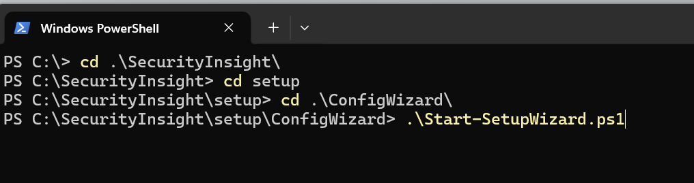

If the sign-in does not complete, or you are signed in to a different tenant, the wizard stops before it opens the page and tells you what to do -- run the same command again with the right `-TenantId`.

The Welcome page groups prereqs into *Always required* / *Use existing* / *Optional features* cards. Click **Start configuring** when ready.

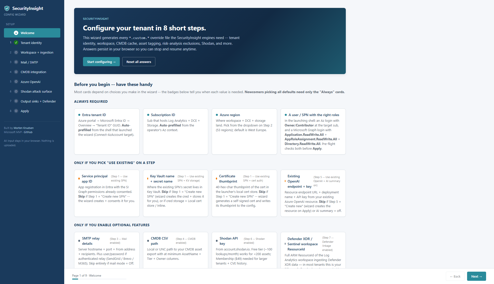

##### 1 — Tenant identity (engine host + SPN + credential)

Pick the engine host + bootstrap-auth combination (dropdown — drives which credential-storage options stay visible later). Tenant ID is auto-pre-filled from your Az login.

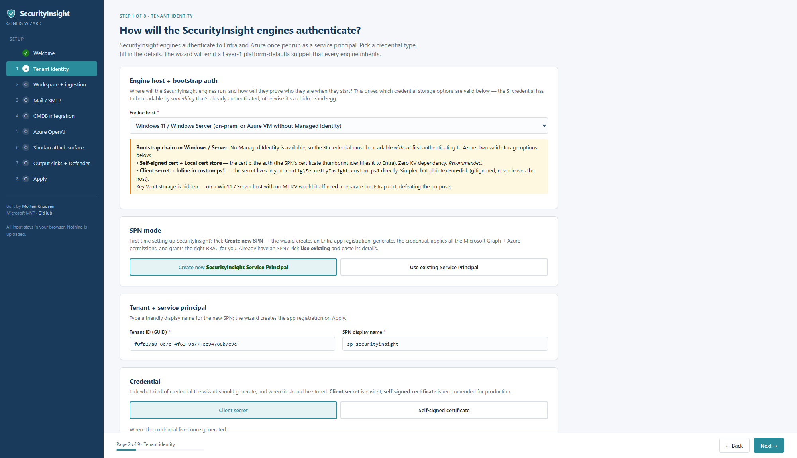

Pick SPN mode (**Create new** / **Use existing**), credential type (Secret / Self-signed cert), and storage (Inline / Local cert store / Key Vault). The wizard hides combinations that can't bootstrap on your chosen host (e.g. KV storage is hidden for non-MI hosts because nothing can reach KV before the SPN exists).

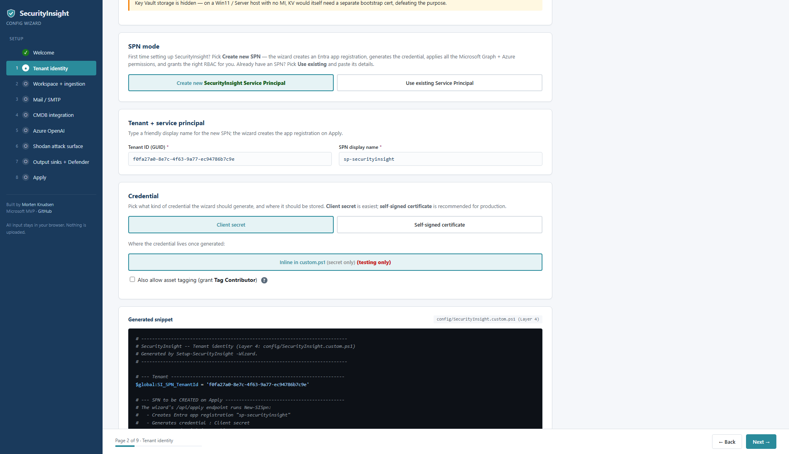

##### 2 — Workspace + ingestion

Subscription ID auto-pre-filled. Pick Azure region from the 53-region dropdown. Workspace name + RG, DCE name + RG, storage account name + RG + container — all defaults pre-filled with the v2.2 standard layout. Optional **naming suffix** (e.g. `prod`) auto-appends to all resource names.

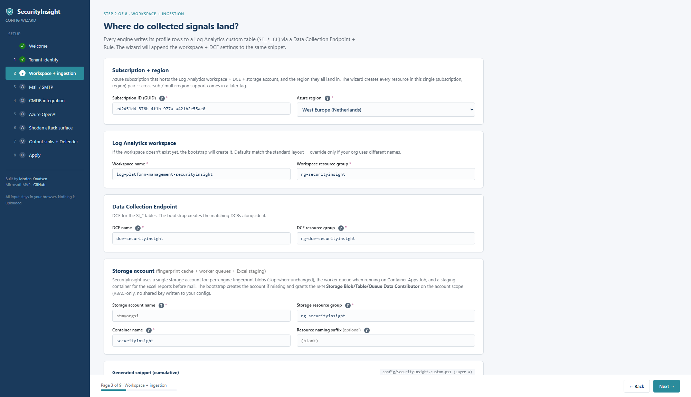

##### 3 — Mail / SMTP *(optional)*

Off / Anonymous relay / Authenticated. Sub-fields appear based on the mode. Any relay works (anonymous or with sign-in). Recommended instead: an Office 365 shared mailbox (`setup\Set-SIMail.ps1`).

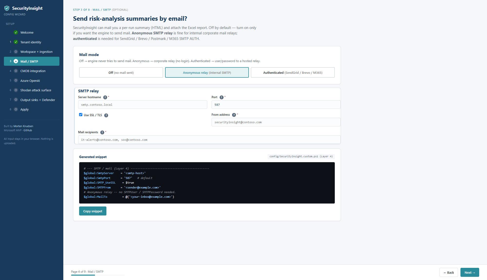

##### 4 — CMDB integration *(optional)*

Off / CSV file. Type the path to your CMDB asset export; SI joins it onto every `SI_*_Profile_CL` row for owner / department / business-app enrichment.

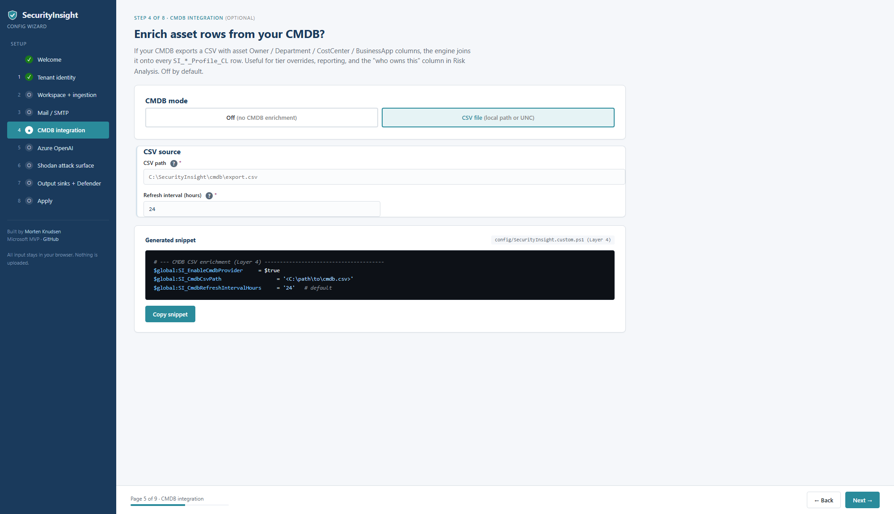

##### 5 — Azure OpenAI *(optional)*

Off / Enabled. Use existing OpenAI resource (paste endpoint + deployment + key) OR create new (resource name + RG + region + deployment + model SKU). Default model: `gpt-4.1-mini` (replaces the deprecated `gpt-4o-mini`).

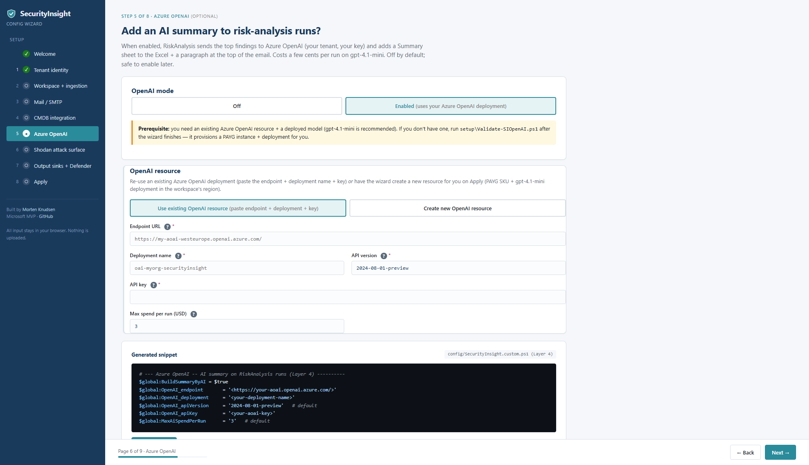

##### 6 — Shodan attack-surface *(optional)*

Off / Enabled. API key + license-tier dropdown (Free / Membership / Small Business / Corporate) so the engine backs off before hitting rate limits.

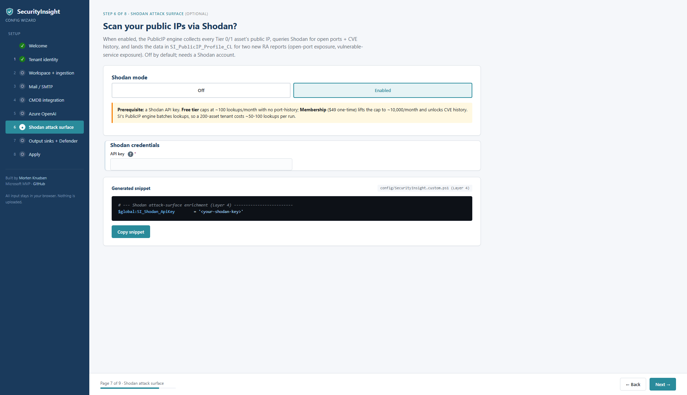

##### 7 — Output sinks + Defender XDR + Entra diagnostic logs *(optional)*

JSON sink toggle (adds `'JSON'` to every `SI_Sinks_<Engine>`). Defender XDR / Sentinel workspace linkage:

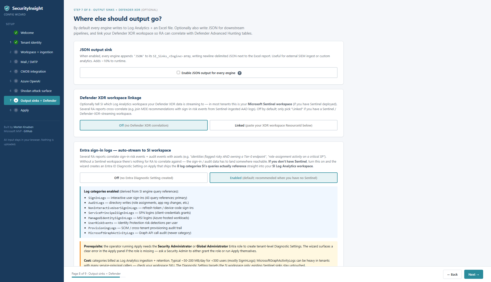

**Entra ID diagnostic-log streaming.** Default ON. Auto-skipped when you linked an existing Defender / Sentinel workspace above (their existing Diagnostic Setting already streams the same categories). When enabled, Phase 4 of Setup creates the `SI-EntraDiag` Diagnostic Setting — see *Phase 4* under § 4.3 above for the full category list and operator-role requirements.

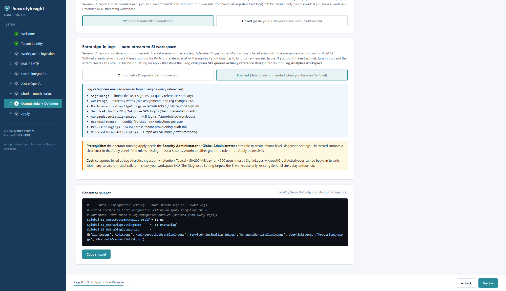

##### 8 — Setup (provisioning)

Review summary (4 phase cards). Click **▶ Setup**. Watch SPN → Infrastructure → Config → Entra Diagnostic Setting phases turn green. Per-step log panel below shows every action (resource provider registrations, app reg + SP creation, per-permission Graph status, RBAC grants, ResourceIds, config file path + sections written, Diagnostic Setting PUT result). If admin consent is pending, the panel surfaces the consent URL — hand it to a Global Admin, then re-click **Setup** (idempotent).

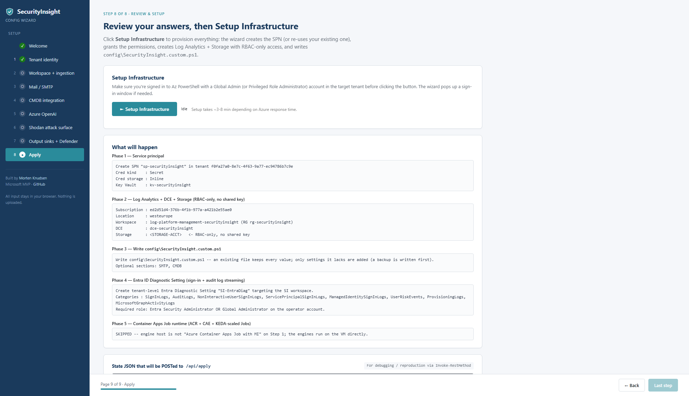

Stop the listener with **Ctrl+C** in the pwsh window — the listener releases port 8766 immediately so re-launching always works.

#### Permissions granted by the wizard — what, to whom, and where

Full disclosure of every permission / role assignment the wizard creates on **Setup**. Nothing is granted that isn't listed here.

#### 1. Microsoft Graph application permissions

Granted to the **SI Service Principal**. All are **application-only** (no delegated user-impersonation) and all require admin consent. The 17 minimum permissions every SI engine reads:

- **ThreatHunting.Read.All** — Defender XDR Advanced Hunting via Microsoft Graph (`/security/runHuntingQuery`).
- **Device.Read.All** — MDE devices, vulnerabilities, secure-config baselines.
- **User.Read.All** — Entra users (UPNs, sign-in metadata, account enabled/disabled).
- **Application.Read.All** — app registrations + service principals (for the Identity engine's SPN-tier classification).
- **Group.Read.All** — Entra group membership (drives tier-via-membership classification).
- **Policy.Read.All** — Conditional Access + auth policies (for the Identity Risk Analysis reports).
- **AuditLog.Read.All** — `AuditLogs` table (directory writes, role assignments, app-reg changes).
- **IdentityRiskEvent.Read.All** — Identity Protection risk events per user.
- **IdentityRiskyUser.Read.All** — risky user state (current risk level, history).
- **Reports.Read.All** — bulk MFA registration via `userRegistrationDetails` (200× faster than per-user lookup).
- **DirectoryRecommendations.Read.All** — Entra directory health + posture recommendations.
- **SecurityEvents.Read.All** — security-alert pipeline.
- **CrossTenantInformation.ReadBasic.All** — cross-tenant guest metadata for B2B asset attribution.
- **RoleManagement.Read.Directory** *(v2.2.230)* — tenant-wide role definitions, role assignments, PIM eligibility schedules. **Required** by `IdentityRoleFetcher` in the `EntraUsers` + `EntraServicePrincipals` discovery sources; without it both sources catch a 403 fetching role definitions and return 0 rows.
- **UserAuthenticationMethod.Read.All** — each user's sign-in methods (`/users/{id}/authentication/methods`, read only), so SecurityInsight can tell which accounts sign in passwordless only. Without it that column stays unknown, never "no". An existing install gets it the next time its permission setup runs (admin consent needed).
- **AccessReview.Read.All** — access review definitions and their instances (`/identityGovernance/accessReviews/definitions`, read only), so SecurityInsight can show when a privileged role, group or application was last reviewed. Without it that column stays empty. An existing install gets it the next time its permission setup runs (admin consent needed).
- **SecurityAlert.Read.All** — the security alerts (`/security/alerts_v2`, read only), read once for the whole tenant, so SecurityInsight can show per device how many alerts are open, their highest severity and the newest one. Without it those columns stay unknown (never 0); the alerts of the last 30 days are unaffected. An existing install gets it the next time its permission setup runs (admin consent needed).
- **SecurityEvents.Read.All** — the Microsoft Secure Score of the tenant (`/security/secureScores`, the latest only, read only), sent with the hourly status report. Without it the report carries no Secure Score and says which permission to grant; nothing SecurityInsight collects changes. An existing install gets it the next time its permission setup runs (admin consent needed).

#### 1b. Microsoft Threat Protection application permissions

Microsoft Threat Protection is a **separate API resource** from Microsoft Graph (resource AppId `8ee8fdad-f234-4243-8f3b-15c294843740`). Granted to the same SI Service Principal as Graph permissions, also application-only + admin consent.

- **AdvancedHunting.Read.All** *(v2.2.231)* — the legacy Defender XDR `advancedhunting/run` endpoint that the Risk Analysis engine probes as a fallback when Graph's `/security/runHuntingQuery` isn't available in the tenant. Soft-fails when the MTP SP isn't present in the tenant (no XDR licensing) — the engine then runs via Graph hunting only.

#### 1c. WindowsDefenderATP application permissions

WindowsDefenderATP is the legacy Microsoft Defender for Endpoint API resource (`fc780465-2017-40d4-a0c5-307022471b92`) — separate from Microsoft Graph and Microsoft Threat Protection. Granted to the same SI Service Principal as Graph/MTP, also application-only + admin consent.

- **Machine.Read.All** *(v2.2.239)* — unlocks the legacy MDE `/api/machines` device-inventory endpoint that the endpoint asset-profiling engine reads on tenants where the unified Graph hunting path isn't available. Soft-fails when the WindowsDefenderATP SP isn't present in the tenant (no MDE licensing) — the engine then runs via Graph hunting only.
- **Vulnerability.Read.All** — the exploit details of a vulnerability from the Defender vulnerability API (`/api/vulnerabilities`, read only): whether the exploit is verified, part of an exploit kit, its kind, and how many devices are exposed. Without it those columns stay empty on the vulnerability findings; nothing else changes. An existing install gets it the next time its permission setup runs (admin consent needed).
- **SecurityRecommendation.Read.All** — the exposure impact and the active-alert mark of a Defender security recommendation (`/api/recommendations`, read only), shown on the vulnerability and configuration findings as context. Without it those two columns stay empty; nothing else changes. An existing install gets it the next time its permission setup runs (admin consent needed).
- **Score.Read.All** — the Defender exposure score of the tenant (`/api/exposureScore`, read only), sent with the hourly status report. Without it the report carries no exposure score and says which permission to grant; nothing SecurityInsight collects changes. An existing install gets it the next time its permission setup runs (admin consent needed).

#### 2. Azure RBAC role assignments

Granted to the **SI Service Principal**. All grants are visible in the Setup page's per-step log + the Apply payload — no hidden grants.

- **Reader** at **tenant-root MG** — subscription discovery for the Azure asset-profiling engine + cross-sub LA queries. *Skip-able via `-SkipTenantRbac` (or hide via the "Use existing SPN" path and grant manually).*

- **Tag Contributor** at **tenant-root MG** — *opt-in only.* Required **only by the asset-exclusion-tagging engine** (writes Custom Security Attributes to flagged assets). **Not granted by default**; enable explicitly via `-IncludeTagContributor` on `New-SISpn` (or the wizard's asset-tagging toggle when that page activates). Most customers don't need it.

- **Contributor** at **the workspace** — broad workspace management (settings, retention, soft-delete, integrations). *Required.* Granted **in addition to** `Log Analytics Contributor` because the engine probes for both at runtime.

- **Log Analytics Contributor** at **the workspace** — DCR table schema management at first ingest. *Required for ingestion.*

- **Contributor** at **the DCR resource group** — DCR resource creation + management. *Required.* Granted **in addition to** `Monitoring Metrics Publisher`.

- **Monitoring Metrics Publisher** at **the DCR resource group** — DCR-based ingest pipeline (the SPN signs DCR PUT requests). *Required for ingestion.*

- **Storage Blob Data Contributor** at **the storage account** — fingerprint cache + Excel report staging, reached with the identity (there is no storage-key option). *Required.*

- **Storage Table Data Contributor** at **the storage account** — table-based dedupe state. *Required.*

- **Storage Queue Data Contributor** at **the storage account** — KEDA queue depth (when running on Container Apps Job — see § 4.11). *Required.*

> **Shared-key access is off by default.** A new install creates the storage account with shared-key access **off**
> (and Entra ID as the default sign-in, TLS 1.2, no public blob access): every host reaches it with its own identity
> through the three roles above, so no account key exists to leak. The container queue scaler signs in as the jobs'
> managed identity too (managed identity or certificate sign-in; queue scaling is not available with a client
> secret). An install created by an earlier release keeps its account as it is — check it, and switch shared-key
> access off when nothing needs it any more, with
> `.\setup\Set-SIStorageSharedKey.ps1` (report) and `.\setup\Set-SIStorageSharedKey.ps1 -Disable`. The switch first
> checks the account's last 7 days of traffic for account-key and key-signed SAS requests, the container jobs'
> queue scalers and the identities' roles, and changes nothing if anything still needs a key. `-Enable` switches it
> back on.

- **Key Vault Secrets User** at **the Key Vault** — *only when cred storage = KV*. The SPN reads its own bootstrap secret from KV at engine startup.

- **Key Vault Certificate User** at **the Key Vault** — *only when cred kind = Cert + storage = KV*. The SPN reads its own bootstrap cert from KV.

#### 3. Managed Identity (Azure VM / Container Apps Job hosts)

If the wizard's "Engine host + bootstrap auth" dropdown is set to **Azure VM with MI** or **Azure Container Apps Job with MI**, the SPN itself isn't the bootstrap identity — the **host's system-assigned Managed Identity** is. The MI needs:

- **Key Vault Secrets User** at **the Key Vault holding the SI SPN's secret/cert** — MI reads the SPN credential at engine startup using its own Azure identity (no bootstrap-cred-needed-to-read-the-cred chicken-and-egg).

The wizard does **NOT** create the MI itself — you assign system-managed identity to your VM / Container Apps Job manually before running the wizard. The wizard's Setup only grants the MI the KV role; it never modifies the MI's other role assignments.

#### 4. Entra ID Diagnostic Setting (when "no Sentinel" path picked)

If you don't have a Sentinel workspace and turn on Step 7's *"auto-stream Entra sign-in logs to SI workspace"* toggle, the wizard creates **one tenant-level Diagnostic Setting** named `SI-EntraDiag` targeting your SI workspace. Categories enabled:

`SignInLogs`, `AuditLogs`, `NonInteractiveUserSignInLogs`, `ServicePrincipalSignInLogs`, `ManagedIdentitySignInLogs`, `UserRiskEvents`, `ProvisioningLogs`, `MicrosoftGraphActivityLogs`.

This list is **derived from grep'ing the engine's RA queries** for table references — only the categories SI's queries actually need. Existing Sentinel-side Diagnostic Settings stay untouched. Required operator role: **Security Administrator** or **Global Administrator** (tenant-level Diagnostic Settings need this).

##### Azure resource provider registrations (per subscription)

Auto-registered by Phase 2 of Setup if not already `Registered` on the target sub:

`Microsoft.Resources`, `Microsoft.OperationalInsights`, `Microsoft.Insights`, `Microsoft.Monitor`, `Microsoft.Storage`, `Microsoft.Authorization`, `Microsoft.AlertsManagement` — plus `Microsoft.KeyVault` if KV cred storage is picked.

<a id="431-unattended-setup-no-wizard"></a>
### 4.3.1 Unattended setup (no wizard — JSON-driven)

Same outcome as the HTML wizard (§4.3) but **headless** — driven by `config/setup-unattended.json` + CLI overrides. Use this for CI/CD pipelines, scripted multi-tenant rollouts, or any context where pointing a browser at `localhost:8766` isn't practical.

The entry point is `Setup-SecurityInsight-Unattended.ps1` (lives at the SecurityInsight solution root). It calls the same backend cmdlets the wizard uses (`New-SISpn` / `Initialize-SIInfra` / `Write-SICustomConfig` / `Set-SIEntraDiagnosticSetting` / `New-SIContainerAppsJobs`) but without the UI layer. Same 5 phases as the wizard's Setup page.

#### Prereqs (one-time per shell)

No PowerShell module and no separate sign-in command. The script signs in by itself, in this order:

1. **A sign-in already open in the session** for the same tenant and subscription is reused (for example when the wizard or another SecurityInsight setup script ran first in the same `pwsh` session).
2. **An app** — for pipelines and scheduled runs — when these environment variables are set: `SI_SPN_AppId` plus `SI_SPN_CertThumbprint` (the certificate with its private key in the machine or user certificate store) or `SI_SPN_Secret`.
3. **A person** — automatically in Azure Cloud Shell, otherwise in the browser on the same machine (see §4.3). No device code.

```powershell
# A pipeline signing in as an app with a certificate:
$env:SI_SPN_AppId          = '<app-id>'
$env:SI_SPN_CertThumbprint = '<certificate-thumbprint>'
.\Setup-SecurityInsight-Unattended.ps1 -TenantId '<your-tenant-id>' -SubscriptionId '<your-subscription-id>'
```

The identity needs the same Azure and Microsoft Entra rights as a person running the wizard.

#### Config file (`setup-unattended.json`)

Copy `config/setup-unattended.sample.json` to `config/setup-unattended.json` (gitignored), then edit. Every field accepts `null` to fall through to a script default (documented inline in the sample).

| Section | Field | Purpose | Internal default | Community default |
|---|---|---|---|---|
| (root) | `Flavour` | `Internal` (re-uses v1 cert SPN, dot-sources platform-defaults.ps1) OR `Community` (creates standalone SPN, inline custom.ps1) | `Internal` | `Community` |
| `Sub` | `TenantId` | Target tenant | `$global:AzureTenantId` (from Connect-Platform) | required |
| `Sub` | `SubscriptionId` | Target subscription | `$global:KV_HighPriv_SubscriptionId` | required |
| `Sub` | `Location` | Azure region for new resources | `westeurope` | `westeurope` |
| `Resources` | `ResourceGroupName` | RG for workspace + DCE + DCR + storage | `rg-securityinsight` | `rg-securityinsight` |
| `Resources` | `WorkspaceName` | LA workspace name | `log-platform-management-securityinsight` | same |
| `Resources` | `DceName` | DCE name | `dce-securityinsight` | same |
| `Resources` | `StorageAccountName` | Storage account name (3-24 chars, lowercase + digits) | auto-derived from RG (`st<rg>si`) | same |
| `Resources` | `NamingSuffix` | Suffix appended to all 4 resource names (e.g. `-fvf` → `rg-securityinsight-fvf`) | `null` | `null` |
| `Auth_Internal` | `AppId` | Re-use this AppId for SPN | `$global:HighPriv_Modern_ApplicationID_Azure` | n/a |
| `Auth_Internal` | `CertificateThumbprint` | Re-use this cert thumbprint | `$global:HighPriv_Modern_CertificateThumbprint_Azure` | n/a |
| `Auth_Internal` | `PlatformDefaultsPath` | Path to platform-defaults.ps1 (dot-sourced into bridged custom.ps1) | auto-resolves to `<repo>\..\PlatformConfiguration\config\platform-defaults.ps1` | n/a |
| `Auth_Internal` | `TopUpGraphPerms` | Re-grant the 13 SI Graph perms idempotently (no harm if already granted) | `true` | n/a |
| `Auth_Community` | `DisplayName` | Entra app reg display name | n/a | `sp-securityinsight` |
| `Auth_Community` | `CredKind` | `Secret` (client secret) OR `Cert` (self-signed) | n/a | `Cert` |
| `Auth_Community` | `CredStorage` | `KeyVault` OR `LocalCertStore` OR `Inline` | n/a | `LocalCertStore` |
| `Auth_Community` | `KeyVaultName` | KV to store the cred (required when CredStorage=KeyVault) | n/a | `null` |
| `EntraDiag` | `Enabled` | Create the tenant Diagnostic Setting that streams sign-in / audit logs to the workspace | `false` (Sentinel customer; already streamed) | `true` typical |
| `Container` | `Enabled` | Provision ACR + Container Apps Environment + KEDA-scaled Jobs runtime | `false` | `false` |
| `Container` | `AcrName` | ACR name (3-50 chars, lowercase + digits) | auto-derived from RG | same |
| `Container` | `EnvName` | Container Apps Environment name | `cae-securityinsight` | same |
| `Container` | `UseKEDA` | Queue-depth auto-scaling | `true` | `true` |
| `Container` | `KedaMaxReplicas` | Hard cap on worker replicas | `30` | `30` |
| `Smtp` | `Server` | SMTP relay hostname (e.g. `smtp-relay.contoso.com`, `smtp.office365.com`) | **n/a — Internal reads SMTP from `PlatformConfiguration/config/platform-defaults.ps1`** | required for emails |
| `Smtp` | `Port` | 25=plain/STARTTLS, 465=SMTPS, 587=submission-with-STARTTLS | n/a | `587` |
| `Smtp` | `User` / `Password` | SMTP auth creds. Omit for unauthenticated relays | n/a | `null` |
| `Smtp` | `From` | Default From address (e.g. `svc-automation@example.com`) | n/a | required |
| `Smtp` | `UseSsl` | STARTTLS / SMTPS on transport | n/a | `true` |
| `Smtp` | `MailTo` / `DetailedTo` / `SummaryTo` | Recipient lists. `MailTo` is the cross-engine default; per-mode overrides for RA | n/a | one of them required |

CLI overrides win over the JSON for: `-Flavour`, `-TenantId`, `-SubscriptionId`, `-Location`, `-NamingSuffix`, `-EntraDiag_Enabled`, `-Container_Enabled`. Anything else is JSON-only. Per-phase skip switches: `-SkipPhase1` (SPN), `-SkipPhase2` (Infra), `-SkipPhase3` (Config), `-SkipPhase4` (EntraDiag), `-SkipPhase5` (Container).

#### Example — Internal flavour (re-use v1 SPN, defaults from platform-defaults.ps1)

This mirrors what you already run today (the `Initialize-PlatformVm.ps1` orchestrator wraps `Setup-SecurityInsight-Unattended.ps1` internally — but you can also call it directly):

```powershell
# 1. (one-time) Copy the sample then trim to Internal-only fields:
Copy-Item config\setup-unattended.sample.json config\setup-unattended.json

# Edit config\setup-unattended.json so it looks like this:
# {
#   "Flavour": "Internal",
#   "Sub":       { "TenantId": null, "SubscriptionId": null, "Location": "westeurope" },
#   "Resources": { "ResourceGroupName": "rg-automateit", "WorkspaceName": "log-platform-management-securityinsight-p", "DceName": "dce-securityinsight", "StorageAccountName": "stnssecurityinsight" },
#   "Auth_Internal": { "AppId": null, "CertificateThumbprint": null, "PlatformDefaultsPath": null, "TopUpGraphPerms": true },
#   "EntraDiag":     { "Enabled": false },
#   "Container":     { "Enabled": false }
# }

# 2. Run (it signs in by itself -- see Prereqs above):
.\Setup-SecurityInsight-Unattended.ps1

# Or with CLI overrides on top of the JSON:
.\Setup-SecurityInsight-Unattended.ps1 `
  -TenantId       '<your-tenant-id>' `
  -SubscriptionId '<your-subscription-id>' `
  -Location       'westeurope'
```

SMTP is read from `PlatformConfiguration/config/platform-defaults.ps1` automatically (Connect-Platform dot-sources it on every engine run — no per-tenant SMTP config needed).

#### Example — Community flavour (standalone SPN, inline SMTP)

Community customers don't have `PlatformConfiguration` — SMTP must be in the per-tenant `config/SecurityInsight.custom.ps1`. The unattended setup writes it for you when you populate the `Smtp` block:

```powershell
# config\setup-unattended.json (Community):
# {
#   "Flavour": "Community",
#   "Sub":       { "TenantId": "<tenant>", "SubscriptionId": "<sub>", "Location": "westeurope" },
#   "Resources": { "ResourceGroupName": "rg-securityinsight", "WorkspaceName": "log-securityinsight", "DceName": "dce-securityinsight", "StorageAccountName": null },
#   "Auth_Community": { "DisplayName": "sp-securityinsight", "CredKind": "Cert", "CredStorage": "LocalCertStore" },
#   "EntraDiag":      { "Enabled": true },
#   "Container":      { "Enabled": false },
#   "Smtp": {
#     "Server":     "smtp.office365.com",
#     "Port":       587,
#     "User":       "svc-automation@contoso.com",
#     "Password":   "<app-password-or-OAuth-token>",
#     "From":       "svc-automation@contoso.com",
#     "UseSsl":     true,
#     "MailTo":     [ "secops@contoso.com" ],
#     "DetailedTo": [],
#     "SummaryTo":  []
#   }
# }

.\Setup-SecurityInsight-Unattended.ps1 -Flavour Community
```

After Phase 3 (Config), inspect `config\SecurityInsight.custom.ps1` — section 5 will contain the rendered `$global:SmtpServer / SmtpPort / SMTPUser / SMTPPassword / SMTPFrom / SMTP_UseSSL / SMTPMailTo` globals.

> ⚠ **Storing SMTP creds in plain text in `custom.ps1` is a known limitation** — for production Community deployments, set the password to a placeholder in the JSON, then post-setup move it into Key Vault and replace the literal with a `Get-AzKeyVaultSecret` lookup in custom.ps1's section 11 (KV pulls). The setup writer doesn't currently auto-vault the SMTP password.

#### Phase status + idempotency

On completion the script prints:

```
===================================================================
 UNATTENDED SETUP DONE  (flavour=Internal)
===================================================================
 SPN       : ok | already | skipped | failed
 Infra     : ok | already | skipped | failed
 Config    : ok | failed
 EntraDiag : ok | skipped | failed
 Container : ok | skipped | failed
```

Re-runs are idempotent — `already` means "no change". `failed` halts subsequent phases unless `-SkipPhaseN` is set.

---

### 4.4 Run the engines

After the wizard finishes, your `config\SecurityInsight.custom.ps1` is populated and the SPN + workspace + storage are live. Now run the asset-profiling collectors first (they populate `SI_*_Profile_CL` tables that Risk Analysis joins against):

```powershell
.\launcher\identity\launcher.community-vm.ps1   # Identity (most important -- drives every Identity report)
.\launcher\endpoint\launcher.community-vm.ps1   # Endpoint (drives every Endpoint report)
.\launcher\azure\launcher.community-vm.ps1      # Azure   (drives every Azure report)
.\launcher\publicip\launcher.community-vm.ps1   # PublicIP / Shodan (only if you enabled Shodan in the wizard)
```

Each takes 5–15 min depending on tenant size. Verify in Azure Portal → your Log Analytics workspace → Logs:

```kql
SI_Identity_Profile_CL | summarize count()
```

Then run Risk Analysis (the headline output):

```powershell
.\launcher\risk-analysis\launcher.community-vm.ps1 -Summary    # aggregated rows, exec view
.\launcher\risk-analysis\launcher.community-vm.ps1 -Detailed   # per-asset rows, ops triage
```

Each takes 15–30 min. Outputs:
- `output\RiskAnalysis_Summary.xlsx` and `output\RiskAnalysis_Detailed.xlsx` (plus a `.json` copy of each when `$global:WriteJsonOutput = $true`)
- LA tables `SI_RiskAnalysis_Summary_CL` + `SI_RiskAnalysis_Detailed_CL`
- *(If mail enabled)* email to your `MailTo` recipients with the xlsx attached + AI exec summary at the top.
Finally, once a day **after** Risk Analysis, run the trend rollup. It reads the Risk Analysis results already in your workspace and publishes `SI_Trend_CL` — a narrow daily table (overall score plus counts per severity, tier and domain) small enough to keep for years, while the wide tables keep about 30 days. Run it every day from the start: a trend line is only as good as its continuity, and a day that was never written cannot be backfilled. `-DryRun` computes and shows the numbers without publishing.

```powershell
.\launcher\asset-trend\launcher.community-vm.ps1
```

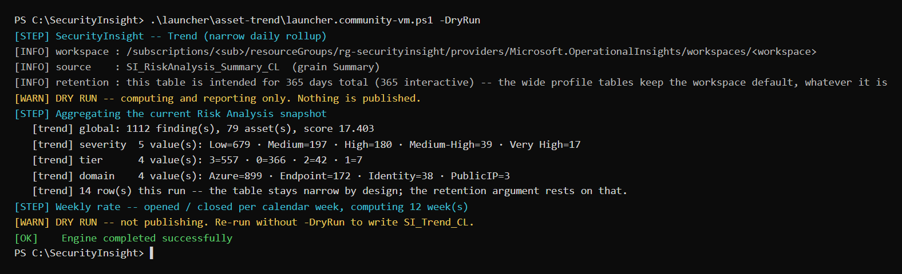

> ⚡ **One-shot alternative — fire every engine in parallel windows:** `.\tools\Run-AllEngines.ps1` opens 6 windows (Endpoint, Azure, Identity, PublicIP, RA Detailed, RA Summary) so you can watch them run side by side. Add `-PrivilegeTierClassifier` only when you want to regenerate the AI-classified tier catalog (Azure OpenAI required).

#### 4.4.1 Schedule the engines on a VM (Windows Task Scheduler)

**Recommended: one pipeline.** `.\setup\Install-SIFlowTask.ps1` creates ONE scheduled task that runs the engines as the
**Daily pipeline** — **Collect** (tier classifier, profilers, Risk Analysis) → **Correlate** → **Deliver** — each stage
when the one before it has finished and succeeded, each engine when the one before it has finished. It starts at
**19:00 in the local time of the install's Azure region** by default (Danish time when the region is not known), after
the nightly update at 18:30 (`SI_Pipeline_StartTime`, `SI_Pipeline_TimeZone`; summer time included), never runs two
things at once, and runs one stage or one engine on request — a request that comes while something runs waits and
runs right after: `.\engine\flow\Invoke-SIJobFlowRun.ps1 -HostKind Vm -Stage collect` (or `-Step risk-analysis`, or
`-Force` for the whole pipeline). The order can be changed in `config\job-flow.custom.json` (see the sample).

**Or one task per engine.** The engines are stateless PowerShell scripts — point Windows Task Scheduler at the launchers and let them run unattended. The cadence below is what production deployments use; adjust for your timezone and tenant size.

**Daily schedule (recommended starting cadence):**

| When | Task | Launcher | Notes |
|------|------|----------|-------|
| **3:00 PM** | Update SecurityInsight | `.\Update-SecurityInsight.ps1` | Takes the release your update ring approves, before the night's runs (on a container install it also moves the jobs). Keep it as its own task — it is never a step of the pipeline, and it waits while an engine runs. |
| **6:00 PM** | Privilege Tier Classifier | `.\launcher\privilege-tier-classifier\launcher.community-vm.ps1` | Refreshes the AI-classified tier catalog *(only if Azure OpenAI is enabled — otherwise skip; the locked catalog covers most cases)*. |
| **9:00 PM** | Asset Profiling — Identity | `.\launcher\identity\launcher.community-vm.ps1` | Runs **in parallel** with the next 3 (separate scheduled tasks, same start time). Each engine writes its own `SI_*_Profile_CL` table — no cross-locking. |
| **9:00 PM** | Asset Profiling — Endpoint | `.\launcher\endpoint\launcher.community-vm.ps1` | |
| **9:00 PM** | Asset Profiling — Azure | `.\launcher\azure\launcher.community-vm.ps1` | |
| **9:00 PM** | Asset Profiling — Public IP | `.\launcher\publicip\launcher.community-vm.ps1` | Only when Shodan was enabled in the wizard. |
| **1:00 AM** | Risk Analysis — Summary | `.\launcher\risk-analysis\launcher.community-vm.ps1 -Summary` | Runs after profiling completes. Aggregated rows + exec summary email. |
| **3:00 AM** | Risk Analysis — Detailed | `.\launcher\risk-analysis\launcher.community-vm.ps1 -Detailed` | Per-asset rows for ops triage. |
| — | Trend | — | No task needed: Risk Analysis (summary) writes the day's trend row at the end of its run. `.\launcher\asset-trend\launcher.community-vm.ps1` still works by hand. |

**Launcher flavours.** Every engine in this repository ships `launcher.community-vm.ps1` — the one to schedule. Managed (Pro) installs use a platform launcher delivered with their managed updates; the engines underneath are the same.
**Creating the scheduled tasks.** Run as `NT AUTHORITY\SYSTEM` (or a dedicated service account that's a member of the local *Administrators* group on the VM) so the run can read the engine certificate's private key in the machine certificate store. Concrete `schtasks` example for the 9:00 PM Identity profiler (`/ST` takes 24-hour `HH:MM`, so 9 PM is `21:00`):

```powershell
schtasks /Create /TN "SecurityInsight\3. Asset Profiling - Identity" `
    /TR "powershell.exe -NoProfile -ExecutionPolicy Bypass -File C:\SecurityInsight\launcher\identity\launcher.community-vm.ps1" `
    /SC DAILY /ST 21:00 /RU "SYSTEM" /RL HIGHEST /F
```

Repeat for each row. Naming convention `SecurityInsight\<n>. <task name> (<h:mm AM/PM>)` is what shows up in the Task Scheduler library and matches the screenshot example above. The schedule runs in the **VM's local time zone** — pick a VM that's in your operations team's timezone so 9:00 PM means after-hours wherever your operators are.

**One flow instead of one task per engine (recommended).** Instead of the per-engine tasks above, the engines can run as ONE flow: one start time, and each engine starts when the one before it has finished -- so a long run never makes the next engine read yesterday's data, and a run never overlaps the previous one. `.\setup\Install-SIFlowTask.ps1` shows what it would do; `-Apply` registers the task `SecurityInsight\SecurityInsight (flow)` and disables (never deletes) the per-engine tasks it replaces; `-Remove` puts them back. The order, the start time and what a failed step does are in `config\job-flow.custom.json` (optional; without it the default order is used). The same flow runs container installs (the `caj-si-flow` job; `.\setup\Switch-SIJobOrchestration.ps1` switches an existing container install, with a preview).

**Logs.** Every launcher writes two files to `logs\` per run: the transcript (`<engine>_<flavour>_<UTC-timestamp>.log`) and a config snapshot (`config-<engine>-<local-timestamp>-<machine>.log`). Same folder regardless of install layout (community-flat at `<install>\logs\`, monorepo at `<install>\SOLUTIONS\SecurityInsight\logs\`). Inspect both when a scheduled run fails — the transcript has the full per-step output, the snapshot shows the resolved config values (which layer set which `$global:*`). v2.2.312+ keeps both side by side; pre-v2.2.312 wrote snapshots to `data\LOGS\` and (on flat-layout community installs) silently dropped transcripts into a stray `<install>\SOLUTIONS\SecurityInsight\logs\` folder.

#### 4.4.2 Schedule the engines on Azure Container Apps Job (KEDA auto-scaling)

For environments without a long-running VM — or for tenants large enough that the asset-profiling collectors benefit from horizontal scale — the engines also run on **Azure Container Apps Job** with **KEDA queue-depth scaling**. The container image is built from `container\Dockerfile` (PS 7.4 + the full module set, ~1.2 GB), and the producer-worker pattern is:

1. **Producer** (`Invoke-ShardProducer.ps1`) reads the in-tenant inventory (Entra users, Defender devices, Azure resources) and the sharding config, then enqueues N shard messages onto an **Azure Storage Queue** (e.g. `si-identity-shards`).
2. **KEDA** watches queue depth. Scale rule: 1 replica per ~50 messages (tunable per-engine in the manifest), max replicas capped per engine — so 5,000 identities → 100 replicas → ~10 min total wall-clock vs 2 hours single-threaded on a VM.
3. **Worker replicas** each pull one shard, classify it (asset-profiling pipeline), and write directly to the SI workspace via DCR ingest. Replicas exit when the queue drains; the Container Apps Job orchestrator scales back to zero.
4. **Risk Analysis** runs as a single non-sharded job invocation (`Start-RiskAnalysisInContainer.ps1`) since RA is a deterministic aggregation, not a parallelizable scan.

**Where to schedule the trigger.** Container Apps Job has its **own cron** (`schedule.cronExpression` on the job resource) — you don't need an external Task Scheduler. Same daily cadence as the VM schedule above:

| Cron (UTC) | Job | What it does |
|------------|-----|--------------|
| `0 22 * * *` (= 6:00 PM EST / 3:00 PM PST) | `caj-si-tier-classifier` | Privilege Tier Classifier (single replica, OpenAI-backed) |
| `0 1 * * *`  (= 9:00 PM EST / 6:00 PM PST) | `caj-si-profile-identity`<br>`caj-si-profile-endpoint`<br>`caj-si-profile-azure`<br>`caj-si-profile-publicip` | Producer enqueues shards → KEDA scales workers → drain → exit. Each engine runs in its own job; KEDA-scaled by its own queue. |
| `0 5 * * *`  (= 1:00 AM EST / 10:00 PM PST prev. day) | `caj-si-ra-summary` | Risk Analysis Summary (single replica) |
| `0 7 * * *`  (= 3:00 AM EST / 12:00 AM PST) | `caj-si-ra-detailed` | Risk Analysis Detailed (single replica) |

> **Cron is always UTC.** Shift the hour fields above for your operations team's timezone. EST = UTC-5 (winter) / EDT = UTC-4 (summer); PST = UTC-8 / PDT = UTC-7. The recommended cadence assumes US Eastern operators — adjust if your team is elsewhere.

**Bootstrap.** `Bootstrap-ContainerAppJob.ps1` is the one-shot installer — it reads `config\SecurityInsight.custom.ps1`, builds + pushes the container image to your ACR, creates the Container Apps Environment + the 6 Jobs, wires KEDA queue scalers, and grants the job's MI the same SI workspace + storage RBAC the VM SPN has. See § 4.11 for the full reference.

**Auth.** The job's system-assigned Managed Identity bootstraps Key Vault access (reads the SI SPN secret), then the job runs as the SPN — same credential model as the VM, just with the chicken-and-egg of "how does the box reach KV before it has the SPN" solved by the host MI.

#### 4.4.3 VM vs Container Apps Job — recommendation

**Default recommendation: start on a VM, move profiling to KEDA only if scale demands it.**

A single Windows Server / Win11 VM running the schedule in § 4.4.1 handles **up to ~10–15K total assets** (identities + endpoints + Azure resources) on a daily cadence with headroom. That's most enterprises. The VM path is simpler to debug (transcripts on the local disk, RDP to the VM, immediate update + re-run loop) and cheaper (no ACR, no KEDA, no Container Apps Environment overhead).

**Move to KEDA when any of these hits:**

- **Single-engine wall-clock > 2 hours** at the 9:00 PM start — typically Identity at 50K+ users or Endpoint at 30K+ devices. KEDA's per-shard parallelism cuts this to ~10–20 minutes.
- **You have no long-running VM** in the environment (cloud-native estate, no on-prem footprint). Container Apps Job runs on Anthos / Microsoft.App / serverless metering — nothing to patch, nothing to keep alive between runs.
- **You want the engines to scale to zero between runs** — VMs cost money 24/7 even when idle. Container Apps Jobs cost only the per-second compute they consume during the actual scan.

**Hybrid model (rare but valid):** profiling on KEDA (parallel, scale-out, idempotent shards), Risk Analysis + Privilege Tier Classifier on a small VM (single-thread aggregations, faster startup than container cold-start, easier mail-relay configuration). Choose per engine: schedule an engine on the VM, or create its container job — the bootstrap's `-Engines` list decides which engines get a job.

**Do not run everything on containers just because you can.** RA and Tier Classifier are aggregation phases, not parallelizable scans — KEDA gives them no benefit and the container cold-start adds 30–60s of overhead per run. Keep them on the VM (or as single-replica Container Apps Jobs without KEDA) if you go hybrid.

#### 4.4.4 Fine-tuning via sample files *(optional)*

The Setup Wizard writes a complete `config\SecurityInsight.custom.ps1` and the launcher defaults work for most tenants. **Don't edit these files unless you have a specific reason** — re-running the wizard is the supported path for changing wizard-managed values. That said, three fine-tuning surfaces exist for cases the wizard doesn't cover:

| File (sample copy → live copy) | When to edit | What's inside |
|--------------------------------|--------------|---------------|
| `config\SecurityInsight.custom.sample.ps1` → `config\SecurityInsight.custom.ps1` | The wizard already wrote this. Hand-edit only for engine-tuning knobs the wizard doesn't expose (e.g. `$global:SI_AssetLimit_<Engine>`, `$global:SI_ActiveStaleDays`, custom DCR names that conflict with existing tables). | Every `$global:SI_*` global the engines read. The full reference of overrides is at the top of the sample file. |
| `launcher\<engine>\LauncherConfig.custom.sample.ps1` → `launcher\<engine>\LauncherConfig.custom.ps1` | Per-engine overrides — e.g. different mail recipients for the Identity engine vs RA, different `$global:AutomationFramework` selector, different sink combinations. | Only the values that differ from `LauncherConfig.defaults.ps1`. |
| `risk-analysis-detection\RiskAnalysis_Queries_Custom.yaml` (alongside the locked one) | Add your own RA reports or mute reports irrelevant to your tenant. The locked YAML ships 100+ reports; your custom YAML merges on top of it. | KQL queries + their threshold / severity / sink config. See § 6 for the YAML concept and § 6.4 for a worked example. |

`config\` and the per-engine `LauncherConfig.custom.ps1` files are **gitignored** — your secrets and tenant-specific overrides are never committed and never touched by an update.

#### 4.4.5 Verify outputs

| Check | Where | What to look for |
|---|---|---|
| **Excel** | `output\` | Open `RiskAnalysis_Detailed.xlsx`. The **Details** sheet is sorted by `RiskScoreTotal_Weighted` desc — top rows are your highest-priority findings. |
| **Email** | Your inbox | Subject: `Security Insights \| Risk Analysis \| RiskAnalysis_Detailed`. Body has the AI exec summary; xlsx attached. |
| **Log Analytics** | Azure Portal → Logs | `SI_RiskAnalysis_Detailed_CL \| where CollectionTime == toscalar(SI_RiskAnalysis_Detailed_CL \| summarize max(CollectionTime)) \| count` |
| **Run health** | LA | `SI_RunHealth_CL \| where Phase=='Start' \| join kind=leftanti (SI_RunHealth_CL \| where Phase=='End') on RunId, ShardIndex` — should be empty (any rows = crashed runs) |

#### 4.4.6 When something doesn't work

| Symptom | Likely cause | Fix |
|---|---|---|
| `Get-PlatformSecretKeyVault: secret '...' not found` | Pre-launch helper looks for an old KV secret name | Cosmetic; the run continues. Update LauncherConfig if persistent. |
| RA reports return 0 rows | Asset profiling hasn't been run yet | Run Step 8 launchers first |
| `Failed to resolve table 'SI_*_Profile_CL'` | DCR not provisioned for that table | Re-run `Bootstrap-Storage.ps1` |
| AI summary skipped | `BuildSummaryByAI` not enabled OR no Azure OpenAI configured | Set `$global:BuildSummaryByAI = $true` + run `setup\Validate-SIOpenAI.ps1` |
| Mail not sent | SMTP From address not verified at relay | Set `$global:SMTPFrom` to a verified-sender address (hosted relays reject mail with a non-verified From) |
| Identity engine throws `SI identity catalog not found at: ...\privilege-tier-catalog\privilege-tier-catalog.locked.json` | Catalog file got deleted (it ships in the repo as of v2.2.13). Older clones predate the shipped catalog. | `.\Update-SecurityInsight.ps1` to land the shipped catalog, OR run `tools\Run-AllEngines.ps1 -PrivilegeTierClassifier` once to regenerate it locally (Azure OpenAI key required). |
| PublicIP throws `LA query failed: ... 'BadRequest'` | `SI_Endpoint_Profile_CL` AND `SI_Azure_Profile_CL` don't exist yet in the workspace (PublicIP queries both). v2.2.12+ tolerates one being missing; older needs both. | Run the Endpoint engine and/or Azure engine successfully at least once, OR upgrade to v2.2.12+ which uses `union isfuzzy=true` to skip missing tables. |
| PublicIP throws `ResourceGroupNotFound` for the workspace's RG | SPN's default Az context is on a DIFFERENT subscription than the one that owns `SI_WorkspaceResourceId`. Common when one SPN sees several subscriptions. | Auto-handled in v2.2.10+ (engine `Set-AzContext`s to the workspace's sub before the LA query). On older versions, add `Set-AzContext -SubscriptionId <wsSub>` to the launcher manually. |
| PublicIP throws `Missing $global:SI_Shodan_ApiKey` even though you set `$global:SHODAN_ApiKey` | Variable name mismatch — engine reads the SI-prefixed name, the legacy v1 sample used `SHODAN_ApiKey`. v2.2.7+ accepts both, but the canonical name is required by older versions. | Use `$global:SI_Shodan_ApiKey = '<key>'` in `config\SecurityInsight.custom.ps1`, OR upgrade to v2.2.7+ which auto-bridges the legacy name. |
| `config\SecurityInsight.custom.ps1` keeps disappearing | Untracked file destroyed by `git clean -fd` (or similar). Public repo gained a `.gitignore` in v2.2.8 that protects this path. | Upgrade to v2.2.8+ (`git pull`) so the file is properly ignored — `git clean` then leaves it alone. Re-add your secrets one more time after the upgrade. |

That's the full first-run loop. Once it works once, schedule the launchers (Windows Task Scheduler, or Container Apps Job cron) for daily / hourly / on-demand cadence.

<a id="32-install-fresh-machine"></a><a id="install-fresh-machine"></a>
### 🧪 4.5 Try out a preview release

[⤴ Back to top](#top)

<details>
<summary><b>Show details (expand)</b></summary>

The `preview` channel tracks the HEAD of the `preview` branch — bleeding-edge features that haven't shipped in a tagged release. Use a **separate folder** from stable.

```powershell
git clone --branch preview https://github.com/KnudsenMorten/SecurityInsight.git C:\SCRIPTS\SecurityInsight-preview
# then install as usual from that folder: setup\Install-SecurityInsight.ps1 (the guided install)
```

> [!NOTE]
> Preview = uncut, unrewindable. Bugs may exist that don't exist in `stable`. File issues at [KnudsenMorten/SecurityInsight](https://github.com/KnudsenMorten/SecurityInsight/issues). When a preview feature stabilizes it's cut to a new `stable` release.
>
> To get **released** versions earlier without running preview code, use update ring 2 instead: `{ "ring": 2 }` in `config\update.custom.json` of your normal install (see [Update to latest version](#update-to-latest-version)).

</details>

<a id="35-pre-requisite-configuration"></a><a id="pre-requisite-configuration"></a>
### 🔧 4.6 Pre-requisite configuration

[⤴ Back to top](#top)

Before you can run any launcher, the solution needs to know **your** values — tenant / subscription IDs, SPN credentials, workspace names, mail recipients, OpenAI endpoint. You provide these through PowerShell config files next to each launcher.

<a id="config-file-model"></a>

#### 🧱 4.6.1 Config-file model — `.defaults.ps1` vs `.custom.ps1`

| Filename pattern | Who owns it | Gets overwritten on update? | When to edit |
|---|---|---|---|
| `*.defaults.ps1` | **Us** — shipped with the solution | **Yes** — replaced on every Step 1 update | **Never.** Treat as read-only. |
| `*.custom.ps1` | **You** — created from a `.sample.ps1` | **Never** — gitignored, preserved by Step 1 | **Yes.** This is the only file you ever edit. |

You'll see both names repeated at three scopes (tenant / solution / engine). That's the **5-layer config stack** — the launcher loads them in order, and each layer overrides the previous (closest wins):

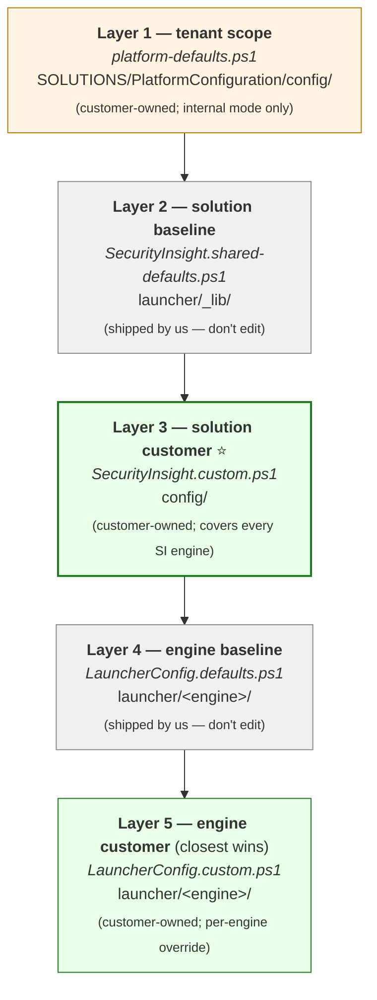

**Legend.** Grey = shipped by us (`.defaults.`, never edit). Green = customer files (`.custom.`, edit here). Orange = internal-mode tenant layer (absent in community-vm installs).

⭐ **Layer 3 (`config\SecurityInsight.custom.ps1`) is where 90% of customers put everything.** It's solution-wide — every SI engine picks it up automatically. You only drop down to Layer 5 if one specific engine needs a different value (e.g. a different mail recipient for Critical-only reports).

> **Example — community-vm customer configures once, runs 10 engines.**
> 1. Copy `config\SecurityInsight.custom.sample.ps1` → `SecurityInsight.custom.ps1` in the same folder.
> 2. Uncomment the SPN block, fill in `$global:SpnTenantId` / `SpnClientId` / `SpnClientSecret`.
> 3. Set `$global:MailTo = @('soc@contoso.com')`.
> 4. Done. RiskAnalysis, CriticalAssetTagging, IdentityAssets, Step 2 / 3 / 4 — all 10 engines inherit these values on their next run.

<a id="354-defender-xdr-licensing--onboarding-requirements"></a><a id="defender-xdr-licensing"></a>
#### 🛡️ 4.6.2 Defender XDR licensing & onboarding requirements

[⤴ Back to top](#top)

The RiskAnalysis engine submits KQL queries through Microsoft Graph advanced hunting (`/security/runHuntingQuery`). That endpoint is a **federated view** over every Defender service the tenant has licensed + onboarded — and each Defender service exposes its own table family. **A query that references a table from a service the tenant doesn't have will fail with `Failed to resolve table or column expression named 'X'`** — there's no way around it; the data simply doesn't exist in that tenant.

**v2.1.198+** the engine recognises these errors as deterministic, **stops retrying immediately** (saves ~12s per failed report), and logs one clear classification line telling you which Defender service / SKU is missing. The outer report loop continues, so other reports still run.

**Table-family → service map** the engine uses to classify schema errors:

| Table prefix | Owner service | Required SKU |
|---|---|---|
| `Device*` (DeviceInfo, DeviceProcessEvents, DeviceLogonEvents, …) | **Microsoft Defender for Endpoint** EDR | **MDE Plan 2** / M365 E5 Security / M365 E5 |
| `DeviceTvm*` (TvmInfoGathering, TvmSecureConfigurationAssessment, TvmSoftwareInventory, TvmSoftwareVulnerabilities) | **Defender Vulnerability Management** | MDVM standalone add-on, **OR** MDE Plan 2 (bundled) |
| `Identity*` (IdentityInfo, IdentityLogonEvents, IdentityDirectoryEvents, IdentityQueryEvents) | **Defender for Identity** | MDI / EMS E5 / M365 E5 + sensor on DCs/AD FS/Entra Connect |
| `AADSignInEvents`, `EntraIdSignInEvents`, `EntraIdSpnSignInEvents`, `GraphAPIAuditEvents`, `IdentityAccountInfo` | **Microsoft Entra** | Entra ID P1/P2 with diagnostic-settings forwarding |
| `ExposureGraphNodes`, `ExposureGraphEdges` | **Defender Exposure Management (MDEM)** | M365 E5 Security / M365 E5 / standalone Exposure Management |
| `EmailEvents`, `EmailUrlInfo`, `EmailAttachmentInfo`, `Message*`, `UrlClickEvents` | **Defender for Office 365 P2** | MDO P2 / M365 E5 / E5 Security / MDO P2 standalone |
| `CloudAppEvents`, `AppFileEvents` | **Defender for Cloud Apps** | MDA / M365 E5 / EMS E5 / MDA standalone |
| `Cloud(Audit\|Dns\|Process\|Storage)*` | **Defender for Cloud** | Workload protection plans for Servers / Storage / DNS |
| `AlertEvidence`, `AlertInfo`, `BehaviorEntities`, `BehaviorInfo` | **Defender XDR** (alert/behavior aggregation) | At least one Defender plan generating alerts |
| `*_CL` (e.g. `SI_IdentityAssets_CL`) | **Your Log Analytics workspace** | The matching SI ingestion engine has run + written rows; **the engine auto-bridges this case** (see § 3.10 / § 6.x) |

**The MDE Plan 1 vs Plan 2 trap** ⚠️ — the most subtle case, surfaced by a real customer onboarding in v2.1.198:

> The Defender portal **Devices Inventory** page (and Risk Level / Exposure Level columns) renders for both **MDE Plan 1**, **Defender for Business**, and **MDE Plan 2** customers — so seeing your devices listed there does NOT prove you have advanced-hunting access to the EDR `Device*` tables. Those tables are **MDE Plan 2 only**. If you've recently upgraded from MDE P1 / Defender for Business to MDE P2, the tables typically appear within **minutes to ~24 hours** while the tenant's advanced-hunting backend re-provisions.

**What you'll see in logs when a service is missing:**

```
[WARN] Table 'DeviceInfo' not present in this tenant's advanced hunting schema.
       Owned by Microsoft Defender for Endpoint (MDE Plan 2 / M365 E5 Security / M365 E5).
       Devices may already be onboarded for inventory + risk + exposure (Defender for Business /
       MDE Plan 1 also support those), but the EDR advanced-hunting schema (Device*, DeviceInfo,
       DeviceProcessEvents, DeviceLogonEvents, etc.) requires Plan 2. Newly upgraded tenants
       typically see the tables appear within minutes to ~24h while the backend re-provisions.
[WARN] Not retrying (deterministic schema failure -- retries cannot conjure a missing table).
```

**Recommendation:** before onboarding RiskAnalysis to a new tenant, use **Defender XDR portal → Hunting → Advanced hunting → Schema** to confirm the table groups you expect to query are present. If a group is missing, either provision the corresponding licence + onboard the service, OR exclude reports that depend on it via your `*_Custom.yaml` overrides (see § 5).

---

<a id="355-no-sentinel-routing-and-entra-diagnostics"></a><a id="no-sentinel-setup"></a>
#### 🛰️ 4.6.3 No Sentinel? Routing model + Entra diagnostic-settings setup

[⤴ Back to top](#top)

You don't need Microsoft Sentinel to run SecurityInsight. The engine adapts based on what you have. This section explains the **routing model** at a high level and walks you through the one piece of setup you DO need when Sentinel isn't in play: **forwarding Entra sign-in + audit logs to your Log Analytics workspace**.

##### Three routing modes (high-level)

When the RiskAnalysis engine submits a KQL query, it picks one of three paths automatically per query:

| Mode | When it fires | Where the query runs | Failure modes you might see |
|---|---|---|---|
| 🟢 **Pure-LA** | Query references ONLY `*_CL` tables (e.g. `SI_IdentityAssets_CL`) and any LA-side tables (`SigninLogs`, `AuditLogs`, `IdentityInfo` if mirrored, etc.) | Direct call to Log Analytics REST (`api.loganalytics.io`) via your existing SPN session. **No advanced-hunting round trip, no body cap, no nginx 413.** Result-set cap is LA's native ~64 MB / 500k rows. | Missing custom table → empty result. Missing LA-side Entra table → see "Entra diagnostic-settings" below. |
| 🟠 **Mixed** | Query joins `SI_IdentityAssets_CL` with a Defender XDR table (`DeviceInfo`, `IdentityInfo`, `ExposureGraph*`, `EmailEvents`, etc. — XDR-only data not in LA) | Engine fetches `SI_IdentityAssets_CL` from LA once, builds an inline `let SI_IdentityAssets_CL = datatable(...) [...]` block, prepends to the KQL, sends through Microsoft Graph advanced hunting (`/security/runHuntingQuery`). | nginx **413 Request Entity Too Large** on big tenants — the let-block payload exceeds advanced hunting's body cap (~1 MB). Recommendation: enable Sentinel data lake + table mirroring for `SI_IdentityAssets_CL` so the let-block becomes unnecessary, OR forward the relevant XDR data into LA so the query can run pure-LA. |
| 🔵 **Pure-XDR** | Query references ONLY Defender XDR tables, no `*_CL` | Direct submit to advanced hunting unchanged | Missing service / SKU → see § 3.5.4. |

**Engine picks the mode automatically** by inspecting each query's KQL body (with string literals stripped to avoid false positives like `"Identity"` as a column value). You don't configure routing — you just need to make sure the data the queries need is reachable. The console log shows which path was taken per report:

```
[INFO] Query touches only Log Analytics tables (no Defender XDR tables);
       routing entire query directly to LA workspace -- no let-block, no
       advanced-hunting round trip, no body-size limit.
```

vs.

```
[INFO] running advanced hunting query against Defender Exposure Management Graph ... Please wait !
[INFO] SI_IdentityAssets_CL not present in advanced hunting -- engine will inline-bridge from Log Analytics.
```

##### Caveats by setup style

| Your tenant | What works out of the box | What you need to configure |
|---|---|---|
| **Sentinel + data lake mirroring of `SI_IdentityAssets_CL`** | Everything — pure-LA, mixed, and pure-XDR all run cleanly. No size limits. Best experience. | Just enable mirroring on the custom table. |
| **Sentinel without data lake mirroring** | Pure-LA + pure-XDR fine. Mixed queries use the let-block bridge — works on small/medium estates but can hit nginx 413 on tenants with many privileged users + heavy `CSA` / `TierSources` JSON columns. | Optional: enable data lake mirroring to remove the size cap. |
| **No Sentinel, Entra logs forwarded to LA** | Pure-LA reports work. Mixed reports work via the let-block (subject to body cap). Sign-in / audit reports run pure-LA against `SigninLogs` / `AuditLogs`. | **Set up Entra diagnostic settings → Log Analytics** (steps below). This is THE prerequisite. |
| **No Sentinel, no Entra log forwarding** | Pure-LA reports against `SI_IdentityAssets_CL` only. Mixed-XDR reports work but go through advanced hunting (let-block bridge). Sign-in / audit reports against LA-side tables fail (table not present). | Forward Entra logs to LA — same steps below. |

##### How to forward Entra ID sign-in + audit logs to Log Analytics

This is a one-time tenant configuration. Once enabled, the LA-side tables `SigninLogs`, `AADNonInteractiveUserSignInLogs`, `AuditLogs` (and a few others) start receiving data within minutes. SecurityInsight's sign-in / audit reports then route pure-LA against them and bypass advanced hunting entirely.

**Two ways to do it:**

**Option A — via Microsoft Sentinel (recommended for retention + analytic-rule coverage):**
1. Open the Sentinel workspace you want the logs in
2. **Content hub → "Microsoft Entra ID" data connector → Open connector page**
3. Tick the log streams you want forwarded (at minimum: SigninLogs, AuditLogs, AADNonInteractiveUserSignInLogs)
4. **Apply Changes** — Sentinel writes the diagnostic setting to Entra automatically

**Option B — directly via Entra (no Sentinel SKU needed):**
1. **Entra admin center → Monitoring & health → Diagnostic settings → + Add diagnostic setting**
2. Name it (e.g. `entra-to-log-analytics`)
3. Tick the categories you need:
   - `SignInLogs` (interactive user sign-ins)
   - `NonInteractiveUserSignInLogs` (background / token-refresh sign-ins)
   - `ServicePrincipalSignInLogs` (SPN sign-ins)
   - `ManagedIdentitySignInLogs` (MI sign-ins)
   - `AuditLogs` (admin actions, group membership changes, role assignments)
   - Optional: `ProvisioningLogs`, `RiskyUsers`, `UserRiskEvents` if you want PIM / Identity Protection data
4. **Send to Log Analytics workspace** → pick your workspace
5. **Save**

**Required licence**: Entra ID **P1** (or higher) for `SignInLogs` / `AuditLogs`. P2 for the risk-event categories. Without P1, the diagnostic-settings page won't even let you enable the sign-in categories.

**Validation** (a few minutes after enabling):
```kql
SigninLogs | where TimeGenerated > ago(15m) | count
AuditLogs  | where TimeGenerated > ago(15m) | count
```
Both should return non-zero.

##### MDE Plan 1 vs Plan 2 vs Defender for Business — quick-reference

A common confusion that comes up alongside this:

| You have | `Device*` tables in advanced hunting? | What works in SecurityInsight |
|---|---|---|
| **MDE Plan 2** / M365 E5 Security / M365 E5 | ✅ Yes (full EDR schema) | All Endpoint reports work (Device_Recommendations, vulnerability reports, attack-paths, etc.) |
| **MDE Plan 1** | ❌ No | Endpoint reports that join `Device*` fail. The Defender portal's Device Inventory page still works (renders for both P1 + P2) — easy to think P1 is "enough" but advanced hunting is P2-only. |
| **Defender for Business** (DfB) | ❌ No | Same as P1 — limited / no advanced hunting access on `Device*`. |
| **MDVM** standalone add-on | Only `DeviceTvm*` (TVM tables) | Vulnerability + secure-config reports work; raw EDR reports don't. |
| **Just upgraded** P1 / DfB → P2 | ✅ Yes — within minutes to ~24h | Wait for the tenant's advanced-hunting backend to re-provision. Re-run the engine once the propagation completes. |

If you only have P1 / DfB and don't plan to upgrade, you can still get value from SecurityInsight on the **Identity** + **Azure** + **Exposure Graph** report families — just exclude the Endpoint-EDR ones via `*_Custom.yaml` overrides (see § 5).

---

<a id="353-azure-openai-optional"></a><a id="azure-openai-optional"></a>
### 🤖 4.7 Azure OpenAI (optional)

[⤴ Back to top](#top)

The AI executive summary is a separate opt-in. Helper script provisions a PAYG Azure OpenAI account + model deployment:

```powershell
.\launcher\Validate-SIOpenAI_OnboardValidate-SecurityInsight-OpenAI-PAYG-Instance-Azure\launcher.community-vm.template.ps1
```

Then enable in any engine's `LauncherConfig.custom.ps1`:

```powershell
$global:BuildSummaryByAI  = $true
$global:OpenAI_endpoint   = 'https://<your-aoai-account>.openai.azure.com'
$global:OpenAI_deployment = 'gpt-4o-mini'
$global:OpenAI_apiKey     = '<your-azure-openai-key>'
```

> [!TIP]
> AI summary is appended both to the **Excel report** (as a 'Summary' worksheet) and the **email body**. Token budget is configurable via `$global:OpenAI_MaxTokensPerRequest` (default 16384).

<a id="37-understand-the-launcherconfig-files"></a><a id="understand-the-launcherconfig-files"></a>
### 📂 4.8 LauncherConfig files

[⤴ Back to top](#top)

Every engine launcher uses a **layered config** model. You only ever edit `LauncherConfig.custom.ps1`; everything else is shipped by us and replaced safely on every release.

```
launcher/<engine>/
├── launcher.*.template.ps1            ← engine wrapper (ours, replaced on update)
├── LauncherConfig.defaults.ps1        ← every supported $global:* with our default (ours, replaced on update)
├── LauncherConfig.sample.ps1          ← copy-paste starter (ours, replaced on update)
├── LauncherConfig.custom.ps1          ← YOUR overrides — gitignored, NEVER overwritten
└── launcher.manifest.json             ← publish metadata (ours)
```

Visual load order (each layer's `$global:*` overrides the previous — a diagram of how the layers merge lives in [§ 7.7](#layered-config-flow)):

| # | File | Owner | Purpose |
|---|---|---|---|
| 0 | `launcher/_lib/SecurityInsight.shared-defaults.ps1` | us | **Solution-wide canonical names** — `$global:WorkspaceName`, `$global:DceName`, `$global:DceResourceGroup`, `$global:DcrResourceGroup`, `$global:Location`, `$global:SubscriptionId` (v2.1.55). Shared by every SI engine so you don't have to repeat them. |
| 1 | `LauncherConfig.defaults.ps1` | us | Engine baseline — table names, DCR name, mode flags |
| 2 | `SOLUTIONS/PlatformConfiguration/config/platform-defaults.ps1` | you (internal mode only) | Shared across every solution on the platform (SMTP, tenant, KV) |
| 3 | `SOLUTIONS/SecurityInsight/config/SecurityInsight.custom.ps1` | you | Solution-wide overrides (DCR / workspace / exclude patterns) |
| 4 | `launcher/<engine>/LauncherConfig.custom.ps1` | you | Per-engine overrides (auth, per-engine mail) |
| 5 | CLI args | per-invocation | Last word |

> [!TIP]
> **Auto-provision, auto-resolve (v2.1.54+)**: missing Workspace / DCE / DCE RG / DCR RG are auto-created on first run, and `DceIngestionUri` is resolved from `DceName` at runtime — you don't have to hardcode endpoint URIs any more. See [§ 5](#whats-new-v21x-highlights) for the full v2.1.53–v2.1.64 feature matrix.

**Quickstart**:

```powershell
# 1. Copy the sample to your custom file (gitignored, never overwritten):
Copy-Item launcher\SecurityInsight_RiskAnalysis\LauncherConfig.sample.ps1 `
          launcher\SecurityInsight_RiskAnalysis\LauncherConfig.custom.ps1

# 2. Edit LauncherConfig.custom.ps1 — uncomment the values you want to set.
#    Bare minimum is the auth method (e.g. SPN + cert thumbprint).

# 3. Run:
.\launcher\SecurityInsight_RiskAnalysis\launcher.community-vm.template.ps1 -Summary
```

<details>
<summary>📧 <b>Example: enable email + AI summary</b></summary>

In `LauncherConfig.custom.ps1`:

```powershell
# Auth (pick ONE method; SPN+cert shown)
$global:SpnTenantId              = '<your-tenant-id-guid>'
$global:SpnClientId              = '<your-app-client-id-guid>'
$global:SpnCertificateThumbprint = '<cert thumbprint, hex, no spaces>'

# Mail (community mode short names)
# NOTE: $SMTPFrom must be a VERIFIED sender in your relay (hosted relays
# all reject mail where From != verified sender). $SMTPUser is just the relay login.
$global:SendMail        = $true
$global:MailTo          = @('soc@yourdomain.com','exec-summary@yourdomain.com')
$global:SmtpServer      = 'smtp.yourdomain.com'
$global:SMTPPort        = 587
$global:SMTP_UseSSL     = $true
$global:SMTPUser        = '<smtp-login-username>'        # relay login
$global:SMTPPassword    = '<smtp-password>'
$global:SMTPFrom        = 'noreply@yourdomain.com'       # verified sender -- appears in From header

# AI executive summary
$global:BuildSummaryByAI  = $true
$global:OpenAI_endpoint   = 'https://aoai-securityinsight.openai.azure.com'
$global:OpenAI_deployment = 'gpt-4o-mini'
$global:OpenAI_apiKey     = '<your-azure-openai-key>'
```

That's it. Re-run the launcher.
</details>

<details>
<summary>📊 <b>Example: ingest results into Log Analytics</b></summary>

In `LauncherConfig.custom.ps1`:

```powershell
$global:SendToLogAnalytics               = $true
$global:SI_RiskAnalysis_DcrResourceGroup = 'rg-securityinsight'
# DCE / Workspace / DceName fall back to the IAC values automatically when present
```

The two DCRs (`dcr-si-risk-analysis-summary` + `dcr-si-risk-analysis-detailed`) and the two custom tables (`SI_RiskAnalysis_Summary_CL` + `SI_RiskAnalysis_Detailed_CL`) are created by SecurityInsight itself (Azure Resource Manager over REST) on first ingest.
</details>

<details>
<summary>☁️ <b>Example: upload .xlsx + .json to UNC share or Azure Storage</b></summary>

```powershell
# UNC (caller's Windows identity needs share write):
$global:ExportDestination = '\\fileserver\reports\SecurityInsight\'

# OR Azure Storage (SPN needs 'Storage Blob Data Contributor' on the container):
$global:ExportDestination = 'https://mystg.blob.core.windows.net/securityinsight/'
```

Type is auto-detected from the prefix. Existing files are renamed to `<name>.<yyyy-MM-dd_HHmmss>.<ext>.bak` before the new file is written, so the canonical path always holds the latest run with backups next to it. For Azure Storage the container is auto-created if missing and the SPN is granted `Storage Blob Data Contributor` at container scope (best-effort — requires caller Owner / UAA on the storage account for the grant).
</details>

<details>
<summary>🧪 <b>Example: launcher-level Summary/Detailed flip (v2.1.57+)</b></summary>

Leave `$global:ReportTemplate` unset and let the override switches pick the template + mode. Lets testers toggle modes with a single line.

```powershell
# Flip to Detailed for this run (no other changes):
$global:RiskAnalysis_Detailed_Override = $true

# Default template names used when ReportTemplate is not explicit:
$global:RiskAnalysis_ReportTemplate_Default_Summary  = 'RiskAnalysis_Summary_Bucket'
$global:RiskAnalysis_ReportTemplate_Default_Detailed = 'RiskAnalysis_Detailed_Bucket'

# Per-template mail (wins over the flat MailTo below):
$global:RiskAnalysis_Detailed_SendMail = $true
$global:RiskAnalysis_Detailed_To       = @('soc@yourdomain.com')
$global:RiskAnalysis_Summary_SendMail  = $true
$global:RiskAnalysis_Summary_To        = @('exec-summary@yourdomain.com')
```
</details>

<details>
<summary>📄 <b>Full RiskAnalysis LauncherConfig.custom.ps1 (community mode, copy-paste)</b></summary>

Minimal ceremony; all placeholders in `<...>`. Everything past section 1 is optional — defaults come from Layer 0 (`launcher/_lib/SecurityInsight.shared-defaults.ps1`).

```powershell
# --- Auth: SPN + plaintext secret (TESTING ONLY) ---
$global:SpnTenantId     = '<your-tenant-id-guid>'
$global:SpnClientId     = '<your-app-client-id-guid>'
$global:SpnClientSecret = '<your-client-secret>'

# --- Infrastructure (overrides Layer 0 shared defaults) ---
$global:DcrResourceGroup = 'rg-dcr-securityinsight-community'
$global:DceResourceGroup = 'rg-dce-securityinsight-community'
$global:DceName          = 'dce-securityinsight-community'
$global:WorkspaceName    = 'log-platform-management-si-community'
$global:SubscriptionId   = '<your-target-subscription-id-guid>'

# --- Ingest + reporting mode ---
$global:SendToLogAnalytics = $true
$global:ReportTemplate     = 'RiskAnalysis_Summary_Bucket'

# --- Mail: flat (fallback) + per-template (preferred) ---
# $SMTPFrom MUST be a verified-sender address in your relay. Common relays
# (hosted relays) reject mail whose From header is not verified.
$global:SendMail        = $true
$global:MailTo          = @('fallback@yourdomain.com')
$global:SmtpServer      = '<smtp-host>'
$global:SmtpPort        = 587
$global:SMTP_UseSSL     = $true
$global:SMTPUser        = '<smtp-login-username>'       
$global:SMTPPassword    = '<smtp-login-password>'
$global:SMTPFrom        = 'noreply@yourdomain.com'      # verified sender in your relay

$global:RiskAnalysis_Detailed_SendMail = $true
$global:RiskAnalysis_Detailed_To       = @('soc@yourdomain.com')
$global:RiskAnalysis_Summary_SendMail  = $true
$global:RiskAnalysis_Summary_To        = @('exec-summary@yourdomain.com')

# --- Output: JSON sibling + upload to blob (container auto-created) ---
$global:WriteJsonOutput    = $true
$global:ExportDestination  = 'https://<your-storacct>.blob.core.windows.net/riskanalysis-summary/'

# --- Launcher mode overrides (flip Summary/Detailed without editing ReportTemplate) ---
$global:RiskAnalysis_Summary_Override                = $null
$global:RiskAnalysis_Detailed_Override               = $true
$global:RiskAnalysis_ReportTemplate_Default_Summary  = 'RiskAnalysis_Summary_Bucket'
$global:RiskAnalysis_ReportTemplate_Default_Detailed = 'RiskAnalysis_Detailed_Bucket'

# --- Behaviour tuning ---
$global:CsaAttributeSet                  = 'SecurityInsight'
$global:SubscriptionNameExcludePatterns  = @('*Azure for Students*')

# --- AI executive summary (Azure OpenAI) ---
$global:OpenAI_apiKey              = '<your-azure-openai-key>'
$global:OpenAI_endpoint            = 'https://<your-aoai-account>.openai.azure.com'
$global:OpenAI_deployment          = '<your-deployment-name>'
$global:OpenAI_apiVersion          = '2025-01-01-preview'
$global:OpenAI_MaxTokensPerRequest = 16384
```
</details>

<details>
<summary>📄 <b>Real-world RiskAnalysis LauncherConfig.custom.ps1 (annotated, sensitive values redacted)</b></summary>

A working config as actually deployed on a community box — full ingest to Log Analytics, JSON + XLSX uploaded to Azure Blob, per-template mail routing via an SMTP relay with a verified sender, and AI executive summary via Azure OpenAI. All credentials / GUIDs / keys replaced with `xxxxx` placeholders; substitute your own.

```powershell
# --- Auth: SPN + plaintext secret ---
$global:SpnTenantId     = 'xxxxxxxx-xxxx-xxxx-xxxx-xxxxxxxxxxxx'
$global:SpnClientId     = 'xxxxxxxx-xxxx-xxxx-xxxx-xxxxxxxxxxxx'
$global:SpnClientSecret = 'xxxxxxxxxxxxxxxxxxxxxxxxxxxxxxxxxxxxxxxxx'

# --- Infrastructure (auto-provisioned on first run if missing) ---
$global:DcrResourceGroup = 'rg-dcr-securityinsight-community'
$global:DceResourceGroup = 'rg-dce-securityinsight-community'
$global:DceName          = 'dce-securityinsight-community'
$global:WorkspaceName    = 'log-platform-management-si-community'
$global:SubscriptionId   = 'xxxxxxxx-xxxx-xxxx-xxxx-xxxxxxxxxxxx'

# --- Ingest ---
# $global:ReportTemplate is deliberately unset -- the Override flags below
# drive which template(s) run. This is the cleanest pattern for scheduled runs.
$global:SendToLogAnalytics = $true

# --- Mail: SMTP relay, verified sender, per-template recipients ---
$global:SendMail        = $true
$global:MailTo          = @('fallback@yourdomain.com')
$global:SmtpServer      = '<smtp-host>'
$global:SmtpPort        = 587
$global:SMTP_UseSSL     = $true
$global:SMTPUser        = '<smtp-login-username>'           # relay login
$global:SMTPPassword    = 'xxxxxxxxxxxxxxxx'
$global:SMTPFrom        = 'svc-automation@yourdomain.com'  # verified sender at your relay

# --- Output: JSON sibling + upload to Azure Blob (container auto-created) ---
$global:WriteJsonOutput    = $true
$global:ExportDestination  = 'https://<your-storacct>.blob.core.windows.net/riskanalysis-summary/'

# --- Launcher mode overrides (drive mode without setting $ReportTemplate) ---
# Override flags only BUMP a mode flag to $true; they never force it to $false.
# Pattern below: Summary ON, Detailed OFF -- only the Summary template runs
# on scheduled invocations. Flip Detailed to $true to run both.
$global:RiskAnalysis_Summary_Override                = $true
$global:RiskAnalysis_Detailed_Override               = $false
$global:RiskAnalysis_ReportTemplate_Default_Summary  = 'RiskAnalysis_Summary_Bucket'
$global:RiskAnalysis_ReportTemplate_Default_Detailed = 'RiskAnalysis_Detailed_Bucket'

# --- Per-template mail recipients (win over the flat $MailTo above) ---
$global:RiskAnalysis_Detailed_SendMail = $true
$global:RiskAnalysis_Detailed_To       = @('IT-Alerts-Identity@yourdomain.com')
$global:RiskAnalysis_Summary_SendMail  = $true
$global:RiskAnalysis_Summary_To        = @('IT-Alerts-Identity@yourdomain.com')

# --- Behaviour tuning ---
$global:CsaAttributeSet                  = 'SecurityInsight'
$global:SubscriptionNameExcludePatterns  = @(
    '*Azure for Students*'
)

# --- AI executive summary (Azure OpenAI) ---
$global:OpenAI_apiKey              = 'xxxxxxxxxxxxxxxxxxxxxxxxxxxxxxxxxxxxxxxxxxxxxxxxxxxxxxxxxxxxxxxxxxxxxxxxxxxxxxxxxx'
$global:OpenAI_endpoint            = 'https://<your-aoai-account>.openai.azure.com'
$global:OpenAI_deployment          = '<your-deployment-name>'
$global:OpenAI_apiVersion          = '2025-01-01-preview'
$global:OpenAI_MaxTokensPerRequest = 16384
```
</details>

<details>
<summary>📄 <b>Full Identity-collection LauncherConfig.custom.ps1 (community mode)</b></summary>

For `launcher/IdentityAssetsCollectDefineTierIngestLog/LauncherConfig.custom.ps1`:

```powershell
# --- Auth: SPN + plaintext secret (TESTING ONLY) ---
$global:SpnTenantId     = '<your-tenant-id-guid>'
$global:SpnClientId     = '<your-app-client-id-guid>'
$global:SpnClientSecret = '<your-client-secret>'

# --- Infrastructure (overrides Layer 0 shared defaults) ---
$global:DcrResourceGroup = 'rg-dcr-securityinsight-community'
$global:DceResourceGroup = 'rg-dce-securityinsight-community'
$global:DceName          = 'dce-securityinsight-community'
$global:WorkspaceName    = 'log-platform-management-si-community'
$global:SubscriptionId   = '<your-target-subscription-id-guid>'

# --- Behaviour tuning ---
$global:BatchSize                        = 200
$global:CsaAttributeSet                  = 'SecurityInsight'
$global:SubscriptionNameExcludePatterns  = @('*Azure for Students*')

# --- Cross-workspace Defender/Sentinel IdentityInfo reads ---
# Set when IdentityInfo lives in a DIFFERENT workspace than the identity-assets
# ingestion workspace. Accepts three names: $global:Defender_WorkspaceNameResourceId
# (canonical), $global:DefenderWorkspaceResourceId, $global:SecurityInsight_Defender_WorkspaceResourceId.
$global:DefenderWorkspaceResourceId = '/subscriptions/<defender-sub-guid>/resourcegroups/<rg>/providers/microsoft.operationalinsights/workspaces/<defender-ws>'

# --- Output: JSON sibling (.jsonl -> .json array) + upload ---
$global:WriteJsonOutput    = $true
$global:ExportDestination  = 'https://<your-storacct>.blob.core.windows.net/identityassets/'
```
</details>

<details>
<summary>📄 <b>Real-world Identity-collection LauncherConfig.custom.ps1 (annotated, sensitive values redacted)</b></summary>

Minimal real-world `launcher/IdentityAssetsCollectDefineTierIngestLog/LauncherConfig.custom.ps1` as actually deployed on a community box. Ingests identities into the local platform workspace (`$WorkspaceName`) but reads `IdentityInfo` rows from a **different** workspace via `$DefenderWorkspaceResourceId` — common split between a customer-managed SecurityInsight workspace and a platform-owned Defender-for-Identity workspace.

```powershell
# --- Auth: SPN + plaintext secret ---
$global:SpnTenantId     = 'xxxxxxxx-xxxx-xxxx-xxxx-xxxxxxxxxxxx'
$global:SpnClientId     = 'xxxxxxxx-xxxx-xxxx-xxxx-xxxxxxxxxxxx'
$global:SpnClientSecret = 'xxxxxxxxxxxxxxxxxxxxxxxxxxxxxxxxxxxxxxxxx'

# --- Infrastructure (auto-provisioned on first run if missing) ---
$global:DcrResourceGroup = 'rg-dcr-securityinsight-community'
$global:DceResourceGroup = 'rg-dce-securityinsight-community'
$global:DceName          = 'dce-securityinsight-community'
$global:WorkspaceName    = 'log-platform-management-si-community'
$global:SubscriptionId   = 'xxxxxxxx-xxxx-xxxx-xxxx-xxxxxxxxxxxx'

# --- Behaviour tuning ---
$global:BatchSize                       = 200
$global:SubscriptionNameExcludePatterns = @( '*Azure for Students*' )

# --- Cross-workspace Defender IdentityInfo reads ---
# When the 'IdentityInfo' table lives in a SEPARATE Log Analytics workspace
# from the ingestion workspace above -- e.g. a platform-owned Defender-for-
# Identity workspace -- point the engine at it with a full resource ID.
# The SPN needs Log Analytics Reader on that workspace too.
$global:DefenderWorkspaceResourceId = '/subscriptions/xxxxxxxx-xxxx-xxxx-xxxx-xxxxxxxxxxxx/resourcegroups/rg-log-platform-management-security-p/providers/microsoft.operationalinsights/workspaces/log-platform-management-security-p'
```
</details>

<details>
<summary>📄 <b>Real-world Build_Tier_Definitions_JSON_File LauncherConfig.custom.ps1 (annotated, sensitive values redacted)</b></summary>

For `launcher/Build_Tier_Definitions_JSON_File/LauncherConfig.custom.ps1` — only auth + Azure OpenAI are required; nothing else needs to be set. The engine tiers the hardcoded `$BuiltInADGroups` list via AI and writes `data/SecurityInsight_IdentityTiering.json`. Run this once per tenant (or whenever you want a fresh AI verdict); the shipped release already contains a curated catalog so most customers don't need to run it at all.

```powershell
# --- Auth: SPN + plaintext secret ---
$global:SpnTenantId     = 'xxxxxxxx-xxxx-xxxx-xxxx-xxxxxxxxxxxx'
$global:SpnClientId     = 'xxxxxxxx-xxxx-xxxx-xxxx-xxxxxxxxxxxx'
$global:SpnClientSecret = 'xxxxxxxxxxxxxxxxxxxxxxxxxxxxxxxxxxxxxxxxx'

# --- Azure OpenAI (required; engine tiers every role/permission/group via AI) ---
$global:OpenAI_apiKey              = 'xxxxxxxxxxxxxxxxxxxxxxxxxxxxxxxxxxxxxxxxxxxxxxxxxxxxxxxxxxxxxxxxxxxxxxxxxxxxxxxxxx'
$global:OpenAI_endpoint            = 'https://<your-aoai-account>.openai.azure.com'
$global:OpenAI_deployment          = '<your-deployment-name>'
$global:OpenAI_apiVersion          = '2025-01-01-preview'
$global:OpenAI_MaxTokensPerRequest = 16384
```

> [!NOTE]
> No `$SubscriptionId` / `$WorkspaceName` / `$DcrResourceGroup` needed — this engine doesn't ingest to Log Analytics or touch Azure resources beyond reading Entra role definitions + Azure built-in roles. Graph reads use the SPN above; Azure role reads use `Get-AzRoleDefinition` which is read-only and works against any subscription the SPN has `Reader`.
</details>

<a id="38-endpoint-asset-tagging"></a><a id="endpoint-asset-tagging"></a>
<a id="39-distribution-model"></a>
### 🚚 4.9 Distribution model — launchers and getting the code

[⤴ Back to top](#top)

**One launcher per engine in this repository:** `launcher/<engine>/launcher.community-vm.ps1`. It reads your layered config (`config\SecurityInsight.custom.ps1`, plus an optional per-engine `LauncherConfig.custom.ps1`), signs in with the method you configured (managed identity, SPN + certificate, SPN + Key Vault secret, or SPN + secret), and runs the engine. Managed (Pro) installs receive their own platform launcher with their updates — the engines underneath are the same code.

**Getting the code:**

```powershell
# Stable (recommended)
git clone https://github.com/KnudsenMorten/SecurityInsight.git C:\SecurityInsight

# Preview channel (latest, before it reaches stable -- see 4.5)
git clone -b preview https://github.com/KnudsenMorten/SecurityInsight.git C:\SecurityInsight
```

Keep it current with `.\Update-SecurityInsight.ps1` (see [Update to latest version](#update-to-latest-version)).
<a id="310-asset-profiling-engine-catalog"></a>
### 📐 4.10 Asset-profiling engine catalog

[⤴ Back to top](#top)

**Four engines, each running independently against the same Profile data model:**

| Engine | Folder | Purpose | Output table(s) |
|---|---|---|---|
| **asset-profiling** | `engine/asset-profiling/` | Identity + Endpoint + Azure → flat-column LA Profile tables. **559** enrichment rules merged from `*.locked.yaml` + `*.custom.yaml` per domain. Tier engine = pure MIN-of-SIRules (no static defaults — every signal becomes a rule entry; engine reduces). | `SI_IdentityAssets_Profile_CL`, `SI_EndpointAssets_Profile_CL`, `SI_AzureAssets_Profile_CL` |
| **privilege-tier-classifier** | `engine/privilege-tier-classifier/` | AI-driven classifier for ambiguous Entra roles / scopes / app permissions. Reads `privilege-tier-catalog/privilege-tier-catalog.locked.json`. | Updates `Tier` on Identity profile rows |
| **publicip** | `engine/publicip/` | Shodan scanner for Tier 0/1 public IPs. Detects open ports + CVEs on internet-exposed assets. | `SI_PublicIP_Profile_CL` |
| **risk-analysis** | `engine/risk-analysis/` | **138 reports** (69 Summary + 69 Detailed, fully paired) across 4 security domains (Endpoint, Identity, Azure, PublicIP). EG-primary RA pattern: queries source from Microsoft Exposure Graph (nodes + edges), join `SI_*_Profile_CL` only for Tier / CMDB enrichment. Two sources the graph does not fully carry are read directly so no finding is lost: Defender for Cloud recommendations (collected by the azure engine) and Defender Vulnerability Management CVEs. 3-layer score model (RiskScoreTotal → RiskScore_Weight_Factor → RiskScoreTotal_Weighted). | `SI_RiskAnalysis_Summary_CL`, `SI_RiskAnalysis_Detailed_CL` |

**Configuration pattern across all engines:** every rule YAML has a `.locked.yaml` (engine-shipped, never edited by customer) and matching `.custom.yaml` (customer-owned, gitignored). The two merge by `id`; Custom wins on conflict and adds new entries. Provider connectors are pluggable under `asset-profiling-providers/<provider>/` — currently `entra/` (built-in) and `generic-cmdb/` (read-only CSV pull).

<a id="311-container-keda"></a>
### 🐳 4.11 Container & KEDA host-mode

[⤴ Back to top](#top)

**The host mode is where you schedule the engines** — there is no setting to flip. Run the launchers from a VM, or run `Bootstrap-ContainerAppJob.ps1` once to create the Container Apps Jobs:

| Mode | Where it runs | When to use |
|---|---|---|
| `vm` (default) | Windows / Linux VM, scheduled task, ad-hoc PowerShell | Manual runs, on-prem-only scenarios, demo / dev |
| `container` | Azure Container Apps Job (KEDA-scaled) | Production scheduled cadence at scale, multi-tenant fan-out, OOM-resilient replicas |

**Container path components:**

| File | Purpose |
|---|---|
| `Bootstrap-ContainerAppJob.ps1` | One-shot bootstrap: provisions ACR + Container Apps Environment + Job + KEDA queue-depth scale rule |
| `container/Dockerfile` | Base image with PowerShell 7 -- no PowerShell modules installed (SecurityInsight v3 calls Azure over REST) |
| `container/Start-RiskAnalysisInContainer.ps1` | RA entrypoint: pulls customer config from Storage, runs the engine, ships outputs back to blob |
| `container/Start-SIInContainer.ps1` | Generic entrypoint for the 3 asset-profiling engines (identity / endpoint / azure) |
| `container/Invoke-ShardProducer.ps1` | Discover-stage shard producer — emits N shards onto an Azure Storage Queue, KEDA scales replicas accordingly |

**KEDA auto-scale:** queue-depth-based. Discover stage probes asset count, computes shard count, emits one queue message per shard. KEDA scales replicas up to `$global:SI_Bootstrap_KedaMaxReplicas` (default 30) and back to 0 when the queue drains. Per-shard heartbeat to `SI_RunHealth_CL` lets you spot OOM'd replicas (Start row but no End row).

**Same `config/SecurityInsight.custom.ps1` works in both modes.** A container never reads the file itself: the bootstrap hands every non-secret setting in it to the jobs, and secrets travel only as job secrets. Re-run the bootstrap after you change the file.

<a id="how-to-fine-tune-reporting"></a>
## 🛠 5. How to fine-tune reporting

Once the engines are scheduled and the daily output looks roughly right, the
next step is tuning what each report includes/excludes for your tenant.
Everything below is **additive** on top of the locked catalog — you never
edit the shipped `*.locked.yaml` files; you sit alongside them with a
`*.custom.yaml` (queries / templates) or a `<ReportName>.exclude.custom.json`
(per-report ignore lists). Release upgrades replace the locked half;
your custom files survive untouched.

```
risk-analysis-detection/<ReportName>.exclude.custom.json      ← ignore-lists for one report (CVEs, scid-* IDs, asset tags)
risk-analysis-detection/RiskAnalysisGlobalExclusions.custom.json ← asset tags left out of every report
risk-analysis-detection/RiskAnalysis_Queries_Locked.yaml (shipped) + RiskAnalysis_Queries_Custom.yaml (yours)
```

Risk Analysis reads all of these from `risk-analysis-detection/` only, and merges them at engine
startup. An exclusion file in `config/` is **not read** (earlier versions of this README said `config/`;
move such a file to `risk-analysis-detection/`). For one report, `<ReportName>.exclude.custom.json` wins over
`<ReportName>.exclude.json`.

---

<a id="51-override-template"></a>
### 5.1 Override the standard template (add/remove reports)

A **template** is a named bundle of reports. Shipped templates:
- `RiskAnalysis_Summary` — the per-domain digest used in daily mails
- `RiskAnalysis_Detailed` — full row-level export to Excel + LA

To customize what reports a template includes (drop noisy ones, add new
internal ones), define a same-named template in your custom YAML — the
engine merges and your `ReportsIncluded` list **wins** on name collision.

**Sample** — `risk-analysis-detection/RiskAnalysis_Queries_Custom.yaml`:

```yaml
ReportTemplates:
- ReportName: RiskAnalysis_Detailed                # SAME name as locked = override
  ReportsIncluded:
  - Identity_PrivilegedUser_NoMFA_Detailed         # keep this
  - Identity_PrivilegedSPN_NoLogin180Days_Detailed # keep this
  - Endpoint_InternetFacing_Tier01_With_CVE_Detailed
  # - Endpoint_StaleHost_NotSeen7Days_Detailed     # ← removed: too noisy for us
  - MyCustom_TenantSpecific_Report_Detailed        # ← added: see 5.2 below

# OR define a brand-new template with a different name
- ReportName: RiskAnalysis_Detailed_IdentityOnly
  ReportsIncluded:
  - Identity_PrivilegedUser_NoMFA_Detailed
  - Identity_PrivilegedSPN_NoLogin180Days_Detailed
  - Identity_SPN_ExpiringCredentials_Detailed
```

**Activate a custom-named template** via either:

a) **`SecurityInsight.custom.ps1`** (sticky default for this customer):
```powershell
$global:RiskAnalysis_ReportTemplate_Default_Detailed = 'RiskAnalysis_Detailed_IdentityOnly'
```

b) **CLI override on a single launcher run** (one-off / ad-hoc):
```powershell
.\launcher\risk-analysis\launcher.community-vm.ps1 -Detailed -ReportTemplate RiskAnalysis_Detailed_IdentityOnly
```

The shipped `RiskAnalysis_Summary` / `RiskAnalysis_Detailed` definitions in
`*_Locked.yaml` are untouched on disk; your custom file wins at merge time
when names collide.

---

<a id="52-override-report-query"></a>
### 5.2 Override a standard report by changing its query (or add a new custom report)

Same merge mechanism, on the `Reports:` section. Define a report with the
**same `ReportName`** as a shipped one to override its query, severity, or
output property order — or use a **new `ReportName`** to add a brand-new
report (and remember to include it in 5.1's template).

**Sample** — same `*_Custom.yaml` file:

```yaml
Reports:

# Override: same ReportName as shipped, our query wins
- ReportName: Identity_PrivilegedUser_NoMFA_Detailed
  ReportPurpose: |-
    [CUSTOMIZED] Tighter than the shipped query: only fires if the user
    has a Tier-0 role (we already accept Tier-1 risk per policy).
  SecurityDomain: Identity
  CategoryInputName:                Category
  SubcategoryInputName:             Subcategory
  ConfigurationIdInputName:         ConfigurationId
  SecuritySeverityInputName:        SecuritySeverity
  CriticalityTierLevelInputName:    CriticalityTierLevel
  RiskConsequenceScoreOutputName:   RiskConsequenceScore
  RiskProbabilityScoreOutputName:   RiskProbabilityScore
  RiskScoreOutputName:              RiskScoreTotal
  OutputPropertyOrder:
  - { Name: ConfigurationName,     Length: 30 }
  - { Name: ConfigurationId,       Length: 40 }
  - { Name: Tier,                  Length: 6  }
  - { Name: EntraRoles_Permanent,  Length: 40 }
  SortBy: RiskScoreTotal
  ReportQuery: |-
    SI_Identity_Profile_CL
    | where TimeGenerated > ago(8d)
    | summarize arg_max(CollectionTime, *) by PrimaryEntityId
    | where IdentityType == "User" and AccountEnabled == true
    | where HasNoMfa == true
    | where Tier == 0                                   // ← TIGHTENED: was Tier in (0,1)
    | project SecurityDomain="Identity", Category="Authentication",
              Subcategory="Privileged user without MFA (Tier-0 only)",
              ConfigurationName=DisplayName, ConfigurationId=Upn,
              SecuritySeverity, CriticalityTier, CriticalityTierLevel,
              EntraRoles_Permanent, RiskScoreTotal
    | sort by RiskScoreTotal desc

# Brand-new report (also list this name in your template's ReportsIncluded)
- ReportName: MyCustom_TenantSpecific_Report_Detailed
  ReportPurpose: |-
    Detect Finance-OU users with admin role on prod resources.
  SecurityDomain: Identity
  CategoryInputName: Category
  SubcategoryInputName: Subcategory
  ConfigurationIdInputName: ConfigurationId
  SecuritySeverityInputName: SecuritySeverity
  CriticalityTierLevelInputName: CriticalityTierLevel
  RiskConsequenceScoreOutputName: RiskConsequenceScore
  RiskProbabilityScoreOutputName: RiskProbabilityScore
  RiskScoreOutputName: RiskScoreTotal
  OutputPropertyOrder:
  - { Name: ConfigurationName, Length: 30 }
  - { Name: ConfigurationId,   Length: 40 }
  - { Name: Department,        Length: 20 }
  SortBy: RiskScoreTotal
  ReportQuery: |-
    SI_Identity_Profile_CL
    | where TimeGenerated > ago(8d)
    | summarize arg_max(CollectionTime, *) by PrimaryEntityId
    | where Department startswith "Finance"
    | where (array_length(todynamic(EntraRoles_Permanent)) > 0)
    | project SecurityDomain="Identity",
              Category="Tenant policy",
              Subcategory="Finance-OU user has admin role",
              ConfigurationName=DisplayName, ConfigurationId=Upn,
              Department, SecuritySeverity, CriticalityTier, CriticalityTierLevel,
              RiskScoreTotal
    | sort by RiskScoreTotal desc
```

Run order: **locked YAML loads first → custom YAML loads second → custom
wins on `ReportName` collision**. The full report list (locked + custom)
is what the engine considers; the active template's `ReportsIncluded`
picks which subset actually runs.

---

<a id="53-exclude-configuration-recommendation"></a>
### 5.3 Exclude a configuration recommendation per report

Some recommendations are noise for your environment (irrelevant policy ID,
already-mitigated config). Ignore them on a per-report basis without
touching any YAML — drop a small JSON next to the report's name:

**File** — `risk-analysis-detection/<ReportName>.exclude.custom.json`:

```json
{
  "_comment": "Operator-curated exclusion list -- safe to commit/tag for audit. Customer file wins over .exclude.json.",
  "ExcludedConfigurationIds": [
    "scid-2090",
    "scid-22",
    "scid-3001"
  ]
}
```

The engine substitutes `__EXCLUDED_CONFIGURATION_IDS__` in the report's
KQL with `dynamic(["scid-2090","scid-22","scid-3001"])` (or `dynamic([])`
if the file is missing). The KQL filter looks like:

```kusto
let _excludedConfigIds = dynamic(__EXCLUDED_CONFIGURATION_IDS__);
SI_Endpoint_Profile_CL
| where ConfigurationId !in (_excludedConfigIds)
| ...
```

No engine restart, no YAML edits. Per-report file always wins on the same
property name.

---

<a id="54-exclude-cve"></a>
### 5.4 Exclude a CVE per report

Same JSON, different property — `ExcludedCves`. Use when an upstream patch
isn't available yet, or when a CVE is genuinely not exploitable in your
environment.

**File** — `risk-analysis-detection/<ReportName>.exclude.custom.json`:

```json
{
  "ExcludedCves": [
    "CVE-2024-12345",
    "CVE-2023-99999"
  ],
  "ExcludedConfigurationIds": [
    "scid-2090"
  ],
  "_comment": "CVE-2024-12345 = vendor patch ETA Q3 2026 (case #INC-7821). CVE-2023-99999 = network-segmented, not internet-reachable."
}
```

Multiple property-types coexist in the same file — keep one file per report.

KQL substitution token: `__EXCLUDED_CVES__` → `dynamic(["CVE-2024-12345","CVE-2023-99999"])`.

---

<a id="55-exclude-asset-tag"></a>
### 5.5 Exclude an asset finding per report

For per-asset exclusions (specific machine name, lab/test asset), use
**asset tags** — apply the tag in MDE/Defender, then list the tag here.
The engine filters out any row whose asset carries one of these tags.

**Per-report file** — `risk-analysis-detection/<ReportName>.exclude.custom.json`:

```json
{
  "ExcludedAssetTags": [
    "lab-only",
    "kioske",
    "decommission-pending"
  ]
}
```

**Tenant-wide fallback** (apply across ALL Endpoint reports without
per-report duplication) — `risk-analysis-detection/RiskAnalysisGlobalExclusions.custom.json`:

```json
{
  "_comment": "Tenant-wide ignore list. Per-report files (above) ALWAYS win on the same property name.",
  "ExcludedAssetTags": [
    "honeypot",
    "training-classroom"
  ]
}
```

KQL substitution token: `__EXCLUDED_ASSET_TAGS__`. Combine with 5.3/5.4
in the same file — engine reads each property independently.

---

> **Operator-rationalize tip**: every exclude file is plain JSON, so you
> can `git diff` it to track *who excluded what + why*. Use the `_comment`
> field as your changelog. When a vendor patches a CVE or your policy
> changes, just delete the entry + re-run — no engine recompile.

---

<a id="55b-exclude-asset-from-profiling-rule"></a>
### 5.5b Exclude a specific asset from a profiling detection rule

When a legacy device matches a **profiling** detection (e.g. it has
`microsoft/system_center` installed for compatibility reasons, but isn't
actually a System Center server) and the resulting tier is wrong, drop a
`<RuleId>.custom.yaml` next to the locked file with the same `id:` and
add **`excludeAssets:`** to each affected detection.

Field semantics (full reference in `docs/DESIGN.md` → Enrichment / detection rule model):

- Lives on the **detection** (sibling of `detect:` and `set:`).
- Accepts a list of asset names (case-insensitive) or PowerShell `-like`
  wildcards (`*`, `?`).
- When the asset's `Name` (with `DeviceName` / `FQDN` / `ComputerName` /
  `HostName` fallbacks) matches any entry, the detection is **skipped**
  for that asset — rule evaluation continues with the next detection.
- Use this when you can't remove the signal (compat-blocking software,
  legacy management agent, etc.) but want the asset out-of-scope FOR
  THIS DETECTION only. The rule continues to fire normally for every
  other asset.

Worked example — the System Center two-rule case:

```yaml
# File: asset-profiling-enrichment/endpoint/AssetProfileByApplicationServiceDetection/MicrosoftSystemCenter.custom.yaml
id:        MicrosoftSystemCenter
appliesTo: endpoint
mode:      locked

detections:
  - id: MicrosoftSystemCenter
    detect:
      any:
        - kind: hasSoftwareInstalled
          tvmSoftwareNames:
            - 'microsoft/system_center'
    excludeAssets:
      - 'oldlegacybox01'           # exact name (CI)
      - 'finance-svr-*'            # wildcard (CI)
    set:
      Tier:     0
      Purpose:  'System Center role'
      Category: 'Application Service'
```

Repeat the `excludeAssets:` block on every rule that fires for the same
legacy device — typically `MicrosoftSystemCenter.custom.yaml` AND
`MicrosoftSystemCenterConfigurationManager.custom.yaml` (or whatever
two rules are misfiring). Each file is gitignored, survives release
upgrades, and is `git diff`-able as a per-tenant audit trail.

> **Compared to `mode: disable`**: the disable flag drops the rule
> fleet-wide. `excludeAssets:` is surgical — every other asset still
> gets the tier stamp. Pick disable when the rule itself is wrong for
> your tenant, `excludeAssets:` when only specific assets need to opt
> out.

> **Compared to MDE tag-based global exclusion** (`--Excluded--SI` in
> `RiskAnalysisGlobalExclusions.custom.json`): tags drop the asset from
> RA reports entirely. `excludeAssets:` only affects the named
> detection during profiling — the asset still appears in RA reports
> just without the wrong tier.

---

<a id="56-scalar-overrides"></a>
### 5.6 Scalar overrides per report (e.g. CVE minimum age)

Some reports support **scalar tunables** in the same `<ReportName>.exclude.custom.json`
— values that change a query threshold without rewriting the YAML. The
shipped query has a `let` block bracketed by sentinel comments
(`//__CVE_MIN_AGE_DAYS_BEGIN__` ... `//__CVE_MIN_AGE_DAYS_END__`); the engine
rewrites it from your JSON at runtime.

| Token | Property name(s) | Default | Used by |
|---|---|---|---|
| `__CVE_MIN_AGE_DAYS__` | `CveMinAgeDays` or `CveMinDays` | `0` | Endpoint CVE reports — only fire for CVEs ≥ N days old |

**Sample** — `risk-analysis-detection/Endpoint_InternetFacing_Tier01_With_CVE_Detailed.exclude.custom.json`:

```json
{
  "ExcludedCves":             ["CVE-2024-12345"],
  "ExcludedConfigurationIds": ["scid-2090"],
  "CveMinAgeDays":            30,
  "_comment": "Suppress CVEs younger than 30 days -- gives our patch pipeline 30 days to ship."
}
```

Per-report only — no tenant-wide fallback for scalars (different reports
have different sensible defaults). Without engine substitution the inline
default in the YAML applies.

---

<a id="57-weighted-risk-factors"></a>
### 5.7 Weighted risk-factor rules (per-engine field-driven uplifts)

The deepest customization point: define **field-driven multipliers** that
amplify (or dampen) a row's `RiskScoreTotal_Weighted` based on per-asset
attributes. Use cases:
- "Tier-0 hosts in production get 2× weight"
- "Identity rows where the user has `EmployeeType=Contractor` get 1.5× weight"
- "Azure resources tagged `env=test` get 0.5× weight (less worry)"

Two file scopes — same shape:

| File | Scope | Wins on conflict |
|---|---|---|
| `config/<ReportName>.weighted.custom.json` | Per-report | ✅ wins |
| `config/riskscore_weighted.schema.custom.json` | Tenant-wide (every report) | fallback |

**Sample** — `config/riskscore_weighted.schema.custom.json`:

```json
{
  "weightedRiskFactors": {
    "endpoint": {
      "combine": "product",
      "rules": [
        { "field": "Tier",                "op": "eq", "value": 0,         "weight": 200 },
        { "field": "IsProductionEnvironment","op":"eq","value": true,     "weight": 150 },
        { "field": "MachineRiskState",    "op": "eq", "value": "High",    "weight": 175 }
      ]
    },
    "identity": {
      "combine": "product",
      "rules": [
        { "field": "EmployeeType",        "op": "eq", "value": "Contractor", "weight": 150 },
        { "field": "Tier",                "op": "eq", "value": 0,         "weight": 200 }
      ]
    },
    "azure": {
      "combine": "product",
      "rules": [
        { "field": "EgCriticality",       "op": "eq", "value": "high",    "weight": 175 }
      ]
    }
  }
}
```

Weights are on the **basis-100 scale** (200 = 2.0×, 150 = 1.5×, 50 = 0.5×).
`combine: product` multiplies all matching rules' weights together; missing/
empty config = no-op (`RiskScoreTotal_Weighted == RiskScoreTotal`).

Inside the report's KQL the engine looks for sentinels
`//__WEIGHTED_FACTORS_BEGIN__` ... `//__WEIGHTED_FACTORS_END__` and rewrites
the bracketed block. Any report YAML can adopt this — most shipped queries
already include the sentinels for endpoint + identity + azure engines.

---

<a id="58-detailed-report-severity-scope"></a>
### 5.8 Detailed report severity scope (defaults + how to narrow)

**Every Detailed report ships with all five severities** in its `SecuritySeverityScope` (Very High, High, Medium-High, Medium, Low), so nothing a source reports is left out of the Excel, the mail or the tables. The engine filters by scope at row-emit time, **before** scoring, sort and Excel export, so narrowing the scope of a high-volume report is the cheapest lever for wall-clock on a very large tenant.

The three reports with the most rows per asset are the ones worth narrowing if a run becomes too long:

| Report | Rows are | A scope a large tenant may choose |
|---|---|---|
| `Device_Missing_CVEs_Detailed` | one per asset and CVE | Very High, High, Medium-High, Medium (Medium-CVSS CVEs can be exploit-chained, so keep Medium) |
| `Device_Recommendations_Detailed` | one per asset and configuration finding | Very High, High, Medium-High |
| `Azure_Recommendations_Detailed` | one per resource and recommendation | Very High, High, Medium-High |

**Important:** a narrowed scope affects **Excel + email output only**.
- LA ingest (`SI_RiskAnalysis_Detailed_CL`) **still receives every severity** — dashboards, KQL queries, and Azure Monitor alerts retain full fidelity.
- The **Summary** variant of a report keeps the full severity distribution (aggregated counts).

**To narrow the scope of a report:** there is no runtime `$global:*` override for `SecuritySeverityScope` — the engine reads scope directly from `risk-analysis-detection/RiskAnalysis_Queries_Locked.yaml`. Edit that file in your deployment:

```yaml
- ReportName: Device_Recommendations_Detailed
  ...
  SecuritySeverityScope:
  - Very High
  - High
  - Medium-High
  # - Medium   # ← removed to narrow
  # - Low      # ← removed to narrow
```

Re-run the engine; no restart of anything else required. Track the edit in your fork/branch: the shipped scope (all five) reapplies on the next update.

**To narrow via the customer YAML overlay** (survives upgrades but high maintenance): § 5.2's merge is **full-entry replace** on `ReportName` collision, not field-level patch. To override `SecuritySeverityScope:` for a report via your custom YAML you have to copy the **entire** locked report entry (purpose, scope blocks, OutputPropertyOrder, full ReportQuery KQL — typically 100-400 lines) into `risk-analysis-detection/RiskAnalysis_Queries_Custom.yaml` and re-declare it with the narrowed scope. Each future SI release that changes the locked query (bucket logic, EG schema migration, weighted-factor sentinel changes) will then **not** apply to your overlaid copy — you own that report's lifecycle from that point on.

For most tenants the in-place edit of `RiskAnalysis_Queries_Locked.yaml` is the lower-friction path; for tenants that want a clean diff against each release, the overlay is the audit-friendlier path.

---

<a id="4-severity--criticality-definitions"></a><a id="severity--criticality-definitions"></a>
## 6. Severity & Criticality Definitions

### 6.1 Severity definitions

[⤴ Back to top](#top)


**Severity** comes from Defender / vendor scoring. SecurityInsight maps the canonical bands to the Consequence score:

| Defender score | SI label | Attack impact |
|---|---|---|
| **10** | **Very High** | Absence of this control gives attackers an immediate and decisive advantage. Either a critical attack path is left fully exposed, or a single exploitation leads directly to full environment compromise with no further steps required. |
| **9** | **High** | This control addresses weaknesses that are actively weaponized in the wild by ransomware operators, credential theft campaigns, and advanced persistent threat actors. Exploitation is well-documented, tooling is widely available, and remediation should be treated as urgent. |
| **8** | **Medium-High** | This control is a foundational hardening measure that meaningfully shrinks the attack surface and disrupts common lateral movement techniques. While not immediately catastrophic if missing, its absence creates conditions that attackers routinely chain together to escalate privileges or move laterally. |
| **5–7** | **Medium** | This control reflects established security best practice and reduces exposure to known attack patterns. Exploitation is possible but less consistent, typically requiring specific environmental conditions or attacker patience. Prioritize after higher-severity items are addressed. |
| **1–4** | **Low** | This control contributes to security hygiene and long-term posture improvement. Missing controls in this range are unlikely to be directly targeted but may marginally increase the cost or noise for an attacker operating in the environment. |


<a id="42-criticality-definitions"></a><a id="criticality-definitions"></a>

### 6.2 Criticality definitions

[⤴ Back to top](#top)


**Criticality** is set per-asset by `CriticalAssetTagging` and reflects "how bad it is if THIS asset is compromised":

| Tier | Label | Attack impact | Defender Portal | API value |
|---|---|---|---|---|
| **0** | **Critical** | **Immediate full environment compromise if taken.** Compromise of a Domain Controller, krbtgt account, or Global Administrator yields unrestricted control over every identity, credential, and resource in the environment. An attacker can forge Kerberos tickets, replicate the entire AD database, assign any Entra role, and persist indefinitely without detection. Recovery requires full forest rebuild. | Very High - tier 0 | 0 |
| **1** | **High** | **High impact, one or two pivots to full compromise.** Compromise of an Exchange server, Authentication Administrator, or jump server provides credential material, token abuse opportunities, or lateral movement paths that lead to tier 0 within one or two steps. An attacker can reset MFA, intercept authentication flows, abuse unconstrained delegation, or exploit ADCS misconfigurations to escalate without direct access to tier 0 assets. | High - tier 1 | 1 |
| **2** | **Medium** | **Significant workload impact, conditional path to escalation.** Compromise of a file server, developer workstation, or SharePoint environment enables mass data exfiltration, credential harvesting from application configs, and abuse of scoped service accounts. Escalation to tier 0 is possible but requires chaining multiple weaknesses such as finding reused credentials, misconfigured delegation, or an over-permissioned service principal. | Medium - tier 2 | 2 |
| **3** | **Low** | **Low blast radius, limited lateral movement potential.** Compromise of a standard employee workstation, guest PC, or read-only service account yields limited immediate value. An attacker gains a foothold for phishing, internal reconnaissance, or credential capture via keylogging, but cannot directly access sensitive systems or escalate without exploiting additional misconfigurations elsewhere in the environment. | Low - tier 3 | 3 |

<a id="tier-0-3-at-a-glance"></a>


#### 5.2.1 Tier 0–3 at a glance

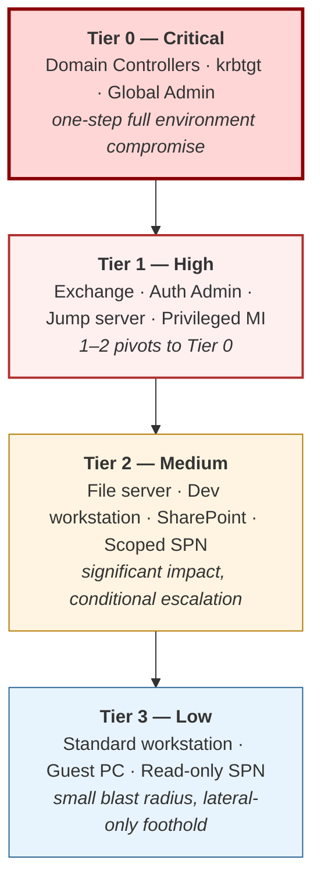

Tier 0 sits at the top because one compromise there is a full-environment compromise — the blast radius shrinks rapidly as you go down. The tables in §§ 5.3 – 5.5 show how these tiers map concretely to **Identity**, **Endpoint**, and **Azure** assets.

<a id="43-asset-classification-identity"></a><a id="asset-classification-identity"></a>
### 6.3 Asset classification: Identity

[⤴ Back to top](#top)


**Disclaimer:** The asset criticality classifications and attacker-centric tiering presented here are based on my own professional judgment and experience working with identity, endpoint, and cloud security environments. Actual tier assignments may vary depending on each organization's specific architecture, hybrid connectivity model, existing compensating controls, risk tolerance, regulatory requirements, and operational priorities. Classifications should be used as a strategic prioritization framework, not as a definitive or exhaustive measure of asset risk. List is not complete.

| Criticality Level | Typical Assets |
| ------------------------------------------------------------ | ------------------------------------------------------------ |
| **Critical<br />(Tier-0)**<br /><br />Immediate Domain Takeover | **Entra ID Roles (built-in) – users/managed identities:** Global Administrator, Privileged Role Administrator, Privileged Authentication Administrator, Partner / GDAP Delegated Admin, Directory Synchronization Accounts, Hybrid Identity Administrator (when Entra Connect is in password hash sync mode)<br /><br />**Application Permissions (Graph / API):** RoleManagement.ReadWrite.Directory, Directory.ReadWrite.All, AppRoleAssignment.ReadWrite.All, Policy.ReadWrite.AuthenticationMethod, PrivilegedAccess.ReadWrite.AzureAD, RoleManagement.ReadWrite.CloudPC, Organization.ReadWrite.All, Domain.ReadWrite.All, CrossTenantUserProfileSharing.ReadWrite.All, OnPremDirectorySynchronization.ReadWrite.All<br /><br />**Azure Built-in Roles:** Owner (root management group), User Access Administrator (root management group), Owner (tenant root subscription)<br /><br />**Azure Permissions:** Contributor + blueprint assign (root MG), Managed Identity Contributor (root scope), Entra ID joined device with Global Admin token cache, Subscription Owner with Az AD write federation<br/><br/>**AD Built-in Groups:** Domain Admins, Enterprise Admins, Schema Admins, Administrators (builtin), Group Policy Creator Owners, Cert Publishers, Domain Controllers group<br/><br/>**AD Permissions:** Replication rights (DCSync), DnsAdmins (with DC write), SYSTEM on any DC<br /><br />**Accounts (list not complete):** krbtgt account, SYSTEM on DC, Entra Connect sync account (MSOL_), ADConnect service account, Break-glass emergency access accounts, Service accounts with DCSync rights, Accounts with AdminSDHolder propagated ACLs |
| **High<br />(Tier-1)**<br /><br />Fast-Track Takeover (Abusable Privileges) | **Entra ID Roles (built-in) – users/managed identities:** Authentication Administrator, Hybrid Identity Administrator, Exchange Administrator, Cloud App Administrator, Application Administrator, Security Administrator, Intune Administrator, Identity Governance Administrator, External Identity Provider Administrator, B2C IEF Policy Administrator, Domain Name Administrator, Password Administrator (when targeting admins), Helpdesk Administrator (when targeting admins), Billing Administrator, Azure DevOps Administrator, Windows 365 Administrator<br/><br/>**Application Permissions (Graph / API):** Application.ReadWrite.All, Mail.ReadWrite (app all users), User.ReadWrite.All, Group.ReadWrite.All, Sites.FullControl.All, DeviceManagementServiceConfig.ReadWrite.All, DeviceManagementApps.ReadWrite.All, DeviceManagementManagedDevices.ReadWrite.All, ServicePrincipalEndpoint.ReadWrite.All, Policy.ReadWrite.ConditionalAccess, Policy.ReadWrite.PermissionGrant, EntitlementManagement.ReadWrite.All, PrivilegedEligibilitySchedule.ReadWrite.AzureADGroup, AuthenticationContext.ReadWrite.All, TrustFrameworkKeySet.ReadWrite.All, UserAuthenticationMethod.ReadWrite.All, IdentityProvider.ReadWrite.All, Organization.ReadWrite.All, Domain.ReadWrite.All, AccessReview.ReadWrite.All, Agreement.ReadWrite.All, RoleEligibilitySchedule.ReadWrite.Directory, RoleAssignmentSchedule.ReadWrite.Directory<br /><br />**Azure Built-in Roles (list not complete):** Owner (subscription or resource group), User Access Administrator (subscription scope), Key Vault Administrator, Azure Kubernetes Service Cluster Admin, Managed Identity Operator (on high-privilege MIs), Virtual Machine Contributor, Automation Account Contributor, Logic App Contributor<br/><br/>**Azure Permissions (list not complete):** Contributor on Key Vault (with access policy model), Azure Arc onboarding with connected machine agent, Storage Account Contributor (with Entra-integrated storage), Azure DevOps project admin (with service connection to high-priv MI), Defender for Cloud admin, IMDS token theft via VM access, Runbook execution as managed identity<br /><br />**AD Built-in Groups:** Account Operators, Backup Operators, Server Operators, Print Operators<br/><br/>**AD Permissions (list not complete):** GPO edit rights on tier 0 OUs, AdminSDHolder write access, msDS-KeyCredentialLink write, WriteOwner on domain root, WriteDACL on domain root, GenericAll on tier 0 groups, GenericWrite on Domain Controllers OU, AllExtendedRights on domain root, ForceChangePassword on admin accounts, Manage CA (AD CS), Certificate enrollment agents, ESC1–ESC8 vulnerable certificate templates, SeBackupPrivilege holders, SeRestorePrivilege holders, SeTakeOwnershipPrivilege holders, SeDebugPrivilege on DC, SeImpersonatePrivilege on DC, Unconstrained delegation computers, Unconstrained delegation service accounts, Shadow Credentials write on admin accounts, SID History injection rights, Trust account manipulation rights, GPO link rights on tier 0 OUs, OU owner on Domain Controllers OU<br /><br />**Accounts (list not complete):** Entra Connect service account, High-privilege service principals with T0 Graph permissions, Admin-consented OAuth apps with T1 permissions, AD CS enrollment agent accounts, Service accounts with unconstrained delegation, Accounts with GenericAll on tier 0 objects, Federated identity credentials on high-privilege app registrations, Managed identities with Owner or UAA at subscription scope, Workload identities bound to high-privilege Azure RBAC roles, Azure Automation Run As accounts, Service principals with client secrets stored in Key Vault accessible to lower-trust identities |
| **Medium<br />(Tier-2)**<br /><br />Conditional Takeover (Needs Chaining / Misconfig) | **Entra ID Roles (built-in) – users/managed identities (list not complete):** User Administrator, Groups Administrator, Conditional Access Administrator, SharePoint Administrator, Teams Administrator, Lifecycle Workflows Administrator<br/><br/>**Application Permissions (Graph / API) (list not complete):** Mail.Read (app all users), Calendars.ReadWrite, Files.ReadWrite.All, AuditLog.Read.All, IdentityRiskyUser.ReadWrite.All, DeviceManagementConfiguration.ReadWrite.All<br/><br/>**Azure Built-in Roles (list not complete):** Network Contributor, Log Analytics Contributor, Automation Operator, Azure DevOps stakeholder, Azure Kubernetes Service Cluster User<br /><br />**Azure Permissions (list not complete):** Contributor (single non-sensitive resource group), Storage Blob Data Reader (scoped to non-sensitive storage), Log Analytics Reader, Monitoring Reader, Security Reader (Defender for Cloud), Managed Identity on low-privilege workload, Service principal scoped to single resource group<br/><br />**AD Built-in Groups:** DNS Admins<br/><br />**AD Permissions (list not complete):** OU-scoped write ACLs, LAPS read rights, Constrained delegation (msDS-AllowedToDelegateTo), RBCD write rights, Kerberoastable high-priv SAs<br/><br />**Accounts (list not complete):** High-privilege service principals scoped to workload, Admin-consented OAuth apps with scoped permissions, Automation accounts with limited RBAC, Azure DevOps service connections scoped to single subscription |
| **Low<br />(Tier-3)**<br /><br />Low blast radius, limited lateral movement potential | **Entra ID Roles (built-in) – users/managed identities:** Global Reader, Security Reader, Reports Reader, Message Center Reader, Usage Summary Reports Reader, Directory Readers, Guest User (default)<br/><br/>**Application Permissions (Graph / API) (list not complete):** User.Read (delegated), Mail.Read (delegated self), Calendars.Read (delegated), Directory.Read.All, AuditLog.Read.All (delegated), IdentityRiskEvent.Read.All<br/><br/>**Azure Built-in Roles (list not complete):** Reader (subscription or resource group), Billing Reader, Cost Management Reader, Tag Contributor, Azure DevOps Basic user (no pipeline access)<br /><br />**Azure Permissions (list not complete):** Storage Blob Data Reader (scoped, non-sensitive), Managed Identity with Reader only, Service principal with Reader on isolated resource group<br/><br/>**AD Built-in Groups:** Domain Users (default), Read-only DC (RODC)<br/><br/>**AD Permissions (list not complete):** Scoped helpdesk OU read, GenericRead on non-priv objects<br /><br />**Accounts (list not complete):** Standard user accounts, Guest accounts, Read-only service accounts, Managed identities with no RBAC assignments, Expired or disabled service principals |


<a id="44-asset-classification-endpoint"></a><a id="asset-classification-endpoint"></a>

### 6.4 Asset classification: Endpoint

[⤴ Back to top](#top)


**Disclaimer:** The asset criticality classifications and attacker-centric tiering presented here are based on my own professional judgment and experience working with identity, endpoint, and cloud security environments. Actual tier assignments may vary depending on each organization's specific architecture, hybrid connectivity model, existing compensating controls, risk tolerance, regulatory requirements, and operational priorities. Classifications should be used as a strategic prioritization framework, not as a definitive or exhaustive measure of asset risk. List is not complete.

| Criticality Level | Typical Assets |
| ------------------------------------------------------------ | ------------------------------------------------------------ |
| **Critical<br />(Tier-0)**<br /><br />Immediate full environment compromise if taken | **Server Roles:** Domain Controllers (Primary/Additional), Read-Only Domain Controllers (RODC), AD CS servers (Certificate Authority — root and subordinate), Entra Connect / AD Connect servers, Federation servers (AD FS primary)<br/><br/>**Management:** Privileged Access Workstations (PAW) used by tier 0 admins, Backup servers with DC/CA backup data, Monitoring servers with domain-level agent credentials, Key Management Services (KMS) servers with domain-joined credential store<br/><br/>**Infrastructure:** HSM-attached servers (storing root CA private keys), SAN / storage controllers backing tier 0 VMs<br/><br/>**Hypervisor:** Hypervisor hosts running tier 0 guest VMs (VMware ESXi, Hyper-V, KVM), vCenter / SCVMM management servers (managing tier 0 hypervisors)<br/><br/>**Network Equipment:** Core routers (BGP, MPLS backbone), Core switches (spanning all VLANs), Firewall clusters (perimeter and internal segmentation), Out-of-band management network devices (iDRAC, iLO, IPMI), Network management servers (Cisco DNA, SolarWinds — full network write access), SD-WAN controllers, Load balancers (handling auth traffic)<br/><br/>**IoT / OT:** Building management systems (BMS) controllers with domain integration, Physical security controllers (badge access, CCTV management) with domain integration, OT / ICS controllers with direct network adjacency to tier 0 systems |
| **High<br />(Tier-1)**<br /><br />High impact, one or two pivots to full compromise | **Server Roles:** Exchange servers, MFA / RADIUS servers, PKI subordinate CA servers, DNS servers (non-DC hosted), Active Directory Federation Services (AD FS) proxy servers<br/><br/>**Management:** Privileged Access Workstations (PAW) used by tier 1 admins, Jump servers / bastion hosts, SIEM servers, Endpoint Detection and Response (EDR) management servers, SCCM / MECM primary site servers, Privileged Identity Management (PIM) approval workflow servers, Secret management servers (HashiCorp Vault, Azure Key Vault private endpoints), Password managers with admin credential stores, Patch management servers (WSUS), Admin workstations used by tier 1 staff without PAW controls<br/><br/>**Infrastructure:** Network Access Control (NAC) servers, VPN concentrators / remote access servers, Azure Arc-connected servers with high-privilege managed identity, Privileged developer machines with production secrets or pipeline credentials<br/><br/>**Hypervisor:** Hypervisor hosts running tier 1 guest VMs, vCenter / SCVMM management servers (managing tier 1 hypervisors)<br/><br/>**Network Equipment:** Distribution switches, Wireless LAN controllers (WLC), Proxy servers (SSL inspection — credential visibility), RADIUS / TACACS+ network authentication servers, Network packet brokers / TAP aggregators, Remote access concentrators (Citrix ADC, F5 BIG-IP), DNS resolvers (internal recursive), DHCP servers (domain-integrated), Network time protocol (NTP) primary servers<br/><br/>**IoT / OT:** SCADA / ICS servers (non-tier 0 adjacent), Industrial IoT gateways with network bridging, UPS management controllers (power disruption potential), HVAC controllers (data center environment impact), Building automation system (BAS) servers, Medical device management servers, Surveillance / CCTV management servers (non-domain integrated)<br/><br/>**Client Devices:** IT staff personal workstations (helpdesk, sysadmin, network engineers — cached credentials, admin tools, RDP session history), IT management laptops (used for remote administration without formal PAW controls), Security operations workstations (SOC analyst machines with SIEM and EDR console access), Senior IT personal workstations (IT managers, architects — broad access scope) |
| **Medium<br />(Tier-2)**<br /><br />Significant workload impact, conditional path to escalation | **Server Roles:** File servers, SharePoint servers, SQL servers hosting sensitive databases, Citrix / RDS session hosts, Web application servers with Entra integrated auth, API gateway servers, Collaboration servers (Teams on-prem, Skype for Business), HR and identity lifecycle management servers, Internal certificate registration authority (RA) servers, IT service management servers (ServiceNow, Jira)<br/><br/>**Management:** Log aggregation servers, DevOps / CI-CD build agents, Container orchestration nodes (Kubernetes worker nodes)<br/><br />**Hypervisor:** Hypervisor hosts running tier 2 guest VMs<br/><br/>**Network Equipment:** Access layer switches (user-facing VLANs), Wireless access points (managed), Network monitoring appliances (read-only), Standalone DHCP servers (non-domain integrated), Content filtering / web proxy appliances, VoIP / SIP gateways<br/><br/>**IoT / OT:** Smart meeting room devices (displays, conferencing systems), Environmental sensors (temperature, humidity — data center), Badge readers (non-domain integrated, isolated), Laboratory equipment with network interfaces, IP cameras (isolated VLAN, no domain integration), Industrial sensors (read-only, no control plane access), Retail / POS terminals (isolated network segment)<br/><br/>**Client Devices:** Production workstations, Lab workstations, Shared devices, Developer workstations, Power user workstations (finance, legal, HR) |
| **Low<br />(Tier-3)**<br /><br />Low blast radius, limited lateral movement potential | **Server Roles:** Print servers, DHCP servers, Time servers (NTP), VoIP servers, Internal wiki / intranet servers, Archival / cold storage servers, Physical access control servers, Test / sandbox servers<br/><br/>**Management:** Network monitoring probes<br/><br/>**Network Equipment:** Unmanaged access switches, Consumer-grade wireless access points, Out-of-band console servers (isolated, read-only access), Standalone print servers (network-connected, no domain join)<br/><br/>**IoT / OT:** Smart lighting controllers (isolated network), Consumer IoT devices (isolated guest VLAN), Non-networked or air-gapped sensors, Vending machines / coffee machines with network connectivity, Digital signage players (isolated, read-only content), Wearables / smart badges (no domain integration), USB-only peripheral devices with firmware update capability<br/><br/>**Client Devices:** Standard employee workstations, Student workstations, Kiosk machines, Guest PCs, Shared classroom / library computers, Development workstations (non-privileged, isolated, no production access), Personally-owned BYOD devices, Retired / decommissioned machines |


<a id="45-asset-classification-azure"></a><a id="asset-classification-azure"></a>

### 6.5 Asset classification: Azure

[⤴ Back to top](#top)


**Disclaimer:** The asset criticality classifications and attacker-centric tiering presented here are based on my own professional judgment and experience working with identity, endpoint, and cloud security environments. Actual tier assignments may vary depending on each organization's specific architecture, hybrid connectivity model, existing compensating controls, risk tolerance, regulatory requirements, and operational priorities. Classifications should be used as a strategic prioritization framework, not as a definitive or exhaustive measure of asset risk. List is not complete.

| Criticality Level | Typical Assets |
| ------------------------------------------------------------ | ------------------------------------------------------------ |
| **Critical<br />(Tier-0)**<br /><br />Immediate full environment compromise if taken | **Compute:** Virtual Machines hosting tier 0 workloads (DC, ADCS, Entra Connect), Virtual Machines with privileged tokens or highly privileged managed identities assigned, VM Scale Sets running privileged workloads, Azure Bastion hosts (gateway to tier 0 VMs), Confidential compute instances handling key material<br/><br/>**Storage:** Storage accounts containing DC/CA backup data, Storage accounts containing Entra Connect configuration, Azure Blob Storage backing tier 0 audit and log pipelines, Storage accounts with Entra-integrated RBAC and tier 0 data, Immutable and locked Azure Storage holding identity bootstrap data<br/><br/>**Identity & Access:** Entra ID tenant root, Management group root (tenant root group), Subscriptions containing tier 0 workloads, Azure Key Vault storing root CA private keys, Azure Key Vault storing tenant-wide secrets and certificates, Azure Key Vaults storing tenant root keys or certificate authorities, Managed Identity with Owner or User Access Administrator at subscription or MG scope, App registrations with RoleManagement.ReadWrite.Directory or Directory.ReadWrite.All, Service principals with tenant-wide privileged Graph API permissions<br/><br/>**Networking:** Virtual Networks hosting tier 0 VMs, Network Security Groups governing tier 0 subnet traffic, Azure Firewall (central hub — controls all east-west and north-south traffic), ExpressRoute circuits (direct on-prem to cloud bridge), Azure Private DNS zones (name resolution for tier 0 services), VPN Gateways (site-to-site tunnels into on-prem tier 0 networks), Azure DDoS Protection plans, Azure Network and Security Policy control plane resources<br/><br/>**Management & Governance:** Azure Management Groups with root tenant-level access, Azure Subscription Owner roles over security-critical subscriptions, Azure Policy assignments at root MG scope, Azure Blueprints assigned at root MG scope, Microsoft Defender for Cloud, Azure Monitor (Log Analytics workspaces ingesting tier 0 signals), Microsoft Sentinel workspace, Azure Automation accounts running as high-privilege managed identity, Azure Automation / Runbook accounts with privileged role assignments, Azure DevOps organizations with service connections to tier 0 subscriptions, Azure Arc control plane (manages on-prem servers as Azure resources), Azure Arc / Hybrid management orchestrators<br/><br/>**Hypervisor / Fabric:** Azure Dedicated Hosts running tier 0 VMs, Azure VMware Solution (AVS) management clusters, Azure Stack HCI clusters running tier 0 guest VMs |
| **High<br />(Tier-1)**<br /><br />High impact, one or two pivots to full compromise | **Compute:** Virtual Machines hosting Exchange, ADFS, MFA, or SIEM workloads, Virtual Machines with scoped privileged tokens or identities, Azure Kubernetes Service (AKS) clusters with privileged workloads, Azure Container Apps running privileged services, Azure Batch accounts with high-privilege managed identity<br/><br/>**Storage:** Storage accounts backing SIEM and log aggregation, Storage accounts containing application secrets or config, Azure File shares mounted by privileged VMs, Azure Data Lake storing sensitive identity or security telemetry, Highly active Azure Key Vaults with large number of operations<br/><br/>**Identity & Access:** App registrations with Application.ReadWrite.All or User.ReadWrite.All, Service principals with Exchange, Intune, or Security Administrator equivalent permissions, Managed Identities with Contributor or Key Vault Administrator at subscription scope, Azure AD B2C tenants federated to production tenant, Federated identity credentials on privileged app registrations<br/><br/>**Networking:** Hub Virtual Networks (peered to tier 0 VNets), Azure Application Gateway (WAF — handles auth traffic), Azure Front Door (global entry point — SSL termination), Azure Load Balancer (fronting tier 1 workloads), Network Virtual Appliances (NVA — routing and inspection), Azure Private Endpoints for tier 1 services, Azure DNS resolvers (recursive — name resolution for all workloads)<br/><br/>**Management & Governance:** Azure Automation accounts with scoped privileged runbooks, Azure Automation / Runbook accounts with scoped role assignments, Log Analytics workspaces ingesting tier 1 signals, Azure DevOps pipelines deploying to tier 1 environments, Azure Key Vault storing tier 1 application secrets, Microsoft Defender for Endpoint, Azure Update Manager, Azure Lighthouse delegations with privileged access, Azure Arc / Hybrid management orchestrators (scoped to tier 1 systems)<br/><br/>**Hypervisor / Fabric:** Azure Dedicated Hosts running tier 1 VMs, Azure Stack HCI clusters running tier 1 guest VMs, Azure VMware Solution (AVS) workload clusters |
| **Medium<br />(Tier-2)**<br /><br />Significant workload impact, conditional path to escalation | **Compute:** Virtual Machines hosting file, SharePoint, SQL, or collaboration workloads, Azure Kubernetes Service (AKS) worker nodes (non-privileged workloads), Azure App Service plans hosting internal applications, Azure Functions with scoped managed identity, Azure Logic Apps with limited connector scope, Azure Virtual Desktop (AVD) / Windows 365 for non-admin users, Dev/Test virtual machines without production data<br/><br/>**Storage:** Storage accounts hosting application data (non-sensitive), Azure SQL databases (non-sensitive schemas), Azure Cosmos DB instances (application data), Azure File shares mounted by standard workload VMs, Azure Blob Storage for application asset delivery<br/><br/>**Identity & Access:** App registrations with scoped delegated permissions, Service principals scoped to single resource group, Managed Identities with Contributor on isolated resource group, App registrations with Mail.Read or Files.ReadWrite.All<br/><br/>**Networking:** Spoke Virtual Networks (workload-specific, peered to hub), Azure Application Gateway (non-auth workloads), Network Security Groups on workload subnets, Azure Traffic Manager profiles, Azure Content Delivery Network (CDN) endpoints<br/><br/>**Management & Governance:** Dev/Test subscriptions and resource groups, Non-production workloads (dev, test, QA, staging) without production data, Azure DevOps pipelines deploying to tier 2 environments, Log Analytics workspaces (workload-scoped), Azure Key Vault storing tier 2 application secrets, Azure Monitor alert rules (workload-scoped), Azure Backup vaults (tier 2 workload data)<br/><br/>**Hypervisor / Fabric:** Azure Dedicated Hosts running tier 2 VMs, Azure Stack HCI clusters running tier 2 guest VMs |
| **Low<br />(Tier-3)**<br /><br />Low blast radius, limited lateral movement potential | **Compute:** Virtual Machines hosting non-sensitive workloads (print, NTP, intranet), Azure App Service (public-facing, no internal integration), Azure Static Web Apps, Azure Container Instances (isolated, ephemeral), Sandbox subscriptions designed for experimentation, Proof-of-concept / pilot workloads with no sensitive data, Lab resource groups intended to be wiped/reset<br/><br/>**Storage:** Storage accounts hosting public or non-sensitive content, Azure Blob Storage for static asset delivery, Azure Archive storage (cold, no active credentials)<br/><br/>**Identity & Access:** App registrations with User.Read delegated only, Service principals with Reader on isolated resource group, Managed Identities with no RBAC assignments, Expired or disabled service principals, Guest user accounts with default permissions, Personal / sandbox resources with no privileged role assignments<br/><br/>**Networking:** Azure CDN endpoints (public content delivery), Azure DNS public zones (external name resolution only), Network Security Groups on isolated low-trust subnets, Azure Virtual WAN branches (read-only monitoring)<br/><br/>**Management & Governance:** Azure Cost Management (read-only), Azure Policy (read-only assignments), Azure Monitor (read-only, non-sensitive workloads), Azure Advisor (recommendations only), Azure Service Health alerts (read-only), Sandbox subscriptions for experimentation, Proof-of-concept and pilot resource groups with no sensitive data<br/><br/>**Hypervisor / Fabric:** Azure Sandbox / dev-test dedicated hosts, Non-production Azure Stack HCI clusters |

---


<a id="6-the-yaml-concept-locked--custom"></a><a id="the-yaml-concept-locked--custom"></a>

## 📜 7. The YAML Concept (Locked + Custom)

[⤴ Back to top](#top)

SecurityInsight is **data-driven**. Engines (`SecurityInsight_RiskAnalysis`, asset-profiling) read their behaviour from YAML at run time. Custom files live alongside their Locked siblings in the same folder (e.g. `asset-profiling-enrichment/azure/AssetProfileByTags.locked.yaml` + `AssetProfileByTags.custom.yaml`; `risk-analysis-detection/RiskAnalysis_Queries_Locked.yaml` + per-report `*.exclude.custom.json`). This means:

- You can add a new report template, a new tagging rule, or a new KQL query **without touching PowerShell**.
- Releases update the curated "Locked" content in-place, while your environment-specific content lives alongside it in a sibling "Custom" file that a release **never overwrites**.

### 7.1 Two files per topic

For every engine that reads YAML, there are exactly two files:

| Topic | Locked (ours) | Custom (yours) |
|---|---|---|
| Risk Analysis queries | `risk-analysis-detection/RiskAnalysis_Queries_Locked.yaml` | `risk-analysis-detection/RiskAnalysis_Queries_Custom.yaml` |
| Asset Tagging rules | `asset-profiling-enrichment/endpoint/AssetTagging.locked.yaml` | `asset-profiling-enrichment/endpoint/AssetTagging.custom.yaml` |

### 7.2 Merge flow

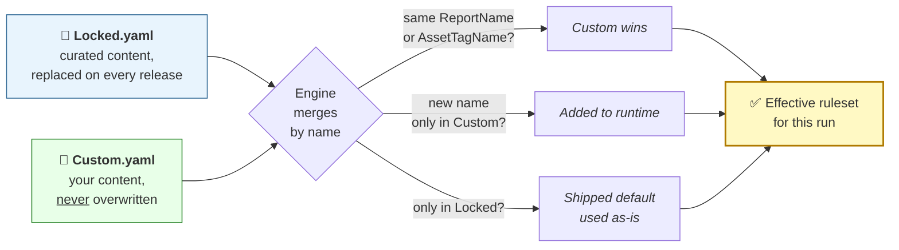

Precedence rule (same for every topic): **Custom entries with the same `ReportName` / `AssetTagName` as a Locked entry OVERRIDE the Locked entry. New entries in Custom are ADDED.**

### 7.3 Three things you do in Custom

| What | Example | Why |
|---|---|---|
| **Add** new entries | A new tagging rule for your org's `PAWDevices` | Most common. Your environment has things ours doesn't. |
| **Override** a Locked entry | Redefine `RiskAnalysis_Detailed_Bucket` with your own `ReportQuery` | Rare. Customize the shipped behaviour without editing a tracked file. |
| **Disable** a Locked entry | Re-declare the name with `Mode: Disabled` in Custom | Rare. Skip a shipped template that doesn't apply to your environment. |

### 7.4 Concrete example

<details open>
<summary>📋 <b>Asset tagging — adding a custom rule</b></summary>

**`asset-profiling-enrichment/endpoint/AssetTagging.custom.yaml`** (your file):

```yaml
AssetTagging:
  # Your environment-specific Tier-0 endpoints
  - AssetTagName: PAWDevices--tier0--SI
    Mode: Prod
    QueryEngine: DefenderGraph
    Query:
      - |
        ExposureGraphNodes
        | where NodeLabel has "device"
        | extend rawData = todynamic(NodeProperties).rawData
        | where tostring(rawData.deviceName) startswith "paw-"
        | extend AssetTagType   = "AssetTier--SI"
        | extend AssetTag       = "PAWDevices"
        | extend AssetTierLevel = 0
        | extend AssetTagName   = strcat(AssetTag, "--tier", tostring(AssetTierLevel), "--SI")

  # Exclude guest workstations from tagging
  - AssetTagName: GuestDevices--excluded--SI
    Mode: Prod
    QueryEngine: DefenderGraph
    Query:
      - |
        ExposureGraphNodes
        | where NodeLabel has "device"
        | extend rawData = todynamic(NodeProperties).rawData
        | where tostring(rawData.deviceName) contains "-guest"
        | extend AssetTagType   = "Asset--Excluded--SI"
        | extend AssetTag       = "GuestDevices"
        | extend AssetTagName   = strcat(AssetTag, "--excluded--SI")
```

On the next run, `CriticalAssetTagging` will:

1. Read both Locked + Custom, merge them.
2. Execute your KQL in Defender Exposure Graph.
3. Apply `PAWDevices--tier0--SI` to every device starting with `paw-`.
4. Apply `GuestDevices--excluded--SI` to every device containing `-guest`.
5. Skip any device without an in-scope tag.

No PowerShell touched. Add more rules the same way.
</details>

<details open>
<summary>📋 <b>Risk Analysis — per-template mail override</b></summary>

**`risk-analysis-detection/RiskAnalysis_Queries_Custom.yaml`** (your file):

```yaml
ReportTemplates:
  # Override the Locked Detailed_Bucket template to route to the vuln team
  - ReportName: RiskAnalysis_Detailed_Bucket
    Mail_To:
      - vuln-team@yourdomain.com
      - audit@yourdomain.com
    Mail_SendMail: true
    # When Mail_To / Mail_SendMail are set on a template, they win over the
    # global mail recipients for that template's run only.
```

Running `-Detailed` now sends the email to `vuln-team@` and `audit@` regardless of what `$global:MailTo` says.
</details>

### 7.5 How-to — override a Locked rule (and what NEVER goes in Locked)

> **Rule of thumb**: anything that's specific to **your** tenant lives in **Custom only**. Locked files ship in the public repo and are re-pulled on every upgrade — leaking customer data into Locked silently affects every other deployment that pulls the next release.

#### Customer-data policy — what NEVER goes in a Locked file

The engine **refuses to fire** some of these when CMDB isn't enabled, but several have NO static gate — a leaked Locked CIDR will fire on whoever's IP happens to match. So just keep them out:

| ❌ Never in Locked | Why | Where it goes |
|---|---|---|
| `cmdbId`, `cmdbName`, `cmdbCriticality`, `cmdbDataSensitivity` | Foreign keys into **your** CMDB. Different per tenant. Engine gates on `$global:SI_EnableCmdbProvider` (v2.2.274+) — silently ignored when CMDB is off, so a Locked leak is invisible until a customer enables CMDB and gets your fictional id stamped on their assets. | `<RuleId>.custom.yaml` `set:` block |
| IPv4 / IPv6 / CIDR ranges (`cidrs:`, IP literals inside `egKustoQuery`) | Production subnets are tenant-specific. **No engine gate** — the rule fires on whoever's IP happens to match. A Locked CIDR can mis-tier other tenants' workstations. | `<RuleId>.custom.yaml` `detect:` block |
| Tenant-specific hostnames / FQDNs / DNS suffixes | E.g. `(?i)^pdc\d` (universal naming) is FINE for Locked; `(?i)^acme-corp-pdc01\.acme\.local$` (customer literal) is NOT. | `<RuleId>.custom.yaml` `detect:` block |
| Tenant IDs / subscription IDs / RG names / AD group SIDs / Entra object IDs | Inherently per-tenant. | `<RuleId>.custom.yaml` |
| Internal SamAccountName / UPN literals (e.g. `svc-ad-prod@acme.local`) | Per-tenant identity. Use generic patterns or group memberships in Locked. | `<RuleId>.custom.yaml` |

#### Override workflow (worked example)

You want to keep the engine's `ADDomainController` detection logic but stamp **your** `cmdbId` (`SVC-AD-PROD`) onto every matched DC, and add a tag for your CAB workflow. Two-step:

1. Drop a sibling `.custom.yaml` next to the locked file (`asset-profiling-enrichment/endpoint/AssetProfileByApplicationServiceDetection/`):
   ```
   ADDomainController.locked.yaml    (shipped baseline -- DO NOT edit)
   ADDomainController.custom.yaml    (NEW -- your override, gitignored)
   ```
2. In `ADDomainController.custom.yaml`, keep the **exact same `id:`**, paste the full rule body, then change only what you want:
   ```yaml
   id:        ADDomainController          # MUST match the locked id
   appliesTo: endpoint
   osPlatformScope: [WindowsServer, Linux]
   mode:      locked
   purpose:   'Domain Controller'
   category:  'Server Roles'
   description: |
     Customer override -- keeps shipped detection, adds CMDB stamp + DC-CAB tag.

   detections:
     - id: ADDomainController
       detect:
         any:
           # ... paste the same `any:` list from the .locked.yaml verbatim ...
       set:
         Tier:     0
         Purpose:  'Domain Controller'
         Category: 'Server Roles'
         Tags:     [ 'cab:domain-controllers' ]
         cmdbId:   'SVC-AD-PROD'           # your CMDB foreign key
   ```

The engine deduplicates by `id` and the `.custom.yaml` always wins (see `Get-SIRuleSet.ps1:265-284`). Locked is suppressed entirely. On the next run every matched DC gets `Tier=0` + `Tags=['cab:domain-controllers']` + `cmdbId='SVC-AD-PROD'` (and Reconcile auto-stamps `cmdbName` / `cmdbCriticality` / `cmdbDataSensitivity` from your CMDB CSV when `$global:SI_EnableCmdbProvider=$true`).

The full annotated grammar with every `detect:` kind + the inline POLICY callout is in [`asset-profiling-enrichment/_TEMPLATE.custom.sample.yaml`](asset-profiling-enrichment/_TEMPLATE.custom.sample.yaml). Detect-kind reference + override semantics are in [`docs/DESIGN.md`](docs/DESIGN.md) → Enrichment / detection rule model.

---

### 7.6 What a release upgrade does to your YAML

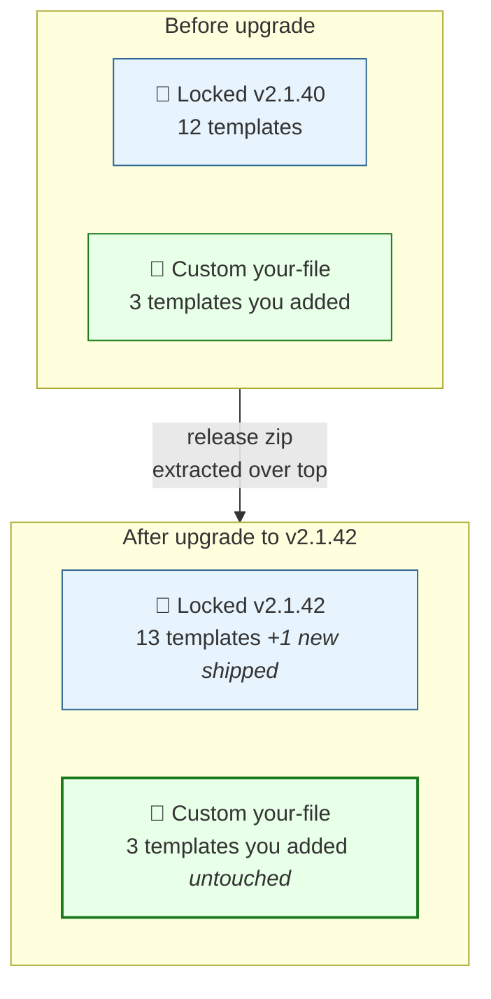

**Locked is replaced; Custom is sacred.** Your edits survive every upgrade. The only time you touch Custom during an upgrade is if the RELEASE NOTES point out that a template you overrode has an updated schema — then you re-apply your override against the new Locked definition.

<a id="66-critical-asset-tagging-mode-and-scope"></a><a id="critical-asset-tagging-mode-and-scope"></a>
### 7.7 `AssetTagName` naming convention — `<stem>--tier<N>--SI` + stem-based merge

[⤴ Back to top](#top)

Every `AssetTagName` in both Locked and Custom YAML **must** match the convention:

```
<stem>--tier<N>--SI
```

Examples: `DomainControllerDNS--tier0--SI`, `BackupOperators--tier1--SI`, `AzHubPlatformManagementSub--tier0--SI`.

- **`<stem>`** — a short, human-readable asset-class name (no spaces, no `--tier` / `--SI` inside).
- **`<N>`** — integer 0..3, the CriticalityTierLevel the rule tags the asset with.
- **`--SI`** — mandatory suffix identifying the tag as produced by this SecurityInsight solution. Downstream consumers (Defender queries, Power BI, aggregators) filter by `--SI` to isolate SI-produced tags from other tagging sources.

**Merge semantics — identity = stem + `--SI`, tier = overridable data.**

The engine normalises every `AssetTagName` to its stem+suffix (upper-cased) and uses THAT as the merge key. The tier integer between is a value the customer can change without disturbing the identity:

```
  Locked.yaml : 'BackupOperators--tier1--SI'   merge key -> BACKUPOPERATORS--SI
  Custom.yaml : 'BackupOperators--tier0--SI'   merge key -> BACKUPOPERATORS--SI   (same!)
  -> Custom wins. Backup Operators is tagged at tier 0 on the next run.
```

This means a customer can re-tier a shipped rule by dropping ONE Custom entry, without having to copy or re-author the Locked query. The Custom record replaces the Locked one wholesale (query included), so the customer can also change the KQL in the same drop-in.

**Malformed `AssetTagName` throws.** A name that doesn't match `<stem>--tier<N>--SI` (e.g. missing `--SI` suffix, or missing tier segment) stops the engine at YAML merge time with:

```
AssetTagName 'MyBadName' in Custom.yaml does not match the required
'<stem>--tier<N>--SI' convention. Fix the YAML entry -- malformed tag
names cannot participate in the Locked/Custom merge.
```

No silent fallback to full-string matching — that path was intentionally rejected because it made collision behaviour hard to predict.

<details>
<summary>📖 <b>Use case 1 — promote an asset class from Tier 1 to Tier 0</b></summary>

Shipped Locked entry:

```yaml
- AssetTagName: BackupOperators--tier1--SI
  Mode: Prod
  QueryEngine: DefenderGraph
  Query:
    - |
      IdentityInfo
      | where GroupMembership has "Backup Operators"
      ...
```

Customer Custom.yaml override — **same stem, different tier**, query can be unchanged or modified:

```yaml
- AssetTagName: BackupOperators--tier0--SI    # tier bumped from 1 to 0
  Mode: Prod
  QueryEngine: DefenderGraph
  Query:
    - |
      IdentityInfo
      | where GroupMembership has "Backup Operators"
      ...
```

Effective on next run: the Backup Operators asset class tags at tier 0. An update never touches a `.custom.yaml` file, so the override persists.

</details>

<details>
<summary>📖 <b>Use case 2 — force a full re-tag (drop the delta filter)</b></summary>

Many shipped Locked queries end with a delta filter like:

```kql
| where isempty(Tag_AssetTier)
    or (Tag_AssetTier != AssetTagName
        and (isnull(ExistingTierNumber) or ExistingTierNumber > AssetTierLevel))
```

…so the rule only fires on assets whose current tag is missing / wrong / lower-tier. When you've changed the `AssetTierLevel` (or want to force every in-scope asset to be re-tagged once), drop the trailing `| where ...` from your Custom.yaml copy:

```yaml
- AssetTagName: AzHubPlatformManagementSub--tier0--SI
  Mode: Prod
  QueryEngine: AzureResourceGraph
  Query:
    - |
      resourcecontainers
      | where type == "microsoft.resources/subscriptions"
      | where properties.managementGroupAncestorsChain has "mg-platform-management"
      | extend AssetTagType = "AssetTier--SI",
               AssetTag     = "AzHubPlatformManagementSub",
               AssetTierLevel = 0
      | extend AssetTagName = strcat(AssetTag, "--tier", tostring(AssetTierLevel), "--SI")
      | project subscriptionId, subscriptionName = name, AssetTagType, AssetTag, AssetTierLevel, AssetTagName, id
      | order by subscriptionId asc
      # NO trailing '| where isempty(Tag_AssetTier) or ...' -- every in-scope asset is re-tagged this run.
```

Run with `$global:Scope = @('TEST')` first to confirm the row set, then flip to `$global:Scope = @('PROD')` for the real write. After a successful force re-tag, you can remove the Custom entry (next run picks Locked's delta-filtered query again, which is a no-op on already-correctly-tagged assets).

</details>

---

<a id="7-appendix"></a><a id="appendix"></a>
<a id="5-concepts"></a><a id="concepts"></a>
## 📎 8. Appendix

[⤴ Back to top](#top)

<a id="71-permissions-catalog"></a><a id="permissions-catalog"></a>
### 8.1 Permissions catalog

[⤴ Back to top](#top)

<details>
<summary><b>Show details (expand)</b></summary>

The exact set `setup\Grant-SIIdentity.ps1` grants (and checks on re-run; `-AppId <client id>` for an app registration):

<details open>
<summary><b>Microsoft Graph (Application permissions, admin consent required)</b></summary>

| Permission | Used by |
|---|---|
| `User.Read.All` | IdentityAssetsCollect (user inventory) |
| `Group.Read.All` | IdentityAssetsCollect (group memberships) |
| `Directory.Read.All` | All engines (directory metadata) |
| `Application.Read.All` | IdentityAssetsCollect (SPN + MI inventory) |
| `AuditLog.Read.All` | IdentityAssetsCollect (sign-in logs) |
| `Policy.Read.All` | Risk Analysis (CA policy enumeration) |
| `RoleManagement.Read.All` | All engines (role assignments) |
| `RoleManagement.Read.Directory` | All engines (role definitions) |
| `RoleManagementPolicy.Read.Directory` | All engines (PIM policies) |
| `RoleEligibilitySchedule.Read.Directory` | All engines (PIM eligible) |
| `RoleAssignmentSchedule.Read.Directory` | All engines (PIM active) |
| `IdentityRiskyUser.Read.All` | Risk Analysis (risky user signal) |
| `IdentityRiskEvent.Read.All` | Risk Analysis (risk event signal) |
| `IdentityRiskyServicePrincipal.Read.All` | Risk Analysis (risky SPN signal) |
| `ThreatHunting.Read.All` | IdentityAssetsCollect + Risk Analysis (Exposure Graph) |
| `UserAuthenticationMethod.Read.All` | IdentityAssetsCollect (users' sign-in methods: which accounts sign in passwordless only) |
| `AccessReview.Read.All` | IdentityAssetsCollect (access reviews: when a privileged role, group or application was last reviewed) |
| `SecurityAlert.Read.All` | Endpoint asset profiling (security alerts: the open alerts per device -- how many, the highest severity, the newest one). Read-only. |
| `SecurityEvents.Read.All` | The hourly status report (`/security/secureScores`: the latest Microsoft Secure Score of the tenant). Read-only. |

</details>

<details>
<summary><b>Microsoft Threat Protection</b></summary>

| Permission | Used by |
|---|---|
| `AdvancedHunting.Read.All` | Risk Analysis (Defender Advanced Hunting KQL) |

</details>

<details>
<summary><b>Microsoft Defender for Endpoint (WindowsDefenderATP)</b></summary>

| Permission | Used by |
|---|---|
| `Machine.Read.All` | Endpoint asset-profiling (`/api/machines` device inventory). Every engine is read-only at collection time. Only the optional asset-tagging engine writes tags back to Defender, which needs `Machine.ReadWrite.All` granted separately. |
| `Vulnerability.Read.All` | Risk Analysis vulnerability reports (`/api/vulnerabilities`: verified exploit, exploit kit, exploit kind, exposed devices per CVE). Read-only. |
| `SecurityRecommendation.Read.All` | Risk Analysis vulnerability and configuration reports (`/api/recommendations`: exposure impact and active alert per Defender recommendation). Read-only. |
| `Score.Read.All` | The hourly status report (`/api/exposureScore`: the Defender exposure score of the tenant). Read-only. |

</details>

<details>
<summary><b>Azure RBAC</b></summary>

| Role | Scope | Used by |
|---|---|---|
| `Reader` | **tenant-root Management Group** (preferred) or every subscription | All engines — sub enumeration via Resource Graph; **`Build_Tier_Definitions_JSON_File` uses this to enumerate the ~800+ Azure built-in role definitions via `Get-AzRoleDefinition`** |
| `Log Analytics Reader` | Defender / Sentinel workspace | Risk Analysis + IAC (cross-workspace IdentityInfo) |
| `Monitoring Metrics Publisher` | each DCR (`dcr-si-identity-assets`, `dcr-si-risk-analysis-summary`, `dcr-si-risk-analysis-detailed`) | IAC + Risk Analysis (LA ingest) |
| `Storage Blob Data Contributor` | Azure Storage container if `$global:ExportDestination` points to one | Risk Analysis (export upload) |
| `Tag Contributor` | tenant root MG | CriticalAssetTagging |

> [!NOTE]
> **If `Azure_BuiltInRoles_Tier0..3` / `Azure_Roles_Catalog` come back empty in `SecurityInsight_IdentityTiering.json`:** the SPN has no subscription it can read. `Get-AzRoleDefinition` needs a subscription scope. Fix by granting **Reader at tenant-root MG** (preferred — `setup\Grant-SIIdentity.ps1 -ReaderScopes <scope> -Apply` grants it) or at least Reader on one subscription. The engine auto-selects the first subscription it can see after `Connect-AzAccount` (v2.1.175+); before that release the call silently returned empty when no subscription context was set.

</details>

</details>

<a id="72-files-deep-dive"></a><a id="files-deep-dive"></a>

### 8.2 Bucketing — beating the 30k row ceiling

[⤴ Back to top](#top)

<details>
<summary><b>Show details (expand)</b></summary>

<details>
<summary><b>The problem</b></summary>

Azure Resource Graph and Defender Exposure Graph both cap query results at **30,000 rows per call**. Some Risk Analysis queries (especially wide exposure joins across large estates) legitimately return more than that. If a query overflows, Kusto / ARG returns one of a small family of errors (`exceeded the allowed result size`, `exceeded the allowed limits`, `preempted`, etc.). Without intervention, the engine would lose rows silently and skew the risk scoring.

</details>

<details>
<summary><b>The bucketing pattern</b></summary>

The bucketing pattern solves this by splitting the query into **N deterministic partitions** that each stay under the row cap. The engine then unions the N partial results back into one logical dataset before scoring.

**1. Placeholder in the KQL.** Each bucketable query has a single placeholder string (default `__BUCKET_FILTER__`) where the bucketing predicate will be injected at runtime:

```kql
ExposureGraphNodes
| where NodeLabel has "device"
__BUCKET_FILTER__
| ...rest of the query...
```

**2. Bucket predicate generation.** At query-prep time the engine substitutes `__BUCKET_FILTER__` with a deterministic hash-based filter:

```kql
| extend __bucket_key = coalesce(NodeId, NodeName, ...)
| where isnotempty(__bucket_key)
| extend __bucket = abs(hash(__bucket_key)) % <BucketCount>
| where __bucket == <BucketIndex>
```

With `BucketCount = 8`, one query becomes eight queries — each processing roughly an eighth of the dataset, all well under 30,000 rows.

**3. Union & dedupe.** Results from all N buckets are concatenated into one array; the scoring pipeline runs unchanged on the unioned dataset.

</details>

<details>
<summary><b>Auto-bucketing — the engine picks the bucket count itself</b></summary>

Manually guessing the right `BucketCount` for every query is brittle. The engine includes an **adaptive probe** that:

1. **Probes.** Runs the query with `BucketCount = 1` (unbucketed). If Kusto returns an overflow error, retries with `2`, `4`, `8`, ... up to `$global:AutoBucketMax` (default 64).
2. **Caches the winning bucket count.** Once a bucket size succeeds, the engine caches the discovered value in `OUTPUT/AutoBucketCache.json` keyed by a **checksum of the query body**. The checksum guarantees the cache is invalidated automatically if the query is edited.
3. **Reuses on the next run.** Subsequent runs of the same query read the cache first and skip probing entirely.

| Variable | Default | Purpose |
|---|---|---|
| `$global:UseQueryBucketing` | `$false` | Master switch (per-query value in YAML overrides). |
| `$global:DefaultBucketCount` | `2` | Starting bucket count if not overridden per-query. |
| `$global:BucketPlaceholderToken` | `__BUCKET_FILTER__` | Token in the KQL that gets replaced. |
| `$global:AutoBucketCount` | `$false` | Enable adaptive probing. |
| `$global:AutoBucketMax` | `64` | Safety cap on probe size. |
| `$global:AutoBucketCache` | `$true` | Persist discovered bucket counts to disk. |

</details>

</details>

<a id="74-output-destinations"></a><a id="output-destinations"></a>

### 8.3 Output destinations

[⤴ Back to top](#top)

<details>
<summary><b>Show details (expand)</b></summary>

<details>
<summary><b>Local files (always)</b></summary>

```
output/<ReportTemplate>.xlsx                                    ← Excel report
output/<ReportTemplate>.json                                    ← JSON sibling (when $global:WriteJsonOutput = $true)
```

Filename mirrors the report template — running `-Summary` produces `RiskAnalysis_Summary_Bucket.xlsx` + `.json`; `-Detailed` produces `RiskAnalysis_Detailed_Bucket.xlsx` + `.json`.

</details>

<details>
<summary><b>Log Analytics (opt-in)</b></summary>

When `$global:SendToLogAnalytics = $true`, the engine POSTs the in-memory dataset to one of two custom tables through the Log Ingestion API, via DCRs SecurityInsight creates itself on first ingest:

| Run mode | DCR (hardcoded) | LA table |
|---|---|---|
| `-Summary` | `dcr-si-risk-analysis-summary` | `SI_RiskAnalysis_Summary_CL` |
| `-Detailed` | `dcr-si-risk-analysis-detailed` | `SI_RiskAnalysis_Detailed_CL` |

Customer only configures the **Resource Group** that holds the DCRs (everything else falls back to the IAC engine's settings). DCR / table provisioning is automatic on first ingest.

</details>

<details>
<summary><b>UNC share OR Azure Storage (opt-in)</b></summary>

When `$global:ExportDestination` is set, the engine uploads BOTH `.xlsx` and `.json` after the local writes finish. **Type is auto-detected from the prefix:**

| Value pattern | Backend | Auth |
|---|---|---|
| `\\server\share\path\` | UNC (`Copy-Item`) | caller's Windows identity needs share write |
| `https://<acct>.blob.core.windows.net/<container>/` | Azure Storage (`Set-AzStorageBlobContent`) | SPN needs `Storage Blob Data Contributor` on the container |

**Backup-then-overwrite**: if a file with the same name already exists at the destination, it is RENAMED to `<name>.<yyyy-MM-dd_HHmmss>.<ext>.bak` BEFORE the new file is written. So the canonical path always holds the latest run; older copies are timestamped backups next to it. No data loss on re-runs.

</details>

<details>
<summary><b>Email (opt-in)</b></summary>

HTML email with .xlsx attachment + AI summary in the body. Routing differs by mode:

| Mode | Recipient globals |
|---|---|
| **Community** | `$global:SendMail`, `$global:MailTo` (one list, used regardless of Summary/Detailed) |
| **Internal (Automation Framework)** | `$global:Mail_SecurityInsight_Summary_SendMail` / `_To` and `_Detailed_SendMail` / `_To` (per-mode routing) |


**Attachment size limit — `$global:SI_MaxMailAttachmentMB` (default 24)**

A large estate can produce a workbook too big to email. Rather than let the relay reject the
message, the report is sent **without the attachment**, and the body says where the workbook is —
so the summary always arrives.

The setting is the **message** budget measured **base64-encoded**, not the file size on disk.
Attachments inflate about 37% on the wire:

| `SI_MaxMailAttachmentMB` | admits a workbook of | resulting message |
|---|---|---|
| 20 | ~14 MB on disk | ~19 MB |
| **24 (default)** | **~17 MB on disk** | **~23 MB** |
| 25 | ~18 MB on disk | ~25 MB |

The default is sized for the **relay**, not for the report. Most relays cap a message at 25 MB
(Exchange Online's default; on-premises is often lower), and that cap covers the whole message —
body and headers as well as the attachment. 24 leaves roughly 1.7 MB of headroom.

> ⚠️ **Lowering this is always safe. Raising it is only safe if you know your relay accepts more.**
> A budget above the relay's limit means the relay rejects the **entire message**, so the recipient
> loses the summary too — strictly worse than dropping just the attachment. Check the limit first,
> e.g. on Exchange Online: `Get-TransportConfig | fl MaxSendSize`.

Set it in your `SecurityInsight.custom.ps1` (section 9 of the sample config).

Per-template override: see [§ 7.5](#per-template-mail-recipient-override-yaml).

</details>

</details>

<a id="75-per-template-mail-recipient-override-yaml"></a><a id="per-template-mail-recipient-override-yaml"></a>

### 8.4 Per-template mail recipient override (YAML)

[⤴ Back to top](#top)

<details>
<summary><b>Show details (expand)</b></summary>

In `risk-analysis-detection/RiskAnalysis_Queries_Custom.yaml` you can override mail recipients **per template**, independent of the global mail config. Useful for routing a specific report to specific stakeholders.

```yaml
ReportTemplates:
  - ReportName: RiskAnalysis_Detailed_Bucket
    Mail_To:
      - vuln-team@yourdomain.com
      - audit@yourdomain.com
    Mail_SendMail: true                 # optional; overrides the global toggle
    # ...rest of the template definition
```

When present on the chosen template, `Mail_To` overrides `$global:Report_To` and `Mail_SendMail` overrides `$global:Report_SendMail` for that template's run. Logged on stdout:

```
[INFO] Mail recipients overridden by template 'RiskAnalysis_Detailed_Bucket': vuln-team@..., audit@...
```

</details>

<a id="76-cross-subscription-workspace-support"></a><a id="cross-subscription-workspace-support"></a>

### 8.5 Cross-subscription workspace support

[⤴ Back to top](#top)

<details>
<summary><b>Show details (expand)</b></summary>

If your Defender / Sentinel workspace lives in a **different Azure subscription** than the one your SPN is currently authenticated against (typical when a Sentinel team owns its own sub), the engine handles it transparently. Set `$global:DefenderWorkspaceResourceId` to the full resource ID of the workspace; the engine uses ARM REST directly so the call works regardless of the SPN's current `Set-AzContext`.

The SPN still needs `Log Analytics Reader` on the cross-sub workspace — granted automatically by `OnboardValidate-Permissions` when you pass `-DefenderWorkspaceResourceId`.

</details>

<a id="77-layered-config-flow"></a><a id="layered-config-flow"></a>

### 8.6 Layered config flow

[⤴ Back to top](#top)

<details>
<summary><b>Show details (expand)</b></summary>

How the 5 layers merge at engine startup:

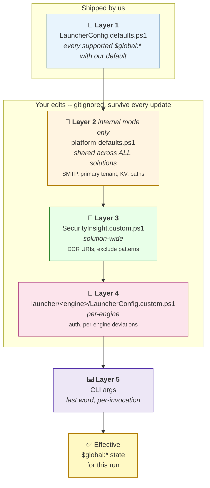

Each layer only writes the values it cares about. If you don't set anything at Layer 4, Layer 3 values pass through. If you don't have Layer 3 either, Layer 1 defaults apply. This is why a working community install can be as small as a 3-line `LauncherConfig.custom.ps1` containing only the SPN auth.

</details>

<a id="78-end-to-end-architecture"></a><a id="end-to-end-architecture"></a>

### 8.7 End-to-end architecture

[⤴ Back to top](#top)

<details>
<summary><b>Show details (expand)</b></summary>

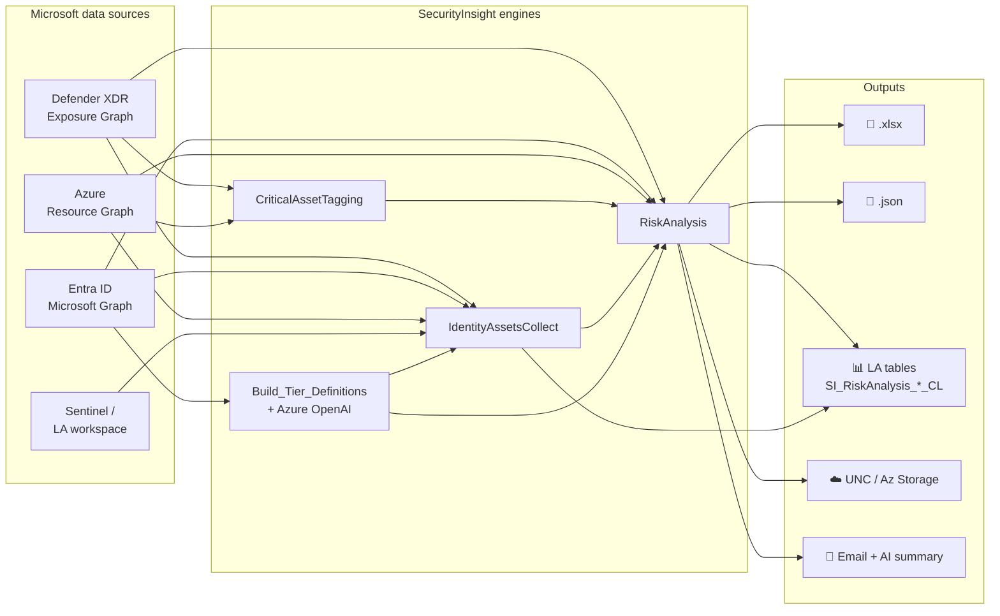

---

<a id="locked-catalog-full-inventory"></a>

<a id="locked-catalog"></a>
### 8.8 Locked catalog — full query / rule inventory

Inventory snapshot (auto-derived from the current `risk-analysis-detection/`, `asset-profiling-enrichment/`, `asset-profiling-schema/`, and `privilege-tier-catalog/` trees):

| 📦 Detection queries + tagging rules — included | Count |
|---|---:|
| 🎯 **Risk Analysis reports** — attacker-centric KQL across Endpoint, Identity, Azure, PublicIP. Auto-generated from `risk-analysis-detection/RiskAnalysis_Queries_Locked.yaml`. | **138** (69 Summary + 69 Detailed: Identity 94 + Endpoint/Device 16 + Azure 4 + Attack Paths 20 + PublicIP/Shodan 4) |
| 🏷️ **Asset-classification rules** — `hasMdeMachineGroupTag` / `hasAzureTag` / `egDetectedRoles` / `nameMatches` / `IPSubnetMatch` / `entraGroupMember` / `groupMembership` / `hasSoftwareInstalled` across Identity, Endpoint, Azure PaaS. Each is a `.locked.yaml` in `asset-profiling-enrichment/`. | **549** (548 endpoint — 545 application/service detections + device type + logon user + asset tagging — and 1 cross-engine `shared/` default tier) |
| 🧬 **Profile schema** — flat-column LA columns the engine emits per asset | **743** fields total across 4 tables (`SI_Endpoint_Profile_CL` 185 + `SI_Identity_Profile_CL` 174 + `SI_Azure_Profile_CL` 332 + `SI_PublicIP_Profile_CL` 52) |
| 📚 **Schema definitions** | **4** — `asset-profiling-schema/{azure,endpoint,identity,public-ip}.schema.locked.json` |
| 👑 **Privilege tier catalog** | **1** — `privilege-tier-catalog/privilege-tier-catalog.locked.json` |
| 🔌 **Provider connectors** | **2** — `asset-profiling-providers/{entra, generic-cmdb}` |

**🤖 AI-classified tier catalog** — every role / permission slotted into Tier 0–3 by the AI integration in SecurityInsight:

| Category | Tier 0 | Tier 1 | Tier 2 | Tier 3 | **Total** |
|---|---:|---:|---:|---:|---:|
| **AD built-in groups** | 9 | 6 | 3 | 51 | **69** |
| **Entra built-in roles** | 5 | 23 | 20 | 95 | **143** |
| **Entra / Graph API permissions** | 2 | 59 | 138 | 1,027 | **1,226** |
| **Azure built-in roles** | 3 | 14 | 130 | 726 | **873** |
| **All categories — grand total** | **19** | **102** | **291** | **1,899** | **2,311** |

Run `tests/Test-Smoke.ps1 -Inventory` for the live count.

[⤴ Back to top](#top)

<details>
<summary><b>Show details (expand)</b></summary>

Every name + one-line purpose of every Risk Analysis report and every application/service detection rule that ships in the `*_Locked.yaml` / `*.locked.yaml` files — replaced on every update, while your `.custom` files are never touched. The full KQL and detection logic behind each entry lives in those YAML files.

#### Risk Analysis — 138 Locked reports (sorted by SecurityDomain)

| # | Domain | Report name | Purpose |
|---:|---|---|---|
| 1 | Azure | `Attack_Paths_Detailed_Credential_Based_Lateral_Movement` | Per-row detail of credential-driven lateral-movement paths to Azure and Endpoint targets, prioritized by FINAL TARGET business impact. |
| 2 | Azure | `Attack_Paths_Detailed_Data_Sensitivity_to_Exposed_Credentials` | Per-row detail of credential-driven attack paths to sensitive data locations prioritized by FINAL TARGET business impact. |
| 3 | Azure | `Attack_Paths_Detailed_Github_to_Azure_Resources` | Per-row detail of credential-driven attack paths from GitHub to Azure targets, prioritized by FINAL TARGET business impact. |
| 4 | Azure | `Attack_Paths_Detailed_Identity_Group_Membership_to_Privileged_Resources` | Per-row detail of group-membership privilege paths to Azure resources prioritized by FINAL TARGET business impact. |
| 5 | Azure | `Attack_Paths_Detailed_Public_IP_to_VM_with_CVE_Exploitation` | Per-row detail of internet-exposed vulnerable assets prioritized by FINAL TARGET business impact. |
| 6 | Azure | `Attack_Paths_Detailed_Workload_ManagedIdentity_to_Azure_Resources` | Per row, a workload (virtual machine, container app, web app, function, database, AI service) that signs in as a managed identity, and an Azure resource that identity holds a role or permission on. |
| 7 | Azure | `Attack_Paths_Summary_Credential_Based_Lateral_Movement` | Credential-driven lateral-movement paths to Azure and Endpoint targets prioritized by FINAL TARGET business impact. |
| 8 | Azure | `Attack_Paths_Summary_Data_Sensitivity_to_Exposed_Credentials` | Credential-driven attack paths to sensitive data locations prioritized by FINAL TARGET business impact. |
| 9 | Azure | `Attack_Paths_Summary_Github_to_Azure_Resources` | Credential-driven attack paths from GitHub to Azure targets, prioritized by FINAL TARGET business impact. |
| 10 | Azure | `Attack_Paths_Summary_Identity_Group_Membership_to_Privileged_Resources` | Group-membership privilege paths to Azure resources prioritized by FINAL TARGET business impact. |
| 11 | Azure | `Attack_Paths_Summary_Public_IP_to_VM_with_CVE_Exploitation` | Internet-exposed vulnerable assets prioritized by FINAL TARGET business impact. |
| 12 | Azure | `Attack_Paths_Summary_Workload_ManagedIdentity_to_Azure_Resources` | Workloads that sign in as a managed identity holding access to Azure resources, grouped by the tier of the resources reached and the tiers the path climbs. |
| 13 | Azure | `Azure_DefenderRecommendations_Detailed` | Every Defender for Cloud (Secure Score) recommendation, one row per (resource x recommendation); container-image and cloud-posture entities rolled up to their parent w... |
| 14 | Azure | `Azure_DefenderRecommendations_Summary` | Every Defender for Cloud (Secure Score) recommendation, summarised per recommendation x tier x severity with the impacted assets listed; container-image and cloud-post... |
| 15 | Azure | `Azure_Recommendations_Detailed` | Per-row detail of Azure ExposureGraph recommendations, prioritised by criticality + Internet-Exposed + edge risk factors. |
| 16 | Azure | `Azure_Recommendations_Summary` | Azure ExposureGraph recommendations prioritised by criticality + Internet-Exposed + risk factors. |
| 17 | Endpoint | `Attack_Paths_Detailed_Device_with_high_severity_vulnerabilities_allows_lateral_movement_Azure` | Per-row detail of credential-driven attack paths from vulnerable devices to Azure targets, prioritized by FINAL TARGET business impact. |
| 18 | Endpoint | `Attack_Paths_Summary_Device_with_high_severity_vulnerabilities_allows_lateral_movement_Azure` | Vulnerable-device-to-Azure-target attack paths prioritized by FINAL TARGET business impact. |
| 19 | Endpoint | `Device_BrowserExtensions_Detailed` | Per-row detail of browser extensions on endpoints that Defender vulnerability management rates High or Critical risk, one row per device and extension. |
| 20 | Endpoint | `Device_BrowserExtensions_Summary` | Browser extensions on endpoints that Defender vulnerability management rates High or Critical risk because of the permissions they hold. Needs the Defender Vulnerability Management add-on. |
| 21 | Endpoint | `Device_Certificates_Detailed` | Per-row detail of endpoint certificates that are about to expire, recently expired, or weak, one row per device and kind of problem. |
| 22 | Endpoint | `Device_Certificates_Summary` | Certificates on endpoints that expire within 30 days, expired in the last 30 days, or use a weak key or signature. Needs the Defender Vulnerability Management add-on. |
| 23 | Endpoint | `Device_EndOfSupport_Software_Detailed` | Per-row detail of endpoint software that is past or near its end of support, one row per device and finding. |
| 24 | Endpoint | `Device_EndOfSupport_Software_Summary` | Software on endpoints that is past or near its end of support, prioritised by asset criticality and exposure. |
| 25 | Endpoint | `Device_Missing_CVEs_Detailed` | Per-row detail of overdue endpoint CVEs, prioritised by asset criticality, exploit signals, and exposure. |
| 26 | Endpoint | `Device_Missing_CVEs_Summary` | This report highlights overdue endpoint CVEs older than 40 days, excluding out-of-scope assets, and prioritizes them using asset criticality, tag-based tiering, and ex... |
| 27 | Endpoint | `Device_Recommendations_Detailed` | Per-row detail of non-compliant TVM secure configuration controls on endpoints, prioritised by criticality + exposure + legacy-OS. |
| 28 | Endpoint | `Device_Recommendations_Summary` | Non-compliant TVM secure configuration controls on endpoints, prioritised by criticality + exposure + legacy-OS. |
| 29 | Endpoint | `Endpoint_ActiveCompromise_Detected_Detailed` | Per-asset detail view of Tier 0/1 endpoints flagged by Microsoft Exposure Mgmt as recently compromised. |
| 30 | Endpoint | `Endpoint_ActiveCompromise_Detected_Summary` | Endpoints of every tier (ranked by tier) where Microsoft Exposure Mgmt has flagged recent compromise indicators (NodeProperties.rawData.isCompromisedRecently). |
| 31 | Endpoint | `Endpoint_ConflictingTierTags_Detailed` | Every endpoint whose operator tags assert TWO OR MORE different criticality tiers at once, with the exact conflicting tags. |
| 32 | Endpoint | `Endpoint_ConflictingTierTags_Summary` | How many endpoints carry operator tags that assert more than one criticality tier, grouped by the most critical tier claimed, with the assets listed. |
| 33 | Endpoint | `Endpoint_ExcludedAssets_Detailed` | Every endpoint currently suppressed from Risk Analysis by an operator exclusion tag, and the exact tag that did it. |
| 34 | Endpoint | `Endpoint_ExcludedAssets_Summary` | How many endpoints are currently suppressed from Risk Analysis by an operator exclusion tag, grouped by criticality tier, with the assets and the exact tags listed. |
| 35 | Identity | `Attack_Paths_Detailed_Owner_to_Privileged_Service_Principal` | Per row, an owner of a Tier 0 or Tier 1 service principal (enterprise application or its application registration) who is on a less critical tier than the application. |
| 36 | Identity | `Attack_Paths_Detailed_ServicePrincipal_Impersonates_Users` | Per row, a service principal (application) the Exposure Graph says can impersonate a user, and what that user reaches. |
| 37 | Identity | `Attack_Paths_Detailed_SignIn_Entitlement_to_Tier0_Servers` | Per row, a user who is entitled to sign in to or administer a Tier 0 server and is not Tier 0 -- directly, or through a group the user is a member of. |
| 38 | Identity | `Attack_Paths_Summary_Owner_to_Privileged_Service_Principal` | Tier 0 and Tier 1 service principals owned by accounts on a less critical tier -- each owner can add a credential and sign in as the application. |
| 39 | Identity | `Attack_Paths_Summary_ServicePrincipal_Impersonates_Users` | Service principals (applications) the Exposure Graph says can impersonate users, grouped by the tier of the users they can act as and the tiers the path climbs. |
| 40 | Identity | `Attack_Paths_Summary_SignIn_Entitlement_to_Tier0_Servers` | Users who are entitled to sign in to or administer Tier 0 servers without being Tier 0 themselves, directly or through a group, grouped by the tiers the path climbs. |
| 41 | Identity | `Identity_Admin_LogonTo_InternetExposedDevice_Detailed` | Per-row detail view for Identity_Admin_LogonTo_InternetExposedDevice_Summary. |
| 42 | Identity | `Identity_Admin_LogonTo_InternetExposedDevice_Summary` | Privileged users (Tier 0/1) authenticated to internet-facing devices. |
| 43 | Identity | `Identity_Admin_LogonTo_LowTierDevice_Detailed` | Per-row detail view for Identity_Admin_LogonTo_LowTierDevice_Summary. |
| 44 | Identity | `Identity_Admin_LogonTo_LowTierDevice_Summary` | Tier 0 privileged users (Global Admin, Domain Admin etc) authenticating to devices that are NOT classified as Tier 0 assets. |
| 45 | Identity | `Identity_Admin_LogonTo_VulnerableDevice_Detailed` | Per-pair detail: privileged admin and the specific vulnerable device they can authenticate to. |
| 46 | Identity | `Identity_Admin_LogonTo_VulnerableDevice_Summary` | Privileged users (permanent or PIM-eligible Tier 0/1 roles) who are observed authenticating to devices that have high or critical severity CVEs outstanding. |
| 47 | Identity | `Identity_AdminAccount_NeverUsed_Detailed` | Per-row detail view for Identity_AdminAccount_NeverUsed_Summary. |
| 48 | Identity | `Identity_AdminAccount_NeverUsed_Summary` | Privileged accounts (Tier 0/1) created more than 14 days ago that have never signed in. |
| 49 | Identity | `Identity_AdminAccount_OnPremSynced_Detailed` | Per-row detail view for Identity_AdminAccount_OnPremSynced_Summary. |
| 50 | Identity | `Identity_AdminAccount_OnPremSynced_Summary` | Privileged admin accounts (Tier 0/1) that are synchronised from on-premises AD rather than being cloud-only. |
| 51 | Identity | `Identity_AdNestedCriticalGroup_NoEntraRole_Detailed` | Users in an AD nested critical group (Domain Admins / Schema Admins / Enterprise Admins via nesting) but holding NO Entra role. |
| 52 | Identity | `Identity_AdNestedCriticalGroup_NoEntraRole_Summary` | Users in an AD nested critical group (Domain Admins / Schema Admins / Enterprise Admins via nesting) but holding NO Entra role. |
| 53 | Identity | `Identity_BreakGlass_Anomaly_Detailed` | Per-row detail view for Identity_BreakGlass_Anomaly_Summary. |
| 54 | Identity | `Identity_BreakGlass_Anomaly_Summary` | Break-glass emergency access accounts with anomalous sign-in patterns. |
| 55 | Identity | `Identity_BreakGlass_SignIn_Detected_Detailed` | Per-row detail view for Identity_BreakGlass_SignIn_Detected_Summary. |
| 56 | Identity | `Identity_BreakGlass_SignIn_Detected_Summary` | Any successful sign-in by an account flagged as a break-glass emergency account. |
| 57 | Identity | `Identity_Departed_AccountStillEnabled_Detailed` | Users whose EmployeeLeaveDateTime is in the past but the account is still enabled. |
| 58 | Identity | `Identity_Departed_AccountStillEnabled_Summary` | Users whose EmployeeLeaveDateTime is in the past but the account is still enabled. |
| 59 | Identity | `Identity_DisabledAccount_ActivePIMAssignment_Detailed` | Per-row detail view for Identity_DisabledAccount_ActivePIMAssignment_Summary. |
| 60 | Identity | `Identity_DisabledAccount_ActivePIMAssignment_Summary` | Disabled user accounts that still have PIM eligible role assignments active. |
| 61 | Identity | `Identity_DisabledPrivilegedUser_Detailed` | Identities flagged DisabledPrivilegedUser by the engine -- account disabled but still carries privileged role assignment. |
| 62 | Identity | `Identity_DisabledPrivilegedUser_Summary` | Identities flagged DisabledPrivilegedUser by the engine -- account disabled but still carries privileged role assignment. |
| 63 | Identity | `Identity_DisabledUser_StillInCriticalGroup_Detailed` | Disabled users still in critical AD nested groups OR with active Entra roles. |
| 64 | Identity | `Identity_DisabledUser_StillInCriticalGroup_Summary` | Disabled users still in critical AD nested groups OR with active Entra roles. |
| 65 | Identity | `Identity_EligibleAdmin_LogonTo_ExploitableDevice_Detailed` | Per-row detail view for Identity_EligibleAdmin_LogonTo_ExploitableDevice_Summary. |
| 66 | Identity | `Identity_EligibleAdmin_LogonTo_ExploitableDevice_Summary` | Users with PIM-eligible Tier 0/1 roles authenticated to devices that have vulnerabilities with known exploits available (isExploitVerified or isInExploitKit). |
| 67 | Identity | `Identity_ExternalUser_PrivilegedRole_Detailed` | Per-row detail view for Identity_ExternalUser_PrivilegedRole_Summary. |
| 68 | Identity | `Identity_ExternalUser_PrivilegedRole_Summary` | External/B2B guest users with Tier 0/1 Entra ID roles. |
| 69 | Identity | `Identity_GuestWithPrivilegedRole_Detailed` | B2B Guest users (UserType=Guest) holding ANY Entra role -- guests should never have privileged roles. |
| 70 | Identity | `Identity_GuestWithPrivilegedRole_Summary` | B2B Guest users (UserType=Guest) holding ANY Entra role -- guests should never have privileged roles. |
| 71 | Identity | `Identity_HighMDIInvestigationPriority_Detailed` | Per-row detail view for Identity_HighMDIInvestigationPriority_Summary. |
| 72 | Identity | `Identity_HighMDIInvestigationPriority_Summary` | Active accounts with MDI Investigation Priority Percentile in the top 10% (MDI_InvestigationPriorityPct >= 90). |
| 73 | Identity | `Identity_HighRiskFactorComposite4Plus_Detailed` | Identities with 4+ risk factors flagged. |
| 74 | Identity | `Identity_HighRiskFactorComposite4Plus_Summary` | Identities with 4+ risk factors flagged. |
| 75 | Identity | `Identity_HighValueTarget_MDIRisk_Detailed` | Per-row detail view for Identity_HighValueTarget_MDIRisk_Summary. |
| 76 | Identity | `Identity_HighValueTarget_MDIRisk_Summary` | Identities flagged by Microsoft Defender for Identity as high or critical risk, cross-referenced with our asset tier classification. |
| 77 | Identity | `Identity_MultiTenant_HighPermission_SPN_Detailed` | Per-row detail view for Identity_MultiTenant_HighPermission_SPN_Summary. |
| 78 | Identity | `Identity_MultiTenant_HighPermission_SPN_Summary` | Multi-tenant service principals (accessible from external tenants) with Tier 0/1 permissions. |
| 79 | Identity | `Identity_NewAccount_ImmediateTier0Role_Detailed` | Per-row detail view for Identity_NewAccount_ImmediateTier0Role_Summary. |
| 80 | Identity | `Identity_NewAccount_ImmediateTier0Role_Summary` | User accounts created within the last 24 hours that already have a Tier 0 Entra ID role assigned. |
| 81 | Identity | `Identity_NoMFA_Detailed` | Per-row detail view for Identity_AnyUser_NoMFA_Summary. |
| 82 | Identity | `Identity_NoMFA_Summary` | All enabled users with no MFA registration, across all tiers. |
| 83 | Identity | `Identity_PasswordNeverExpires_Privileged_Detailed` | Per-row detail view for Identity_PasswordNeverExpires_Privileged_Summary. |
| 84 | Identity | `Identity_PasswordNeverExpires_Privileged_Summary` | Privileged accounts with password-never-expires flag set. |
| 85 | Identity | `Identity_PermanentPrivilegedRole_Detailed` | Per-row detail view for Identity_PermanentPrivilegedRole_Summary. |
| 86 | Identity | `Identity_PermanentPrivilegedRole_Summary` | Privileged users with permanent (non-PIM) role assignments. |
| 87 | Identity | `Identity_PIM_DuplicateRoleAssignment_Detailed` | Per-row detail view for Identity_PIM_DuplicateRoleAssignment_Summary. |
| 88 | Identity | `Identity_PIM_DuplicateRoleAssignment_Summary` | Users who have the same Entra ID role assigned both permanently AND as PIM eligible. |
| 89 | Identity | `Identity_PIM_EligibleNeverActivated_Detailed` | Per-row detail view for Identity_PIM_EligibleNeverActivated_Summary. |
| 90 | Identity | `Identity_PIM_EligibleNeverActivated_Summary` | Users with PIM-eligible Tier 0/1 role assignments that have never been activated (no interactive sign-in with the role active). |
| 91 | Identity | `Identity_PrivilegedRole_PermanentNotEligible_Detailed` | Users / SPNs holding PERMANENT (always-on) privileged role assignments instead of PIM-eligible. |
| 92 | Identity | `Identity_PrivilegedRole_PermanentNotEligible_Summary` | Users / SPNs holding PERMANENT (always-on) privileged role assignments instead of PIM-eligible. |
| 93 | Identity | `Identity_PrivilegedSPN_NoLogin180Days_Detailed` | Per-SPN/MI detail for privileged workloads inactive for 180+ days. |
| 94 | Identity | `Identity_PrivilegedSPN_NoLogin180Days_Summary` | Service Principals and Managed Identities with Tier 0/1 permissions (high-privilege app roles or directory roles) that have not authenticated for 180+ days. |
| 95 | Identity | `Identity_PrivilegedUser_NoConditionalAccess_Detailed` | Privileged users whose recent successful sign-ins did NOT trigger any Conditional Access policy. |
| 96 | Identity | `Identity_PrivilegedUser_NoConditionalAccess_Summary` | Privileged users whose recent successful sign-ins did NOT trigger any Conditional Access policy. |
| 97 | Identity | `Identity_PrivilegedUser_SignIn_NonTrustedLocation_Detailed` | Per-user detail: privileged accounts with non-trusted location sign-ins. |
| 98 | Identity | `Identity_PrivilegedUser_SignIn_NonTrustedLocation_Summary` | Privileged users (Tier 0/1) who have successfully signed in from a network location that is NOT defined as a trusted named location in Conditional Access. |
| 99 | Identity | `Identity_PrivilegedUser_StalePassword_Detailed` | Per-row detail view for Identity_PrivilegedUser_StalePassword_Summary. |
| 100 | Identity | `Identity_PrivilegedUser_StalePassword_Summary` | Privileged accounts whose password has not been changed in over 365 days. |
| 101 | Identity | `Identity_ServiceAccount_InteractiveSignIn_Detailed` | Per-row detail view for Identity_ServiceAccount_InteractiveSignIn_Summary. |
| 102 | Identity | `Identity_ServiceAccount_InteractiveSignIn_Summary` | Accounts classified by MDI as service accounts (MDI_IsServiceAccount = true) that have interactive human sign-ins recorded in SigninLogs. |
| 103 | Identity | `Identity_ServiceAccount_SignIn_NonTrustedLocation_Detailed` | Per-row detail view for Identity_ServiceAccount_SignIn_NonTrustedLocation_Summary. |
| 104 | Identity | `Identity_ServiceAccount_SignIn_NonTrustedLocation_Summary` | Accounts classified as service accounts by MDI (MDI_IsServiceAccount = true) that have successfully authenticated from non-trusted network locations. |
| 105 | Identity | `Identity_ShadowAdmin_Detailed` | Per-row detail view for Identity_ShadowAdmin_Summary. |
| 106 | Identity | `Identity_ShadowAdmin_Summary` | Users classified as shadow admins: they hold Tier 0/1 AD group membership (e.g. |
| 107 | Identity | `Identity_SPN_AppRoleAssignmentWrite_Detailed` | Per-row detail view for Identity_SPN_AppRoleAssignmentWrite_Summary. |
| 108 | Identity | `Identity_SPN_AppRoleAssignmentWrite_Summary` | Service Principals with AppRoleAssignment.ReadWrite.All permission. |
| 109 | Identity | `Identity_SPN_ExpiringCredentials_Detailed` | Per-row detail view for Identity_SPN_ExpiringCredentials_Summary. |
| 110 | Identity | `Identity_SPN_ExpiringCredentials_Summary` | Service Principals with client secrets or certificates that have expired or will expire within 30 days. |
| 111 | Identity | `Identity_SPN_MailboxAccess_Detailed` | Per-row detail view for Identity_SPN_MailboxAccess_Summary. |
| 112 | Identity | `Identity_SPN_MailboxAccess_Summary` | Service Principals with mailbox-level Microsoft Graph permissions (Mail.ReadWrite, Mail.Send, MailboxSettings.ReadWrite or equivalent). |
| 113 | Identity | `Identity_SPN_MailboxImpersonation_Detailed` | SPNs holding Mail.Read / Mail.Send / Mail.ReadWrite as APPLICATION permission (impersonates ANY user mailbox tenant-wide). |
| 114 | Identity | `Identity_SPN_MailboxImpersonation_Summary` | SPNs holding Mail.Read / Mail.Send / Mail.ReadWrite as APPLICATION permission (impersonates ANY user mailbox tenant-wide). |
| 115 | Identity | `Identity_SPN_Orphan_NoOwner_Detailed` | Per-row detail view for Identity_SPN_Orphan_NoOwner_Summary. |
| 116 | Identity | `Identity_SPN_Orphan_NoOwner_Summary` | Service Principals with no registered owner. |
| 117 | Identity | `Identity_SPN_OverCredentialed_Detailed` | Per-row detail view for Identity_SPN_OverCredentialed_Summary. |
| 118 | Identity | `Identity_SPN_OverCredentialed_Summary` | Service Principals that have both a client secret AND a certificate registered. |
| 119 | Identity | `Identity_SPN_OwnerMismatch_Detailed` | SPNs whose Owner is different from the Application Owner -- common in apps inherited from a departed employee where ownership got cleaned up only on one side. |
| 120 | Identity | `Identity_SPN_OwnerMismatch_Summary` | SPNs whose Owner is different from the Application Owner -- common in apps inherited from a departed employee where ownership got cleaned up only on one side. |
| 121 | Identity | `Identity_SPN_OwnsResourcePublicAccess_Detailed` | Service principals and managed identities that hold an Azure role on a publicly exposed resource -- direct, or Owner / Contributor inherited from its resource group or subscription... |
| 122 | Identity | `Identity_SPN_OwnsResourcePublicAccess_Summary` | Service principals and managed identities that hold an Azure role on a publicly exposed resource -- direct, or Owner / Contributor inherited from its resource group or subscription... |
| 123 | Identity | `Identity_SPN_PrivilegedAccessWrite_Detailed` | Per-row detail view for Identity_SPN_PrivilegedAccessWrite_Summary. |
| 124 | Identity | `Identity_SPN_PrivilegedAccessWrite_Summary` | Service Principals with PrivilegedAccess.ReadWrite.AzureAD permission. |
| 125 | Identity | `Identity_SPN_RoleManagementWrite_Detailed` | Per-row detail view for Identity_SPN_RoleManagementWrite_Summary. |
| 126 | Identity | `Identity_SPN_RoleManagementWrite_Summary` | Service Principals with the RoleManagement.ReadWrite.Directory Graph permission. |
| 127 | Identity | `Identity_SPN_UnverifiedPublisher_HighPermission_Detailed` | Per-row detail view for Identity_SPN_UnverifiedPublisher_HighPermission_Summary. |
| 128 | Identity | `Identity_SPN_UnverifiedPublisher_HighPermission_Summary` | Service Principals with Tier 0/1 permissions whose publisher has not been verified by Microsoft. |
| 129 | Identity | `Identity_StaleGuest_NoLogin90Days_Detailed` | Per-row detail view for Identity_StaleGuest_NoLogin90Days_Summary. |
| 130 | Identity | `Identity_StaleGuest_NoLogin90Days_Summary` | B2B guest/external collaborator accounts with no sign-in for 90+ days. |
| 131 | Identity | `Identity_StaleUser_NoLogin180Days_Detailed` | Per-user detail for enabled accounts with no sign-in for 180+ days. |
| 132 | Identity | `Identity_StaleUser_NoLogin180Days_Summary` | Enabled user accounts with no interactive or non-interactive sign-in for 180+ days. |
| 133 | Identity | `Identity_TooManyGlobalAdmins_Detailed` | Per-row detail view for Identity_TooManyGlobalAdmins_Summary. |
| 134 | Identity | `Identity_TooManyGlobalAdmins_Summary` | Detects when the organisation has more than 5 active Global Administrator accounts. |
| 135 | PublicIP | `PublicIP_OpenPorts_Detailed` | Per-row Detailed view of public-IP open ports. |
| 136 | PublicIP | `PublicIP_OpenPorts_Summary` | Public IPs that Shodan reports with one or more open ports, aggregated per asset. |
| 137 | PublicIP | `PublicIP_Vulnerabilities_Detailed` | Per-row Detailed view of public-IP CVEs. |
| 138 | PublicIP | `PublicIP_Vulnerabilities_Summary` | Public IPs that Shodan reports with one or more known CVEs. |

#### Risk Analysis — 4 Locked report templates (orchestrators)

Templates bundle multiple reports into one launcher run (the Summary / Detailed flavours, plus two load-test bundles).

| # | Template name | Includes | Purpose |
|---:|---|---:|---|
| 1 | `RiskAnalysis_Detailed` | 65 | Detailed — every Detailed report |
| 2 | `RiskAnalysis_Summary` | 65 | Summary — every Summary report |
| 3 | `AssetSimulationComplexSummary` | 11 | Load test — the heaviest cross-domain Summary reports, run with `-RunAssetSimulation ComplexSummary` |
| 4 | `AssetSimulationComplexDetailed` | 8 | Load test — their Detailed counterparts, run with `-RunAssetSimulation ComplexDetailed` |

#### Application & service detection — 545 Locked rules (sorted by category)

Each rule recognises one server role, application or appliance from Defender signals (installed software, Exposure Graph roles, listening services, name patterns) and feeds the tier decision. Every rule is a YAML file in `asset-profiling-enrichment/endpoint/AssetProfileByApplicationServiceDetection/`; a `.custom.yaml` with the same name overrides it.

| # | Category | Rule | Detects |
|---:|---|---|---|
| 1 | Analytics | `AlteryxServer` | Alteryx Server |
| 2 | Analytics | `ApacheHadoop` | Apache Hadoop |
| 3 | Analytics | `ApacheSpark` | Apache Spark |
| 4 | Analytics | `SasSas` | SAS |
| 5 | API Gateway | `GoogleApigeeEdge` | Apigee Edge |
| 6 | API Gateway | `KongGateway` | Kong Gateway |
| 7 | API Gateway | `Wso2ApiManager` | WSO2 API Manager |
| 8 | App Delivery | `MicrosoftApplicationVirtualization` | Microsoft Application Virtualization |
| 9 | App Server | `ApacheTomcat` | Apache Tomcat |
| 10 | App Server | `EclipseJetty` | Eclipse Jetty |
| 11 | App Server | `IbmWebsphereApplicationServer` | IBM WebSphere Application Server |
| 12 | App Server | `IbmWebsphereLiberty` | IBM WebSphere Liberty |
| 13 | App Server | `OracleGlassfishServer` | GlassFish Server |
| 14 | App Server | `OracleWeblogicServer` | Oracle WebLogic Server |
| 15 | App Server | `RedhatJbossEnterpriseApplicationPlatform` | JBoss Enterprise Application Platform |
| 16 | App Server | `RedhatWildfly` | WildFly |
| 17 | Artifact Repo | `JfrogArtifactory` | JFrog Artifactory |
| 18 | Artifact Repo | `SonatypeNexusRepositoryManager` | Sonatype Nexus Repository Manager |
| 19 | Authentication | `CiscoSecureAccessByDuo` | Cisco Secure Access by Duo |
| 20 | Authentication | `DuoAuthenticationProxy` | Duo Authentication Proxy |
| 21 | Authentication | `DuoSecurityForWindowsLogon` | Duo Security for Windows Logon |
| 22 | Authentication | `FortinetFortiauthenticator` | FortiAuthenticator |
| 23 | Authentication | `FreeradiusFreeradius` | FreeRADIUS |
| 24 | Authentication | `MicrosoftAzureMfaNpsExtension` | Microsoft Entra multifactor authentication NPS extension |
| 25 | Authentication | `MicrosoftNetworkPolicyServer` | Microsoft Network Policy Server |
| 26 | Authentication | `NetiqAdvancedAuthentication` | NetIQ Advanced Authentication |
| 27 | Authentication | `RsaAuthenticationManager` | RSA Authentication Manager |
| 28 | Authentication | `RsaSecuridAuthenticationAgent` | RSA SecurID Authentication Agent |
| 29 | Authentication | `YubicoAuthenticator` | Yubico Authenticator |
| 30 | Automation | `MicrosoftSystemCenterOrchestrator` | Microsoft System Center Orchestrator |
| 31 | Backup | `AcronisCyberProtect` | Acronis Cyber Backup |
| 32 | Backup | `ArcserveUdp` | Arcserve Backup |
| 33 | Backup | `CohesityDataprotect` | Cohesity DataProtect |
| 34 | Backup | `CohesityHelios` | Cohesity Helios |
| 35 | Backup | `CommvaultCommvault` | Commvault Server |
| 36 | Backup | `CommvaultHyperscale` | Commvault HyperScale |
| 37 | Backup | `DellAvamar` | Dell EMC Avamar Server |
| 38 | Backup | `DellNetworker` | Dell EMC NetWorker |
| 39 | Backup | `DruvaInsync` | Druva inSync |
| 40 | Backup | `DruvaPhoenix` | Druva Phoenix |
| 41 | Backup | `IbmSpectrumProtect` | IBM Spectrum Protect |
| 42 | Backup | `MicrosoftAzureBackupServer` | Microsoft Azure Backup Server |
| 43 | Backup | `MicrosoftAzureRecoveryServicesAgent` | Microsoft Azure Recovery Services Agent |
| 44 | Backup | `MicrosoftSystemCenterDataProtectionManager` | Microsoft System Center Data Protection Manager |
| 45 | Backup | `RubrikCdm` | Rubrik Cluster |
| 46 | Backup | `RubrikPolaris` | Rubrik Polaris |
| 47 | Backup | `VeeamAgentForMicrosoftWindows` | Veeam Agent for Microsoft Windows |
| 48 | Backup | `VeeamBackupEnterpriseManager` | Veeam Backup Enterprise Manager |
| 49 | Backup | `VeeamBackupForAws` | Veeam Backup for AWS |
| 50 | Backup | `VeeamBackupForAzure` | Veeam Backup for Azure |
| 51 | Backup | `VeeamBackupForMicrosoft365` | Veeam Backup for Microsoft 365 |
| 52 | Backup | `VeeamBackupReplication` | Veeam Backup & Replication |
| 53 | Backup | `VeritasBackupExec` | Veritas Backup Exec |
| 54 | Backup | `VeritasNetbackup` | Veritas NetBackup Server |
| 55 | BI | `IbmCognosAnalytics` | IBM Cognos Analytics |
| 56 | BI | `MicrosoftPerformancePointServer` | Microsoft Performance Point Server |
| 57 | BI | `MicrosoftPowerBiGateway` | Microsoft Power BI Gateway |
| 58 | BI | `MicrosoftPowerBiReportServer` | Microsoft Power BI Report Server |
| 59 | BI | `MicrosoftPowerPivotForSharepoint` | Microsoft Power Pivot for SharePoint |
| 60 | BI | `MicrostrategyMicrostrategy` | MicroStrategy |
| 61 | BI | `OracleHyperion` | Oracle Hyperion |
| 62 | BI | `QlikSense` | Qlik Sense Enterprise |
| 63 | BI | `QlikViewServer` | QlikView Server |
| 64 | BI | `SapBusinessobjects` | SAP BusinessObjects |
| 65 | BI | `TableauServer` | Tableau Server |
| 66 | Build/CI | `AtlassianBamboo` | Atlassian Bamboo |
| 67 | Build/CI | `AtlassianBambooAgent` | Atlassian Bamboo Agent |
| 68 | Build/CI | `CircleciServer` | CircleCI Server |
| 69 | Build/CI | `GithubActionsRunner` | GitHub Actions Runner |
| 70 | Build/CI | `GitlabRunner` | GitLab Runner |
| 71 | Build/CI | `JenkinsAgent` | Jenkins Agent |
| 72 | Build/CI | `JenkinsJenkins` | Jenkins |
| 73 | Build/CI | `JetbrainsTeamcity` | TeamCity Server |
| 74 | Build/CI | `JetbrainsTeamcityAgent` | TeamCity Build Agent |
| 75 | Build/CI | `MicrosoftAzureDevopsServer` | Azure DevOps Server |
| 76 | Build/CI | `MicrosoftAzurePipelinesAgent` | Azure Pipelines Agent |
| 77 | CASB | `MicrosoftDefenderForCloudApps` | Microsoft Defender for Cloud Apps |
| 78 | Client Devices | `SecurityOperationsWorkstationSOCAnalyst` | Security Operations Workstation (SOC Analyst) |
| 79 | Cloud Mgmt | `AmazonSsmAgent` | AWS Systems Manager Agent |
| 80 | Cloud Migration | `MicrosoftAzureMigrateAppliance` | Microsoft Azure Migrate Appliance |
| 81 | CMS | `AdobeExperienceManager` | Adobe Experience Manager |
| 82 | CMS | `DrupalDrupal` | Drupal |
| 83 | CMS | `JoomlaJoomla` | Joomla |
| 84 | CMS | `SitecoreExperiencePlatform` | Sitecore Experience Platform |
| 85 | CMS | `WordpressWordpress` | WordPress |
| 86 | Collaboration | `AtlassianConfluenceServer` | Confluence Server |
| 87 | Collaboration | `IbmSametimeServer` | IBM Sametime Server |
| 88 | Collaboration | `MicrosoftSharepointFoundation` | Microsoft SharePoint Foundation |
| 89 | Collaboration | `MicrosoftSharepointServer` | Microsoft SharePoint Server 2019 |
| 90 | Collaboration | `MicrosoftSkypeForBusinessServer` | Microsoft Skype for Business Server |
| 91 | Collaboration | `MicrosoftTeamsRooms` | Microsoft Teams Rooms |
| 92 | Compliance | `MicrosoftBaselineSecurityAnalyzer` | Microsoft Baseline Security Analyzer |
| 93 | Compliance | `MicrosoftSecurityComplianceToolkit` | Microsoft Security Compliance Toolkit |
| 94 | Containers | `DockerEngine` | Docker Engine |
| 95 | Containers | `MirantisContainerRuntime` | Mirantis Container Runtime |
| 96 | Containers | `PortainerPortainer` | Portainer |
| 97 | Containers | `RancherServer` | Rancher Server |
| 98 | Containers | `VmwareTanzuApplicationService` | VMware Tanzu Application Service |
| 99 | Containers/Orchestration | `MicrosoftServiceFabric` | Microsoft Service Fabric |
| 100 | Coordination | `ApacheZookeeper` | Apache ZooKeeper |
| 101 | CRM | `MicrosoftDynamicsCrmServer` | Microsoft Dynamics CRM Server |
| 102 | Data Security | `VaronisDatadvantage` | Varonis DatAdvantage |
| 103 | Data Security | `VaronisDataprivilege` | Varonis DataPrivilege |
| 104 | Database | `ApacheCassandra` | Cassandra |
| 105 | Database | `CouchbaseServer` | Couchbase Server |
| 106 | Database | `IbmDb2` | IBM Db2 |
| 107 | Database | `IbmInformix` | IBM Informix |
| 108 | Database | `InfluxdataInfluxdb` | InfluxDB |
| 109 | Database | `IntersystemsIris` | InterSystems Cache |
| 110 | Database | `MariadbServer` | MariaDB Server |
| 111 | Database | `MicrosoftSqlServer` | Microsoft SQL Server 2022 |
| 112 | Database | `MicrosoftSqlServerAnalysisServices` | Microsoft SQL Server Analysis Services |
| 113 | Database | `MicrosoftSqlServerIntegrationServices` | Microsoft SQL Server Integration Services |
| 114 | Database | `MicrosoftSqlServerReportingServices` | Microsoft SQL Server Reporting Services |
| 115 | Database | `MongodbMongodb` | MongoDB Server |
| 116 | Database | `Neo4jNeo4j` | Neo4j |
| 117 | Database | `OracleDatabase` | Oracle Database 19c |
| 118 | Database | `OracleMysqlServer` | MySQL Server |
| 119 | Database | `PostgresqlPostgresql` | PostgreSQL |
| 120 | Database | `RedisRedis` | Redis |
| 121 | Database | `SapAdaptiveServerEnterprise` | SAP Adaptive Server Enterprise |
| 122 | Database | `SapHana` | SAP HANA Server |
| 123 | Database | `TeradataDatabase` | Teradata Database |
| 124 | Deployment | `OctopusDeployServer` | Octopus Deploy Server |
| 125 | Deployment | `OctopusTentacle` | Octopus Tentacle |
| 126 | DLP | `BroadcomDataLossPrevention` | Symantec DLP |
| 127 | DLP | `DigitalGuardianEndpointDlp` | Digital Guardian |
| 128 | DLP | `ForcepointDlp` | Forcepoint DLP |
| 129 | DLP | `MicrosoftPurviewInformationProtectionScanner` | Microsoft Purview Information Protection Scanner |
| 130 | DR/Replication | `MicrosoftAzureSiteRecovery` | Microsoft Azure Site Recovery |
| 131 | DR/Replication | `VmwareSiteRecoveryManager` | VMware Site Recovery Manager |
| 132 | DR/Replication | `VmwareVsphereReplication` | VMware vSphere Replication |
| 133 | DR/Replication | `ZertoVirtualManager` | Zerto Virtual Manager |
| 134 | DR/Replication | `ZertoVra` | Zerto Virtual Replication Appliance |
| 135 | E-commerce | `AdobeCommerce` | Magento Commerce |
| 136 | EDR | `CheckpointHarmonyEndpoint` | Check Point Endpoint Security E80 |
| 137 | EDR | `CiscoSecureEndpoint` | Cisco Secure Endpoint |
| 138 | EDR | `CrowdstrikeFalcon` | CrowdStrike Falcon |
| 139 | EDR | `SentineloneSingularity` | SentinelOne Singularity |
| 140 | EDR | `VmwareCarbonBlackAppControl` | Carbon Black App Control |
| 141 | EDR/AV | `BitdefenderGravityzone` | Bitdefender GravityZone |
| 142 | EDR/AV | `BroadcomCriticalSystemProtection` | Symantec Critical System Protection |
| 143 | EDR/AV | `BroadcomEndpointProtectionManager` | Symantec Endpoint Protection Manager |
| 144 | EDR/AV | `EsetProtect` | ESET Security Management Center |
| 145 | EDR/AV | `KasperskySecurityCenter` | Kaspersky Security Center |
| 146 | EDR/AV | `SophosEnterpriseConsole` | Sophos Enterprise Console |
| 147 | EDR/AV | `TrellixEpolicyOrchestrator` | McAfee ePolicy Orchestrator |
| 148 | EDR/AV | `TrendmicroApexCentral` | Trend Micro Apex Central |
| 149 | EDR/AV | `TrendmicroDeepSecurityManager` | Trend Micro Deep Security Manager |
| 150 | Encryption | `BroadcomEndpointEncryption` | Symantec Endpoint Encryption |
| 151 | Encryption | `SophosSafeguard` | Sophos Central Endpoint |
| 152 | Encryption | `TrellixDriveEncryption` | McAfee Drive Encryption |
| 153 | Endpoint Mgmt | `HclBigfixPlatform` | BigFix Platform |
| 154 | Endpoint Mgmt | `IvantiEndpointManager` | Ivanti Endpoint Manager |
| 155 | Endpoint Mgmt | `ManageengineEndpointCentral` | ManageEngine Endpoint Central |
| 156 | Endpoint Mgmt | `MicrosoftEndpointConfigurationManager` | Microsoft Endpoint Configuration Manager Console |
| 157 | Endpoint Mgmt | `MicrosoftSystemCenterConfigurationManager` | Microsoft Endpoint Configuration Manager |
| 158 | Endpoint Mgmt | `QuestKaceSma` | KACE Systems Management Appliance |
| 159 | Endpoint Mgmt | `TaniumServer` | Tanium Server |
| 160 | ERP | `EpicorErp` | Epicor ERP |
| 161 | ERP | `IfsApplications` | IFS Applications |
| 162 | ERP | `InforLn` | Infor LN |
| 163 | ERP | `MicrosoftDynamics365BusinessCentral` | Microsoft Dynamics 365 Business Central |
| 164 | ERP | `MicrosoftDynamicsAx` | Microsoft Dynamics AX |
| 165 | ERP | `MicrosoftDynamicsGp` | Microsoft Dynamics GP |
| 166 | ERP | `MicrosoftDynamicsNav` | Microsoft Dynamics NAV |
| 167 | ERP | `OracleEBusinessSuite` | Oracle E-Business Suite |
| 168 | ERP | `OracleJdEdwardsEnterpriseone` | Oracle JD Edwards EnterpriseOne |
| 169 | ERP | `OracleNetsuiteConnector` | NetSuite Connector |
| 170 | ERP | `OraclePeoplesoft` | Oracle PeopleSoft |
| 171 | ERP | `SageX3` | Sage 100 |
| 172 | ERP | `SapNetweaver` | SAP NetWeaver |
| 173 | File Storage | `MicrosoftDistributedFileSystem` | Microsoft Distributed File System |
| 174 | File Storage | `MicrosoftFileServer` | Microsoft File Server |
| 175 | Firewall Mgmt | `CheckpointR80SecurityManagement` | Check Point R80 Security Management |
| 176 | Firewall Mgmt | `CheckpointSmartconsole` | Check Point SmartConsole |
| 177 | Firewall Mgmt | `CiscoFirepowerManagementCenter` | Cisco Firepower Management Center |
| 178 | Firewall Mgmt | `FortinetFortimanager` | Fortinet FortiManager |
| 179 | Firewall Mgmt | `PaloaltonetworksPanorama` | Palo Alto Networks Panorama |
| 180 | FTP | `CerberusFtpServer` | Cerberus FTP Server |
| 181 | FTP | `FilezillaServer` | FileZilla Server |
| 182 | FTP | `GlobalscapeEft` | Globalscape EFT Server |
| 183 | FTP | `SolarwindsServU` | Solarwinds Serv-U FTP Server |
| 184 | HA/Cluster | `MicrosoftFailoverClustering` | Microsoft Failover Clustering |
| 185 | Hardware Mgmt | `CiscoUcsManager` | Cisco UCS Manager |
| 186 | Hardware Mgmt | `DellIdracServiceModule` | Dell iDRAC Service Module |
| 187 | Hardware Mgmt | `DellOpenmanageServerAdministrator` | Dell OpenManage Server Administrator |
| 188 | Hardware Mgmt | `HpeInsightManagement` | HP Insight Management Agents |
| 189 | Hardware Mgmt | `HpeSmartUpdateManager` | HPE iLO Service Pack |
| 190 | Hardware Mgmt | `LenovoXclarityAdministrator` | Lenovo XClarity Administrator |
| 191 | Hardware Mgmt | `LenovoXclarityProvisioningManager` | Lenovo XClarity Provisioning Manager |
| 192 | Hardware Mgmt | `SupermicroIpmiview` | Supermicro IPMIView |
| 193 | HCM | `WorkdayStudio` | Workday Studio |
| 194 | Hypervisor | `HypervisorHostRunningTier1GuestVMs` | Hypervisor Host Running Tier 1 Guest VMs |
| 195 | Hypervisor | `HypervisorHostRunningTier2GuestVMs` | Hypervisor Host Running Tier 2 Guest VMs |
| 196 | Hypervisor | `VCenterSCVMMManagementServerManagingTier0Hypervisors` | vCenter / SCVMM Management Server (Managing Tier 0 Hypervisors) |
| 197 | Hypervisor | `VCenterSCVMMManagementServerManagingTier1Hypervisors` | vCenter / SCVMM Management Server (Managing Tier 1 Hypervisors) |
| 198 | Identity | `AtlassianCrowd` | Atlassian Crowd |
| 199 | Identity | `IbmTivoliAccessManager` | IBM Tivoli Access Manager |
| 200 | Identity | `IbmTivoliDirectoryServer` | IBM Tivoli Directory Server |
| 201 | Identity | `IbmTivoliIdentityManager` | IBM Tivoli Identity Manager |
| 202 | Identity | `ManageengineAdselfservicePlus` | ManageEngine ADSelfService Plus |
| 203 | Identity | `MicrosoftActiveDirectory` | Active Directory Domain Services |
| 204 | Identity | `MicrosoftActiveDirectoryFederationServices` | Active Directory Federation Services |
| 205 | Identity | `MicrosoftActiveDirectoryFederationServicesProxy` | Microsoft Active Directory Federation Services Proxy |
| 206 | Identity | `MicrosoftActiveDirectoryLightweightDirectoryServices` | Active Directory Lightweight Directory Services |
| 207 | Identity | `MicrosoftActiveDirectoryRightsManagementServices` | Active Directory Rights Management Services |
| 208 | Identity | `MicrosoftAzureAdApplicationProxyConnector` | Microsoft Entra Application Proxy Connector |
| 209 | Identity | `MicrosoftAzureAdPasswordProtectionDcAgent` | Microsoft Entra Password Protection DC Agent |
| 210 | Identity | `MicrosoftAzureAdPasswordProtectionProxy` | Microsoft Entra Password Protection Proxy |
| 211 | Identity | `MicrosoftForefrontIdentityManager` | Forefront Identity Manager 2010 |
| 212 | Identity | `MicrosoftIdentityManager` | Microsoft Identity Manager 2016 |
| 213 | Identity | `MicrosoftLaps` | Microsoft LAPS |
| 214 | Identity | `MicrosoftWebApplicationProxy` | Microsoft Web Application Proxy |
| 215 | Identity | `NetwrixAccountLockoutExaminer` | Netwrix Account Lockout Examiner |
| 216 | Identity | `QuestActiveRoles` | Quest Active Roles |
| 217 | Identity | `QuestGpoadmin` | Quest GPOADmin |
| 218 | Identity Audit | `ManageengineAdauditPlus` | ManageEngine ADAudit Plus |
| 219 | Identity Audit | `NetwrixAuditor` | Netwrix Auditor |
| 220 | Identity Audit | `QuestChangeAuditor` | Quest Change Auditor |
| 221 | Identity Backup | `QuestRecoveryManagerForActiveDirectory` | Quest Recovery Manager for Active Directory |
| 222 | Identity Backup | `SemperisAdForestRecovery` | Semperis Active Directory Forest Recovery |
| 223 | Identity Backup | `SemperisDirectoryServicesProtector` | Semperis Directory Services Protector |
| 224 | Identity Governance | `OmadaIdentity` | Omada Identity |
| 225 | Identity Governance | `SailpointIdentityiq` | SailPoint IdentityIQ |
| 226 | Identity Governance | `SaviyntEicConnector` | Saviynt Enterprise Identity Cloud Connector |
| 227 | Identity Mgmt | `ManageengineAdmanagerPlus` | ManageEngine ADManager Plus |
| 228 | Identity Migration | `QuestOnDemandMigration` | Quest On Demand Migration |
| 229 | Identity Security | `MicrosoftAdvancedThreatAnalytics` | Microsoft Advanced Threat Analytics |
| 230 | Identity Security | `PingcastlePingcastle` | PingCastle |
| 231 | Identity Security | `SemperisPurpleKnight` | Purple Knight |
| 232 | Identity Security | `SpecteropsBloodhoundCommunity` | BloodHound Community Edition |
| 233 | Identity Security | `SpecteropsBloodhoundEnterprise` | BloodHound Enterprise |
| 234 | Identity Sync | `MicrosoftAzureAdConnect` | Microsoft Azure AD Connect |
| 235 | Identity Sync | `MicrosoftAzureAdConnectCloudProvisioningAgent` | Microsoft Entra Cloud Sync |
| 236 | Identity Sync | `MicrosoftAzureAdConnectHealth` | Microsoft Azure AD Connect Health agent for sync |
| 237 | Identity Sync | `MicrosoftAzureAdConnectHealthAdDs` | Microsoft Entra Connect Health agent for AD DS |
| 238 | Identity Sync | `MicrosoftAzureAdConnectHealthAdFs` | Microsoft Entra Connect Health agent for AD FS |
| 239 | Identity Sync | `MicrosoftAzureAdConnectSync` | Microsoft Azure AD Connect synchronization services |
| 240 | Infrastructure | `HSMAttachedServerStoringRootCAPrivateKeys` | HSM-Attached Server (Storing Root CA Private Keys) |
| 241 | Infrastructure | `NetworkAccessControlNACServer` | Network Access Control (NAC) Server |
| 242 | Infrastructure | `PrivilegedDeveloperMachineWithProductionSecretsOrPipelineCredentials` | Privileged Developer Machine with Production Secrets or Pipeline Credentials |
| 243 | Infrastructure | `SANStorageControllerBackingTier0VMs` | SAN / Storage Controller Backing Tier 0 VMs |
| 244 | Infrastructure | `VPNConcentratorRemoteAccessServer` | VPN Concentrator / Remote Access Server |
| 245 | Integration | `MicrosoftBiztalkServer` | Microsoft BizTalk Server |
| 246 | Integration | `MicrosoftHostIntegrationServer` | Microsoft Host Integration Server |
| 247 | Integration | `MulesoftAnypointRuntime` | MuleSoft Anypoint Runtime |
| 248 | Integration | `MulesoftAnypointStudio` | MuleSoft Anypoint Studio |
| 249 | IoT / OT | `BadgeReaderNonDomainIntegratedIsolated` | Badge Reader (Non-Domain Integrated, Isolated) |
| 250 | IoT / OT | `BuildingAutomationSystemBASServer` | Building Automation System (BAS) Server |
| 251 | IoT / OT | `BuildingManagementSystemBMSControllerWithDomainIntegration` | Building Management System (BMS) Controller with Domain Integration |
| 252 | IoT / OT | `DigitalSignagePlayerIsolatedReadOnlyContent` | Digital Signage Player (Isolated, Read-Only Content) |
| 253 | IoT / OT | `EnvironmentalSensorTemperatureHumidityInDataCenter` | Environmental Sensor (Temperature, Humidity in Data Center) |
| 254 | IoT / OT | `HVACControllerDataCenterEnvironmentImpact` | HVAC Controller (Data Center Environment Impact) |
| 255 | IoT / OT | `IndustrialIoTGatewayWithNetworkBridging` | Industrial IoT Gateway with Network Bridging |
| 256 | IoT / OT | `IndustrialSensorReadOnlyNoControlPlaneAccess` | Industrial Sensor (Read-Only, No Control Plane Access) |
| 257 | IoT / OT | `IPCameraIsolatedVLANNoDomainIntegration` | IP Camera (Isolated VLAN, No Domain Integration) |
| 258 | IoT / OT | `LaboratoryEquipmentWithNetworkInterface` | Laboratory Equipment with Network Interface |
| 259 | IoT / OT | `MedicalDeviceManagementServer` | Medical Device Management Server |
| 260 | IoT / OT | `OTICSControllerWithDirectNetworkAdjacencyToTier0Systems` | OT / ICS Controller with Direct Network Adjacency to Tier 0 Systems |
| 261 | IoT / OT | `PhysicalSecurityControllerBadgeAccessCCTVManagementWithDomainIntegratio` | Physical Security Controller (Badge Access, CCTV Management) with Domain Integration |
| 262 | IoT / OT | `RetailPOSTerminalIsolatedNetworkSegment` | Retail / POS Terminal (Isolated Network Segment) |
| 263 | IoT / OT | `SCADAICSServerNonTier0Adjacent` | SCADA / ICS Server (Non-Tier 0 Adjacent) |
| 264 | IoT / OT | `SmartLightingControllerIsolatedNetwork` | Smart Lighting Controller (Isolated Network) |
| 265 | IoT / OT | `SmartMeetingRoomDeviceDisplayConferencingSystem` | Smart Meeting Room Device (Display, Conferencing System) |
| 266 | IoT / OT | `SurveillanceCCTVManagementServerNonDomainIntegrated` | Surveillance / CCTV Management Server (Non-Domain Integrated) |
| 267 | IoT / OT | `UPSManagementControllerPowerDisruptionPotential` | UPS Management Controller (Power Disruption Potential) |
| 268 | ITSM | `AtlassianJiraServer` | Jira Software Server |
| 269 | ITSM | `BmcRemedy` | BMC Remedy |
| 270 | ITSM | `FreshworksDiscoveryProbe` | Freshservice Discovery Probe |
| 271 | ITSM | `IvantiCherwellServiceManagement` | Cherwell Service Management |
| 272 | ITSM | `IvantiServiceManager` | Ivanti Service Manager |
| 273 | ITSM | `ManageengineServicedeskPlus` | ManageEngine ServiceDesk Plus |
| 274 | ITSM | `MicrosoftSystemCenterServiceManager` | Microsoft System Center Service Manager |
| 275 | ITSM | `ServicenowMidServer` | ServiceNow MID Server |
| 276 | ITSM | `TopdeskTopdesk` | TOPdesk |
| 277 | ITSM | `ZendeskConnect` | Zendesk Connect |
| 278 | ITSM/CMDB | `BmcDiscovery` | BMC Discovery |
| 279 | Licensing/Crypto | `MicrosoftKeyManagementServices` | Microsoft Key Management Service Host |
| 280 | Load Balancer | `CitrixAdc` | Citrix ADC |
| 281 | Load Balancer | `MicrosoftNetworkLoadBalancing` | Microsoft Network Load Balancing |
| 282 | Load Balancer Mgmt | `CitrixApplicationDeliveryManagement` | Citrix ADM |
| 283 | Load Balancer Mgmt | `F5BigIq` | F5 BIG-IQ |
| 284 | Logs | `VmwareAriaOperationsForLogs` | VMware vRealize Log Insight |
| 285 | Low-code | `MicrosoftPowerApps` | Microsoft Power Apps |
| 286 | Mail | `CyrusImap` | Cyrus IMAP |
| 287 | Mail | `DovecotDovecot` | Dovecot |
| 288 | Mail | `HmailserverHmailserver` | hMailServer |
| 289 | Mail | `IcewarpMailServer` | IceWarp Mail Server |
| 290 | Mail | `MdaemonEmailServer` | MDaemon Email Server |
| 291 | Mail | `MicrosoftExchangeEdgeTransport` | Microsoft Exchange Edge Transport |
| 292 | Mail | `MicrosoftExchangeHybridConfigurationWizard` | Microsoft Exchange Hybrid Configuration |
| 293 | Mail | `MicrosoftExchangeMailbox` | Microsoft Exchange Mailbox Role |
| 294 | Mail | `MicrosoftExchangeManagementTools` | Microsoft Exchange Management Tools |
| 295 | Mail | `MicrosoftExchangeServer` | Microsoft Exchange Server 2019 |
| 296 | Mail | `PostfixPostfix` | Postfix |
| 297 | Mail | `ProofpointSendmail` | Sendmail |
| 298 | Mail/Collaboration | `IbmDominoServer` | IBM Domino Server |
| 299 | Mail/Collaboration | `OpenXchangeServer` | Open-Xchange Server |
| 300 | Mail/Collaboration | `ZimbraCollaborationSuite` | Zimbra Collaboration Suite |
| 301 | Management | `BackupServerWithDCCABackupData` | Backup Server with DC/CA Backup Data |
| 302 | Management | `ContainerOrchestrationNodeKubernetesWorker` | Container Orchestration Node (Kubernetes Worker) |
| 303 | Management | `DevOpsCICDBuildAgent` | DevOps / CI-CD Build Agent |
| 304 | Management | `EndpointDetectionAndResponseEDRManagementServer` | Endpoint Detection and Response (EDR) Management Server |
| 305 | Management | `JumpServerBastionHost` | Jump Server / Bastion Host |
| 306 | Management | `LogAggregationServer` | Log Aggregation Server |
| 307 | Management | `MonitoringServerWithDomainLevelAgentCredentials` | Monitoring Server with Domain-Level Agent Credentials |
| 308 | Management | `NetworkMonitoringProbe` | Network Monitoring Probe |
| 309 | Management | `PatchManagementServerWSUS` | Patch Management Server (WSUS) |
| 310 | Management | `PrivilegedIdentityManagementPIMApprovalWorkflowServer` | Privileged Identity Management (PIM) Approval Workflow Server |
| 311 | Management | `SCCMMECMPrimarySiteServer` | SCCM / MECM Primary Site Server |
| 312 | Management | `SecretManagementServerHashiCorpVaultAzureKeyVaultPrivateEndpoint` | Secret Management Server (HashiCorp Vault, Azure Key Vault Private Endpoint) |
| 313 | Management | `SIEMServer` | SIEM Server |
| 314 | Messaging | `ApacheActivemq` | Apache ActiveMQ |
| 315 | Messaging | `ApacheKafka` | Apache Kafka |
| 316 | Messaging | `IbmMq` | IBM WebSphere MQ |
| 317 | Messaging | `MicrosoftMessageQueuing` | Microsoft Message Queuing |
| 318 | Messaging | `MicrosoftServiceBusForWindowsServer` | Microsoft Service Bus for Windows Server |
| 319 | Messaging | `ParticularNservicebus` | NServiceBus |
| 320 | Messaging | `RabbitmqRabbitmq` | RabbitMQ |
| 321 | MFT | `FortraGoanywhereMft` | GoAnywhere MFT |
| 322 | MFT | `JscapeMftServer` | JSCAPE MFT Server |
| 323 | MFT | `ProgressMoveitTransfer` | Progress MOVEit Transfer |
| 324 | Mgmt Suite | `MicrosoftSystemCenter` | Microsoft System Center 2022 |
| 325 | Monitoring | `AmazonCloudwatchAgent` | Amazon CloudWatch Agent |
| 326 | Monitoring | `AppdynamicsController` | AppDynamics Controller |
| 327 | Monitoring | `GoogleCloudOpsAgent` | Google Cloud Ops Agent |
| 328 | Monitoring | `GrafanaGrafana` | Grafana |
| 329 | Monitoring | `IcingaIcinga` | Icinga |
| 330 | Monitoring | `LibrenmsLibrenms` | LibreNMS |
| 331 | Monitoring | `MicrosoftSystemCenterOperationsManager` | Microsoft System Center Operations Manager |
| 332 | Monitoring | `NagiosXi` | Nagios Core |
| 333 | Monitoring | `PaesslerPrtgNetworkMonitor` | PRTG Network Monitor |
| 334 | Monitoring | `ProgressWhatsupGold` | WhatsUp Gold |
| 335 | Monitoring | `PrometheusPrometheus` | Prometheus |
| 336 | Monitoring | `SolarwindsDatabasePerformanceAnalyzer` | SolarWinds Database Performance Analyzer |
| 337 | Monitoring | `SolarwindsNetworkPerformanceMonitor` | SolarWinds Network Performance Monitor |
| 338 | Monitoring | `SolarwindsOrionPlatform` | SolarWinds Orion Platform |
| 339 | Monitoring | `SolarwindsServerApplicationMonitor` | SolarWinds Server & Application Monitor |
| 340 | Monitoring | `ZabbixServer` | Zabbix Server |
| 341 | NAC | `CiscoIdentityServicesEngine` | Cisco Identity Services Engine |
| 342 | NAC | `HpeClearpass` | Aruba ClearPass |
| 343 | NAC | `IvantiPolicySecure` | Ivanti Policy Secure |
| 344 | NDR | `CiscoStealthwatch` | Cisco Stealthwatch |
| 345 | Network | `BluecatAddressManager` | BlueCat Address Manager |
| 346 | Network | `InfobloxNios` | Infoblox NIOS |
| 347 | Network | `IscBind` | BIND |
| 348 | Network | `MicrosoftDhcpServer` | Microsoft DHCP Server |
| 349 | Network | `MicrosoftDnsServer` | Microsoft DNS Server |
| 350 | Network Equipment | `AccessLayerSwitchUserFacingVLAN` | Access Layer Switch (User-Facing VLAN) |
| 351 | Network Equipment | `ConsumerGradeWirelessAccessPoint` | Consumer-Grade Wireless Access Point |
| 352 | Network Equipment | `ContentFilteringWebProxyAppliance` | Content Filtering / Web Proxy Appliance |
| 353 | Network Equipment | `CoreRouterBGPMPLSBackbone` | Core Router (BGP, MPLS Backbone) |
| 354 | Network Equipment | `CoreSwitchSpanningAllVLANs` | Core Switch (Spanning All VLANs) |
| 355 | Network Equipment | `DHCPServerDomainIntegrated` | DHCP Server (Domain-Integrated) |
| 356 | Network Equipment | `DistributionSwitch` | Distribution Switch |
| 357 | Network Equipment | `DNSResolverInternalRecursive` | DNS Resolver (Internal Recursive) |
| 358 | Network Equipment | `FirewallClusterPerimeterAndInternalSegmentation` | Firewall Cluster (Perimeter and Internal Segmentation) |
| 359 | Network Equipment | `LoadBalancerHandlingAuthTraffic` | Load Balancer (Handling Auth Traffic) |
| 360 | Network Equipment | `NetworkManagementServerCiscoDNASolarWindsWithFullNetworkWriteAccess` | Network Management Server (Cisco DNA, SolarWinds with Full Network Write Access) |
| 361 | Network Equipment | `NetworkMonitoringApplianceReadOnly` | Network Monitoring Appliance (Read-Only) |
| 362 | Network Equipment | `NetworkPacketBrokerTAPAggregator` | Network Packet Broker / TAP Aggregator |
| 363 | Network Equipment | `NetworkTimeProtocolNTPPrimaryServer` | Network Time Protocol (NTP) Primary Server |
| 364 | Network Equipment | `OutOfBandConsoleServerIsolatedReadOnlyAccess` | Out-of-Band Console Server (Isolated, Read-Only Access) |
| 365 | Network Equipment | `OutOfBandManagementNetworkDeviceIDRACILOIPMI` | Out-of-Band Management Network Device (iDRAC, iLO, IPMI) |
| 366 | Network Equipment | `ProxyServerSSLInspectionCredentialVisibility` | Proxy Server (SSL Inspection — Credential Visibility) |
| 367 | Network Equipment | `RADIUSTACACSNetworkAuthenticationServer` | RADIUS / TACACS+ Network Authentication Server |
| 368 | Network Equipment | `RemoteAccessConcentratorCitrixADCF5BIGIP` | Remote Access Concentrator (Citrix ADC, F5 BIG-IP) |
| 369 | Network Equipment | `SDWANController` | SD-WAN Controller |
| 370 | Network Equipment | `VoIPSIPGateway` | VoIP / SIP Gateway |
| 371 | Network Equipment | `WirelessAccessPointManaged` | Wireless Access Point (Managed) |
| 372 | Network Equipment | `WirelessLANControllerWLC` | Wireless LAN Controller (WLC) |
| 373 | Network Mgmt | `CiscoPrimeInfrastructure` | Cisco Prime Infrastructure |
| 374 | Network/SDN | `VmwareNsxEdge` | VMware NSX Edge |
| 375 | Network/SDN | `VmwareNsxManager` | VMware NSX Manager |
| 376 | Network/SDN | `VmwareVrealizeNetworkInsight` | VMware vRealize Network Insight |
| 377 | Orchestration | `HashicorpNomad` | HashiCorp Nomad |
| 378 | PAM | `BeyondtrustPasswordSafe` | BeyondTrust Password Safe |
| 379 | PAM | `BeyondtrustPrivilegedIdentity` | BeyondTrust Privileged Identity |
| 380 | PAM | `BeyondtrustRemoteSupport` | BeyondTrust Remote Support |
| 381 | PAM | `CyberarkEndpointPrivilegeManager` | CyberArk Endpoint Privilege Manager |
| 382 | PAM | `CyberarkPrivilegedAccessManager` | CyberArk Privileged Access Manager |
| 383 | PAM | `CyberarkPrivilegedSessionManager` | CyberArk Privileged Session Manager |
| 384 | PAM | `CyberarkVault` | CyberArk Vault |
| 385 | PAM | `DelineaPrivilegeManager` | Delinea Privilege Manager |
| 386 | PAM | `DelineaSecretServer` | Delinea Secret Server |
| 387 | PAM | `ManageenginePam360` | ManageEngine PAM360 |
| 388 | PAM | `MicrosoftMimPam` | Microsoft Privileged Access Management for Active Directory |
| 389 | PAM | `OneIdentitySafeguard` | One Identity Safeguard |
| 390 | Patch Mgmt | `IvantiPatchForWindows` | Ivanti Patch for Windows |
| 391 | Patch Mgmt | `ManageenginePatchManagerPlus` | ManageEngine Patch Manager Plus |
| 392 | Patch Mgmt | `MicrosoftWindowsServerUpdateServices` | Windows Server Update Services |
| 393 | PKI | `DigicertCertificateUtility` | DigiCert CertCentral |
| 394 | PKI | `DigicertPkiPlatform` | DigiCert PKI Platform |
| 395 | PKI | `GlobalsignAtlas` | GlobalSign Atlas |
| 396 | PKI | `KeyfactorCommand` | Keyfactor Command |
| 397 | PKI | `MicrosoftActiveDirectoryCertificateServices` | Active Directory Certificate Services |
| 398 | PKI | `MicrosoftFimCertificateManagement` | Microsoft FIM Certificate Management |
| 399 | PKI | `PrimekeyEjbca` | EJBCA Enterprise |
| 400 | PKI | `SectigoCertificateManager` | Sectigo Certificate Manager |
| 401 | PKI | `VenafiEncryptionDirector` | Venafi Encryption Director |
| 402 | PKI | `VenafiTrustProtectionPlatform` | Venafi Trust Protection Platform |
| 403 | PKI/HSM | `EntrustNshield` | Entrust nShield Software |
| 404 | Portal | `LiferayPortal` | Liferay Portal |
| 405 | Print | `CanonUniflow` | uniFLOW |
| 406 | Print | `MicrosoftPrintServer` | Microsoft Print Server |
| 407 | Print | `PapercutPapercut` | PaperCut MF |
| 408 | Print | `YsoftSafeq` | YSoft SafeQ |
| 409 | Profile Mgmt | `MicrosoftFslogix` | FSLogix |
| 410 | Profile Mgmt | `MicrosoftUserExperienceVirtualization` | Microsoft User Experience Virtualization |
| 411 | Project Mgmt | `MicrosoftProjectServer` | Microsoft Project Server |
| 412 | Proxy | `MicrosoftForefrontTmg` | Microsoft Forefront Threat Management Gateway |
| 413 | Proxy | `MicrosoftIsaServer` | Microsoft Internet Security and Acceleration Server |
| 414 | Proxy | `SquidSquid` | Squid Web Proxy |
| 415 | Remote Access | `MicrosoftForefrontUag` | Microsoft Forefront Unified Access Gateway |
| 416 | Remote Access | `MicrosoftRemoteDesktopConnectionBroker` | Microsoft Remote Desktop Connection Broker |
| 417 | Remote Access | `MicrosoftRemoteDesktopGateway` | Microsoft Remote Desktop Gateway |
| 418 | Remote Access | `MicrosoftRemoteDesktopLicensing` | Microsoft Remote Desktop Licensing |
| 419 | Remote Access | `MicrosoftRemoteDesktopServices` | Microsoft Remote Desktop Services |
| 420 | Remote Access | `MicrosoftRemoteDesktopSessionHost` | Microsoft Remote Desktop Session Host |
| 421 | Remote Access | `MicrosoftRemoteDesktopVirtualizationHost` | Microsoft Remote Desktop Virtualization Host |
| 422 | Remote Access | `MicrosoftRemoteDesktopWebAccess` | Microsoft Remote Desktop Web Access |
| 423 | Runtime/Server | `ErlangOtp` | Erlang/OTP |
| 424 | SCM | `AtlassianBitbucketServer` | Atlassian Bitbucket Server |
| 425 | SCM | `AtlassianCrucible` | Atlassian Crucible |
| 426 | SCM | `AtlassianFisheye` | Atlassian Fisheye |
| 427 | SCM | `GithubEnterpriseServer` | GitHub Enterprise Server |
| 428 | SCM | `GitlabGitlab` | GitLab Self-Managed |
| 429 | Search | `ApacheSolr` | Apache Solr |
| 430 | Search | `MicrosoftSearchServer` | Microsoft Search Server |
| 431 | Search/SIEM | `OpensearchOpensearch` | OpenSearch |
| 432 | Secrets | `HashicorpVault` | HashiCorp Vault Enterprise |
| 433 | Server Mgmt | `MicrosoftWindowsAdminCenter` | Microsoft Windows Admin Center |
| 434 | Server Roles | `ADCertificateServices` | AD CS Server (Certificate Authority) |
| 435 | Server Roles | `ADDomainController` | Domain Controller |
| 436 | Server Roles | `ADFSProxyServer` | AD FS Proxy Server |
| 437 | Server Roles | `APIGatewayServer` | API Gateway Server |
| 438 | Server Roles | `ArchivalColdStorageServer` | Archival / Cold Storage Server |
| 439 | Server Roles | `CitrixRDSSessionHost` | Citrix / RDS Session Host |
| 440 | Server Roles | `DHCPServer` | DHCP Server |
| 441 | Server Roles | `DNSServerNonDCHosted` | DNS Server (Non-DC Hosted) |
| 442 | Server Roles | `EntraConnectADConnectServer` | Entra Connect / AD Connect Server |
| 443 | Server Roles | `ExchangeServer` | Exchange Server |
| 444 | Server Roles | `FederationServerADFSPrimary` | Federation Server (AD FS Primary) |
| 445 | Server Roles | `FileServer` | File Server |
| 446 | Server Roles | `HRAndIdentityLifecycleManagementServer` | HR and Identity Lifecycle Management Server |
| 447 | Server Roles | `HypervisorHostT0` | Hypervisor Host (Tier 0 guest VMs) |
| 448 | Server Roles | `InternalCertificateRegistrationAuthorityRAServer` | Internal Certificate Registration Authority (RA) Server |
| 449 | Server Roles | `InternalWikiIntranetServer` | Internal Wiki / Intranet Server |
| 450 | Server Roles | `MFARADIUSServer` | MFA / RADIUS Server |
| 451 | Server Roles | `PhysicalAccessControlServer` | Physical Access Control Server |
| 452 | Server Roles | `PIMHybridWorker` | PIM Hybrid Worker |
| 453 | Server Roles | `PKISubordinateCAServer` | PKI Subordinate CA Server |
| 454 | Server Roles | `PrintServer` | Print Server |
| 455 | Server Roles | `SharePointServer` | SharePoint Server |
| 456 | Server Roles | `SQLServerHostingSensitiveDatabases` | SQL Server Hosting Sensitive Databases |
| 457 | Server Roles | `TestSandboxServer` | Test / Sandbox Server |
| 458 | Server Roles | `TimeServerNTP` | Time Server (NTP) |
| 459 | Server Roles | `VoIPServer` | VoIP Server |
| 460 | Server Roles | `WebApplicationServerWithEntraIntegratedAuth` | Web Application Server with Entra Integrated Auth |
| 461 | Service Mesh | `HashicorpConsul` | HashiCorp Consul |
| 462 | SIEM | `FortinetFortianalyzer` | Fortinet FortiAnalyzer |
| 463 | SIEM | `FortinetFortisiem` | FortiSIEM |
| 464 | SIEM | `IbmQradar` | IBM QRadar |
| 465 | SIEM | `LogrhythmPlatformManager` | LogRhythm Platform Manager |
| 466 | SIEM | `MicrofocusArcsightEsm` | ArcSight ESM |
| 467 | SIEM | `MicrosoftSentinel` | Microsoft Sentinel |
| 468 | SIEM | `Rapid7Insightidr` | Rapid7 InsightIDR |
| 469 | SIEM | `SplunkDbConnect` | Splunk DB Connect |
| 470 | SIEM | `SplunkEnterpriseSecurity` | Splunk Enterprise Security |
| 471 | SIEM | `SplunkHeavyForwarder` | Splunk Heavy Forwarder |
| 472 | SIEM | `SplunkSplunk` | Splunk Enterprise |
| 473 | SIEM | `SplunkStream` | Splunk Stream |
| 474 | SIEM/Log | `ElasticElasticsearch` | Elastic Stack |
| 475 | SIEM/Log | `ElasticKibana` | Kibana |
| 476 | SIEM/Log | `ElasticLogstash` | Logstash |
| 477 | SIEM/Log | `ElasticMarvel` | Elasticsearch Marvel |
| 478 | SOAR | `FortinetFortisoar` | FortiSOAR |
| 479 | SOAR | `PaloaltonetworksCortexXsoar` | Palo Alto Networks Cortex XSOAR |
| 480 | SOAR | `SplunkSoar` | Splunk SOAR |
| 481 | Storage | `CommvaultHedvig` | Commvault Hedvig |
| 482 | Storage | `DellSolutionsEnabler` | Dell EMC Solutions Enabler |
| 483 | Storage | `DellUnisphere` | Dell EMC Unisphere |
| 484 | Storage | `Hpe3ParServiceProcessor` | HPE 3PAR Service Processor |
| 485 | Storage | `HpeNimbleConnectionManager` | Nimble Storage Connection Manager |
| 486 | Storage | `IbmStorageManager` | IBM Storage Manager |
| 487 | Storage | `MicrosoftAzureFileSync` | Microsoft Azure File Sync |
| 488 | Storage | `MicrosoftStorageMigrationService` | Microsoft Storage Migration Service |
| 489 | Storage | `MicrosoftStorageReplica` | Microsoft Storage Replica |
| 490 | Storage | `MicrosoftStorageSpacesDirect` | Microsoft Storage Spaces Direct |
| 491 | Storage | `NetappOntapTools` | NetApp ONTAP Tools |
| 492 | Time Sync | `MeinbergNtp` | Meinberg NTP |
| 493 | Time Sync | `MicrosoftWindowsTime` | Microsoft Windows Time Service |
| 494 | VDI | `CitrixDeliveryController` | Citrix Delivery Controller |
| 495 | VDI | `CitrixDirector` | Citrix Director |
| 496 | VDI | `CitrixLicenseServer` | Citrix License Server |
| 497 | VDI | `CitrixProvisioningServer` | Citrix Provisioning Server |
| 498 | VDI | `CitrixProvisioningServices` | Citrix Provisioning Services |
| 499 | VDI | `CitrixStorefront` | Citrix StoreFront |
| 500 | VDI | `CitrixStudio` | Citrix Studio |
| 501 | VDI | `CitrixVirtualAppsAndDesktops` | Citrix Virtual Apps and Desktops |
| 502 | VDI | `VmwareHorizonConnectionServer` | VMware Horizon Connection Server |
| 503 | VDI | `VmwareViewComposer` | VMware View Composer |
| 504 | Virtualization | `CitrixHypervisor` | Citrix Hypervisor |
| 505 | Virtualization | `MicrosoftAzureStackHci` | Microsoft Azure Stack HCI |
| 506 | Virtualization | `MicrosoftHyperV` | Microsoft Hyper-V |
| 507 | Virtualization | `MicrosoftSystemCenterVirtualMachineManager` | Microsoft System Center Virtual Machine Manager |
| 508 | Virtualization | `NutanixAhv` | Nutanix AHV |
| 509 | Virtualization | `NutanixPrismCentral` | Nutanix Prism Central |
| 510 | Virtualization | `VmwareEsxi` | VMware ESXi |
| 511 | Virtualization | `VmwareVcenterServer` | VMware vCenter Server |
| 512 | Virtualization | `VmwareVsphere` | VMware vSphere Client |
| 513 | Virtualization Mgmt | `VmwareAriaAutomation` | VMware vRealize Automation |
| 514 | Virtualization Mgmt | `VmwareAriaOperations` | VMware vRealize Operations |
| 515 | VoIP | `3CxPhoneSystem` | 3CX Phone System Server |
| 516 | VoIP | `DigiumAsterisk` | Asterisk |
| 517 | VoIP | `MicrosoftVoipServer` | Microsoft VOIP / Skype Server |
| 518 | VoIP | `MitelMivoiceBusiness` | Mitel MiVoice Business |
| 519 | VPN | `IvantiConnectSecure` | Ivanti Connect Secure |
| 520 | VPN | `IvantiPulseConnectSecure` | Pulse Connect Secure Collaboration Suite |
| 521 | VPN | `MicrosoftDirectaccess` | Microsoft DirectAccess Connectivity Assistant |
| 522 | VPN | `MicrosoftRoutingAndRemoteAccess` | Microsoft Routing and Remote Access |
| 523 | VPN | `MicrosoftVpnServer` | Microsoft Routing and Remote Access Server |
| 524 | VPN | `TailscaleTailscale` | Tailscale |
| 525 | VPN | `WireguardWireguard` | WireGuard |
| 526 | Vulnerability Mgmt | `AmazonInspectorAgent` | Amazon Inspector Agent |
| 527 | Vulnerability Mgmt | `GreenboneSecurityManager` | Greenbone Security Manager |
| 528 | Vulnerability Mgmt | `QualysScannerAppliance` | Qualys Scanner Appliance |
| 529 | Vulnerability Mgmt | `Rapid7Insightvm` | Rapid7 InsightVM |
| 530 | Vulnerability Mgmt | `Rapid7Nexpose` | Rapid7 Nexpose |
| 531 | Vulnerability Mgmt | `TenableLumin` | Tenable Lumin |
| 532 | Vulnerability Mgmt | `TenableNessus` | Tenable Nessus |
| 533 | Vulnerability Mgmt | `TenableNessusManager` | Tenable Nessus Manager |
| 534 | Vulnerability Mgmt | `TenableSecurityCenter` | Tenable Security Center |
| 535 | Web Server | `ApacheHttpServer` | Apache HTTP Server |
| 536 | Web Server | `CaddyCaddy` | Caddy |
| 537 | Web Server | `IbmHttpServer` | IBM HTTP Server |
| 538 | Web Server | `MicrosoftInternetInformationServices` | Microsoft Internet Information Services |
| 539 | Web Server | `NginxNginx` | nginx |
| 540 | Web Server | `NginxNginxPlus` | NGINX Plus |
| 541 | Wiki | `BookstackBookstack` | BookStack |
| 542 | Wiki | `MediawikiMediawiki` | MediaWiki |
| 543 | Workflow | `MicrosoftWorkflowManager` | Microsoft Workflow Manager |
| 544 | ZTNA | `CloudflareCloudflared` | Cloudflared |
| 545 | ZTNA/Proxy | `ZscalerInternetAccessConnector` | Zscaler Internet Access Connector |

</details>

---
</details>

<a id="video-walkthroughs"></a>

<a id="8-support"></a><a id="support-chapter"></a>
## 📺 9. Video walkthroughs

[⤴ Back to top](#top)

| Topic | Link |
|---|---|
| Summary Excel output | [▶ Watch](https://youtu.be/Txno9r2pJj4) |
| Summary AI output mail | [▶ Watch](https://youtu.be/kFhrkB0KHvg) |
| Detailed Excel output | [▶ Watch](https://youtu.be/kDrWDzOuWos) |
| Collect / Build Risk Analytics (Summary) | [▶ Watch](https://youtu.be/taW7k4uY9Qo) |
| RiskAnalytics Risk Index | [▶ Watch](https://youtu.be/YzPIUqU9vJU) |
| Risk Analytics Queries Locked YAML | [▶ Watch](https://youtu.be/OImndAACTy0) |
| Run Tagging | [▶ Watch](https://youtu.be/erIS68DaaB8) |
| Tagging Custom YAML | [▶ Watch](https://youtu.be/_WzIVRe0YxU) |
| Tagging Locked YAML | [▶ Watch](https://youtu.be/ndTiLZzcl58) |

---

<a id="9-support"></a><a id="support"></a>
## 💬 10. Support

[⤴ Back to top](#top)

| Channel | When |
|---|---|
| **🛒 SecurityInsight Pro** | [Product page](https://invardia.com/products/securityinsight/) · [Pricing](https://invardia.com/pricing/) · [Buy](https://invardia.com/order/) · [60-day Pro trial](https://invardia.com/trial/). Licences arrive by mail and in the [portal](https://portal.invardia.com/) › Licences. |
| **🎫 Pro support (paid licences)** | [support@invardia.com](mailto:support@invardia.com) (each mail opens a ticket) or [portal.invardia.com](https://portal.invardia.com/) › Support — for customers with a SecurityInsight Pro licence. |
| **🐛 Bugs / incidents (Community)** | [Open a GitHub Issue](https://github.com/KnudsenMorten/SecurityInsight/issues/new) — include the launcher banner (so we know your version), the failing command, and the [STEP] / [ERROR] lines from stdout. |
| **🔧 Pull requests** | Welcome — especially Custom YAML rules from your environment that could promote to Locked, or new risk factors. Fork → branch → PR. |
| **💬 Contact** | [info@invardia.com](mailto:info@invardia.com) or [invardia.com/contact](https://invardia.com/contact/) — for sensitive reports, licensing questions or commercial engagement. |
| **📰 Blog / announcements** | [mortenknudsen.net](https://mortenknudsen.net) (alias [aka.ms/morten](https://aka.ms/morten)) |
| **📺 YouTube** | [@KnudsenMorten](https://www.youtube.com/@KnudsenMorten) |

#### Who is behind SecurityInsight

<picture>
  <source media="(prefers-color-scheme: dark)" srcset="docs/images/brand/invardia-horizontal-reversed.svg">
  
</picture>

Invardia is a brand owned and operated by 2LINKIT, a company founded and owned by Morten Knudsen.
All agreements, licences and invoices for SecurityInsight and PIM Manager are issued by 2LINKIT, Strandvejen 21A, 6000 Kolding, Denmark (VAT no. DK39208032).
Contact: [info@invardia.com](mailto:info@invardia.com).

---

---

<a id="5-whats-new-v21x-highlights"></a><a id="whats-new-v21x-highlights"></a><a id="whats-new"></a>
## 🆕 11. What's New

[⤴ Back to top](#top)

| Area | Capability | Tag |
|---|---|---|
| 🚀 **SecurityInsight 3.0 — two editions, signed staged updates, and your settings finally win** | The Community edition (this repository, now under the PolyForm Shield License 1.0.0) and a licensed Pro edition with cross-engine correlation, asset properties and the ServiceNow CMDB connector. New: Defender for Cloud recommendations and CVEs, a daily Trend rollup, a Community launcher for asset tagging, no PowerShell modules (REST only), storage reached with the identity only, updates through a signed release channel with update rings (`Update-SecurityInsight.ps1`, no git), and setup that upgrades an existing config instead of overwriting it. Fixed: your `config\SecurityInsight.custom.ps1` now overrides the shipped per-engine defaults; every setting reaches container jobs; Azure OpenAI and a storage key are optional in containers. There is no upgrade from 2.2: SecurityInsight 3 is a separate install beside it — see [SecurityInsight 3: a new, side-by-side install](#securityinsight-3-a-new-side-by-side-install). | v3.0.0 |
| 🧭 **An uncertain routing check no longer sends a query where it cannot work** | Before a report runs, the engine asks whether one of SecurityInsight's own tables can be queried from advanced hunting; the answer picks the route. Three answers are possible and the third was handled the wrong way round: *available* → advanced hunting, *not available* → Log Analytics direct, and **the question could not be answered** → advanced hunting. The routes are not interchangeable. A SecurityInsight table is always written to the Log Analytics workspace, so **Log Analytics direct always works**; advanced hunting works only where the customer has also mirrored that table, which is their choice and not the usual case. So a throttle, a timeout, or an error worded unexpectedly resolved the uncertainty toward the one route that can fail — and when it failed, that portion of the report returned nothing, missing from the workbook **and** the Log Analytics table while the run reported success. 🪤 **The guess was also remembered for the rest of the run**, so one momentary failure re-routed every later query touching that table. An uncertain answer is now resolved toward the route that always works and is no longer remembered — the next query asks again, so a customer who has mirrored their tables keeps the faster path and regains it the moment the service answers cleanly. **The route each query takes is now stated in the log** (`routing to Log Analytics direct -- SI tables in this query: …`); it was previously visible only with diagnostics switched on, which is why a routing problem reported twice could not be explained after the fact. 7 tests, including that a genuinely mirrored table is still used from advanced hunting | v2.2.460 |
| 📧 **A report too large to email now has a documented, configurable limit — and a safer default** | On a large estate the Detailed workbook can exceed what a mail relay will carry. That was already handled — the report is sent **without the attachment** rather than letting the relay reject the message, with the body giving the file's location — but the limit itself was undocumented and effectively undiscoverable: it appeared only in the reference config, never in the sample file customers actually copy. It is now documented in the sample config, in this README, and in the design doc. 🔑 **The number is the MESSAGE budget measured base64-encoded, not the file size on disk** — attachments inflate about 37% on the wire, so the shipped default of **24 MB admits a workbook of roughly 17 MB**. The default is sized for the **relay**, not the report: most relays cap a message at 25 MB (Exchange Online's default; on-premises is often lower) and that cap covers body and headers too, so 24 leaves about 1.7 MB of headroom. ⚠️ **Lowering it is always safe; raising it is only safe if you know your relay accepts more** — a budget above the relay's limit means the relay rejects the *entire* message, so the recipient loses the summary as well as the workbook, which is strictly worse than dropping the attachment alone. Set `$global:SI_MaxMailAttachmentMB` in your own config to match your relay | v2.2.459 |
| 🧾 **The AI summary no longer arrives as one token per line, and a diagnostic that read like data loss is quiet** | Two things the logs were telling customers that they should never have said. The executive summary is streamed from the AI service, and each chunk was written to the console as it arrived — which renders as an ordinary paragraph interactively, but a run transcript records every write as its own line, so an unattended run produced the summary as **thousands of one-token lines**. It is now assembled and written once, after the stream completes: identical text, one block. Separately, a line reporting that type-annotation columns had been dropped from the export read as though findings had been thrown away and generated support calls; nothing was lost — those columns are annotations the query service adds beside values, were never findings, and never reached the Log Analytics table — so it is now shown only when diagnostics are requested. Internal tracking identifiers are likewise gone from console, log and email output | v2.2.458 |
| 🧹 **A query failure now reads as one line, not a twenty-line stack dump** | When an advanced-hunting query hit a service limit, the log printed a `TerminatingError(...)` block with HTTP status, request ids and diagnostic headers — **twice for the same request**. Unlike the two earlier log-noise fixes, **this failure is real and worth reporting**: it is what makes the engine split the query into smaller pieces and retry. The problem was the *form*, not the fact — the engine's own one-line summary (`Query exceeded allowed limits/result size; not retrying`) was already printed underneath. Now that line is all you get. **Why twice:** PowerShell transcripts record every terminating error, and two things raised one — the query command itself, and the engine re-raising it to drive the retry logic. The command is no longer asked in a way that raises one, and what the engine raises is a short message rather than the service's exception object. 🔒 **Behaviour is unchanged, and that was the hard part.** The retry and splitting logic reads these failures to decide what to do next, and one case is delicate: the 15-minute ceiling arrives as *"The request was canceled due to the configured HttpClient.Timeout…"*, which the engine recognises **by the error's type**, not its wording — the wording matches none of its patterns. A careless fix would have **silently stopped query-splitting on exactly the large reports that depend on it**, with no error and nothing in the log. The type is therefore carried through in the message, and a test proves the distinction directly. Service limits, gateway errors, authentication, schema and syntax errors, retries and bucket escalation all classify exactly as before. 📌 Third and last of the log-noise fixes, after v2.2.445 (advanced-hunting table check) and v2.2.451 (data lake): a healthy run should now read as healthy, and a failing one should say what failed in a sentence | v2.2.452 |
| 🤫 **A clean run now produces a clean log — no more error blocks when the data lake isn't onboarded** | Reported by an operator: *"customers are calling me asking what it means."* A perfectly healthy run printed `TerminatingError(Invoke-RestMethod)` blocks quoting `InvalidDatabaseInQuery — Database '…' is not available for current user`, complete with the workspace identifier. **Nothing had failed.** The engine tries the Sentinel data lake first because it is the fastest route when available; it is **not onboarded on most tenants**, so that reply is the *expected* one — the engine notes it, switches to the normal route, and every report completes. A routing decision was being printed as a fault, twice per attempt. **Why it showed at all:** PowerShell transcripts record every terminating error *including ones the script catches and handles*, and two things were raising one — the web request, and the engine re-packaging that result and re-raising it. Both now hand the result back instead, so nothing terminates and nothing reaches the transcript. 🔒 Behaviour is unchanged: same detection, same automatic fallback, same policy of staying quiet about a route that failed when a later route succeeded, and a genuine fault (authentication, network) is still caught and reported exactly as before. 📌 Together with the same fix applied in v2.2.445 to the advanced-hunting table check — which printed up to four similar blocks per healthy run — a clean run should now read as clean. 🪤 The trap, recorded because it catches you twice: re-raising the error inside the fix puts the block straight back, since a caught-and-rethrown error is still a terminating error; tests now assert neither site re-raises | v2.2.451 |
| 🔴 **CRITICAL — the Excel export could fail at the final write (upgrade past v2.2.445–.449)** | On v2.2.445 through v2.2.449 a Risk Analysis run could complete every query and build every report, then fail while writing the workbook with `Cannot find type [OfficeOpenXml.ExcelPackage]` — losing the workbook, the email **and** the Log Analytics upload, because the run ended before reaching them. **Cause:** v2.2.445's ~30× faster export refers to the spreadsheet library's **type** directly, and PowerShell auto-loads a module only when one of its **commands** is first used. The engine merely *checked the library was installed*; it never loaded it. The old code happened to call a command, so the library was always loaded by accident. The export now loads it explicitly. **Why the tests missed it:** the test harness loads the library at the top of the file and the engine does not, so every test ran with it already present and could not reproduce the one condition that mattered — it was caught by a real engine run, not by the suite. The regression test now runs the export in a **separate process that never loads the library**, and deliberately fails if that process starts with it already present, so it can never pass for the wrong reason. Runs on v2.2.444 and earlier were never affected | v2.2.450 |
| 🔍 **Three Detailed reports were hiding findings their own Summary counted** | Found by asking why one report logged *"474 rows → 200 rows after filters"*. Every report declares which severities are in scope, and three **Detailed** reports declared a narrower list than their paired **Summary**: `Device_Missing_CVEs` omitted **Low**; `Device_Recommendations` and `Azure_Recommendations` omitted **Medium and Low**. With the engine's filter audit switched on, the removed rows were named exactly — no unexpected or malformed values, just ordinary severities: **191 removed** (Low) from Device_Missing_CVEs_Detailed, **274** (Medium 249, Low 25) from Device_Recommendations_Detailed = **58% of that report**, and **541** (Low 408, Medium 133) from Azure_Recommendations_Detailed = **92%**. On a larger production estate the same three were removing **1,742 / 59,225 / 19,714** rows, the Azure report delivering 1,474 of 21,188 findings — again **93%**. 🔑 **Why this is a defect, not a preference:** the Summary reports a *count* and the Detailed lists *which assets*, so scoping them differently meant a Summary saying "N findings" was paired with a sheet that could not show you N — and a report missing 92% of its rows looks exactly like an environment that genuinely has no Low or Medium findings. **Every report now defaults to the full range — Very High, High, Medium-High, Medium, Low — and every Summary/Detailed pair must agree**, both enforced by tests so a scope cannot quietly narrow again or a pair drift apart. ⚠️ **Expect those three reports to get noticeably bigger, and that is the correction**: on the estate measured above the Detailed workbook goes from ~121,000 to ~201,000 rows (+67%), almost all Azure recommendations. The newly-included findings are genuinely lower severity so they sort to the bottom and nothing that mattered before has moved; the export stays well inside the v2.2.445 improvement at roughly 35 minutes, against 5 h 34 m before it. 📌 Tier scoping was already complete on every report and is now asserted too. 🔑 If you *want* a narrower report, the supported way is still an override in your own `RiskAnalysis_Queries_Custom.yaml`, which survives upgrades — what changed is the shipped default | v2.2.449 |
| 📦 **The faster export was writing workbooks 3.6× larger than it needed to** | A side effect of the v2.2.445 speed-up, found by measuring the finished **file** rather than the clock: correct workbooks, **3.6× bigger** than before for identical data — **16.03 MB where the old export wrote 4.44 MB** at one real size. Empty cells were **not** the cause, and that was measured rather than assumed (0.56 MB with 251 empty columns, 0.56 MB without) — the spreadsheet engine correctly writes nothing for an empty cell. The cost was **top-alignment applied to every column**: styling a column forces a real, styled cell into every empty slot in it, and the Detailed sheet merges roughly sixty reports into one, so about **85% of its cells are empty by construction**. Applied across all 291 columns that alone took a controlled test from 0.67 MB to 2.40 MB. Top-alignment now goes only on the seven **wrapping** columns it was added for — not a compromise, because top versus the default centre is only visible once a row is tall enough for text to sit somewhere other than the middle, which is exactly when wrapping fires; in an ordinary single-line row the two are indistinguishable. At 20,000 rows × 291 columns the export is now **107 s / 1.9 GB / 4.44 MB**, against the old **3,472 s / 10 GB / 4.44 MB** — same file, **32× faster, five times less memory**. ⚠️ Worth chasing rather than shrugging at: an attachment over **20 MB** is dropped from the report email, so an inflated workbook can silently stop being attached for a customer who was comfortably under the limit. 🔑 The same round of measurement answered the open question from v2.2.445 — the old export peaked at **10 GB** of memory and the new one at **1.9 GB**, so the faster path is also the one far less likely to exhaust a collection host | v2.2.448 |
| 📏 **The export figure, corrected by a full-scale measurement** | v2.2.445 said the spreadsheet export would go from 5 h 34 m to *"about 15 minutes"* — a projection from a 20,000-row test. It has now been run at **the exact size that produced the original 5 h 34 m**: 121,111 rows × 291 columns. The measured result is **1,261.6 s — 21 minutes — against the 20,051.92 s observed in production, a 16× reduction**, with all sixteen fidelity checks passing at full scale. The projection was optimistic because cost per cell **grows with row count** (20.1 → 25.6 → 35.8 microseconds at 3,000, 20,000 and 121,111 rows, almost certainly garbage-collection pressure), so extrapolating linearly from a smaller run under-reads this workload. Every published figure now says **~21 minutes and roughly 16×**. Documentation only — no code changed | v2.2.447 |
| 🧾 **A failed query bucket no longer shrinks a report in silence** | A Detailed run lost **2 of 26 query buckets** on one report to a platform error, after all four retries. The engine logged both failures and **ran to completion normally** — workbook written, data uploaded, email sent, nothing saying the report was incomplete. Against the previous night's run of the same report on the same estate: **162,495 → 150,148 raw rows, 15,220 → 14,084 after duplicate removal — roughly 1,100 findings simply absent** from the spreadsheet, from Log Analytics *and* from the email. ⚠️ The run-over-run row-count guard printed **"no report lost its findings"** and was right by its own definition: it asks whether a report lost *all* of its findings, and this one still produced 14,084 rows — so a report that loses *some* of its data looks exactly like one whose environment genuinely improved. Every path that can drop a bucket's rows is now counted and reported, and **there are six** — the one in this log plus five that would have stayed silent had only the reported case been fixed: retries exhausted, any other query error, a query that **succeeded** but whose results failed to convert, and two splitting failure modes. **Per report**, a verdict prints immediately under the row total it qualifies, naming each lost bucket and telling you to re-run (a bucket lost to a 500 or a timeout usually succeeds next time). **Per run**, a roll-up prints *above* the row-count guard so the two are never read out of order, with an explicit note that the guard cannot see this class. **In run health**, an affected run records `success-partial` rather than `success`, so partial runs are queryable instead of only visible in a log — ⚠️ a dashboard filtering `ExitReason == "success"` will stop counting them, which is the intent; crash detection is unaffected, as it keys on a run that started and never finished. 🔑 A healthy run now says so out loud rather than staying quiet, because silence is not evidence a check ran. 📌 A lost bucket does **not** fail the run — partial data beats no data and the surviving reports are still correct; and a bucket **recovered** by automatic splitting is deliberately not counted, since a false "incomplete" would teach operators to ignore the line | v2.2.446 |
| ⚡ **A 5½-hour spreadsheet export, cut to about 21 minutes** | A Detailed run spent **20,051 seconds — 5 h 34 m — writing the workbook**, with every query already finished and the data already correct. Cause: the spreadsheet library writes cells **one at a time**, about **0.55 ms each**, and a Detailed workbook of 121,111 rows × 291 columns is over **35 million cells** — a rate that predicted the observed time to within 3.4%, leaving no mystery, only a decision. Two findings shaped the fix. First, the obvious suspect was wrong: column auto-sizing looked like the cost and measured **1%**. Second, **empty cells cost almost as much as full ones** — removing 86% of the *values* saved only 9% of the time, because every declared column is visited whether or not it holds anything, and the Detailed sheet merges roughly sixty reports into one sheet that is largely empty by construction. The export now builds the sheet in **one pass** and hands the whole block to the spreadsheet engine in a **single call**, with a second redundant pass over the data removed alongside: 3,000 × 291 went from ~520 s to **17.5 s**, 20,000 × 291 takes **149 s**, and the customer's own 121,111 × 291 shape — measured end to end — takes **1,262 s (21 min)** against the 20,052 s observed, a **16×** reduction. **Nothing about the workbook changes** — same rows, columns, order, table, filter, frozen header, widths, wrapping and alignment. 🔑 A long-standing hazard disappears with it: numbers are now handed over **as numbers** instead of being converted to text first, so on comma-decimal systems (Danish, German, French, Dutch …) a value like `9.8` can no longer be re-read as `98` — now proven by tests that run *inside* such a locale. Two further items from the same log: the step reported as a 532-second "sort" was almost entirely the engine copying rows into a new list one at a time, which grows quadratically (**681 s** at 121,111 rows, now **0.002 s**); and a healthy run no longer prints alarming `TerminatingError` blocks when the engine checks whether a table is reachable by a faster route — for most installations the answer is legitimately *no*, and the normal route is used, but the expected answer was being recorded as a fault. Routing is unchanged; only the noise is gone. The Log Analytics upload is now timed like every other stage, so *"is the upload what's taking hours?"* is answerable from the log | v2.2.445 |
| 🪪 **15 Detailed reports promised an asset name and never delivered one** | Follow-on from v2.2.442: fixing one report raised the question of how many others shared the defect, and **15 of the 60 Detailed reports** did. Every Detailed report declares three columns identifying what a finding is about — the asset's **name**, **id** and **type** — and these 15 declared them without ever producing them, so their rows arrived without the one field saying *which* user, service principal or device was involved. (The 60 **Summary** reports declare an impacted-asset *list* instead, correct for an aggregated view, and are structurally unaffected.) For `AssetName` this is not cosmetic: the engine's duplicate-removal keys on it, so rows that genuinely differ look identical and merge; and the AI summary resolves assets from it, so affected findings could not be attributed — precisely why v2.2.442's report collapsed 296 rows into 12. Fixed: **11 identity reports** now emit all three (verified live — every row populated with real values), **4 attack-path reports** now emit the id and type they lacked, and a catalogue-wide check enforces the contract so no report can promise one of these columns again without producing it. ⚠️ Findings from the affected reports will now **name the identity involved** where they previously showed a blank, and row counts may shift slightly as duplicate removal can finally tell those rows apart — both are corrections | v2.2.443 |
| 🚨 **A Tier 0 report was producing findings that were entirely false** | `Identity_SPN_OwnsResourcePublicAccess` (Summary + Detailed) reports service principals holding rights over a **publicly exposed** Azure resource — "maximum blast radius if compromised" — and it was fabricating every row. It read each role assignment's scope as `scope` instead of `Scope`; those are different properties in the query language, so the value was **empty on every row** (measured live: 148 of 148 empty, where the correct spelling finds 39 real scopes). That empty value was then used as the match key against the public-resource list, and two exposed resources happened to have no resource id recorded — so **empty matched empty**: 148 × 2 = **296 rows in which no service principal owned anything**, presented as 12 Tier 0 findings after duplicate removal. It was not obvious because a populated report gets acted on while an empty one gets questioned, and the one column that would have exposed it — the service principal's **name** — was declared in the report's output and never filled in (which is also why 296 rows correctly collapsed to 12: with no name, they were indistinguishable). Fixed on three fronts: the scope is read under its real name, an empty value can no longer be used as a match key on **either** side, and the Detailed view now carries the SPN name it always declared. Both rules are now enforced catalogue-wide. ⚠️ **These findings will disappear** — the environment this was diagnosed on went from 12 findings to **0**, which is the correct answer there; the row-count guard will flag the drop and that is expected. Environments with genuine cases will see them **for the first time**, with the SPN named | v2.2.442 |
| 🏷️ **Asset names are atomic — one identity is no longer reported as three assets, and every silent cap now says what it dropped** | In the Detailed AI summary an identity named `SVC-Reporting (Admin, Cloud, ID)` was split on its commas into **three separate "assets"** (`SVC-Reporting (Admin`, `Cloud`, `ID)`), with bare words like `Cloud` ranked as Tier 0 top risks. Each fragment aggregated its own risk score and Top-N row, so the real asset's findings were divided across phantoms, the phantoms displaced genuine assets from a ranked list, and one identity could appear twice with different scores. A per-row asset column was being treated as a comma-separated list; it holds exactly one asset. Lists are handled separately and are untouched — a comma inside a list entry is still preserved. Alongside this, a full review of the solution for anything that trims data made every previously-silent limit self-reporting: MoreDetails link and length caps, oversized fields skipped during link collection, the AI summary's asset/finding/link slices (so the model is never shown a partial list as if complete), and the 50-row audit caps on data sent to Log Analytics. The review also confirmed what is **not** capped: no row limits in any of the 120 shipped report queries, no default asset limit, and duplicate-row removal that only ever drops rows identical in every compared column. Finally, two scale limits now behave predictably instead of failing: the workbook keeps the **top 1,000,000 rows by risk score** (Excel's sheet ceiling) and says how many were left out — the `.json` and Log Analytics still hold every row — and a report too large to email is **sent without the attachment** rather than having the whole message rejected, with a notice giving the file's location (20 MB message budget, `$global:SI_MaxMailAttachmentMB`) | v2.2.441 |
| 🧮 **The impacted-asset list no longer collapses to a single entry — and the fix for it now actually runs** | One Summary report showed `ImpactedAssetCount` = 69 beside an `ImpactedAssetsList` holding a single blank item. The list reaches the engine in two forms — a real array from Defender Advanced Hunting, **JSON text** from reports reading your own `SI_*_CL` tables — and v2.2.438 taught the engine to parse the text form using `@($text \| ConvertFrom-Json)`. That expression yields the items individually on **PowerShell 7** but the whole array as **one** item on **Windows PowerShell 5.1**, which is the host every engine actually runs on. The fix therefore worked everywhere it was tested and nowhere it was used. The engine now decodes into a variable rather than through the pipeline, which behaves identically on both hosts; the companion trap — an empty list decoding to "nothing" on 7 and "an empty array" on 5.1 — is fixed with it. 🔑 The wider finding: the test suite runs on a **different PowerShell than the engines**, so host-dependent defects were invisible to it. The #25 checks now also run the real engine code inside a genuine PowerShell 5.1 process and assert both hosts agree | v2.2.440 |
| 🛡️ **A completed Risk Analysis run can no longer be thrown away at the final write** | Risk Analysis could run every report successfully — dozens of queries, tens of minutes, thousands of rows — and then fail while writing the workbook with *"The property cannot be processed because the property "OSPlatform" already exists"*, losing the whole run. The `.xlsx` is written **before** the `.json`, so neither artifact survived and a re-run hit the same wall. Cause: the workbook's column list is the union of columns across every report in your template, and that union compared names **case-sensitively** — so `OsPlatform` (endpoint reports) and `OSPlatform` (another report) were both kept, while Excel and PowerShell treat property names as case-**in**sensitive and rejected the list. The union is now case-insensitive (first spelling wins; no cell value changes), and the export additionally drops duplicate/blank column names itself and writes the sheet anyway, warning so the underlying disagreement still gets fixed. A regression test now assembles the poisoned column list deliberately and asserts both that the export survives and that no row or column is lost — the collision needs **two** reports to disagree, so no per-report test could ever have produced it | v2.2.439 |
| 🧾 **Container runs keep a log, and two reports now count what they list** | The container host — the one recommended for large tenants — produced **no run transcript at all**, while every VM run has kept one since v2.2.312. Container runs now write one and upload it to your staging storage under `run-logs/<engine>/` with the same 30-day retention; the upload can never fail the collection run, and the transcript is closed before it is read so the uploaded file includes the tail you need after a failure. Separately, two Summary reports computed their impacted-asset **count** over a different column than the **list** printed beside it — both now derive it from their own list, so the excluded-assets count may drop slightly (it counts distinct asset *names*). The check meant to catch this had been selecting on the list column's name, so it reported PASS while skipping the only two reports that broke the rule; it now selects on the count, and a report in an unrecognised shape fails the build instead of being silently skipped. ⚠️ **If you build the container images yourself, rebuild the orchestrator image** — a build-exclusion rule meant for the analyzer image would have produced an orchestrator image containing no engine and no entrypoint | v2.2.438 |
| 📖 **CMDB column names now mean something, and it is documented** | `cmdbName` and `CmdbMatchState` are spelled differently on purpose: **`cmdb…`** is a value copied **verbatim from your CMDB**, **`Cmdb…`** is *our* record of how the asset was matched. So `cmdbCriticality` is your CMDB's opinion and every `Cmdb*` column is our account of how we got there — worth knowing, because Log Analytics column names are **case-sensitive**. **Nothing was renamed:** a rename would split your history at the upgrade point, with old rows keeping the old name and no query able to see both sides. The rule is documented and enforced by tests instead. Also: three columns you were already receiving (`CmdbMatchRule`, `CmdbMatchConfidence`, `LastSeenInCmdb`) are now properly described in the published schema, and documentation examples that omitted the `SI_` prefix from profile-table names now run exactly as printed | v2.2.425 |
| 🏷️ **Every row says which CMDB answered** | New **`CmdbSource`** column on all asset profiles, so *"where did this criticality come from?"* is answerable from the export instead of a run log. **Exactly one CMDB is ever active and sources are never blended** — if two could both fill `cmdbCriticality`, *"why is this asset Critical?"* has no checkable answer. Today that is the free CSV importer (unchanged, still free); the ordering is in place for richer CMDBs later, and when one takes over the run says plainly that the CSV stopped being read rather than letting you infer it from moved risk scores. **A configured source that fails will not silently substitute another** — wrong-but-plausible is worse than empty, because empty is visible. ℹ️ Any new column needs two runs to appear in Log Analytics: the first declares it, the second populates it | v2.2.424 |
| 🔔 **Columns that quietly stop carrying data are now reported** | Three separate defects have hidden the same way: a run finishes cleanly and carries **less** data than yesterday, so absence reads as good news. v2.2.419 caught a report losing its **rows**; the CMDB fault in v2.2.422 had every row present and only the **columns** drained, so that guard correctly stayed quiet. Each run now also compares every report's columns against the previous run and reports `COLUMN-VANISHED`, `COLUMN-EMPTIED` or `FILL-DROP`. **It warns, never fails** — reaching zero by genuinely remediating everything is success. Two deliberate silences keep it worth reading: it compares the *proportion* of rows carrying a value (so a report legitimately shrinking is not a finding), and it leaves empty reports to the row-count guard rather than firing once per column. First run after upgrading records a baseline | v2.2.423 |
| ✅ **CMDB enrichment fixed** | `cmdbName` / `cmdbCriticality` / `cmdbDataSensitivity` were arriving **empty on every run** under identity-based storage access (the default) — the cache-fill job still used an account key, so it silently did nothing. `cmdbId` kept populating, which is why it looked fine. Verified live: cache **0 → 7 services**, RA rows carrying CMDB values **0 → 55**. ⚠️ **Risk scores will rise** — business criticality is a weighted input and has been contributing nothing | v2.2.422 |
| 🏷️ **CMDB provider renamed to `generic-cmdb`** | It was called `servicenow-cmdb` and claimed to read ServiceNow CIs, business services and relationships with write-back — none of which existed. It reads **a CSV you maintain**, from any source. Your existing `CMDB.csv` still works from the old folder, with a message telling you where to move it. Precedence is now settled too: **only one CMDB is ever active**, a live CMDB (planned, paid) wins over the CSV, sources are never blended, and a failing source says so rather than silently falling back | v2.2.421 |
| ⚠️ **Known issue — CMDB values blank** | `cmdbName` / `cmdbCriticality` / `cmdbDataSensitivity` are **not currently populated** (the cache they fold from is written with an older storage auth method the product no longer uses, so it stays empty). `cmdbId` still populates, which makes it easy to miss. Source CSV untouched; fix in progress | v2.2.421 |
| 🛡️ **All graph filters hardened** | The last 8 filters that read one exact graph property path — across the two device CVE reports, the two device recommendation reports and the vulnerable-device attack paths (~1,400 rows in the detailed CVE report alone) — now check alternative locations and use whichever exists. This is the fault that emptied both Azure reports in v2.2.417. **Behaviour-neutral by construction** — it can only rescue a report that would otherwise go empty, never drop a finding. Verified live: the three high-volume reports identical (incl. 1,397 rows unchanged to the row); the two volatile attack-path reports also moved under a control run of *unchanged* code, so that variation is the data. The build check is now zero-tolerance — any new unhedged filter fails the build | v2.2.420 |
| 🔔 **Run-over-run loss detection** | Every report's result count is remembered, and each run tells you if a report **found things before and finds none now** (or dropped >80%). That is the exact signature of the v2.2.417 Azure fault, which went 75 findings → 0 overnight and was caught by a person, not the software. **Warns, never fails** — remediating everything legitimately reaches zero, and a check that cries wolf on success gets switched off | v2.2.419 |
| ⚡ **Two attack-path reports bounded** | GitHub-to-Azure and data-sensitivity gathered *every* matching relationship tenant-wide before narrowing. Each stage is now limited to what the previous stage found — **same findings**, GitHub **70.5s → 36.5s**, data-sensitivity **124.1s → 4.3s**. On a large estate this is the difference between completing and hitting the query time limit | v2.2.419 |
| 🧪 **Build-time guard on graph filters** | New check rejects any report that filters on a raw security-graph property without a fallback — exactly how the Azure fault happened. Plus tests proving that splitting a large report into pieces drops no rows and double-counts none | v2.2.419 |
| 🧩 **Attack-path retry no longer under-reports** | The vulnerable-device-to-Azure report could exceed the query time limit on a slow day; the retry that followed looked successful but returned **one finding fewer**. It now starts from a finer split — every piece completes in 98–146s with **no timeouts and no retries**, and all findings are returned | v2.2.418 |
| ☁️ **Azure findings restored** | Azure recommendation reports had begun returning **nothing** — valid queries, normal runtime, "success", zero findings — because a Microsoft graph property they relied on changed shape. Assets are now identified by **resource type** (structure, not payload), which is also faster. Expect **more** Azure findings than before: the old filter was narrower than intended | v2.2.417 |
| 🧭 **Attack paths bounded** | The credential lateral-movement report gathered every matching relationship tenant-wide before narrowing it, so a single well-connected identity could stall it past the query time limit and return nothing. Each step is now bounded by the previous one — **same findings, 297s → 108s**, no timeouts | v2.2.417 |
| ⚖️ **Risk score corrected** | A column with three conflicting definitions (wrong on **21%** of rows, up to **2,048×**) was the per-row weight behind each domain's headline risk score. Removed; the weight now comes from the impacted-asset count. **Some scores will move — the new value is the correct one** | v2.2.417 |
| 🏷️ **`RiskRating`** | Plain-language band beside every risk score — Critical / High / Moderate / Low — derived in the same step as the score, so the two can never disagree | v2.2.417 |
| 🔎 **Rule diagnostics** | Every run reports rules that cannot work: a match type the engine doesn't recognise (with the number of detections affected) and any rule that loads with an empty detection block. A rule you deliberately switched off is not flagged. The on-demand rule checker also states **how many files it examined** next to its verdict, so "clean" can no longer mean "looked at nothing" | v2.2.408 |
| ✅ **Checked templates** | The rule templates you are told to copy are validated before release — a fault in one blocks the build instead of shipping. Coverage spans **1,106** rule files (shipped rules + templates); checking your own rules stays scoped to your files | v2.2.409 |
| 🎯 **Outputs** | JSON sibling of every XLSX (default ON) | v2.1.40 |
| 📊 **Outputs** | Direct ingest to two Log Analytics tables (`SI_RiskAnalysis_Summary_CL` + `_Detailed_CL`) via auto-created DCRs (no manual table provisioning) | v2.1.41 |
| ☁️ **Outputs** | Optional upload of `.xlsx` + `.json` to UNC share OR Azure Storage, type auto-detected, **backup-then-overwrite** semantics so re-runs never lose data | v2.1.42 / v2.1.44 |
| 📧 **Mail routing** | Per-template recipient override in YAML (`Mail_To` / `Mail_SendMail` per `ReportName`) | v2.1.38 |
| 🔐 **Permissions** | New `Validate-SIPermissions_OnboardValidate-SecurityInsight-Permissions` admin utility — idempotent, data-driven catalog, supports interactive / SPN+secret / SPN+cert / MI auth | v2.1.32 / v2.1.33 |
| 🧱 **Layered config** | Defaults vs. customer overrides cleanly separated. Customer file is gitignored, never overwritten by an upgrade | v2.1.24 / v2.1.26 |
| 🩹 **Resilience** | MSAL token cache auto-recovery in `Build_Tier_Definitions_JSON_File` — no more silently empty Section B/C tier files | v2.1.34 |
| 🌍 **Multi-sub** | Cross-subscription Defender / Sentinel workspace queries (resource ID embeds the sub — no Set-AzContext required) | v2.1.28 |
| 🚫 **Scope filter** | `$global:SubscriptionNameExcludePatterns` wildcard filter for Azure-side enumeration | v2.1.21 |
| 🏷️ **Banner** | Version-stamped banner across all 40 launcher templates — easy to confirm what's running | v2.1.31 / v2.1.36 |
| 🤖 **Auth log** | `[INFO] Auth method (Graph) : SPN + Secret (clientId=..., tenant=...)` printed on every connect | v2.1.34 |
| 📧 **SMTP fallback** | `$global:SecureCredentialsSMTP` can now be assembled from 9 global-name variants (`SMTPUser/SMTPPassword`, `Mail_SmtpUser/Password`, legacy `Mail_SecurityInsight_Username/Password`, …). Refuses interactive prompt under unattended runs. | v2.1.53 / v2.1.56 |
| 🏗️ **Auto-provision infra** | Ingestion engines self-heal: if Log Analytics workspace / DCE / DCE RG / DCR RG is missing, create it and assign the SecurityInsight SPN the roles it needs. `DceIngestionUri` is auto-resolved from the DCE name (no longer required in the custom file). | v2.1.54 / v2.1.62 |
| 🔀 **Layered defaults** | New **Layer 0** shared-defaults file (`launcher/_lib/SecurityInsight.shared-defaults.ps1`) holds the canonical `$global:WorkspaceName`, `$global:DceName`, `$global:DceResourceGroup`, `$global:DcrResourceGroup`, `$global:Location`, and `$global:SubscriptionId`. Shared by every SI engine; customer overrides on top. | v2.1.55 |
| 🧪 **Launcher mode override** | `$global:RiskAnalysis_Detailed_Override` / `_Summary_Override` lets a launcher flip Summary vs Detailed runs without touching `$global:ReportTemplate`. | v2.1.57 |
| 📬 **Per-template mail (community)** | Community-mode mail now supports the same `RiskAnalysis_Detailed_To` / `_Summary_To` splits as AF mode — falls back to flat `$global:MailTo` when per-template vars aren't set. | v2.1.57 |
| 📦 **IAC JSON + upload** | Identity collection engine now writes a `.json` array sibling of its `.jsonl` stream and optionally uploads both to UNC / Azure Storage (same pattern RiskAnalysis uses). Four unified behaviour globals (`TroubleshootingMode`, `CsaAttributeSet`, `Defender_WorkspaceNameResourceId`, `SubscriptionNameExcludePatterns`) work in both AF and community mode. | v2.1.58 |
| 📁 **Auto-create container** | When `$global:ExportDestination` points at an Azure Storage URL and the container doesn't exist, the upload helper creates it and (best-effort) grants the SPN `Storage Blob Data Contributor` at the container scope. | v2.1.60 |
| 🎯 **Sub-scoped DCE/DCR cache** | `$global:AzDceDetails` / `$global:AzDcrDetails` now filtered to the target subscription, so duplicate-named DCRs in other tenant subs can't poison `Post-AzLogAnalyticsLogIngestCustomLogDcrDce-Output` (fixes spurious 403 "DCE FQDN not associated with DCR immutable Id"). | v2.1.61 / v2.1.62 |
| 🔑 **SubscriptionId honored** | Both IAC and RiskAnalysis self-heal blocks now read `$global:SubscriptionId` first, parsed from `$WorkspaceResourceId` second, Az context last. Ends the silent "wrong subscription" behaviour when only `$global:WorkspaceName` + `$global:SubscriptionId` are set. | v2.1.59 / v2.1.63 |
| 📋 **OnboardValidate summary** | `Validate-SIPermissions_OnboardValidate-SecurityInsight-Permissions` now emits a final copy-paste-ready summary block (App (client) ID, SPN ObjectId, Tenant ID, counts, ready-to-paste `$global:Spn*` block, verification KQL). | v2.1.64 |
| 🎯 **Deterministic TraceID / TraceName** | Every RiskAnalysis row carries a `TraceName` (e.g. `Update vulnerable software--Very High--Critical - tier 0`) + a SHA-256-derived `TraceID` that stays stable across runs. Group-by TraceID in KQL to track the same finding across time. Separator bumped to `--` so severities containing a hyphen don't collide. | v2.1.88 / v2.1.93 |
| ⏱️ **CollectionTime stamping** | RiskAnalysis ingest pipeline now mirrors the identity engine: `Add-CollectionTimeToAllEntriesInArray` → `Add-ColumnDataToAllEntriesInArray` → `ValidateFix-AzLogAnalyticsTableSchemaColumnNames` → `Build-DataArrayToAlignWithSchema` → `Post-AzLogAnalyticsLogIngestCustomLogDcrDce-Output`. One `CollectionTime` per run, so `\| where CollectionTime == toscalar(...max(CollectionTime))` gives the latest slice. | v2.1.92 |
| 🧮 **`$global:SolutionVersion` on every row** | VERSION.txt walk-up from `$PSScriptRoot`; stamped as a column on both `SI_RiskAnalysis_*_CL` and `SI_IdentityAssets_CL`. Tells you which engine version wrote which batch of rows. Surfaced in the Workbook "Data powered by" footer tile. | v2.1.96 |
| 📊 **Azure Monitor Workbook** | Drop-in workbook template `TOOLS/AzureWorkbook/SecurityInsight-RiskAnalysis.workbook.json` with workspace pill (ARG-backed), time-range, multi-select filters (SecurityDomain / SecuritySeverity / CriticalityTier / Subcategory), trends, velocity (new vs resolved), Top-N, stale findings, identity inventory, Data-powered-by footer. Version badge visible in the GUI. | v2.1.99 / v2.1.106 |
| 📤 **Power BI dataset refresh (community)** | New `$global:SendToPowerBI` toggle in the RiskAnalysis engine; when `$true`, acquires an OAuth2 token via SPN client-credentials and POSTs to the dataset's `/refreshes` endpoint so the customer's Power BI workspace picks up the latest KQL-ingested data on each scheduled run. Paired with a new Deploy-SIPowerBI one-time deploy engine for fully-automated `.pbix` upload + parameter rebind. | v2.1.98 / v2.1.102 |
| 🗂️ **Step folders renumbered 0–4** | Bootstrap is now `Setup-SecurityInsight (Github phase)` (install / update from GitHub); engines are `Validate-SIPermissions` Permissions → `Validate-SILogAnalytics` Log Analytics → `Validate-SIOpenAI` Azure OpenAI → `Deploy-SIPowerBI` Power BI (BETA). Setup Configurator tabs + launcher folder names + docs all aligned. | v2.1.103 |
| 🧰 **Workbook multi-select fix** | Dropdowns now preselect `*` as a synthetic first option (`union (print Col='*'), (<query>)`); KQL guard is `'*' in ({Param}) or Col in ({Param})` so an empty pill never produces `Col in ()` and parse errors on fresh import. | v2.1.107 |
| 📧 **`$global:SMTPFrom` (verified sender)** | Separate the SMTP login username from the `From` header. Hosted relays reject mail whose `From` isn't a verified sender — the relay login is NOT a valid `From`. Engine resolves `$SMTPFrom` → `$MailFrom` → `$SMTPUser` (legacy fallback) and throws if all three are empty. Configurator, sample, defaults, and README updated in lock-step. | v2.1.108 |
| 🩹 **Setup-SecurityInsight (Github phase) bootstrap: `iwr -OutFile`, not `irm \| Out-File`** | `Invoke-RestMethod` on PS 5.1 returns a string that includes the UTF-8 BOM as a content character, then `Out-File`'s default Unicode encoding writes a UTF-16 BOM + that stray FEFF — the parser then trips on `[CmdletBinding()]` with "Unexpected attribute". Switch to `Invoke-WebRequest -OutFile` (raw bytes). | v2.1.108 |
| 📦 **One canonical PowerShell module set auto-installed on first run** | `Ensure-SecurityInsightModules` in `_shared/Ensure-Module.ps1` installs `Az`, `Az.ResourceGraph`, `Microsoft.Graph`, `Microsoft.Graph.Beta`, `AzLogDcrIngestPS`, `MicrosoftGraphPS`, `ImportExcel`, `powershell-yaml` — the superset any SI engine could need. Default `-Scope AllUsers` with fail-fast elevation check so installs land machine-wide and are visible to the daily scheduled task SYSTEM account. Directory-first module probe keeps warm-VM checks under 1 second even with 70+ Az.* submodules installed. | v2.1.113 / v2.1.114 / v2.1.122 / v2.1.125 |
| 🗓️ **Daily auto-refresh scheduled task** | New `SCRIPTS/Register-SecurityInsightDailyUpdate.ps1` helper registers a Windows Scheduled Task that runs Step 0 every day at 03:00 as SYSTEM. New Locked YAML + engine code + launcher templates + workbook JSON land automatically while `LauncherConfig.custom.ps1` + `*_Custom.yaml` stay untouched. One-time admin setup, idempotent, `-Unregister` for clean removal. See [Update to latest version](#update-to-latest-version). | v2.1.116 |
| 🧰 **DCE/DCR cache filter: sub + RG** | `Ensure-SecurityInsightAzDceDcrCache` filters `$global:AzDcrDetails` / `$global:AzDceDetails` by both `-SubscriptionId` and `-DcrResourceGroup` / `-DceResourceGroup`. Stops the module's name-only lookup picking a neighbour DCR in a different RG (manifested as the cryptic `"Data collection rule with immutable Id 'westeurope' not found"` 404 on customer VMs with duplicate-named DCRs across RGs). | v2.1.129 |
| 🩹 **RA `$laDceRg` priority fix** | Engine now reads `$global:SI_DceResourceGroup` (canonical SI customer global) BEFORE the legacy Layer-0 `$global:DceResourceGroup` default. Previously the customer's RG override was masked and the DCE collision guard tripped on every Summary ingest with `[WARN] DCE collision guard: 'dce-...' NOT in sub '...' / RG 'rg-dce-securityinsight'`. | v2.2.71 |
| 📁 **Asset-Tagging engine folder rename** | `engine/asset-tagging-endpoint-exclusions/` → `engine/asset-tagging/` (the engine tags any asset type, not just endpoint exclusions — old name was a misnomer). Launcher dot-source path updated, schedulers should point at the launcher rather than the engine directly. | v2.2.72 |
| ✅ **RA `ImpactedAssetsList` unification** | Endpoint Summary KQL emits `ImpactedAssetsList` (make_set array); Identity Summary KQL emits `ImpactedAssets` (semicolon string). Engine post-process canonicalizes both to `ImpactedAssetsList` so Excel column union no longer splits the data into two half-filled columns; Identity rows now populate the same column as Endpoint. Also fixes the `Top 25` AI summary regression (lookup chain) where the rollup collapsed to a single asset. | v2.2.72 / v2.2.78 |
| 🩹 **Send-SIRunHealthRow DCR collision guard** | RunHealth heartbeat helper now does the same cache-prefetch + (sub + RG + name) DCR filter as Invoke-Output.ps1. Eliminates the `Log Ingestion API request failed. HTTP Status: 404 ... immutable Id 'westeurope' not found` at the start of every RA run. | v2.2.75 |
| 🎨 **RA Spreadsheet visible-noise fixes** | `(engine-substituted at runtime)` placeholder text gone from 122 YAML occurrences. MoreDetails URL is AssetType-aware (Endpoint→MDE / User→Entra User blade / SP→App Registration blade / Azure→portal resource). CVE-IDs in any column auto-link to `nvd.nist.gov/vuln/detail/<CVE>`; Summary's YAML-supplied `CVE-XXX => URL` shape gets the prefix stripped. PublicIP_*_Detailed reports' duplicate `AssetName` in `project` clause fixed (was 400 BadRequest on every run). | v2.2.76 / v2.2.80 / v2.2.84 |
| 🎯 **MITRE_Tactics + MITRE_Techniques inferred** | Engine fills both columns from `SecurityDomain + Subcategory + ConfigurationName` keyword regex when YAML didn't. v2.2.85 also reads Defender-native `Categories` / `AlertCategories` / `AttackTechniques` from the row and maps tactic-name → `TA####` via a static 14-tactic lookup; alert/EG-sourced reports get IDs straight from Defender. MoreDetails column gets matching `attack.mitre.org/...` URLs from the harvester. | v2.2.77 / v2.2.85 |
| 📋 **ComplianceTags anchored to 9 frameworks** | NIST 800-53, NIST CSF 2.0, ISO 27001 Annex A, CIS Controls v8, PCI DSS 4.0, HIPAA Security Rule, SOC 2 Trust Services, NIS2 (EU), DORA (EU finance), plus GDPR for data-sensitivity. 6-9 framework anchors per finding instead of 3-4. YAML-authored tags still win. | v2.2.83 / v2.2.85 |
| 📂 **RA output folder moved** | RA xlsx/json now lands in `SOLUTIONS/SecurityInsight/output/` instead of `SOLUTIONS/SecurityInsight/risk-analysis-detection/OUTPUT/`. Override path with `$global:SI_RiskAnalysis_OutputDir`. Both old + new paths gitignored. | v2.2.79 |
| 🔐 **Storage auth is OAuth-only** | v2.2.314 hardcodes OAuth on the storage path; `$global:SI_UseStorageOAuth = $false` is silently ignored, `$global:SI_StorageKey` is no longer read, `Get-AzStorageAccountKey` is no longer called, and the prestage no longer auto-persists a key back into your `custom.ps1`. Pre-v2.2.314 lines are harmless leftovers — delete them when convenient. SPN/MSI needs `Storage Blob/Table/Queue Data Contributor` on the storage account (granted automatically by prestage) and no `listKeys` permission. Private-endpoint deployments need zero code changes. | v2.2.74 / v2.2.79 / v2.2.314 |
| 🧮 **Risk-Score KPI: Summary == Detailed** | v2.2.314 weights each row by `TotalIssuesImpactedAssets` in the run-end KPI rollup, so the Summary report (one row = N asset-findings) converges to the Detailed report (one row = one asset-finding) on the same underlying data. Operators no longer see different KPIs between the two reports. Per-row `RiskScoreKPI` and the published bands (At Risk / Moderate / Good / Very Good) are unchanged; only the aggregated `RA_KPI` global / report-header number shifts. | v2.2.311 / v2.2.314 |
| 🏷️ **`MoreDetails` on Azure rows lists Subscription Id + Name** | RA appends `Subscription: <Name> (<Id>)` to the `MoreDetails` cell whenever the row's `SecurityDomain == 'Azure'` and the row has an `AzureResourceId`. Id comes from the resource-path segment; Name from `AZ_SubscriptionName` / `SubscriptionName` / `AzureSubscriptionName` on the row (cross-domain rows whose `AzureResourceId` came from EG traversal show id-only). | v2.2.314 |
| 🤫 **Quiet launcher startup** | `Initialize-PlatformLegacyIdentity` demoted per-key Write-Warning to Write-Verbose under `-IgnoreMissing` (most v2 cloud-only customers don't carry the legacy `Azure-VM-LocalAdmin-*` / `Legacy-*-Internal/DMZ-Prod` KV secrets, so they were spamming WARN on every start). Auto-init at `Initialize-LauncherConfig:454` now passes `-IgnoreMissingSecrets`. Asset-Tagging engine's redundant `Initialize-PlatformAutomationFramework` call now skips when the launcher already ran it (halves the legacy WARN noise). Use `-Verbose` to see what was skipped. | v2.2.73 / v2.2.80 |
| 🚀 **Bootstrap update wrappers** | `Update_SecurityInsight*.ps1` wrappers in `bootstrap/` now accept `-Token` for VisualCron `{VARIABLE(name)}` integration (preferred — avoids DPAPI cross-account binding when scheduler runs as a different user than the one that encrypted `.automateit-pat`). DPAPI fallback still works when `-Token` empty. New `Update_SecurityInsight_Prompt_PAT.ps1` for one-off interactive runs (`Read-Host -AsSecureString`, no disk persistence). | v2.2.71 |
| 📊 **RA AI summary: Summary + Detailed converge on the same top assets** | Detailed previously over-weighted hot assets (one host with 562 CVEs was scored 24× Summary's view of the same asset). AI rollup now collapses Detailed by `(asset, ConfigBucket)` with `max(WeightedRisk)` before scoring, mirroring Summary's `extend ConfigurationId = "CVE"` collapse. Detailed XLSX is unchanged — still all 562 forensic rows on disk; only the AI input view is normalized. | v2.2.227 |
| 🎯 **Weighted-factors JSON: walk-up discovery, no `$global:SettingsPath` required** | Operators saw `RiskScore_Weight_Factor=100` + single-field `Detailed="cmdbCriticality=Critical"` even when their JSON had both `cmdbCriticality` AND `cmdbDataSensitivity` configured. Fix: `Get-WeightedFactorsConfig` walks up from the engine's own `$PSScriptRoot` looking for `risk-analysis-detection/`. Each load emits `[INFO] [weight] <Report> (engine=<x>): N field(s), source=<path>`; each miss emits a WARN naming the searched dirs so misconfigs are visible. | v2.2.228 |
| 🔐 **SPN + Certificate auth wired end-to-end** | Community customers using SPN + cert (no client secret) previously hit `Missing SPN globals (SpnTenantId/SpnClientId/SpnClientSecret)` in every engine. Fixed across the whole stack: `Initialize-LauncherConfig` bridges `SI_SPN_CertThumbprint` → `SpnCertificateThumbprint`; every engine entry-point (`Invoke-SIEngineRun` / `Invoke-RiskAnalysis` / `Invoke-PrivilegeTierClassifier` / `Invoke-PublicIpScanner` / `AssetTagging`) mirrors the bridge defensively; auth gates accept Cert OR Secret; `Connect-AzAccount` + `Connect-MgGraph` branch on cert in the RA engine; `Invoke-Output.ps1` / `Send-SIRunHealthRow` / `Invoke-Tagging` / `Invoke-SchemaOutput` route `-AzAppCertificateThumbprint` into AzLogDcrIngestPS instead of `-AzAppSecret`. New `launcher/_lib/Get-SIAuthState.ps1` helper returns the right splat-ready hashtable for any of MI / SPN+Cert / SPN+Secret / AF — future engines call it instead of inlining their own check. | v2.2.229 / v2.2.232 / v2.2.233 / v2.2.234 / v2.2.237 / v2.2.238 |
| 🆔 **Setup Wizard: 3 API resources granted in one pass** | The SI Service Principal now gets permissions on **Microsoft Graph** (14 perms — added `RoleManagement.Read.Directory` for IdentityRoleFetcher), **Microsoft Threat Protection** (`AdvancedHunting.Read.All` — the separate-from-Graph XDR Advanced Hunting endpoint), and **WindowsDefenderATP** (`Machine.Read.All` — the legacy MDE inventory endpoint). New `-ThreatProtectionPermissions` + `-WindowsDefenderAtpPermissions` parameters on `New-SISpn.ps1` mirror the Graph block; each soft-fails when the target resource SP isn't in the tenant (no XDR / no MDE licensing). | v2.2.230 / v2.2.231 / v2.2.239 |
| 🔗 **MoreDetails: clickable portal URLs per asset** | Excel MoreDetails column now includes per-asset Defender / Entra / Azure portal URLs built from the row's identifiers + `$global:SI_SPN_TenantId`. MDE Endpoint (`MdeDeviceId`), MDE Identity 3-shape (AD-only via `AccountSID`, Cloud-only via `EntraAccountObjectId`, Synced when both present), and Azure resource (`AzureResourceId` + `$global:SI_TenantDomain` anchor). Grace-skip when identifier or tenant ID is missing. | v2.2.235 |
| 📩 **Setup Wizard: email serializer + port-25 SSL coercion** | Wizard previously wrote `$global:MailTo = @('System.Collections.Hashtable','System.Collections.Hashtable')` when the frontend passed recipient objects instead of strings. New `_CfgEmailString` helper coerces hashtable / pscustomobject / string to a clean email address (looks through `Email/Address/Mail/Value/Recipient/Upn` keys). Also auto-coerces `SMTP_UseSSL=$false` when `SmtpPort=25` and emits an explanatory comment — port 25 + implicit-TLS handshake fails against plain-SMTP relays. | v2.2.229 |
| 🩹 **`Attack_Paths_Summary_Device_..._Azure`: 80+ min hang fixed** | This single 4-hop attack-path report hung indefinitely on Azure Automation (Device → CVE → Credential → Identity → AzureTarget cartesian, summarize only after hop 4). Added per-hop `summarize any(...) by <natural key>` + `\| take 50000` row caps after each intermediate `let`. Final XLSX top-N picks the highest-priority paths regardless. Other 12 EG reports unaffected (shorter join chains). | v2.2.240 |
| 🔄 **AzLogDcrIngestPS auto-upgrade from PSGallery** | `Ensure-Module` new `-KeepLatest <string[]>` parameter. For Morten's own modules (`AzLogDcrIngestPS`, `MicrosoftGraphPS`), after the on-disk probe a `Find-Module` query checks PSGallery for newer versions; when newer, `Install-Module` pulls it, the old version is `Remove-Module`'d, and the new one is `Import-Module`'d with `-RequiredVersion` so the upgrade is live in the same run. Throttled to once per 24h per module via marker in `$env:TEMP` so engine runs don't hit the gallery every time. | v2.2.238 |

---


<sub>Developed by **Morten Knudsen** — Microsoft MVP. Invardia – a brand of 2LINKIT, founded and owned by Morten Knudsen. Contact: [info@invardia.com](mailto:info@invardia.com). Licensed under the PolyForm Shield License 1.0.0 (versions before 3.0.0: MIT). PRs welcome.</sub>

[⤴ Back to top](#top)
<!-- public:end -->
