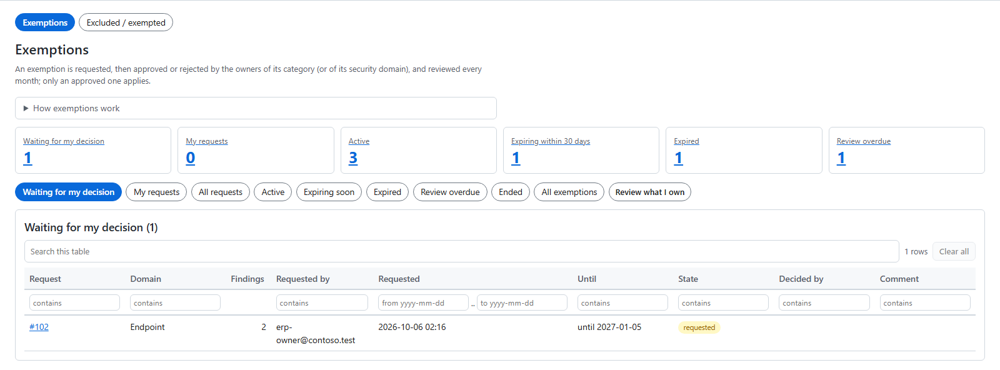
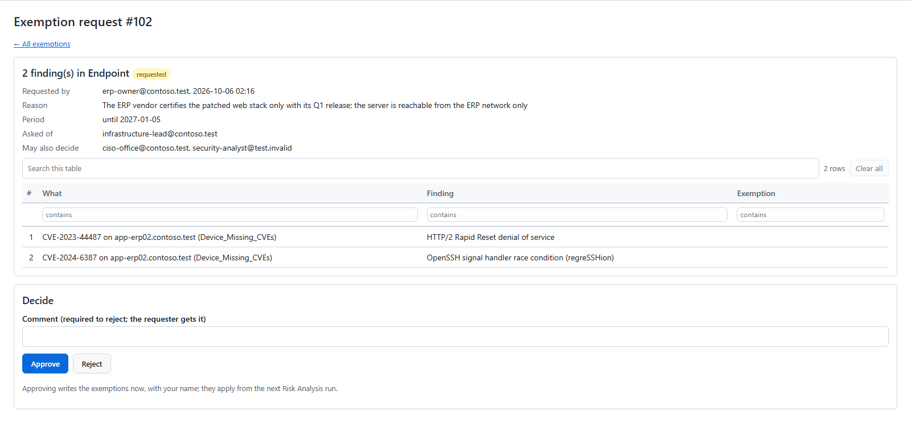

# Exemptions

An exemption accepts a risk for a while: a finding you will not fix now, for a stated reason, until a stated date. An
exemption is **requested**, then **approved or rejected** by the right people, and reviewed every month. Only an
approved exemption applies.

You find them on **Security recommendations > Exemptions**.

## Request an exemption

1. On a findings view (Findings, a collection view, or a department's page), tick the rows you mean.
2. Choose **Request exemption** in the action bar.
3. The dialog's title names what you selected, for example *Exempt CVE-… on 3 assets* or *Exempt 1 finding: CVE-… on
   &lt;asset&gt;*.
4. Give the reason and the **period**: 3, 6 or 12 months, or *Custom date*.
5. Check who is asked. The dialog names the approvers. *Change approver* appears only when someone else may decide
   every part of the request.
6. Send it.

**Scope.** By default, the request covers exactly what you selected. Under *More options*, one wider scope is offered
where it fits:

- one issue selected: *Also future assets* — the issue on every asset, now and later;
- one asset with several issues selected: every finding on it, now and later.

**Approve now.** If you may approve every part yourself (an Admin, or an owner or approver of each part), the dialog
offers *Approve now*.

An approved exemption counts from the next Risk Analysis run.

## Who is asked

| Where the request is made | Who decides |
|---|---|
| On a **department's own page** (*Operations > Departments >* the department), for findings that belong to that department | The department's **business approvers**. |
| On a department's page, but the department has **no business approver** | The security domain or category owners. The dialog and the result say *"&lt;department&gt; has no business approver, so the security owners approve it"*. |
| Anywhere else (Findings, the collection views) | The owners of the finding's **category**, or else of its **security domain** (*Configuration > Security owners*). |

When exemption mail is on, the people asked get a mail.

**What a business approver may decide.** Exactly the requests routed to *their* department. Not a request made
elsewhere, not another department's, and not a request that went to the security owners because the department had no
business approver at the time. The security domain and category owners, and Admins, can still decide every request.

The routing is stored with the request for audit. The request page shows *Routed to*, and the audit trail records who
was asked.

## Decide a request

Open **Waiting for my decision**. A request shows what it covers, who asked, the reason, the period, who is asked, and
who else may decide.

- **Approve** writes the exemptions with your name. They apply from the next Risk Analysis run.
- **Reject** needs a comment. The requester gets it.

## What an exemption does to the data

An approved exemption **never removes a finding from the data**. Risk Analysis still writes every finding to Log
Analytics and marks exempted ones. The reports, the mails and the web app leave exempted findings out by default.
*Security recommendations > Exemptions > Excluded / exempted* lists them.

Whether exempted findings count in the management numbers is a setting (*Configuration > Settings > Data & retention*).

## Keep exemptions current

The tiles and filters on the Exemptions page show what needs attention: *Active*, *Expiring within 30 days*, *Expired*
and *Review overdue*. *Review what I own* lists the exemptions you are responsible for reviewing.
