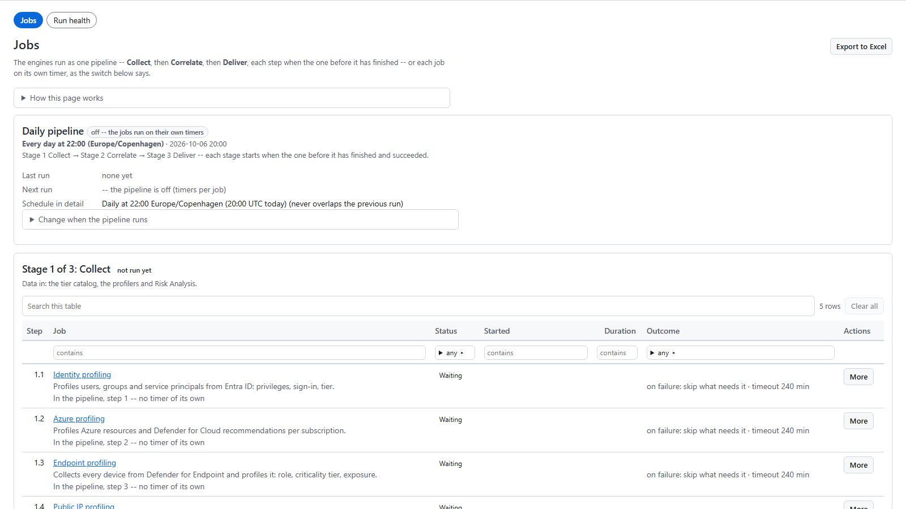

# The daily pipeline

SecurityInsight Pro runs its jobs as one **Daily pipeline** of three stages: **Collect → Correlate → Deliver**. You see
and control it on **Operations > Jobs**.

## The three stages

| Stage | What it does | Steps (in order) |
|---|---|---|
| **1. Collect** | Takes data in: the role catalogue, the profilers and Risk Analysis. | Privilege tier classifier, identity profiling, Azure profiling, endpoint profiling, public IP profiling, Risk Analysis Summary, Risk Analysis Detailed |
| **2. Correlate** | Links the same asset seen by several sources into one asset. | Asset correlation, asset properties |
| **3. Deliver** | Hands the results on. | SQL CMDB, ServiceNow CMDB, vulnerability connector (SQL), vulnerability connector (ServiceNow), data sync into the web app, mails |

A job you did not install (for example the ServiceNow steps without ServiceNow) is left out.

## When it runs

The pipeline starts every day at **19:00 in the local time of the install's Azure region** (for example Europe/Amsterdam
for West Europe; Danish time when the region is not known), after the nightly update at 18:30 in the same time zone, so
the night's run is complete by 08:00. The Jobs page shows the time zone your install uses. The local time stays the same all year; summer time is handled for you. A start
time you choose yourself is read in your installation's own time zone, which the guided install asks for.

To change it, open *Change when the pipeline runs* on the Jobs page. You can set another start time or time zone, or
run it *every N hours after it finishes*. The settings *Daily pipeline start time* and *Daily pipeline time zone*
(*Configuration > Settings > Schedules & what runs*) hold the same values. Every change is recorded in the change
history.

Times on the page are shown in your browser's local time zone.

## How one stage follows another

- A stage starts only when the stage before it has **finished and succeeded**. Nothing is delivered from a collection
  that did not complete.
- **Deliver never runs after a failed Collect**, whatever a stage is set to.
- Inside a stage, a step starts when the step above it has finished. *Start together with the step above* makes a
  group of steps that start at the same time.
- Inside Deliver, every target is independent. A failed vulnerability connector does not stop the data sync or the
  mails.
- When a step fails, by default only the steps that need it are skipped. Per step you can choose instead to *Stop the
  pipeline* or *Carry on*.

## Run now

**Run now** works at every level:

| Button | What runs |
|---|---|
| **Run pipeline now** | The whole pipeline, stage after stage. |
| **Run now** on a stage | That stage only. |
| **Run step** on a step | That one job only. |
| **Re-run from here** | A step and everything after it, for example after you fixed a failed step. |

## Nothing runs over anything else

The installation runs one thing at a time. If you press Run now while something is running, your request **waits in the
queue**. The queue is shown on the Jobs page, with who asked, and you can **Cancel** a request there. The same request
is kept once. The pipeline's runner wakes every 5 minutes and starts what is due as soon as the installation is free.

If a scheduled start comes while a manual run is going, it also waits in the queue and runs once.

## The updater is never a pipeline step

The updater job runs on its **own daily schedule, at 18:30 in the local time of the install's Azure region** (Danish
time when the region is not known), in every mode. It is listed on the Jobs page under the
jobs that are not a step of the pipeline, and it cannot be added to the pipeline.

- An update waits while a SecurityInsight job runs.
- The pipeline waits while an update runs. Its requests stay queued and start after the update.

So the two never run at the same time.

## Changing the pipeline

On the Jobs page an Admin can:

- move a step up or down, or to another stage (*Move to stage*);
- set what happens when a step fails, and its timeout;
- take a job out of the pipeline (it gets back the schedule it had, or stays manual) or add one in.

## Pipeline or timers

*How the jobs run* on the Jobs page shows the mode:

- **As one pipeline** — the jobs above. A job in the pipeline has no timer of its own. A new installation runs this way.
- **Each job on its own timer** — the jobs do not wait for each other, and a job can read yesterday's data when the
  one before it runs long. An installation from before the pipeline existed keeps its timers until you switch.

*Switch now* changes the mode. It asks first and is recorded.

## The risk trend

The trend is not a separate step. The Risk Analysis Summary run writes the day's trend row itself, from the rows it
has just published. A partial run is not a trend point: that day is a gap, never a drop. The web app's trend pages
(*Changes & trends > Trends*) read the history in the Pro database.

## Checking a run

- **Operations > Jobs** shows each step's status, start, duration and outcome, and the last executions with their log
  lines. Log lines reach the workspace a few minutes after the run.
- **Operations > Jobs > Run health** lists every engine run, newest first. A run that did not publish everything ends
  *partial* with the reason.
- **Operations > Guards (safety checks)** lists every step a safety check held or stopped. See [Guards](guards).
