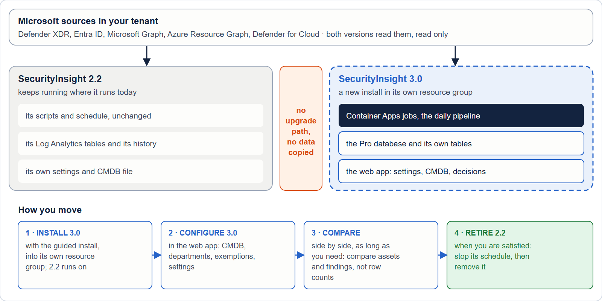

# SecurityInsight 3 beside 2.2

You run SecurityInsight 2.2 and want SecurityInsight 3. There is no supported upgrade from 2.2 to 3. You install 3 as
a separate installation beside 2.2, run both for a while, compare the results, and then switch 2.2 off.

This page explains why, and how to set it up. It applies to both editions: Community (free) and Pro (Pro Business and
Pro Enterprise).

## Why there is no upgrade

SecurityInsight 3 is a different product on the inside. Almost nothing of a 2.2 install can be reused as it is.

| | SecurityInsight 2.2 | SecurityInsight 3 |
|---|---|---|
| Where it runs | A Windows server with scheduled tasks, or container jobs you set up yourself | Azure Container Apps jobs, created by the guided install |
| Where your settings live | Configuration files in the install folder | A SQL database in your subscription |
| How you work with it | Files, Excel workbooks and mail | A web app behind Microsoft Entra sign-in, plus the reports and mail |
| How it signs in | An app registration with a certificate or a client secret | Managed identities, one per role, with read-only rights |
| How it is updated | `git pull` of the public repository | Its own update path, separate from 2.2 |
| The data model | Rows per source in Log Analytics | One asset per configuration item, records from several sources merged |

An in-place upgrade would have to move files into a database, replace the sign-in, rebuild the hosting and convert the
data at the same time, on a system that produces your security reports every night. A separate install avoids that
risk: 2.2 keeps running unchanged until you decide that 3 gives you what you need.

## What you need

- An Azure subscription where you may create a resource group. It can be the subscription 2.2 uses.
- The rights the guided install asks for. See [Install SecurityInsight Pro](install). The same rights apply to
  Community, except the Pro licence.
- For Pro: your SecurityInsight Pro licence. Without a licence, the install sets up Community.
- Azure Cloud Shell (PowerShell).

You do not need anything from your 2.2 install to start.

## Set up SecurityInsight 3

1. **Answer the install wizard on invardia.com.** It gives you one command for Azure Cloud Shell. For Community you
   can also run `setup/Install-SecurityInsight.ps1 -ConfigPath ./config.json` yourself, from the Community package.
2. **Keep the default resource group,** or choose another one that 2.2 does not use. The defaults are
   `rg-si-prod-community-ca` for Community and `rg-si-prod-pro-ca` for Pro. The names inside it follow the same
   pattern, for example `log-si-prod-community-ca` for the workspace and `sql-si-prod-community-ca-<suffix>` for the
   database server. The suffix is derived from your subscription. None of these names is a name 2.2 creates
   (`rg-securityinsight`, `log-securityinsight`, `dce-securityinsight`, `sp-securityinsight`).
3. **Choose a new Log Analytics workspace** on the *Data and scope* page. This is the default. Do not choose 2.2's
   workspace: both versions write tables with the same names, and 3 would change their columns under 2.2.
4. **Run the command in Cloud Shell.** The install checks your sign-in, rights, resource providers and names first,
   and changes nothing until those checks pass. Then it creates every resource step by step and starts the first run.
5. **Make the grants it lists.** A grant you may not make yourself ends as a warning with the exact command for the
   person who can. SecurityInsight 3 has its own managed identity, so it needs its own read rights, even when 2.2
   already has them.

The setup steps are the same for both editions. Pro adds the licence, the Pro features in the web app and the
updater job. See [Install SecurityInsight Pro](install) for every step.

## Run both and compare

Leave 2.2 running exactly as it is. Both installations read the same tenant, each with its own identity, and each
writes to its own workspace.

Compare the two for as long as you need. Compare assets and findings, not raw row counts. The counts differ on
purpose:

- **Fewer asset rows.** 3 merges the records Defender, Exposure Graph and Azure Resource Graph keep for one machine or
  one resource into one asset.
- **More identities.** 3 includes identities that have no sign-in history.
- **More findings.** 3 reports vulnerabilities that Defender Vulnerability Management lists even when the Exposure
  Graph has no link for them, and it treats every security recommendation as a vulnerability.
- **Different grouping.** A machine has one tier everywhere, so a finding can appear in more tier groups.

## Carry over what you need

Nothing moves from 2.2 to 3 by itself. You carry over what you want, by hand.

| From 2.2 | In SecurityInsight 3 |
|---|---|
| Your CMDB (`CMDB.csv`) | **Pro:** *Assets & services > CMDB*, *Import your v2.2 CMDB.csv (once)*. Each service gets a new number and keeps its cmdbID. An optional second file links assets to services. The file is checked line by line first, and nothing is written if a line is wrong. **Community:** the CMDB page is part of Pro. |
| Your settings (`config\SecurityInsight.custom.ps1`) | Set them again on *Configuration > Settings* in the web app. |
| Your own tier and profiling rules | Re-create them on *Configuration > Profiling rules*. |
| Your risk index changes | Make them again on *Configuration > Risk index*. |
| Your report exclusions | Add them again on *Configuration > Reports*, tab *Exclusions*. |
| Your mail recipients and SMTP server | Answer them in the install wizard, or set them in the web app. |

What does not carry over:

- **History.** Your 2.2 profiles, findings and trend stay in 2.2's Log Analytics workspace. 3 starts its own history
  from its first run. Keep 2.2's workspace for as long as you need its history.
- **Files you edited in the 2.2 folder.** 3 does not read the 2.2 folder.
- **Power BI datasets** built on 2.2's tables. Point them at 3's data when you are ready.

## Switch 2.2 off

When 3 gives you what you need:

1. **Stop 2.2's runs.**
   - On a Windows server: disable the scheduled tasks under the task folder `\SecurityInsight\`, including the update
     task.
   - In containers: stop or delete the Container Apps jobs in 2.2's resource group.
2. **Stop 2.2's updates.** Remove a scheduled `git pull` or a scheduled `Update-SecurityInsight.ps1` of the 2.2 folder.
3. **Keep the workspace** for as long as you need 2.2's history.

## Remove 2.2

When you no longer need 2.2's history, remove what 2.2 created. With the 2.2 defaults that is:

- The resource group `rg-securityinsight`, with its Log Analytics workspace, data collection endpoint and rules,
  storage account and, for containers, the registry and jobs. Check first that it holds nothing else.
- The app registration `sp-securityinsight` (or your own name for it), with its API permissions and its role
  assignments outside the resource group. A resource group delete does not remove those.
- 2.2's secrets in your Key Vault, if you stored any there.
- The SecurityInsight folder on the server, and the PowerShell modules 2.2 installed, if nothing else on the server
  uses them.

Do not remove anything in SecurityInsight 3's resource group.

## Questions

**Can both run at the same time?** Yes. They are separate installations with separate identities, resource groups and
workspaces. You pay for both while both run, and both read the same tenant through Microsoft's APIs.

**Does SecurityInsight 3 touch 2.2's resources?** No. The guided install creates and changes resources only in its
own resource group, and it looks for an existing install only there. It gives its own identity read access to what it
reads. It does not change 2.2's app registration, workspace, scheduled tasks or folder.

**What happens to my 2.2 updater?** It keeps updating 2.2 only. It does not install SecurityInsight 3. You get 3 only
with the guided install described on this page.

**Can I move back to 2.2?** Yes. 2.2 keeps running until you switch it off. Turn its scheduled tasks or jobs back on.

**Do I need Pro to run 3?** No. Community is SecurityInsight 3 without the paid features. The licence decides which
features are on.

Verified against SecurityInsight 3.0.0.202610261957 on 2026-10-27
