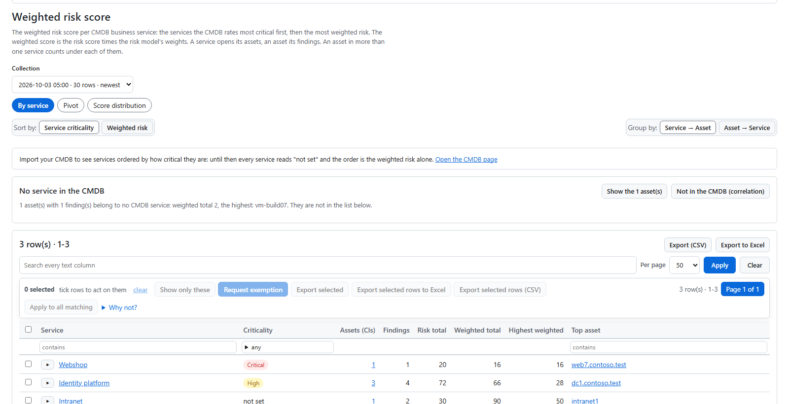

# Weighted risk by CMDB service

The **risk score** of a finding combines its consequence (severity) with its probability (the asset's tier) and risk
factors such as internet exposure. The **weighted risk score** multiplies that by what the business says about the
asset: the **criticality** and **data sensitivity** of its CMDB service. The same finding then ranks higher on a payroll
server than on a sandbox.

Open **Risks (detailed) > Risk score > Weighted risk score**. Pick a collection at the top; the newest is selected.

## How the weight is calculated

Each criticality and each data sensitivity has a weight in your risk model: a whole number on a basis of 100 (150 =
1.5x). With the shipped sample weights, a domain controller in a *Critical* service (150) with *Restricted* data (130)
gets a factor of 150 × 130 / 100 = 195 (1.95x). Admins change the weights on *Configuration > Reports >
Weights*; a report's own weights replace the general ones for that report.

The values come from your CMDB — or from your own profile rule where it overrides the CMDB record (see [CMDB and
ServiceNow](cmdb-servicenow)).

## The three tabs

### By service (the default)

One row per CMDB business service in the collection:

| Column | What it shows |
|---|---|
| Service | The service. |
| Criticality | From the CMDB, as a coloured chip; *not set* when the CMDB has none. |
| Assets (CIs) | The service's assets with findings. |
| Findings | The number of findings. |
| Risk total / Weighted total | The sum of the risk and weighted risk scores. |
| Highest weighted | The highest single weighted score. |
| Top asset | The asset with the highest weighted score. |

- **Sort by: Service criticality** (the default) puts the most critical services first, then the highest weighted
  risk. **Weighted risk** sorts by weighted risk alone.
- **Group by: Service → Asset** (the default) or **Asset → Service** turns the dimension around: one row per asset, with
  its most critical service and how many services it is in.
- Expand a row in place to see its assets. An asset opens its findings.
- **No service in the CMDB**: a band above the table counts the assets with findings that belong to no CMDB service,
  with links to those assets and to the correlation page's *not in the CMDB*.

An asset in more than one service counts under each of them.

### Pivot

Build your own view:

1. Drag **fields** into **Rows** (up to 3), **Columns** (up to 2) or **Filters** (up to 6). Fields: service, service
   criticality, service owner, department, asset kind, asset, tier, domain, report, severity, CVE or issue.
2. Drag **measures** into **Values** (up to 6): findings, assets (distinct), risk total, weighted total, highest,
   average.
3. Click a column heading to sort. **Swap rows and columns** turns the table around.

Every move can also be done with the arrow buttons on each field, and with the keyboard (Tab, Enter). The table shows
row totals, column totals and a grand total.

**Saved views.** *Save this pivot as* stores the view under your name. An Admin can also share a view with every reader
(*Share with every reader*). A saved view opens from *Saved views*, or by its link.

**Export.** *Export (CSV)* and *Export to Excel* download what you see. Exports are recorded on the audit trail.

### Score distribution

The spread of weighted scores, and every CI's weighted total.

## What you need for this page

- **A CMDB with services and criticality.** Import it or keep it on the CMDB page (*Assets & services > CMDB*). Until a
  service has a criticality, it reads *not set*, and the page orders by weighted risk alone, with a link to the CMDB
  page.
- **Assets linked to services**, by your CMDB, by profile rules (`cmdbId`), or on the CMDB page.
- **A data sync after the import.** The page reads the collection the data sync loaded into the Pro database.

## Who sees what

A department-scoped user sees their own assets by weighted risk on *By service* (service totals still span every
department), and only their own findings in the pivot.
